# Lab Builder — the Microsoft AI Training Generator

The 40 labs in `labs/` are fixed walkthroughs of Microsoft Copilot Studio. The lab builder is the opposite:
you pick the **products** you are teaching (Copilot Studio, declarative agents for Microsoft 365 Copilot, SharePoint AI,
Microsoft Foundry, the Microsoft 365 Copilot hub, or the Power Platform AI hub), an industry, the roles you are teaching,
and the capabilities you want covered, and it writes a complete, step-by-step lab for
that exact combination, drawing on live Microsoft Learn documentation where it
can and on a curated catalog where it cannot.

Which is which matters, because the two age differently:

| Part of the lab | Where it comes from |
|---|---|
| Microsoft Learn citations and the **From the docs** excerpt | Searched live at build time, scored for relevance, and link-checked before use. |
| **Vendor documentation** links and their quote | Specifications published outside Microsoft Learn (MCP, A2A, OpenAPI, Adaptive Cards), listed per feature in the catalog and read live at build time from an allowlist of hosts. See [Vendor documentation](#3b-vendor-documentation). |
| **Do this** walk-through steps | Read from the module's live documentation page **when a procedure on it matches the module confidently enough** — otherwise the curated catalog steps, labeled as such in that module. |
| Module set, ordering, prerequisites, concepts, **Check your work** | The curated catalog, `portal/lib/lab-builder/features.json`. Never live. |
| Overview and per-module "In your scenario" narrative | A language model, when one is configured; otherwise the curated catalog. By default a model never writes the steps; see [step synthesis](#4b-opt-in-grounded-step-synthesis) for the opt-in exception. |
| Screenshots | Reused from existing labs in this repo, or listed for you to capture. |

The share of modules that get live steps is not a fixed property of the tool. It
depends on what the documentation looks like on the day you build, and in the
builds sampled so far it has been well under half. The builder prints the count
at the end of every build and records the source per module in `manifest.json` —
that is the only current answer.

Two ways to use it:

| | |
|---|---|
| **Portal** | The **🧬 Build a Lab** tab — an eight-step wizard (seven when no selected product has harnesses) with live preview. |
| **CLI** | `node tools/lab-builder/build.mjs` — no portal and no sign-in. Offline builds (`--no-learn`) need nothing beyond Node 24; live vendor-page reads load `sanitize-html` from `portal/` (run `npm ci` there first). |

Output lands in `generated-labs/<slug>/` (git-ignored) as:

```
generated-labs/<slug>/
  index.md        the lab, in this repo's standard lab format (one H1 title,
                  sections from H2; see README "Authoring a lab")
  manifest.json   what was selected, what was grounded, the Learn sources used
                  and the HTTP status each returned when checked, when they were
                  verified, the vendor pages each module cites and whether each
                  was read, where each module's steps came from, and any
                  decisions a human made about a blocked build
  shots.json      capture manifest for the screenshots that could not be reused
  assets/         screenshots copied from existing labs in this repo
```

---

## Quick start (CLI)

```bash
# See every industry, role, and feature id
node tools/lab-builder/build.mjs --list

# Build a lab
node tools/lab-builder/build.mjs \
  --industry healthcare \
  --roles customer-service \
  --features knowledge-sharepoint,authentication,content-moderation \
  --time 240

# Or answer prompts instead
node tools/lab-builder/build.mjs --interactive
```

Useful flags:

| Flag | Effect |
|---|---|
| `--time <minutes>` | Preferred lab length. Guidance only: no module is ever removed. A lab that runs longer gets a suggestion to split it into parts. |
| `--no-core` | Skip the level 100 foundation modules (assumes learners already have an agent). |
| `--no-learn` | Offline mode. Skips Microsoft Learn and vendor documentation reads, and uses the curated doc links. |
| `--no-llm` | Deterministic composition even if LLM credentials are configured. |
| `--synthesize-steps <ids\|all>` | Opt in to [grounded step synthesis](#4b-opt-in-grounded-step-synthesis) for these modules. Needs a language model and Microsoft Learn. |
| `--decide <code>=<option>` | Pre-answer a build blocker. Repeatable. See [Blocked builds](#blocked-builds). |
| `--non-interactive` | Never prompt. Report blockers and exit 2 instead. |
| `--dry-run` | Print the plan and exit without writing anything. |
| `--out <dir>` | Write somewhere other than `generated-labs/`. |
| `--title "<text>"` | Override the generated lab title. |
| `--agent-name "<text>"` | Override the scenario agent name. |

Exit codes:

| Code | Meaning |
|---|---|
| `0` | The lab was built and passed validation. |
| `1` | Bad input, or the generated lab failed validation. |
| `2` | The build stopped for a decision and none was supplied. |
| `3` | A decision cancelled the build. |

---

## Blocked builds

Some conditions would quietly make the lab worse: Microsoft Learn being
unreachable, a module that finds no documentation, a language model that writes
some passages but not others. Rather than note them and carry on, the builder
**stops before writing anything** and asks a human.

Each blocker carries a stable `code`, a plain-language description of what it
means for the learner, and two to four ranked options — exactly one recommended,
each stating its tradeoff.

| Code | Raised when | Options |
|---|---|---|
| `learn-mcp-unavailable` | The Learn MCP handshake fails. | `retry` *(recommended)*, `proceed-curated`, `cancel` |
| `modules-ungrounded` | A module has nothing to cite: no relevant search result and no curated link. | `proceed-curated` *(recommended)*, `drop-modules`, `cancel` |
| `sources-dead` | Link checking found that *every* URL a module cites returns an error, leaving it with no reference. | `proceed-flagged` *(recommended)*, `drop-modules`, `cancel` |
| `steps-fetch-failed` | A module's documentation page could not be read. | `retry` *(recommended)*, `proceed-catalog`, `cancel` |
| `steps-not-derived` | The page was read, but no procedure on it matched the module. | `proceed-catalog` *(recommended)*, `cancel` |
| `llm-partial-failure` | A configured model wrote some passages but not others. | `retry` *(recommended)*, `proceed-deterministic`, `proceed-mixed`, `cancel` |
| `vendor-docs-unavailable` | A vendor documentation page a module cites could not be read, or was refused by the builder's safety rules. | `retry` *(recommended)*, `proceed-unverified`, `cancel` |

An explicit choice you already made is never a blocker. `--no-learn` and
`--no-llm`, `LAB_BUILDER_VENDOR_DOCS=off`, stay warnings — you decided those.

There is no blocker for lab length. The earlier `modules-deferred` blocker was
retired with the time budget; a decision for it is still accepted and ignored so
older clients keep working.

`retry` is not a resolution: it re-runs the same gate, so a condition that has
not cleared asks again.

```bash
# CI: fails loudly rather than shipping a degraded lab
node tools/lab-builder/build.mjs --features topics --non-interactive

# CI: proceed deliberately, recorded in the manifest
node tools/lab-builder/build.mjs --features topics \
  --decide learn-mcp-unavailable=proceed-curated
```

Whatever is chosen is written to `manifest.json` so a reader can see which
decisions shaped the lab:

```json
"decisions": [
  {
    "code": "learn-mcp-unavailable",
    "title": "Microsoft Learn is unreachable",
    "consequence": "Microsoft Learn could not be reached (fetch failed). …",
    "chosen": { "id": "proceed-curated", "label": "Build on the curated documentation links instead", "tradeoff": "…" },
    "decidedAt": "2026-08-23T01:06:11.335Z",
    "decidedVia": "cli-flag"
  }
]
```

The record deliberately carries **no user identity**. The manifest travels with
the lab, and `exporter.js` archives every non-Markdown file in a lab directory
into a downloadable ZIP. Who decided is written to the portal's server log
instead.

---

## Quick start (portal)

The portal groups its ten panels into four areas, and **Build** is where it opens:

| Area | Tabs | Use it to |
|---|---|---|
| **Build** | Build a Lab, Industry scenarios | Create a lab, or browse industry scenarios and recommended labs. |
| **Preview and validate** | Preview, Validation | Read a lab as learners see it, and check it against Microsoft Learn. |
| **Deploy and share** | Lab setup, Azure resources, Power Platform, Email labs | Set up the lab environment and send labs to learners. |
| **Settings** | Configuration | Branding, identity, email, and deployment targets. |

The **🤖 Assistant** button in the header opens the lab assistant (formerly the
Agent Chat tab) from anywhere. Nothing was removed: each panel keeps its id, so a
link such as `/#provision` or `/#azure` still opens the right panel, and the
arrow, Home, and End keys move among the tabs of the current area.

1. Start the portal: `cd portal && npm install && npm start`.
2. Open the portal; it lands on **🧬 Build a Lab**.
3. Answer one question per step, in this order:
   1. **Product** (any number). Copilot Studio is the default, so the wizard behaves as
      it always did until you pick another. A lab can combine products, for example
      SharePoint AI with Copilot Studio. Each product shows how many topics it has at
      each level and links to its Microsoft Learn hub. See [Products](#products).
   2. **Vertical** (industry). Cross-industry is the default.
   3. **Departments** (any number, optional).
   4. **Level**: 100 Beginner, 200 Intermediate, or 300 Advanced. This is the single
      source of truth for level: every later step shows, and the lab builds, only
      that level (see [The level filter](#the-level-filter)). A product with no topic
      at a level is named under that level, never silently dropped.
   5. **Harness**: Standard, Microsoft Copilot, or Customer Conversation (preview).
      This step appears **only when a selected product has harnesses** (today, Copilot
      Studio). Without one, the wizard goes from Level straight to Topics, the step
      numbers close up ("Step 5 of 7"), and the request carries no harness.
   6. **Topics**: every topic at your level that applies to your products (and, for
      Copilot Studio, your harness), grouped by
      concept (Instructions, Knowledge, Tools, Skills, MCP servers, and so on), each
      labeled with its product.
      Topics are pre-selected from your answers, each with the reason. Check or
      uncheck anything; use **Select all**, **Clear**, **Reset to recommended**, or
      the per-group buttons. A status line announces the count ("Showing 20 topics
      for Level 100 (Beginner)"). Prerequisites at the same level are marked
      *Required prerequisite*. Prerequisites from lower levels are not mixed into
      the list: they sit in a collapsed group, **Prerequisites from lower levels
      (included automatically)**, each with the reason and a checkbox. If you
      uncheck one, you get a warning, and the lab assumes learners have already
      done it. Concepts with no topic for your selection say whether the product or
      harness has no equivalent or the topic is not written yet, and a product with
      nothing at your level says what it does have and at which levels.
   7. **Review**: the outline with the estimated time for each module and a total.
      Advanced options (agent name, title, Learn grounding, model narrative, and a
      preferred length that only suggests where to split) are folded away here.
   8. **Generate**.

   The step list at the top is made of buttons: you can jump back to any step you
   have already reached, and changing an earlier answer recomputes the topic
   recommendations (the page says so if it resets your own choices). Changing the
   **level** after you picked topics removes those picks, because they belonged to
   the old level; an announced notice lists what was removed and has a **Restore my
   Level N choices** button. A "Your lab
   so far" line shows the answers and a running time estimate throughout. Times
   are guidance only; nothing is removed to fit them. What the topic list shows is
   exactly what gets built: the wizard sends `includeCore: false` and the topics
   you kept, so no foundation module is added behind your back.

   The level is chosen only in the Level step. The left-hand "Lab Chapters" pane that used to
   group the hand-written labs by level has been removed; choosing which hand-written
   labs are included now lives under **Lab chapters** on the **Lab setup** tab, and the
   **Preview** tab has its own lab picker. Open `/#labbuilder` to start the wizard.

The wizard previews the module outline (with prerequisites resolved and an
estimated time for every module and for the whole lab) before you commit to a
build. If the build hits a blocker it
pauses and shows the decision inline — keyboard-navigable radios with the
consequence and each option's tradeoff — and only resumes once you choose. The
finished markdown appears with a download button and a record of any decisions.

---

## How it works

```mermaid
flowchart LR
  A[Wizard selections] --> B[Planner]
  B -->|expand prereqs, order,<br/>estimate time| C[Learn MCP grounding]
  C --> V[Vendor documentation<br/>allowlisted HTTPS]
  V -->|microsoft_docs_search<br/>per module| S[Step derivation<br/>microsoft_docs_fetch]
  S --> D[LLM enrichment<br/>optional]
  D --> E[Composer]
  E --> F[index.md + assets + shots.json]
  F --> G[Validator<br/>same rules as labs/]
```



### 1. Feature catalog

The catalog is the source of truth for *structure*. Copilot Studio's 97
capabilities live in `portal/lib/lab-builder/features.json` across 11 categories, covering the standard
harness, the Microsoft Copilot harness, and the Customer Conversation harness (see
[Harnesses and levels](#harnesses-and-levels)); every other product keeps its own
file, `portal/lib/lab-builder/catalog/<product-id>.json` (see [Products](#products)).
`catalog-source.js` merges them, and everything that reads the catalog (the portal,
the CLI, the accuracy checks, and the feature tour) goes through it. The Copilot Studio
capabilities include the enterprise
integrations (ServiceNow, Snowflake, SAP, Salesforce, Jira, Epic on FHIR, Shopify,
on-premises data gateway, VNet private connectivity) and governance topics (agent
inventory, release readiness, Entra agent identities) that the repository's
hand-written labs cover. Each entry carries the level, harness tags (Copilot Studio only), time
estimate, prerequisites, concepts, fallback click-by-click steps, validation
checks, Microsoft Learn search queries, doc URLs, related labs in this repo, any
existing screenshots that can be reused, and when and against which page it was
last verified (`lastVerified`, `verifiedAgainst`).

The steps in this file are the fallback for the **Do this** list, used whenever
the module's documentation page cannot be read or carries no procedure that
matches the module closely enough. That is not a rare path: the gates in
[Step derivation](#4-step-derivation) are strict on purpose, and some modules'
pages never carry a procedure that clears them. Treat these steps as content a
learner will read, and keep them accurate.

This is the file to edit to add a feature, change a module's structure, or
correct those curated steps. `validateCatalog()` (and a test) enforces its
integrity, including prerequisite cycles and the freshness fields described in
[Extending the catalog](#extending-the-catalog).

#### Products

A **product** is a solution area the generator builds labs for. It sits above the harness:
a harness exists only for a product that has harnesses (today, Copilot Studio), so
every harness rule applies to Copilot Studio features alone. `products.json` defines
each product:

| Field | Meaning |
|---|---|
| `id`, `name`, `shortName`, `summary`, `order` | Identity and display. Plain text; no emoji. |
| `learnHubUrl`, `learnRoots` | The Microsoft Learn hub and URL prefixes the product's topic discovery starts from and is limited to. |
| `levels` | The levels (100, 200, 300) the product has curated topics for. Each must have at least one feature. |
| `hasHarnesses` | True only when a harness belongs to the product. |
| `agentNoun`, `labPrerequisites`, `licenseNote` | Quoted into generated labs, so state only what Learn states and mark the rest "Not confirmed in Microsoft Learn." |

The products, and what each covers:

| Id | Product | Grounded on |
|---|---|---|
| `copilot-studio` | Microsoft Copilot Studio (Standard, Microsoft Copilot, and Customer Conversation harnesses) | `/microsoft-copilot-studio/` |
| `m365-copilot-agent-builder` | Agent Builder and declarative agents for Microsoft 365 Copilot (Agent Builder; Microsoft 365 Agents Toolkit; plugins as actions; sharing, org catalog, and admin governance) | `/microsoft-365/copilot/extensibility/`, `/microsoftteams/platform/toolkit/`, `/microsoft-agent-365/admin/`, `/microsoft-365/admin/manage/agent-registry` |
| `sharepoint-ai` | SharePoint AI features (Copilot in SharePoint, agents with SharePoint content, document processing, SharePoint Advanced Management) | `/sharepoint/`, `/microsoft-365/documentprocessing/` |
| `ai-foundry` | Microsoft Foundry, formerly Azure AI Foundry (Foundry projects and hub-based projects) | `/azure/foundry/`, `/azure/foundry-classic/` |
| `m365-copilot-hub` | Microsoft 365 Copilot hub and Copilot controls in the Microsoft 365 admin center | `/copilot/implement/`, `/microsoft-365/admin/` |
| `power-platform-ai-hub` | Power Platform AI hub (AI Builder) | `/ai-builder/` |

**Which "AI hub"?** The request that introduced products said "the AI Hub", which is
ambiguous in Microsoft's portfolio. Rather than guess, the generator includes the
three products that plausibly match as separate, clearly named products: Microsoft
Foundry hubs and projects (`ai-foundry`), the Microsoft 365 Copilot hub
(`m365-copilot-hub`), and the Power Platform AI hub (`power-platform-ai-hub`). Each
product is one entry in `products.json` plus one file in `catalog/`, so pruning one
means deleting those two and the ids that name it in `concepts.json` and
`recommendations.json`.

Rules the catalog enforces (`validateProducts`, `validateCategories`, `validateConcepts`):

- A feature with no `product` field is a `copilot-studio` feature. A feature in
  `catalog/<product-id>.json` takes that product, and the file's `product` must match
  its name.
- A feature of a product without harnesses carries **no** `harness` tag; a feature of
  Copilot Studio must carry one.
- A feature's `level` must be in its product's `levels`, its `category` must belong to
  its product, and its `prereqs` must stay inside the product.
- Every product has at least one feature, and every level it lists has one.

**Wizard and planner.** The request carries `products` (default: the products of the
selected topics, so older callers keep working). `recommend` and `planLab` take only
topics of the selected products; a harness is validated and used only when a selected
product has harnesses, and is otherwise ignored with a warning. A lab for products
without harnesses has `harness: null` and no "How this differs" notes. The core
foundation modules are Copilot Studio modules, so another product's lab never gets
them as a seed. `recommend` returns `products`, one summary per selected product
with its topic counts per level and a sentence that says what exists when the chosen
level has nothing, which is how the wizard avoids a dead end.

**Manifests.** `manifest.json` records `generator`, `product` (the one most modules
belong to), `products`, and each module's `product`. A manifest without them is a
Copilot Studio lab. The Previously generated labs list shows a chip per product.

**Topic discovery** is scoped per product: `discoverSnapshot({ product })` starts at
the product's `learnHubUrl`, follows only links under its `learnRoots`, compares only
that product's catalog features, and tags its topics with the product. The portal's
refresh runs Copilot Studio discovery; the other products use the curated catalog
until their snapshots are added.

#### Adding a product

1. Add an entry to `products.json` (ids are lower-case slugs; set `hasHarnesses` to
   `false` unless the product genuinely has harnesses). Read Microsoft Learn first,
   because product names change; mention a former name only when Learn does.
2. Create `catalog/<product-id>.json`:
   `{ "product": "<product-id>", "categories": [...], "features": [...] }`. Features
   use the same fields as [Extending the catalog](#extending-the-catalog), minus
   `harness` and `product`.
3. In `concepts.json`, add the product to the `products` of each concept its features
   teach, add those feature ids to the concept, and add product-specific concepts where
   no existing one fits. For a concept the product should cover but does not yet, list
   `concept:<product-id>` in `knownGaps`; for one that does not apply, give a
   `notApplicable.<product-id>` reason that says what Learn says.
4. Add the new topics to `recommendations.json` (`levels`, and any vertical or
   department they suit, each with a `why`).
5. Regenerate the coverage matrix below, run `npm test` in `portal/`, and run
   `node tools/lab-accuracy/check-catalog.mjs`.

Every feature must be written from pages you fetched on Learn, with `lastVerified` set
only for pages you read. Mark anything you could not confirm "Not confirmed in
Microsoft Learn."

#### Harnesses and levels

Copilot Studio runs every agent on a *harness*. The catalog lists three,
in the top-level `harnesses` array (each with a name, description, and
`learnUrl`):

| Harness id | Name | Use it for |
| --- | --- | --- |
| `standard` | Standard harness | Rule-based agents, topics, and agent flows (the classic experience). |
| `microsoft-copilot` | Microsoft Copilot harness | Reasoning-heavy agents and workflows built on the **Build** tab, billed in Copilot Credits. |
| `customer-conversation` | Customer Conversation harness (preview) | Customer-facing agents over voice and chat, with subagents and escalation to a human. |

The Customer Conversation harness has its own module set (25 modules, ids that
start with `cc-`), all tagged `["customer-conversation"]` and written from the
`agents-experience/*-customer-conversation` pages on Learn. It covers creating the
primary agent, instructions with separate Speech and Chat guidance, the model
mode, knowledge, tools (including the prebuilt **Escalate** tool for handing a
conversation to a human representative), skills, MCP servers, sub-agents and
Microsoft Foundry connected agents, memory, events and voice settings,
workflows, Dynamics 365 Contact Center, preview and evaluation, monitoring, the
demo website, web chat and Teams Phone channels, authentication and Biometric
Authentication, export and import, and Copilot Credits. Concepts Learn does not
describe for this harness (SDK, files and code, hooks, triggers) carry a
`notApplicable` reason in `concepts.json` that says what Learn says, in the
"Not confirmed in Microsoft Learn" convention where the evidence is thin. The
harness is preview, so every module is marked `preview` except the Copilot
Credits module, whose billing pages carry no preview label. Learn also documents a Copilot chat harness. It
uses a separate creation path and is not modeled here.

Every feature has a `harness` array that names the harnesses its steps and checks
describe. Features whose id starts with `mc-` and a few others are
`["microsoft-copilot"]`; most older features are `["standard"]`; a feature is
tagged for both only when Learn shows the same behavior on both harnesses (for
example `dlp-governance` and `mc-harness-choice`). Three optional fields add
detail, and each is set only when a Learn page says it:

- `availability`: `ga`, `preview`, or `retired`. The wizard shows it as a badge.
- `harnessNote`: one sentence on a documented difference between the harnesses,
  such as "Prompts are replaced by skills." The notes come from the comparison
  table on [Harnesses in Copilot Studio](https://learn.microsoft.com/microsoft-copilot-studio/harnesses-overview)
  and the [harness FAQ](https://learn.microsoft.com/microsoft-copilot-studio/agents-experience/faqs-copilot-harness).
- A sibling relationship: when both harnesses offer a capability with different
  steps, the catalog keeps two features (for example `knowledge-sharepoint` and
  `mc-knowledge`) rather than one feature with two step lists.

The wizard filters by harness and by level. The planner uses the tags in two ways:
the level 100 *core* modules it adds (only when the lab is at level 100 or has no
level) follow the harness of the features you picked
(a feature tagged for both stays neutral, and untagged features count as
standard), and a plan that mixes single-harness modules from both harnesses gets
a warning.

`level` follows a rubric, and `validateCatalog()` rejects a feature that requires
a prerequisite from a higher level:

| Level | Label | Covers |
| --- | --- | --- |
| 100 | Beginner | The basics of making an agent and testing it. |
| 200 | Intermediate | Adding tools, skills, MCP servers, workflows, knowledge tuning, and evaluation. |
| 300 | Advanced | Custom connectors, ALM, governance, identity, networking, and autonomous or protocol-level integration. |

#### The level filter

The level chosen in the Level step decides what the rest of the wizard shows and what the
lab contains. There is no second level selector in the Topics step, so the two can
never disagree. `levels.js` holds the shared rules.

- **Listed topics.** `recommend()` returns only topics whose level equals the
  chosen level. Industry and department boosts apply only to topics at that level.
  A concept with no topic at the level is left out when the harness has topics for
  it at other levels; a concept the harness cannot teach at any level stays as a
  muted row that explains why. The response carries `filter` (`level`, `label`,
  `shown`, and `droppedSelections`), which the wizard announces as "Showing N
  topics for Level 100 (Beginner)".
- **Prerequisites from lower levels.** A topic's `prereqs` in `features.json`
  are hard dependencies (the catalog validator already requires them to be at the
  same or a lower level). A same-level prerequisite stays in the main list as
  *Required prerequisite*. A lower-level one is returned apart, in
  `prerequisites.topics`, with `neededBy`, a `reason`, and recap minutes (at most
  5 per topic, `PREREQ_RECAP_MINUTES`). It is auto-included, which keeps the
  warn-don't-block behavior: unchecking it adds it to `excluded`, the lab assumes
  learners know it, and a warning says so. The wizard shows these in a collapsed
  group, never as same-level content. `selectedIds` holds only the level's own
  topics, so the wizard sends exactly those, and the planner re-derives the
  prerequisites.
- **Topics from Microsoft Learn.** A discovered topic uses the level in the
  snapshot (`declared`). Without a valid level, `resolveTopicLevel()` applies the
  same rubric as the table above to its address and title (300 first: custom
  connectors, ALM, governance, identity, networking, SDK; then 200: tools, skills,
  MCP, workflows, memory, hooks, evaluation, flows, triggers, monitoring; then 100:
  overview, get started, create, test, publish) and the card says **Estimated
  level**. If nothing matches, the level is unknown: the topic is returned in
  `levelUnknown`, shown only in a collapsed **Level unknown** group, never
  recommended, never counted in "Select all", and built only if the learner picks
  it on purpose. Harness and Learn-bar counts are also per level.
- **The planner and generator enforce it too.** With a `level`, `planLab()` drops
  requested topics from other levels (recorded in `plan.request.droppedOutOfLevel`
  and a warning) and refuses a request with none at the level. Lower-level
  prerequisites become *recaps*: flagged `prerequisite`, ordered first, estimated at
  no more than 5 minutes, and written short (what you are doing, the steps, a check,
  and sources; no concepts, knowledge checks, or screenshots). The lab titles them
  `Recap: <name>`, labels them as prerequisite recaps in the Time Estimate table, and
  keeps them out of the learning objectives and the quality review's per-module
  checks. A recap dropped during the build never removes the module that builds on
  it; the lab assumes it instead. The metadata table gains a **LEVEL** row, and
  `manifest.json` records `level`, `levelName`, `prerequisites`, and a `role`
  (`level` or `prerequisite`) per module. A request with no `level` (the CLI, older
  API callers) is built exactly as before.
- **Older saved labs.** A lab saved before the level was recorded has no level, so
  its card says "Level not recorded"; **Edit selections** takes the highest level
  among its topics, and tells you which saved topics belong to another level and
  were not loaded.

**The rename.** Copilot Studio renamed the *GitHub Copilot harness* to the
*Microsoft Copilot harness*, and some Learn pages, titles, and URLs still use the
old name. Our own content (catalog, UI, docs, tests, comments) says Microsoft
Copilot harness. Learn URLs and titles are never edited, because they are
citations. The step validator's `normalizeText()` maps the old name to the new one
on both sides of a comparison, so a claim written with either name matches Learn
text that uses either name. Unrelated uses of GitHub Copilot, such as the IDE
product, are untouched.

#### Concepts and recommendations

The catalog is organized by product and, for Copilot Studio, by harness, but learners think in concepts: Instructions,
Knowledge, Tools, Skills, MCP servers, Subagents, SDK, Memory, Hooks, Triggers,
Workflows, Testing, Publish, Governance, and so on. `concepts.json` is that
layer. Each concept lists the feature ids that teach it and the `products` it
applies to (default: Copilot Studio), so a concept such as Instructions, Knowledge,
Governance, or Publish can be shared across products while one such as Hooks stays
product-specific. A feature's own `harness` tag says where it applies within Copilot
Studio, so **Skills** lists `prompt-tools` (Standard
harness) and `mc-skills` (Microsoft Copilot harness). When a concept has nothing
for a harness or product, its `notApplicable` map says why, so the wizard explains the gap
and names what to use instead. Every feature belongs to exactly one concept, and the concept must list the feature's product.

`recommendations.json` holds the deterministic rules that pre-select topics: the
topics that make up each level (the new depth it adds; prerequisites join
automatically), plus topics a vertical or a department adds, each with a
plain-language reason. A vertical or department topic is recommended only when it
is at the chosen level, and always stays selectable.

`validateCatalog()` checks both files (every feature in one concept, known ids,
a reason for every `notApplicable`), and `recommend.js` turns the answers into
concept rows with `selected`, `required`, and `reasons` per topic. Every topic at
the chosen level that applies to the harness is listed (topics from other levels
are not; see [The level filter](#the-level-filter)), and a topic whose
prerequisite you turn off only produces a warning.

#### Concept coverage matrix

Every concept must say something for every coverage target it applies to. A target is
a **harness** for a product that has harnesses (Copilot Studio) and the **product itself**
for every other product; a concept is judged only on the products it lists in `products`,
so a concept that makes sense for one product never owes a cell to the others. Each cell
is a catalog feature for that target (`variant`, with the number of features), or a
`notApplicable` reason in `concepts.json` keyed by the harness or product id (`n/a`). A
cell with neither is `missing` and
fails `validateCatalog()`, the portal tests, and the monthly `check-catalog`
run, unless it is listed in `knownGaps` in `concepts.json` as `concept:target`. `knownGaps` can
only shrink: a listed cell that gains a variant or an `n/a` reason fails until
it is removed. The **missing** cells below are the known gaps, which the next
sessions that deepen a product fill in. The matrix below is generated by `buildCoverageMatrix` in
`portal/lib/lab-builder/coverage.js` and a test keeps it in sync.

<!-- coverage-matrix:start -->
**Microsoft Copilot Studio**

| Concept | Standard harness | Microsoft Copilot harness | Customer Conversation harness |
| --- | --- | --- | --- |
| Choose a harness | variant (2) | variant (2) | variant (1) |
| Create an agent | variant (1) | variant (1) | variant (1) |
| Instructions | variant (1) | variant (1) | variant (1) |
| Model and orchestration | variant (2) | variant (1) | variant (1) |
| Knowledge | variant (4) | variant (2) | variant (1) |
| Tools and connectors | variant (3) | variant (1) | variant (2) |
| Skills and prompt tools | variant (1) | variant (1) | variant (1) |
| MCP servers | variant (1) | variant (1) | variant (1) |
| Subagents and connected agents | variant (2) | variant (1) | variant (2) |
| SDK and extensibility | variant (2) | variant (1) | n/a |
| Memory | n/a | variant (1) | variant (1) |
| Files and code execution | n/a | variant (1) | n/a |
| Conversation design | variant (4) | n/a | variant (2) |
| Hooks | n/a | variant (1) | n/a |
| Triggers | n/a | variant (1) | n/a |
| Workflows and flows | variant (3) | variant (1) | variant (1) |
| Enterprise systems and Microsoft 365 | variant (9) | variant (1) | variant (1) |
| Testing and evaluation | variant (4) | variant (2) | variant (2) |
| Monitor and analytics | variant (1) | variant (1) | variant (1) |
| Publish and channels | variant (3) | variant (1) | variant (2) |
| Authentication and safety | variant (3) | variant (1) | variant (2) |
| Governance and ALM | variant (3) | variant (3) | variant (1) |
| Credits and billing | variant (1) | variant (1) | variant (1) |

**Agent Builder and declarative agents for Microsoft 365 Copilot**

| Concept | Coverage |
| --- | --- |
| Choose an approach | variant (2) |
| Create an agent | variant (3) |
| Instructions | variant (1) |
| Knowledge | variant (2) |
| Tools and connectors | variant (2) |
| Skills and prompt tools | variant (1) |
| MCP servers | variant (1) |
| SDK and extensibility | variant (1) |
| Testing and evaluation | variant (1) |
| Publish and channels | variant (2) |
| Authentication and safety | variant (1) |
| Governance and ALM | variant (2) |
| Credits and billing | variant (1) |

**SharePoint AI features**

| Concept | Coverage |
| --- | --- |
| Create an agent | variant (1) |
| Copilot in the host app | variant (2) |
| Knowledge | variant (1) |
| Content AI and document processing | variant (2) |
| Monitor and analytics | variant (1) |
| Publish and channels | variant (1) |
| Authentication and safety | variant (3) |
| Governance and ALM | variant (6) |
| Credits and billing | variant (1) |

**Microsoft Foundry**

| Concept | Coverage |
| --- | --- |
| Resources, hubs, and projects | variant (3) |
| Create an agent | variant (2) |
| Model deployment and playground | variant (3) |
| Knowledge | variant (2) |
| Tools and connectors | variant (1) |
| Subagents and connected agents | variant (1) |
| Testing and evaluation | variant (1) |
| Monitor and analytics | variant (2) |
| Publish and channels | variant (2) |
| Authentication and safety | variant (1) |
| Governance and ALM | variant (1) |
| Credits and billing | variant (1) |

**Microsoft 365 Copilot hub and Copilot controls**

| Concept | Coverage |
| --- | --- |
| Copilot controls and settings | variant (6) |
| Data protection for Copilot | variant (5) |
| Agent lifecycle and rules | variant (2) |
| Pay-as-you-go and metering | variant (1) |
| Monitor and analytics | variant (1) |
| Authentication and safety | variant (1) |
| Governance and ALM | variant (3) |
| Credits and billing | variant (1) |

**Power Platform AI hub (AI Builder)**

| Concept | Coverage |
| --- | --- |
| Choose an AI capability | variant (1) |
| Instructions | variant (1) |
| Content AI and document processing | variant (1) |
| Use AI in apps and flows | variant (1) |
| Governance and ALM | variant (1) |
| Credits and billing | variant (1) |
<!-- coverage-matrix:end -->

#### Harness differences

Every generated lab is written for one harness. Where the same concept works
differently on another harness, the section carries an expandable note, an
accessible `<details>` block titled **How this differs on the Microsoft Copilot
harness** (or **...on the Standard harness**, or **...on the Customer
Conversation harness**). Inside it: the same goal, how the concept works in this
lab and on the other harness (with where to find it), terminology, availability
(Supported, Preview, Planned, Not supported, or Not confirmed in Microsoft
Learn), limits and gaps, and the Microsoft Learn pages the note rests on. The
labels are bold text rather than headings, so heading order is never disturbed.

The notes come from `harness-differences.json`, one curated record per concept.
They are grounded on Microsoft Learn (the harness comparison, the skills, hooks,
memory, and channels pages, and the Customer Conversation overview) and are never
generated or fetched at build time, so a lab cannot quote a page as a difference.
A harness whose behavior Learn does not describe is marked `unknown`, and a record
that leans on it is `partly-documented` or `uncertain` with an `uncertainNote`;
the lab then says **Not confirmed in Microsoft Learn** instead of guessing.

Each concept is explained once per lab, on its first module. By default a lab
compares the Standard and Microsoft Copilot harnesses with each other, and a
Customer Conversation lab compares with both; set `differencesFor` to a list of
harness ids to choose, or to `[]` to leave the notes out. The wizard offers the
choice on the harness step. `manifest.json` records `differences` (the lab's
harness, who it was compared with, which concepts, and which are not fully
documented).

`validateCatalog()` checks the records: a concept that exists, at least two
harnesses described, Learn sources only, `verifiedAgainst` among them, a valid
`lastVerified`, an `uncertainNote` when not fully documented, no use of the
earlier harness name, and US English. The monthly `check-catalog` run also
checks that every source still resolves and flags records older than the
threshold. The structural validators check the rendered notes: `expandable-notes`
in the portal validator and the details check inside `accessible-markdown` in
`validate_labs.py` require a non-empty `<summary>` first, content after it, and
balanced tags. Step validation skips these notes, because they describe a
different harness than the lab's steps.

### 2. Planner

`planner.js` resolves the industry and roles, expands transitive prerequisites,
topologically orders modules (prerequisite → category → level), and derives the
title, difficulty, time estimate, and scenario framing. When the request has a
`level`, it also enforces the level filter: see [The level filter](#the-level-filter).

**Time is guidance, never a limit.** Every module you select, and every
prerequisite it needs, stays in the lab. Each module carries an estimated
`minutes` value; the plan adds `estimate` (`totalMinutes`, `duration`,
`bySection`, and `suggestedParts`). The generated lab shows the estimate in its
metadata table (`TIME`), in a **Time Estimate** section with one row per module
and a total, and in `manifest.json`. When the total passes the advisory length
(240 minutes by default, or the optional `targetMinutes` you pass; `timeBudget`
is accepted as an older name), the planner suggests split points between
modules in plan order, so a module never lands in a part before its
prerequisites. That is a suggestion in the warnings and the lab, never a cut.

Scenario framing comes from `scenario-profiles.json`: per-industry agent name,
audience, business problem, knowledge sources, sample questions, domain
vocabulary, and the KPI to watch — plus per-role design guidance.

### 3. Microsoft Learn grounding

`learn-mcp.js` is a small streamable-HTTP JSON-RPC client for the public
[Microsoft Learn MCP server](https://learn.microsoft.com/api/mcp). No sign-in is
required. For each module it runs the catalog's `learnQueries` through
`microsoft_docs_search`, parses the SSE-framed response, dedupes by URL, and
then **scores every result for relevance before citing any of it**.

That scoring step (`relevance.js`) is not optional polish. Learn search spans
every Microsoft product at once, so a module about creating a Copilot Studio
agent was citing Microsoft Fabric IQ, Power Automate process mining, and a
Power Platform release plan, with the page that actually answered it ranked
fourth. Every one of those URLs returns HTTP 200, so link checking cannot see
the problem.

A result is scored on three things:

- **Product affinity** — does the URL sit under a documentation area this module
  is expected to live in? The expected prefixes are derived from the catalog's
  existing `docUrls`, so no catalog entry needs hand editing; a feature can
  override them with `docPaths`. Affinity *multiplies* the topical score rather
  than adding to it, because an off-product page scores well on words precisely
  when it describes the same task in the wrong product.
- **Topical overlap** — the title against the module name, and the excerpt
  against the module's vocabulary, using the same tokenizer and the same
  `overlap`/`coverage` measures `steps.js` uses to pick a procedure.
- **Page kind** — release plans, "what's new", and troubleshooting articles are
  demoted, but only when an unpenalized how-to already clears the floor.

Results below the relevance floor are dropped from the citation list and
recorded in the manifest under `relevance.droppedAsIrrelevant`, so a reviewer
can see what the filter refused and why. The **From the docs** pull quote is
taken from the highest-scoring source rather than the first sufficiently long
one, so a module cannot quote one product's page under another product's
heading.

Every call degrades gracefully at the transport level: a timeout or a malformed
response returns an empty result rather than throwing. What it does *not* do is
quietly ship a lab built on that emptiness — an unreachable server raises the
`learn-mcp-unavailable` blocker and the build stops until a human decides.

A search that returns nothing *relevant* is deliberately not a blocker. It falls
back to the catalog's curated `docUrls`, which are on-target by construction;
only a module with no curated link either raises `modules-ungrounded`. Blocking
on a merely noisy search would prompt on almost every build and teach people to
click straight through the prompt.

The manifest distinguishes the two claims per module: `grounded` means the
module has citations at all, and the narrower `learnVerified` means they came
from a live search that cleared the floor. Only `learnVerified` modules are
counted in the lab's "checked against live Microsoft Learn documentation" line.

The catalog's `docUrls` serve two purposes: they are the pages the step deriver
reads (below), and they are the citation fallback when a search returns nothing
relevant.
Every feature also records `lastVerified`, the day someone last compared its
curated steps against the live documentation, and `verifiedAgainst`, the page
they compared against. The blocker text quotes the oldest `lastVerified` among the
affected modules, and each module that ships curated steps names its own date and
page. There is deliberately no catalog-wide review date: features are re-verified
one at a time, so a single date would claim more than anyone checked.

### 3b. Vendor documentation

Microsoft Learn is the only source the MCP server can return, and some features
are defined by someone else's specification or product: MCP tools by the Model
Context Protocol, A2A connections by the A2A protocol, custom connectors by
OpenAPI 2.0, and each enterprise integration by the system it connects to. A lab
about those is only well grounded if it cites that documentation too (issue
#39), so the builder has a second, non-MCP grounding path.

**Where the sources come from.** A feature may list `thirdPartySources` in
`features.json`, each with a `vendor`, a descriptive `title` (it becomes the link
text), an `https` `url`, and a `stability` note that tells the learner how likely
the page is to change or move — for example "a frozen specification version" or
"redirects to the newest dated revision". Nothing is discovered by search; every
vendor link is curated.

**The allowlist.** The catalog's top-level `vendorHosts` is the only set of
hosts the builder will contact, each with the reason it is trusted:

| Host | Used by |
|---|---|
| `a2a-protocol.org` | `agent-to-agent` |
| `adaptivecards.microsoft.com` | `adaptive-cards` |
| `developer.atlassian.com` | `jira-integration` |
| `developer.salesforce.com` | `salesforce-integration` |
| `docs.snowflake.com` | `snowflake-integration` |
| `fhir.epic.com` | `epic-fhir-integration` |
| `hl7.org` | `epic-fhir-integration` |
| `modelcontextprotocol.io` | `mcp-servers` |
| `shopify.dev` | `shopify-integration` |
| `spec.openapis.org` | `custom-connectors` |
| `support.sap.com` | `sap-integration` |
| `www.servicenow.com` | `servicenow-integration` |

Two of those sites answer HTTP 200 for any address and build the page in the
browser: `www.servicenow.com/docs` and `fhir.epic.com/Documentation`. A link
check against them can only show that the site is up, not that the page still
exists, and their `stability` notes say so. Re-open those pages in a browser
when you re-verify the feature.

`validateCatalog()` enforces it: every `thirdPartySources` URL must be `https`,
on the default port, with no credentials, on a listed host (exact match, no
wildcards or subdomains), and not on `learn.microsoft.com` (that belongs in
`docUrls`). A listed host that no feature uses is also a problem, so the
allowlist never grows wider than the catalog needs.

**How a page is read** (`vendor-docs.js`). Vendor pages are untrusted input from
the public internet, so:

- Redirects are followed by hand (`redirect: "manual"`), at most five, and every
  hop is re-checked against the allowlist and the `https` rule. A page that
  redirects off the allowlist is refused, and the target is never requested.
- One timeout covers the whole redirect chain and the body (10s,
  `LAB_BUILDER_VENDOR_TIMEOUT_MS`), and the body is read as a stream and
  abandoned past 2 MB.
- Only `text/html` and `text/plain` are accepted. HTML is reduced to plain text
  with `sanitize-html`, and the *contents* of `script`, `style`, `noscript`,
  `template`, `iframe`, code samples, and page chrome are discarded, not kept.
  Angle brackets, square brackets, backslashes, and backticks are then removed,
  so no Markdown link, image, or HTML survives however the page nests or escapes
  it, and a paragraph that carries a bare URL or email address (which Markdown
  would turn into a link) is never quoted.
- Parsing is linear. A page whose markup nests more than 256 elements deep is
  refused (real documentation nests about 25), because sanitize-html's cost
  grows with the square of nesting depth and a crafted page could otherwise stall
  the portal process after its body was read.
- Nothing from a vendor page is executed, and nothing is ever rendered as HTML.
  At most one line per module is quoted, and it goes through the same
  `condense()` + `scrubForbidden()` path as a Microsoft Learn excerpt.
- Only successful reads are cached (15 minutes); a failure never is, so `retry`
  really does try again.
- `sanitize-html` is loaded only when a vendor HTML page is actually read, so
  the CLI still runs offline (`--no-learn`) without the portal's npm
  dependencies installed. If a live build runs without it, the read fails and
  raises `vendor-docs-unavailable`, telling you to run `npm ci` in `portal/`.

**In the lab.** Each module that cites vendor pages gets a **Vendor
documentation** block beside its Microsoft Learn references — vendor name,
title link, stability note — and, when a page yielded quotable prose, a
**From the *vendor* documentation** quote attributed to the vendor, never to
Microsoft Learn. A page that was not read is marked in place. **How This Lab Was
Built** says which vendors were cited, how many pages were read, and that vendor
pages were treated as untrusted. The manifest records every vendor source per
module with its fetch status, `fetchedAt`, final URL, link-check verdict, and
whether it is still in the lab; the top-level `vendorDocs` summary records the
allowlist the build ran under.

Vendor URLs are link-checked with the rest (below), but never through the
generic checker, which only requires each hop to be a public host. They are
checked through
the vendor reader itself, so every hop is re-checked against the allowlist, a
page refused on policy is never requested by another route, and a page already
read in this build is answered from cache. A vendor site that answers with 401,
403, or 429 is turning an automated client away, not reporting the page gone,
so the link is kept and counted as `unverifiable`. 404, 410, and 5xx remove it,
and the lab's **How This Lab Was Built** paragraph then counts only the vendor
links still in the lab and says how many were left out.

**When a read fails.** A vendor page that times out, errors, or is refused by the
rules above raises `vendor-docs-unavailable`: `retry` (recommended),
`proceed-unverified` (cite the link, marked unverified, quote nothing), or
`cancel`. There is no "drop the modules" option, because a vendor page
supplements a module that is still grounded on Microsoft Learn. When the failure
was the builder's own refusal, the blocker says a retry will not help.

Switching grounding off (`--no-learn`, or `useLearnMcp: false`) skips vendor
reads too, with a warning rather than a blocker — the same rule as Microsoft
Learn. `LAB_BUILDER_VENDOR_DOCS=off` skips only the vendor reads, for air-gapped
builds and hermetic tests.

**Adding a vendor source.**

1. Request the page yourself and confirm it is the right page, that it resolves,
   where it redirects, and that it serves `text/html` or `text/plain`. A page
   rendered entirely in the browser (such as the Adaptive Cards site) can still
   be cited, but will have nothing to quote.
2. Add it to the feature's `thirdPartySources` with an honest `stability` note.
3. If its host — or any host it redirects through — is new, add it to
   `vendorHosts` with the reason it is trusted. Prefer a versioned or canonical
   URL over one that redirects across hosts.
4. Run `npm test` in `portal/`; the catalog test fails on anything the rules
   above reject.

### 4. Step derivation

Grounding contributes citations. It does not, on its own, make the *instructions*
current — and the instructions are the substance of a walk-through. `steps.js`
closes that gap: for each module it fetches the catalog's `docUrls` with
`microsoft_docs_fetch`, finds the numbered procedures on the page, scores them
against the module, and renders the best match as the module's **Do this** list.

Selection is the hard part, not extraction. One Learn article routinely carries
several unrelated procedures — `knowledge-add-sharepoint` has six — so a
candidate must clear a confidence threshold and two structural gates before it is
used:

- **Label coverage.** It has to reproduce a share of the curated steps' bolded UI
  labels. The curated wording is not trusted, but it is a fair statement of which
  screens the module is about, and a candidate that never mentions them is
  describing something else.
- **Completeness.** It is never allowed to be materially shorter than the curated
  procedure. A shorter candidate is a fragment, not the procedure.

When nothing clears the gates, the curated steps are used and the module says so
in the lab. That path raises `steps-not-derived` first, so it is a decision rather
than a silent substitution.

Expect that to happen often. The gates reject any candidate that is a fragment or
that never names the screens the module is about, and Learn articles frequently
carry no procedure that matches a module at that standard. A five-module
healthcare build derived one; an eight-module sample derived three. The ratio
moves whenever Microsoft edits a page, so the count the builder prints at the end
of a run is the only number worth quoting.

**No language model is involved** on this path. Every derived step is a cleaned
substring of a page that was fetched, which is a structural guarantee that the
builder cannot invent product UI — stronger than asking a model not to. It also
means the steps are identical with and without credentials configured.

Fetched pages are untrusted input. They are never executed. Steps are stripped of
HTML, images, and control characters; relative Learn links are resolved to
absolute `https:` URLs and unsafe schemes dropped; TODO-style markers are scrubbed
because `validateLabDir()` rejects them anywhere in a lab file. When a model *is*
configured, fetched text reaches it inside `<untrusted-documentation>` markers
that the system prompt defines as quoted material, never instructions.

Each module records in `manifest.json` whether its steps were `doc-derived` or
`catalog-fallback`, the source URL and section heading, the fetch timestamp, and a
`drift` record comparing the curated steps against the live page. Drift is
reported rather than acted on — the derived path already resolved it — and it is
the signal that a catalog entry has gone stale. The manifest also carries each
module's `catalog: { lastVerified, verifiedAgainst }`, so a reviewer can see how
old the curated entry behind a module is, whichever path its steps took.

### 4b. Opt-in: grounded step synthesis

> **Prototype.** Off unless you pass `--synthesize-steps` (CLI) or
> `synthesizeSteps` (`generateLab()` option). The portal wizard and the HTTP API
> do not expose it yet.

Extraction only ever copies one numbered list off one page. That makes it safe,
but it also puts a ceiling on it. It rejects a module whenever no single list
matches closely enough. It can pick the wrong list when a page has several. And
it cannot tailor anything to the scenario. On the connector-tools module, for
example, it reads the "create a new tool" procedure, which lists Prompt, Agent
flow, and REST API but never prebuilt connectors. The procedure the module
needs sits on the second catalog page.

`synthesis.js` inverts the trust model. A language model writes the module's
steps from the same fetched pages, which covers choosing the procedure, combining
pages, and filling in scenario values. A deterministic verifier then decides
whether anything it wrote reaches the learner. The model returns every step with
an `evidence` quote, and each step must pass all of these checks:

| Check | Rule |
|---|---|
| Evidence | The quote appears word for word on a supplied page, after both sides drop Markdown emphasis, list markers, table pipes, and link targets. A quote containing HTML or an image is refused, so nothing can hide where the match cannot see. Support is measured against the quote *as matched*, not the raw string. |
| UI labels | Every label written as `**Label**` is bolded somewhere in the documentation *and* appears in the step's own quote. The model can neither invent a button nor move a real one to the wrong step. Bold in any other form (`__x__`, stray `**`) is refused rather than left unchecked. |
| Support | At least 75% of the step's claims appear in its quote. Scenario words and a short list of instruction verbs are neutral, so padding a claim with scenario vocabulary cannot carry it over the line. |
| Typed values | Every `` `code span` `` (a name or value the learner types) uses only words from the scenario or the pages. `Care Team Assistant` passes. A connector the documentation never names does not. |
| Links | Every link target, including links with titles or padding, already appears on a supplied page; relative targets are made absolute. Bare URLs are refused, because renderers turn them into links too. |
| Shape | 3–15 steps; no ellipses, HTML, headings, images, or repeats; and together they cover the module's own summary. |

A failed check goes back to the model as a specific error. When a quote is a near
miss, the error also shows where it stops matching the page. The model gets up to
four attempts in all. If none passes, **nothing the model wrote is used**, and the
module falls through to the extraction path above, with its gates and blockers
unchanged. Failed checks are recorded in `manifest.json`.

A request that never got a reply is kept apart from a reply that failed, for the
same reason `linkcheck.js` keeps a 404 apart from a timeout. Rate limits,
overload, and network errors are waited out, honouring any "retry after N
seconds" hint, and they do not use up an attempt. A request that keeps failing,
or is refused outright (for example by a content filter), is recorded as
`request-failed` and warned about separately from `not-verified`.

A verified module is recorded as `llm-verified`. Its `steps.synthesis` record in
the manifest names the model, the number of attempts, and every step with the
quote, page, and section that earned it a place. The lab's **Do this** line says
which model wrote the steps and from which page, and **How This Lab Was Built**
counts those modules separately rather than repeating the default claim that no
model wrote a step.

What this does and does not guarantee:

- It guarantees that every bolded UI label and every quote exists in the fetched
  documentation. The model cannot pass a step off as documented when it is not.
- It does not guarantee that a quote came from the procedure the module needs
  rather than a neighbouring one on the same page, or that steps stay in the
  documentation's order. Read a synthesized module before you teach from it, the
  same as a derived one.
- Results vary from run to run, and depend on the model deployment's capacity.
  In a sampled nine-module healthcare build with these checks, three modules
  verified, three failed verification, and three never got a reply: the
  deployment's rate limit or content filter refused the request. Extraction
  covered some of the rest. As with extraction, the count the builder prints is
  the only number worth quoting.

```bash
# One module
node tools/lab-builder/build.mjs --industry healthcare \
  --features connector-tools --synthesize-steps connector-tools

# Every module in the plan
node tools/lab-builder/build.mjs --features knowledge-sharepoint,mcp-servers \
  --synthesize-steps all
```

### 5. LLM enrichment (optional)

`llm.js` auto-detects a provider:

1. **Azure OpenAI** — `AZURE_OPENAI_ENDPOINT` + `AZURE_OPENAI_DEPLOYMENT`, plus
   either `AZURE_OPENAI_API_KEY` or `AZURE_OPENAI_AD_TOKEN`. Use the token for a
   resource with key authentication disabled, for example
   `az account get-access-token --resource https://cognitiveservices.azure.com --query accessToken -o tsv`.
   Entra tokens expire, typically after about an hour.
   Set `AZURE_OPENAI_API_VERSION` to override the default API version (`2024-10-21`).
2. **GitHub Models** — `GITHUB_TOKEN` or `GITHUB_MODELS_TOKEN` (optionally
   `GITHUB_MODELS_MODEL` and `GITHUB_MODELS_ENDPOINT`)
3. **None** — deterministic composition from the catalog and Learn excerpts

With a provider configured, the builder drafts the lab overview and a
scenario-specific "In your scenario" paragraph per module, constrained by a
system prompt that forbids inventing product UI. Without one, the lab is still
complete — it just uses the curated narrative instead. The model plays no part in
producing the walk-through steps unless you opt in to
[step synthesis](#4b-opt-in-grounded-step-synthesis).

Set `LAB_BUILDER_LLM=off` to force deterministic mode. Each model call times out
after 60 seconds (`LAB_BUILDER_LLM_TIMEOUT_MS`).

### 6. Screenshots

Copilot Studio is behind an interactive sign-in, so the builder cannot capture
fresh screenshots on demand, and it never invents an image of the product. Every
screenshot a well-written lab would show gets a slot instead:

- **Reuse.** Real screenshots already committed in `labs/*/assets/` are copied into
  the lab and captioned with their source lab.
- **Slots.** Every other screenshot is a slot from the feature catalog
  (`screenshots` in `features.json`), or from the feature tour overlay
  (`tools/feature-tour/overlay.json`) for features the catalog gives none, such as
  the Microsoft Copilot harness features. There are slots for where something
  lives, dialogs, settings pages, before and after states, and test results.
- **Alt text, caption, kind.** `screenshot-slots.json` holds specific alt text (what
  the image shows and why it matters), a short caption, and a kind for every slot.
  `validateCatalog()` fails when a slot has no entry or the alt text is empty,
  generic, shorter than four words, longer than 250 characters, starts with
  "Screenshot of" or "Image of", looks like a file name, or relies on a color. The
  alt text is written before the image exists, so the lab is accessible the moment
  it is generated.
- **Figures.** Each image is followed by a numbered caption (*Figure 2.1. ...*).
  Capture instructions are for authors, so they are not in the lab.
- **Pending slots.** A slot not yet captured holds a neutral "Screenshot pending"
  image (a 1-bit PNG, 532 bytes, made by
  `tools/lab-builder/make-pending-placeholder.mjs`) at its final filename. It shows
  no product UI. `tools/screenshot-capture` and the feature tour treat any image
  under 5 KB as missing, so the capture tool overwrites it in place and the lab's
  Markdown never has to change. The portal preview reads the files on disk each
  time and adds a visible "Screenshot pending." note after every image that is
  still a placeholder.
- **Shot list.** `shots.json` carries one entry per pending slot (numeric `id`,
  `filename`, `section`, `instructions`, plus `alt`, `caption`, `kind`, `figure`,
  and `status`), and `SHOTLIST.md` lists the same for a human.

Fill the gaps against your own tenant with the existing capture tool; it reads
placeholders as missing:

```bash
node tools/screenshot-capture/capture.js --manifest="generated-labs/<slug>/shots.json" --missing
node tools/screenshot-capture/verify-shots.js
```

A known limit: until an image is captured, a screen reader reads the alt text,
which describes the finished screenshot, and the visible "Screenshot pending."
note only appears in the portal preview. Raw Markdown shows the placeholder image,
which says "Screenshot pending" in its pixels.

The portal's result view renders the generated lab as HTML (images served from
`/api/lab-builder/generated/:labId/assets/:file`, which only serves PNG, JPEG, GIF,
and WebP files inside the lab's own `assets` folder) with the Markdown source one
click away.

### 7. Composition and validation

`composer.js` writes markdown in this repo's standard lab format — exactly one H1
for the title, every section from H2 down (see
[Authoring a lab](../README.md#-authoring-a-lab)) — so generated labs look and
validate exactly like the handwritten ones. Every generated lab is run through the
same rule set as `labs/` (`validateLabDir()` in `portal/lib/validator.js`) before
the builder reports success. CI also builds an offline lab and runs
`python validate_labs.py --lab-dir <path>` on it, so the composer is held to the
Python checks (heading order, alt text, link text, table headers, expandable
notes, required sections) too. The portal validator also checks every image's alt
text (`image-alt-text`), heading order (`heading-order`), and warns on code blocks
with no language label (`code-fence-language`).
[`scripts/lab-validation-rules.json`](../scripts/lab-validation-rules.json) records
which validator owns each rule.

Before composition, every URL the lab is about to embed is requested once
(`linkcheck.js`). This is the liveness check `validateLabDir()` cannot do — it is
structural, and `parseImageRefs` skips anything with an `http:` scheme, so until
issue #41 a build could report all checks passing while citing a page that no
longer exists.

The check reuses the approach in `tools/lab-accuracy/check-accuracy.mjs`: GET
rather than HEAD, because some Learn endpoints reject HEAD; redirects followed by
hand (at most five), with every hop required to be a public host — loopback,
private, link-local, and internal names are refused, so a crafted search result
or redirect cannot point the server at its own network (a host that merely
*resolves* to a private address needs egress filtering as well);
and HTTP >= 400 kept distinct from status 0. That distinction decides what
happens next:

- **4xx/5xx** — the origin says the page is gone, so the citation is removed. If
  the module still has others, that is a warning, not a blocker; keeping five
  good links instead of six is not a decision anyone would make differently.
- **Status 0, or 408, 425, 429, 502, 503, 504** — a timeout, DNS failure, proxy,
  or an origin asking us to slow down or try again. That is evidence about the
  machine running the build or about throttling, not about the page, so the
  citation is kept and reported as a warning. (A burst of builds can make
  Microsoft Learn answer 429 for every page; that must never strip a lab's
  citations.)

Only a module left with *no* citation at all raises `sources-dead`. URLs are
deduplicated per run, checked with a bounded concurrency of 8 and an 8s timeout
(`LAB_BUILDER_LINK_TIMEOUT_MS`). Measured on a five-module healthcare build with
28 unique URLs, the check adds roughly 0.7s to a 3.5s build.

Set `LAB_BUILDER_LINK_CHECK=off` to skip it — for an air-gapped build, or for
tests. A lab built that way says so in place of a verification date rather than
implying a check that never ran.

`manifest.json` records `verifiedAt`, a `linkCheck` summary, and the HTTP status
of each source. The lab itself carries a **VERIFIED** metadata row and states
that it is a point-in-time artifact: generated labs live outside `labs/`, are
git-ignored, and are therefore not covered by the monthly accuracy audit, so the
remedy for an old one is to regenerate it rather than re-read it.

Each module renders as:

- **What you are doing** and **Why it matters**
- **From the docs** — a quoted Microsoft Learn excerpt with a link
- **Concepts before you click** — the mental model, from the curated catalog
- **Do this** — numbered, click-level steps, followed by a line naming where they
  came from: the documentation page and the date it was read, or a note that the
  curated catalog steps were used, why, and the date and page they were last
  verified against
- **What you should see** — the screen to compare against (the module's last
  figure) and the expected outcome, so a learner can confirm progress mid-module
- **In your scenario** — the module applied to the chosen industry
- **Sample input** — a description, starter instructions, test prompts, or sample
  data tailored to the vertical (`teaching.js`); text that came from the caller is
  stripped of markup so it cannot close the code fence
- Screenshots (reused) and capture callouts (to fill in)
- **Check your work** — per-module validation, from the curated catalog
- **Troubleshooting** — cautions taken from the module's own concepts, a pointer
  to the cited Learn page when a step does not match the screen, and recovery for
  a check that is not true yet
- **Knowledge check** — short self-check questions with expandable
  `<details>`/`<summary>` answers
- **Microsoft Learn references** — citations, relevance-scored and link-checked
- **Vendor documentation** — for modules whose catalog entry lists
  `thirdPartySources`: vendor, title link, stability note, and an optional quote
  attributed to the vendor

The lab as a whole adds **Licensing and permissions** to Prerequisites, objectives
that name the step teaching them, **Cleanup** (conditioned on the modules present),
a **Glossary**, and **Further reading on Microsoft Learn**. Every one of these is
built from text the catalog already vets, so none invents a UI path, a limit, or a
URL. A catalog feature may supply `expectedResults` (list of strings) or
`troubleshooting` (list of `{ symptom, fix }`) to override the defaults. Time
estimates stay guidance only: no block is dropped to fit a time.

#### Lab quality review

After composition, `assessLab()` in `portal/lib/lab-builder/qa.js` scores the lab
0-100 and returns a per-module completeness checklist and actionable findings:
numbered steps, expected results, verification, troubleshooting, knowledge checks,
scenario thread, screenshots with valid alt text, time estimate, and Learn
citation per module; objectives mapped to steps, licensing and permissions, cleanup,
glossary, further learning, every selected topic covered, specific alt text and
figure captions, heading order, consistent time estimates, the
"Microsoft Copilot harness" product name, US English, repeated paragraphs, and
sentence length. It is advisory and deterministic: it never blocks a build. The
result appears in the CLI output, in the portal result view (**Lab quality**), in
the `/api/lab-builder/generate` response as `qa`, and as a summary in
`manifest.json` (`quality`). The validators separately enforce the product name
(`harness-terminology` in `validator.js`; inside `accessible-markdown` in
`validate_labs.py`).

---

## Dynamic topics from Microsoft Learn

The static catalog (`features.json`) is reviewed by hand, so it trails the
documentation. The topic discovery service closes that gap: it reads the Copilot
Studio documentation on Microsoft Learn through the Learn MCP server
(`microsoft_docs_search` and `microsoft_docs_fetch`) and keeps a topic list the
wizard offers next to the catalog.

**How discovery works** (`topic-discovery.js`). It reads the documentation hub and
the harness overview pages, follows their links, runs a few targeted searches per
concept, and reads each page once. For every page it derives a stable id (`learn-`
plus the path under `/microsoft-copilot-studio/`), a title, a summary, the Learn
URL, the harnesses (from the section that links it, its path, and its title), a
concept (from keyword rules; otherwise `uncategorized`), availability when the page
states it (`preview` or `retired`; silence is `null`), first and last seen dates,
and a content hash. Topics seen before are re-read directly, so a search that
returns different results never makes a topic flap; a topic leaves the list only
when Learn says its page no longer exists.

**Classification.** Each discovered topic is `covered` when its page is one of a
catalog feature's `docUrls` (a page that still uses the earlier harness name in
its URL matches the renamed catalog page) and `new` otherwise. Each catalog feature
is checked the other way: `stale` when every one of its documentation pages is gone
from Learn, `updated` when a page it cites changed since the last run.

**In the wizard.** The Topics step shows new topics at their own level inside their concept group (or
in "New from Learn: not yet grouped") with a **New from Learn** badge and a link to
the source article; a topic whose level could not be resolved goes in the collapsed **Level unknown** group (see [The level filter](#the-level-filter)). Catalog topics whose documentation changed get **Updated**, and
ones whose pages disappeared get **Docs moved**. A status line says when the list
was last refreshed and from where; **Refresh from Microsoft Learn** re-reads it, and
the **Show** filter narrows the list to new, updated, or moved topics. New topics
are never pre-selected. The Customer Conversation harness becomes selectable when
discovery finds topics for it.

**Generating a lab for a new topic.** A new topic becomes a feature with no curated
steps, so the lab says so: the module is marked **[Unverified]**, its steps are read
from the Learn article by the same derivation path as catalog features (and by the
opt-in model synthesis, which keeps only steps that verify against the page), and
when nothing can be derived the module tells the learner to follow the article.
Nothing is invented. The Learn title and summary are always quoted as untrusted
data in any model prompt and never placed in its instructions.

**Where the list comes from, and what happens offline.** In order: the runtime
cache, then `portal/lib/lab-builder/learn-topics.snapshot.json` (committed, the
offline baseline), then nothing, in which case the wizard shows only the static
catalog. Each layer is schema-validated before use. The wizard works with no
network at all. A refresh that fails never touches the cache, and a failure is
never stored as a success. The cache is stale after 24 hours (stale-while-revalidate:
the old list is served immediately and refreshed in the background). Protections:
one refresh at a time, a minimum spacing between refreshes, a per-refresh call
budget (500 calls, 250 pages) and deadline (4 minutes), a per-call timeout, and a
circuit breaker that pauses refreshing for 15 minutes after three failures. A run
that hits a budget is flagged `partial` and keeps earlier topics.

**Security.** Everything fetched is untrusted. URLs must be `https` on
`learn.microsoft.com` with no credentials or port; text is stripped of markup and
control characters and length-capped; the UI renders it escaped, never as HTML. The
product name is always "Microsoft Copilot harness": Learn's earlier "GitHub Copilot
harness" wording is accepted when matching pages and rewritten in every stored
string.

**Configuration** (`portal/.env.template`):

| Variable | Default | Purpose |
|---|---|---|
| `LAB_BUILDER_TOPICS_DISABLED` | `false` | Never contact Microsoft Learn; use the cache or snapshot. |
| `LAB_BUILDER_TOPICS_CACHE` | `portal/data/lab-builder/topics-cache.json` | Cache file (inside the git-ignored `portal/data/`). |
| `LAB_BUILDER_TOPICS_SNAPSHOT` | the committed snapshot | Offline baseline file. |
| `LAB_BUILDER_TOPICS_TTL_MS` | `86400000` | How long the list counts as fresh. |
| `LAB_BUILDER_TOPICS_AUTO_REFRESH` | `false` | Refresh on a timer while the server runs (the timer never keeps the process alive). |
| `LAB_BUILDER_TOPICS_REFRESH_MS` | `86400000` | Timer interval. |
| `LAB_BUILDER_TOPICS_MAX_CALLS`, `_MAX_PAGES`, `_DEADLINE_MS`, `_CALL_TIMEOUT_MS` | `500`, `250`, `240000`, `20000` | Per-refresh budgets and timeouts. |
| `LAB_BUILDER_TOPICS_MIN_REFRESH_MS` | `60000` | Minimum spacing between refreshes. |
| `LAB_BUILDER_TOPICS_BREAKER_FAILURES`, `_BREAKER_COOLDOWN_MS` | `3`, `900000` | Circuit breaker. |
| `LAB_BUILDER_TOPICS_RATE_MAX`, `_RATE_WINDOW_MS` | `6`, `3600000` | Per-user limit on the refresh route. |
| `LAB_BUILDER_TOPICS_UPDATED_DAYS` | `30` | How long an Updated badge stays. |

**Refreshing the committed snapshot.**

```bash
npm run refresh-topics               # discover and write the snapshot if the topics changed
npm run refresh-topics -- --check    # discover and report, write nothing
```

The CLI prints a covered, new, and stale count per harness and exits non-zero (writing
nothing) if Learn is unreachable or the run was cut short. It rewrites the snapshot
only when the topic list changed, so a run that finds nothing new leaves the working
tree clean. `.github/workflows/refresh-topics.yml` runs it weekly and on demand and
opens a pull request with the updated snapshot only when something changed. It needs
"Allow GitHub Actions to create and approve pull requests" enabled in the
repository's Actions settings; pull requests opened with the default token do not
start other workflows, so close and reopen the pull request to run checks on it.

---

## API

All routes sit under `/api/lab-builder` and follow the portal's normal auth rules:
every call needs an Entra ID bearer token (the CLI does not use these routes, which
is why it needs no sign-in). For local development without Entra, set
`PORTAL_AUTH_DISABLED=true`; never do that outside a development machine.

Limits, all configurable by environment variable:

- Request bodies on these routes are capped at 64 KB (`LAB_BUILDER_BODY_LIMIT`).
- `generate` allows 10 builds per user per hour (`LAB_BUILDER_RATE_MAX`,
  `LAB_BUILDER_RATE_WINDOW_MS`) and two builds at once per process
  (`LAB_BUILDER_MAX_ACTIVE`). Both answer HTTP 429 with `Retry-After`. The windows
  are in memory, so each portal instance counts for itself.

Generated labs are a **shared library**: any authenticated user can list and read
every lab. Nothing sensitive is written into one — who resolved a blocker goes to
the server log, never the manifest — and the output is exportable by design.

| Method | Route | Purpose |
|---|---|---|
| `GET` | `/api/lab-builder/features` | Industries, roles, concepts, and the feature catalog grouped by category. |
| `GET` | `/api/lab-builder/topics` | The static catalog merged with topics discovered on Microsoft Learn: each entry has `source` (`catalog` or `learn`), `status` (`current`, `updated`, `stale`, `new`), harnesses, and URLs, plus `refreshedAt`, `ageMs`, `stale`, `offline`, and per-harness covered, new, and stale counts. Serves the cache or snapshot immediately and revalidates in the background when stale. |
| `POST` | `/api/lab-builder/topics/refresh` | Re-read the topic list from Microsoft Learn. Takes an empty `{}` body (anything else is HTTP 400). Limited to 6 refreshes per user per hour (`LAB_BUILDER_TOPICS_RATE_MAX`); answers 429 with `Retry-After` when rate limited, spaced too closely, or paused by the circuit breaker, 503 when refreshing is turned off, and 502 when Microsoft Learn failed. Every failure still returns the last good list. |
| `POST` | `/api/lab-builder/recommend` | Topics at the chosen level, grouped by concept, for `{ industry, departments, level, harness, selected?, excluded? }`, each with `selected`, `required`, and `reasons`. Also returns `prerequisites` (lower-level topics included as recaps, with `neededBy`, `reason`, and recap `minutes`), `levelUnknown` (Learn topics whose level could not be resolved), `filter` (`level`, `label`, `shown`, `droppedSelections`), and `totals` (`selectedCount`, `prerequisiteCount`, `minutes`). A `selected` list that names other levels is filtered, not trusted. Read-only. |
| `POST` | `/api/lab-builder/preview` | Plan a lab (ordering, timing, warnings) without generating it. With a `level`, topics from other levels are dropped (`droppedOutOfLevel`), and each module has a `role` of `level` or `prerequisite`. |
| `POST` | `/api/lab-builder/generate` | Build the lab, write it to `generated-labs/`, return markdown + validation. Optional `replaceLabId` (an existing generated lab) deletes that lab only after the new one was built and passed validation, and carries its notes over; a failed or cancelled build leaves it alone. The response has `replacedLabId` when that happened. |
| `GET` | `/api/lab-builder/generated` | List previously generated labs: title, notes, dates, vertical, level, harness, estimated minutes, topic count, validation counts, and `selections` (null for labs built before choices were saved). |
| `GET` | `/api/lab-builder/generated/:labId` | Read one generated lab as markdown and HTML. |
| `PATCH` | `/api/lab-builder/generated/:labId` | Change `title` (1-160 characters, no line breaks) and/or `notes` (up to 1000 characters). No other field is accepted. Updates the manifest and the lab's single `#` heading; the folder name stays the same. |
| `DELETE` | `/api/lab-builder/generated/:labId` | Delete a generated lab folder. The id must match an existing folder directly under `generated-labs/` that holds a `manifest.json`, so hand-written labs under `labs/` can never be reached. Answers 400 for a bad id and 404 when it does not exist. |

`PATCH` and `DELETE` are limited to 60 requests per user per hour
(`LAB_BUILDER_MANAGE_RATE_MAX`, `LAB_BUILDER_MANAGE_RATE_WINDOW_MS`) and answer 429
with `Retry-After`.

### Managing generated labs

Under **🗂️ Previously generated labs** each lab shows its title, created date, industry, level, harness,
estimated time, topic count, and validation result, with a search box and a sort menu.
Each row has **Open**, **Edit selections**, **Rename**, and **Delete**:

- **Delete** asks for confirmation in a dialog and cannot be undone.
- **Rename** changes the title and notes only.
- **Edit selections** re-opens the wizard on the Review step, pre-filled with the saved industry,
  departments, level, harness, topics, and options. On the last step you choose **Save as a new lab**
  (the default) or **Replace** the original. Nothing is overwritten unless you pick Replace.
- Labs built before choices were saved (`selections` is `null`) cannot be edited. They can still be opened, renamed,
  or deleted, and the row offers **Start a new lab**.

The manifest records the choices in `request` (industry, roles, features, excluded, harness, level, differencesFor,
targetMinutes) and `options` (custom title, agent name, `useLearnMcp`, `useLlm`), plus `validation`
(`passed`, `failed`, `checkedAt`) and, after a rename, `notes` and `updatedAt`.

Request body for preview and generate:

```json
{
  "industry": "healthcare",
  "roles": ["customer-service"],
  "features": ["knowledge-sharepoint", "authentication"],
  "targetMinutes": 240,
  "harness": "microsoft-copilot",       // optional: the harness the lab is written for
  "level": 200,                         // optional: 100, 200, or 300
  "excluded": [],                       // optional: prerequisites to assume instead of teaching
  "differencesFor": ["standard"],       // optional: harnesses to explain; [] turns the notes off
  "includeCore": true,
  "title": "Optional title override",
  "agentName": "Optional agent name override",
  "useLearnMcp": true,
  "useLlm": true,
  "decisions": { "learn-mcp-unavailable": "proceed-curated" }
}
```

`POST /api/lab-builder/generate` returns HTTP 200 with one of three shapes,
discriminated by `status`:

```jsonc
// the lab was built and written
{ "status": "complete", "labId": "…", "markdown": "…", "manifest": { … }, "validation": { … } }

// a gate needs a human; nothing was written
{ "status": "blocked", "blockers": [ { "code": "…", "consequence": "…", "options": [ … ] } ] }

// a decision stopped the build; nothing was written
{ "status": "cancelled", "blockers": [ … ] }
```

Resuming is stateless: the client re-POSTs the same body with the accumulated
`decisions`. The server holds nothing between requests, so there is no pending
session to expire and no capability token to leak. An unknown blocker code or
option id is rejected with HTTP 400.

---

## Extending the catalog

Add a feature to `portal/lib/lab-builder/features.json` (Copilot Studio) or to the product's
`catalog/<product-id>.json` (any other product; leave out `product` and `harness` there):

```jsonc
{
  "id": "my-feature",
  "name": "My feature",
  "category": "tools",            // must match a category id
  "level": 200,                   // 100, 200, or 300; see the level rubric under Harnesses and levels
  "minutes": 20,
  "harness": ["standard"],        // Copilot Studio features only: ids from the top-level harnesses list. Other products carry none.
  "availability": "preview",      // optional: ga, preview, or retired; only when a Learn page states it
  "harnessNote": "How the other harness differs, with the sibling feature id.", // optional
  "summary": "One sentence on what the learner configures.",
  "whyItMatters": "Why this exists and what breaks without it.",
  "concepts": ["Mental model point one.", "Point two."],
  "steps": ["Click-level step one.", "Step two."],
  "validation": ["How the learner proves it worked."],
  "screenshots": [{ "filename": "my-feature.png", "section": "agents", "instructions": ["What to show."] }],
  "learnQueries": ["Copilot Studio my feature"],
  "docUrls": ["https://learn.microsoft.com/microsoft-copilot-studio/..."],
  // Optional: documentation published outside Microsoft Learn. The host must be
  // in the catalog's top-level vendorHosts allowlist. See "Vendor documentation".
  "thirdPartySources": [
    { "vendor": "Model Context Protocol", "title": "MCP specification: Tools",
      "url": "https://modelcontextprotocol.io/specification/latest/server/tools",
      "stability": "Redirects to the newest dated specification revision." }
  ],
  "lastVerified": "2026-09-27",   // required: the day you checked the steps against verifiedAgainst
  "verifiedAgainst": "https://learn.microsoft.com/microsoft-copilot-studio/...", // required: a docUrls or thirdPartySources url
  "prereqs": ["create-agent"],
  "relatedLabs": ["01-intro-workshop"],
  "reuseScreenshots": [{ "lab": "06-energy-weather-agent", "file": "some-shot.png", "caption": "..." }]
}
```

Then run `npm test` in `portal/` — the catalog integrity test will flag unknown
categories, bad levels, unknown or missing harness tags, prerequisites from a
higher level, missing fields, dangling prerequisites, cycles, any
vendor source that breaks the allowlist rules, and missing or invalid freshness
fields.

Write the steps for the step deriver as well as for the learner. Put the page
whose procedure the steps follow first in `docUrls`, keep roughly one step per
step of that procedure, and bold UI labels exactly as the page bolds them. The
deriver only uses a live procedure whose bolded labels overlap the curated ones,
and `diffSteps` reports drift against the curated list, so steps that paraphrase
the page loosely both derive less often and raise stale-catalog warnings they do
not deserve. `docUrls` also decide which search results count as on-product (see
[Microsoft Learn grounding](#3-microsoft-learn-grounding)), so keep them on
`learn.microsoft.com` and in the product area the feature is about.

To add an industry, add an entry to `portal/lib/scenarios.json` (used across the
portal) and a matching profile in `portal/lib/lab-builder/scenario-profiles.json`.

### Freshness: `lastVerified` and `verifiedAgainst`

Every feature must carry both fields, and `validateCatalog()` rejects a catalog
where any feature is missing one, has a `lastVerified` that is not a real
`YYYY-MM-DD` date or is in the future (one day of grace for time zones ahead of
UTC), or has a `verifiedAgainst` that is not an `https` URL from the feature's own
`docUrls` or `thirdPartySources`. `verifiedAgainst` is normally the Microsoft
Learn page the steps follow; point it at a vendor page only when the steps
follow the vendor's documentation instead. Generated labs quote both in every
module that falls back to curated steps ("last verified by hand on 2026-09-27
against the … documentation") and record them per module in `manifest.json`
under `catalog`.

A date is a claim that someone did the work, so only change `lastVerified` after
you have done all of this for that feature:

1. Request every `docUrls` and `thirdPartySources` entry. Replace a `404`
   with the current page for the same capability, and replace a URL that
   redirects to a different page with its destination (a redirect that only
   adds a locale such as `/en-us/` is not a move; keep URLs locale-free).
2. Read `verifiedAgainst` in full, for example with the Learn MCP server's
   `microsoft_docs_fetch`, and skim the other `docUrls`.
3. Compare `name`, `summary`, `whyItMatters`, `concepts`, `steps`, `validation`,
   and screenshot instructions against the page, and correct what drifted: UI
   labels, menu paths, step order, renamed or retired options, and preview versus
   generally available status. Do not invent a label the page does not show.
4. Set `lastVerified` to today and `verifiedAgainst` to the page the steps follow.

If you cannot finish the check, leave the old date in place. A wrong freshness
date is worse than an old one.

### The monthly catalog check

The [monthly accuracy workflow](../.github/workflows/monthly-lab-accuracy.yml)
runs `tools/lab-accuracy/check-catalog.mjs` alongside the lab checks. It requests
every feature's `docUrls` and `verifiedAgainst` once (GET, redirects followed,
15-second timeout, the same approach as `check-accuracy.mjs`), re-applies the
freshness rules above, and flags every feature whose `lastVerified` is more than
180 days old.

Vendor pages in `thirdPartySources` are requested under the lab builder's own
reading rules: only hosts in `vendorHosts`, redirects followed by hand with every
hop re-checked, and only `text/html` or `text/plain` under the builder's size
limit. The result is then bucketed with the same third-party rules as lab links.
HTTP 401, 403, and 429 are `unverifiable`, because a vendor site is turning away
an automated client, and they are listed but need no action. 404, 410, and 5xx
are broken. A link the builder would refuse to read is `refused` and needs
action, because every build that cites it would stop at `vendor-docs-unavailable`.
Vendor redirects are not listed, because versioned "latest" paths redirect by design.

It writes `out/catalog.json`, and `build-issue.mjs` adds a
**🧭 Lab-builder catalog** section to the tracking issue. Broken, unreachable, or
refused links, overdue verification dates, and invalid freshness fields all mark the
month as needing a maintainer. So does a missing or malformed catalog report,
because an audit that did not run has not shown that anything is fine. Microsoft
Learn links that redirect to a different page are listed, but they do not need
action on their own.

```bash
cd tools/lab-accuracy
node check-catalog.mjs                     # informational; exit 0
node check-catalog.mjs --max-age-days=90   # tighter threshold (or CATALOG_MAX_AGE_DAYS)
node check-catalog.mjs --strict            # exit 1 when the catalog needs a maintainer
```

The threshold is also a `workflow_dispatch` input (`catalog_max_age_days`) when
you run the workflow by hand.

---

## Testing

```bash
cd portal && npm test
```

`portal/test/lab-builder.test.js` covers catalog integrity (including the
freshness rules for missing, malformed, future, and foreign verification
metadata), prerequisite expansion and ordering, planner behavior (time estimates
and split suggestions that never remove a module,
unknown inputs), blocker detection and resolution for all codes, LLM
provider detection, per-module disclosure of `lastVerified`, and a full offline
generation that must pass every validator rule.
`portal/test/lab-builder-synthesis.test.js` covers each verifier check with a
passing and a failing case, the repair loop, the split between failed requests
and failed verification, and an end-to-end build with a scripted model.
`portal/test/lab-builder-vendor.test.js` covers vendor documentation: allowlist
and redirect refusals, content-type and size limits, sanitization of hostile
HTML, the `vendor-docs-unavailable` blocker and each of its options, the
rendered block and manifest fields, third-party link-check rules, and catalog
validation of bad sources. `portal/test/lab-builder-learn-topics.test.js` covers the Learn topic list against
a mocked Learn MCP server (no network): discovery parsing, covered, new, and stale
classification, change detection and a stable list hash, the call budget and
partial runs, caching, offline fallback, the circuit breaker and single-flight
refresh, the API routes (authentication, rate limit, bad input), hostile text
staying inert, and validation of the committed snapshot.
`portal/test/lab-builder-offline.test.js` runs the
CLI with every npm package blocked, the way CI runs it before `npm ci`, and
fails if the builder's import graph starts needing `portal/node_modules`. No
network access is required.

The monthly catalog check is tested with the rest of the accuracy tooling:

```bash
cd tools/lab-accuracy && npm test
```

`tools/lab-accuracy/test/catalog-report.test.mjs` covers the age threshold and
its overrides, broken versus unreachable versus redirected links, vendor links
under the third-party and builder reading rules (unverifiable, refused, and
off-allowlist redirects that are never followed), fail-closed handling of a
missing, malformed, or empty report, and the tracking-issue section. Its link
checks run against a local HTTP server or a stub, so it makes no requests to
Microsoft Learn or any vendor.
