# Lab Builder — the Agentic Microsoft Training and Lab Generator

The 40 labs in `labs/` are fixed walkthroughs of Microsoft Copilot Studio. The lab builder is the opposite:
you pick the **products** you are teaching (Copilot Studio, declarative agents for Microsoft 365 Copilot, SharePoint AI,
Microsoft Foundry, the Microsoft 365 Copilot hub, or the Power Platform AI hub), an industry, the roles you are teaching,
and the capabilities you want covered, and it writes a complete, step-by-step lab for
that exact combination, drawing on live Microsoft Learn documentation where it
can and on a curated catalog where it cannot.

Which is which matters, because the two age differently:

| Part of the lab | Where it comes from |
|---|---|
| Microsoft Learn citations and the **From the docs** excerpt | Searched live at build time, scored for relevance, deduplicated by canonical article URL and visible citation title (`learn-citations.js`), and link-checked before use. |
| **Vendor documentation** links and their quote | Specifications published outside Microsoft Learn (MCP, A2A, OpenAPI, Adaptive Cards), listed per feature in the catalog and read live at build time from an allowlist of hosts. See [Vendor documentation](#3b-vendor-documentation). |
| **Do this** walk-through steps | Read from the module's live documentation page **when a procedure on it matches the module confidently enough** — otherwise the curated catalog steps, labeled as such in that module. |
| Module set, ordering, prerequisites, concepts, **Check your work**, **Lesson mini-quiz** | The curated six-product, 200-capability catalog (`portal/lib/lab-builder/features.json` for Copilot Studio plus `portal/lib/lab-builder/catalog/<product-id>.json` for the other five products). Never live. |
| **Administrator setup** (connectors, data policies, environment, tenant, identity, and cloud settings, each with `Required By` topics) | Derived deterministically (`admin-prereqs.js`) from the planned products, harness, and modules. It is written **only** to the [Administrator setup guide and Prerequisites checklist](#administrator-setup-guide-and-prerequisites-checklist-kept-separate-from-learner-guides), never into the learner guides. |
| Overview and per-module "In your scenario" narrative | A language model, when one is configured; otherwise the curated catalog. By default a model never writes the steps; see [step synthesis](#4b-opt-in-grounded-step-synthesis) for the opt-in exception. |
| Screenshots | Reused from existing labs or `docs/feature-tour/screenshots/`, or written as a per-lab `shots.json` manifest that the portal's Screenshot Center captures on your own computer against your tenant. |

The share of modules that get live steps is not a fixed property of the tool. It
depends on what the documentation looks like on the day you build, and in the
builds sampled so far it has been well under half. The builder prints the count
at the end of every build and records the source per module in `manifest.json` —
that is the only current answer.

Two ways to use it:

| | |
|---|---|
| **Portal** | The **Build a Lab** tab (`http://localhost:3005`) — an eight-step wizard (seven when no selected product has harnesses) with live preview and multi-format exports (`.md`, `.html`, `.docx`, `.pdf`, `.pptx`, per-topic `.docx`/`.pptx`, and `.zip`). |
| **CLI** | `node tools/lab-builder/build.mjs` — no portal and no sign-in. Offline builds (`--no-learn`) need nothing beyond Node 24; live vendor-page reads load `sanitize-html` from `portal/` (run `npm ci` there first). |

Output lands in `generated-labs/<slug>/` (git-ignored) as:

```
generated-labs/<slug>/
  index.md        the lab, in this repo's standard lab format (one H1 title,
                  sections from H2; see README "Authoring a lab")
  index.html      standalone, multi-page interactive HTML version of the lab
                  with Previous/Next navigation, section jumper, Show all pages
                  toggle, light/dark theme toggle, localStorage checkable task
                  lists, opt-in multiple-choice Knowledge Check mini-quizzes,
                  and print styles for all pages
  manifest.json   what was selected, what was grounded, the Learn sources used
                  and the HTTP status each returned when checked, when they were
                  verified, the vendor pages each module cites and whether each
                  was read, where each module's steps came from, per-topic
                  Word/PowerPoint metadata (topicDocuments), and any decisions a
                  human made about a blocked build
  shots.json      Capture manifest for pending screenshots (the Screenshot Center reads it)
  assets/         screenshots copied from existing labs or feature-tour captures
  topics/         standalone Word (.docx) and PowerPoint (.pptx) files generated
                  for each topic and prerequisite recap, named per lab
                  (<Lab Name> - Step NN - <Topic Name>.docx / .pptx, or
                  <Lab Name> - Recap N - <Topic Name>.docx / .pptx)
```

---

## Quick start (CLI)

```bash
# See all 6 products, industries, departments, roles, and capabilities grouped by product
node tools/lab-builder/build.mjs --list

# Build a lab
node tools/lab-builder/build.mjs \
  --products copilot-studio \
  --industry healthcare \
  --departments customer-service \
  --roles customer-service \
  --levels 100,200 \
  --harnesses standard \
  --features knowledge-sharepoint,authentication,content-moderation \
  --time 240

# Or answer prompts instead
node tools/lab-builder/build.mjs --interactive

# Optional: have an AI model reword the lab and decks, using this PC's own Copilot sign-in.
# Off unless you pass --ai-model. See docs/ai-writing.md.
node tools/lab-builder/build.mjs --ai-list-models
```

Useful flags:

| Flag | Effect |
|---|---|
| `--products <a,b>` | Product ids from `products.json` (`copilot-studio`, `m365-copilot-agent-builder`, `sharepoint-ai`, `ai-foundry`, `m365-copilot-hub`, `power-platform-ai-hub`). Defaults to the products of the selected features (or `copilot-studio`). |
| `--industry <id>` | Scenario vertical id (`healthcare`, `manufacturing`, `financial-services`, and so on). |
| `--departments <a,b>` | Department ids (`it`, `customer-service`, `finance`, `hr`, and so on) to tailor the scenario profile and objectives. |
| `--roles <a,b>` | Learner role ids (`maker`, `developer`, `admin`, `architect`, `customer-service`, and so on). |
| `--levels <100,200,300>` | Restrict planned modules to one or more catalog levels (`100`, `200`, `300`); `--level <n>` is accepted for a single level. Lower-level prerequisites are included automatically as short recaps. |
| `--harnesses <a,b>` | Copilot Studio harness filter (`standard`, `microsoft-copilot`, `customer-conversation`); `--harness <id>` sets a single primary harness. Ignored for products without harnesses. |
| `--both-harnesses` | Cover two harnesses one after another in one lab (order from `--harnesses a,b`; default `standard`, then `microsoft-copilot`). Shared topics are taught once. See [Both harnesses, one after another](#both-harnesses-one-after-another). |
| `--features <a,b>` | Capability ids to teach; prerequisites within the product are added automatically unless listed in `--excluded <a,b>`. |
| `--exclude-subtopics <a,b>` | Sub-topic ids to leave out of a Microsoft Learn topic. Every sub-topic is included unless it is named here; an unknown id is an error. List the ids with `npm run export-topics -- --format json` (see [Export All Topics](#export-all-topics)). |
| `--time <minutes>` | Preferred lab length. Guidance only: no module is ever removed. A lab that runs longer gets a suggestion to split it into parts. |
| `--core` | Also add the level 100 Copilot Studio foundation modules (create, instructions, and so on). Off by default: only the features you list, plus the prerequisites they need, are built. The older `--no-core` is still accepted and is now the default. |
| `--no-learn` | Offline mode. Skips Microsoft Learn and vendor documentation reads, and uses the curated doc links. |
| `--no-llm` | Deterministic composition even if LLM credentials are configured. |
| `--synthesize-steps <ids\|all>` | Opt in to [grounded step synthesis](#4b-opt-in-grounded-step-synthesis) for these modules. Needs a language model and Microsoft Learn. |
| `--decide <code>=<option>` | Pre-answer a build blocker. Repeatable. See [Blocked builds](#blocked-builds). |
| `--non-interactive` | Never prompt. Report blockers and exit 2 instead. |
| `--dry-run` | Print the plan and exit without writing anything. |
| `--out <dir>` | Write somewhere other than `generated-labs/`. |
| `--title "<text>"` | Override the generated lab title. |
| `--agent-name "<text>"` | Override the scenario agent name. |

Exit codes:

| Code | Meaning |
|---|---|
| `0` | The lab was built and passed validation. |
| `1` | Bad input, or the generated lab failed validation. |
| `2` | The build stopped for a decision and none was supplied. |
| `3` | A decision canceled the build. |

---

## Blocked builds

Some conditions would quietly make the lab worse: Microsoft Learn being
unreachable, a module that finds no documentation, a language model that writes
some passages but not others. Rather than note them and carry on, the builder
**stops before writing anything** and asks a human.

Each blocker carries a stable `code`, a plain-language description of what it
means for the learner, and two to four ranked options — exactly one recommended,
each stating its tradeoff.

| Code | Raised when | Options |
|---|---|---|
| `learn-mcp-unavailable` | The Learn MCP handshake fails. | `retry` *(recommended)*, `proceed-curated`, `cancel` |
| `modules-ungrounded` | A module has nothing to cite: no relevant search result and no curated link. | `proceed-curated` *(recommended)*, `drop-modules`, `cancel` |
| `sources-dead` | Link checking found that *every* URL a module cites returns an error, leaving it with no reference. | `proceed-flagged` *(recommended)*, `drop-modules`, `cancel` |
| `steps-fetch-failed` | A module's documentation page could not be read. | `retry` *(recommended)*, `proceed-catalog`, `cancel` |
| `steps-not-derived` | The page was read, no procedure on it matched the module, and the module could not be confirmed as a freshly verified Conceptual/Overview page. | `proceed-catalog` *(recommended)*, `cancel` |
| `llm-partial-failure` | A configured model wrote some passages but not others. | `retry` *(recommended)*, `proceed-deterministic`, `proceed-mixed`, `cancel` |
| `vendor-docs-unavailable` | A vendor documentation page a module cites could not be read, or was refused by the builder's safety rules. | `retry` *(recommended)*, `proceed-unverified`, `cancel` |

An explicit choice you already made is never a blocker. `--no-learn` and
`--no-llm`, `LAB_BUILDER_VENDOR_DOCS=off`, stay warnings — you decided those.

There is no blocker for lab length. The earlier `modules-deferred` blocker was
retired with the time budget; a decision for it is still accepted and ignored so
older clients keep working.

`retry` is not a resolution: it re-runs the same gate, so a condition that has
not cleared asks again.

```bash
# CI: fails loudly rather than shipping a degraded lab
node tools/lab-builder/build.mjs --features topics --non-interactive

# CI: proceed deliberately when Learn is unreachable or a live page has no matching procedure, recorded in manifest.json
node tools/lab-builder/build.mjs --features topics \
  --decide learn-mcp-unavailable=proceed-curated \
  --decide steps-not-derived=proceed-catalog
```

Whatever is chosen is written to `manifest.json` so a reader can see which
decisions shaped the lab:

```json
"decisions": [
  {
    "code": "learn-mcp-unavailable",
    "title": "Microsoft Learn is unreachable",
    "consequence": "Microsoft Learn could not be reached (fetch failed). …",
    "chosen": { "id": "proceed-curated", "label": "Build on the curated documentation links instead", "tradeoff": "…" },
    "decidedAt": "2026-08-23T01:06:11.335Z",
    "decidedVia": "cli-flag"
  }
]
```

The record deliberately carries **no user identity**. The manifest travels with
the lab, and `exporter.js` archives every non-Markdown file in a lab directory
into a downloadable ZIP. Who decided is written to the portal's server log
instead.

---

## Quick start (portal)

The portal groups its ten panels into four areas, and **Build** is where it opens:

| Area | Tabs | Use it to |
|---|---|---|
| **Build** | Build a Lab, Use Case Builder | Create a lab, or build a live list of Copilot Studio and Agent Builder use cases for your scenario and turn it into a lab (see [Use Case Builder](#use-case-builder)). |
| **Preview and validate** | Preview, Validation | Read a lab as learners see it, and check it against Microsoft Learn. |
| **Deploy and share** | Lab setup, Azure resources, Power Platform, Email labs | Set up the lab environment and send labs to learners. |
| **Settings** | Configuration | Brand profiles, identity, email, and deployment targets. |

The **Assistant** button in the header opens the lab assistant (formerly the
Agent Chat tab) from anywhere. Nothing was removed: each panel keeps its id, so a
link such as `/#provision` or `/#azure` still opens the right panel, and the
arrow, Home, and End keys move among the tabs of the current area.

1. Start the portal: `cd portal && npm install && npm start`.
2. Open the portal; it lands on **Build a Lab**.
3. Work through four steps, in this order. The page is one frame: a single title row, a wizard
   header that stays at the top (the four-item step list, the persistent line **Your lab so far**,
   and the navigation), and one card for the current step, so you always see where you are and
   where to look. See [How the page is laid out](#how-the-page-is-laid-out).
   1. **Product** (one or more). Nothing is pre-selected on load: pick the product(s)
      you are teaching — for example SharePoint AI alone, Copilot Studio alone, or both
      together. Use **Start over** in the wizard header (or **Start new lab** under
      *Previously generated labs*) at any time to clear your selections and start fresh.
      **Start over** asks first, in the status area above the step: *Start over? This clears your
      choices. Your saved drafts are kept.* with **Start over** and **Keep working**
      (Esc also closes it). Nothing is cleared, and the autosave copy is left alone, until
      you confirm. It only clears the wizard: it never deletes a saved draft or a generated
      lab. To keep your choices instead, use **Save and finish later**
      (see [Save your progress and resume later](#save-your-progress-and-resume-later)).
      Each product shows how many topics it has at each level and links to its Microsoft
      Learn hub. See [Products](#products).
   2. **Tailor it**: one screen for the choices that shape the lab, with every default
      already selected and explained in one line. **Next** accepts them all.
      - **Industry** (a drop-down). *Cross-industry* is selected: "Cross-industry is
        selected. Not sure? Keep it."
      - **Departments** (checkable chips, any number). *All departments* is selected
        until you pick specific departments; choose **All departments** to go back.
      - **Level**: *Level 100* (Beginner), *Level 200* (Intermediate), or *Level 300*
        (Advanced), as a three-option choice with the number of topics at each level
        shown inline. Level 100 is selected. This is the single source of truth for
        level: every later step shows, and the lab builds, only that level (see
        [The level filter](#the-level-filter)). A product with no topic at a level is
        named under the choice, never silently dropped.
      - **Agent experience (harness)**: *Standard*, *Microsoft Copilot*, or *Customer
        Conversation* (preview), with *Standard* selected and a one-line explanation of
        what a harness is. This choice appears **only when a selected product has
        harnesses** (today, Copilot Studio); otherwise it is not shown and the request
        carries no harness. **Both, one after another** (Copilot Studio) teaches the Standard
        (Classic) harness and then the Microsoft Copilot harness in one lab, with shared topics
        once; an **Order** row with a **Swap** button changes which comes first (see
        [Both harnesses, one after another](#both-harnesses-one-after-another)). **Add "How this differs" notes** (collapsed) lists the other
        harnesses the lab compares against; each reads "Compare with ...", and Microsoft
        Copilot is ticked by default.

      Changing any answer here recomputes the topic suggestions on the next step (the
      page says so if it resets your own topic choices).
   3. **Topics**: every topic at your level that applies to your products (and, for
      Copilot Studio, your harness), grouped by
      concept (Instructions, Knowledge, Tools, Skills, MCP servers, and so on). The step
      **arrives with the suggested topics already selected**, so **Next** accepts them:
      the topics the rules recommend for your level, plus any that follow from the
      industry or departments you chose. A saved draft, **Edit selections**, or a restored
      level choice keeps the topics you picked and is never replaced by the suggestion. One
      sentence says why ("Suggested for Level 100 (Beginner): the usual starting topics."), and
      one line leads the step: **Suggested lab: 8 topics + 2 refreshers, about 2 h 20 min.**
      (it reads **Your lab: ...** once you change a pick, and **No topics selected yet.** when
      nothing is chosen, which keeps **Next** blocked with a plain message).

      **Change** opens the topic tools: **Search topics**, **Show** (All, Selected, Suggested,
      New from Learn, Updated, Docs moved, Optional 3rd-party connectors), and the three bulk
      buttons **Back to suggested** (the suggested topics again; it also replaces the old
      *Reset to my answers*, which no longer exists), **Select all**, and **Clear**.

      The groups are **collapsed**, each showing *k of n selected, about T min* with its own
      **Select group** and **Clear group** inside. Groups with no topic for your answers share
      one closed line ("2 more groups have nothing for these answers") that says, when opened,
      whether the product or harness has no equivalent or the topic is not written yet. A
      search or a filter opens every group that has a match. Opening a group shows
      **compact rows**: a checkbox, the title, the time, and one status chip
      (*Required prerequisite*, *Added by you*, *New from Learn*, *Updated*, *Docs moved*,
      *Level unknown*, *Optional 3rd-party connector*, or *Suggested*). Everything else is behind
      each row's **Details**: the description, why it was suggested for your industry or
      departments, **Requires:** and **Required by:**, the **Microsoft Learn** documentation
      hyperlinks (`opens in a new tab`, which never toggle the row's checkbox), notes, and the
      sub-topics. Details stay open or closed as you work.

      **Custom labs default strictly to 1st-party Microsoft connectors**: 3rd-party SaaS, ERP,
      CRM, EHR, and ticketing connector modules (such as SAP, Salesforce, ServiceNow, Snowflake,
      Jira, Epic on FHIR, and Shopify) carry an *Optional 3rd-party connector* chip, can be
      narrowed with the **Optional 3rd-party connectors** filter, and are never selected for
      you (neither the suggestion nor **Back to suggested** adds them). A status line announces
      the count ("16 topics and 1 sub-topic for Level 100 (Beginner)"). Prerequisites at the
      same level are marked *Required prerequisite*. Prerequisites from lower levels are not
      mixed into the list: they sit in a collapsed group, **Refreshers from lower levels
      (included automatically)**, each with a checkbox, its time, and its reason under
      **Details**. If you uncheck one, you get a warning, and the lab assumes learners have
      already done it. A product with nothing at your level says what it does have and at
      which levels.

      **Sub-topics are options, not notes.** A new topic from Microsoft Learn can
      carry *sub-topics*: companion articles (an overview, an examples page, a
      how-to) that Learn splits one capability across and the builder merges under
      the topic. They sit under the topic's **Details**, each as its own checkbox in a labeled
      group (**3 sub-topics from Microsoft Learn: 3 included**), with its title, summary,
      level and time when known, and its own **Microsoft Learn** link, which opens in
      a new tab and never toggles the checkbox; the row itself says "· 2 of 3 sub-topics".
      Selecting a topic includes all of its
      sub-topics. Unchecking one puts the topic's checkbox in the mixed state; with
      every sub-topic unchecked the topic's own article is still built (uncheck the
      topic to remove it). Clicking the mixed checkbox includes them all again; checking
      a sub-topic under an unselected topic selects the topic with only that one.
      A list longer than six shows the first six and **Show N more sub-topics**.
      **Select all**, **Back to suggested**, **Clear**, and the
      group buttons all reset sub-topic choices with the topics. The summary line adds
      ", 2 of 5 sub-topics included", the status line reads "Showing 20 topics and 47
      sub-topics for Level 200 (Intermediate)" while a search or filter narrows the list, and each change is announced ("Alpha
      trigger examples left out. 2 of 3 sub-topics included under Alpha trigger.").
      A search also matches sub-topic titles and summaries and opens the matching
      row's details to show the sub-topic under its topic. Reviewed catalog topics have no sub-topics; their
      related topics are shown in **Details** as **Requires:** and **Required by:**, each
      with where it shows up (selected, included as a lower-level refresher, turned off,
      listed here, or at another level or harness), so no related topic is invisible.

      **More ways to add topics** (one closed line at the end of the step) holds the
      rest: **Refresh from Microsoft Learn** with its "Last refreshed" line, **Add a topic
      from Microsoft Learn** (see [Add a topic from Microsoft Learn](#add-a-topic-from-microsoft-learn)),
      and **Export All Topics**, which exports every topic and sub-topic for the products you
      chose in Step 1 at every level, whatever the search, filter, level, or selection. See
      [Export All Topics](#export-all-topics). A product that is not listed is added in Step 1,
      under **Add another Microsoft product**, because it joins the product list.
   4. **Review and build**: one screen with the outline, the optional extras, and the
      build. The outline names the lab and says, in one line, how many modules and
      refreshers it has and about how long it takes, then lists every planned module
      with the estimated time for each and a total. Every planned module—including both
      chosen modules and lower-level
      prerequisite refreshers—has an **Include** checkbox so you can uncheck anything
      you do not want right in the outline. Rows show only the checkbox, the title, and
      the time. **Edit order** reveals the rest: the move up and move down buttons, the
      step numbers, each module's description, and the direct **Microsoft Learn**
      reference links (on included rows and on excluded **Removed from
      curriculum** items too); **Done** hides them again. Unchecking a module immediately removes
      it from the curriculum, renumbers the remaining steps, updates **Your lab so
      far** and the Topics step's checkboxes, and moves the removed module into a **Removed
      from curriculum** section below the outline where you can re-check individual
      modules or **Restore all** without leaving the step. If every module is
      unchecked, the step stays open with a recovery prompt and disables **Build my
      lab** until at least one module is included. Under a module that has
      sub-topics, the outline lists each one as an indented row with its own checkbox,
      so you can leave one out (or bring it back) here as well; it is the same
      choice the Topics step holds, and the header says "2 of 3 sub-topics included". The
      same screen also holds:
      - **Per-lesson Knowledge Check mini-quizzes (`includeKnowledgeCheck`)** — an
        opt-in toggle (unchecked by default on a fresh wizard start) that adds
        1–3 multiple-choice questions (`A`–`D`) per lesson with instant grading and
        Microsoft Learn reference links.
      - **SharePoint site (optional)** — when the planned lab includes SharePoint AI
        capabilities or SharePoint knowledge sources, you can enter a SharePoint site name
        and `https://` address so generated instructions, grounding blocks, and
        prerequisites render clickable links to that site instead of generic
        placeholders. It never blocks a build: leave both fields blank and learners see
        placeholder instructions (one calm line under the fields says so, and you can add
        the site to the lab later). Only an address you typed that cannot be used stops the
        build, with an inline message and the field focused.
      - **Brand: Default [Change]** — one line naming the brand profile the lab uses.
        **Change** opens the brand card (profile, per-lab overrides, cover preview) and
        **Hide** closes it. The lab keeps its own copy of the profile.
      - **Advanced options** — folded away for custom lab title, agent name,
        Microsoft Learn checks, optional LLM narrative, and a preferred length
        that only suggests split points.
      - **Capture screenshots when the lab is built** — shown only while a computer is
        connected; otherwise one line says how to connect one (or to capture after the build).
      - **Build my lab** — the one primary button, with the progress card and **Cancel** while
        the build runs. A lab opened with **Edit selections** also asks here whether to save a
        new lab or replace the original.

   The step list and the **Your lab so far** line make up the wizard header. It stays pinned at the top of
   every wizard step on a large screen, so you can always see what will be generated.
   The summary line appears once you have chosen a product (until then the step list
   stands alone, and **Save and finish later** waits for a product too). **Your lab so far**
   names your product first; once you have seen **Tailor
   it** it also names the industry, departments, level, and harness that are selected
   (defaults included), and when you go back to an earlier step it adds the topic count and
   time estimate. On **Topics** and **Review and build** the line leaves out what the
   screen already says (the topic count and time, the quiz choice, the SharePoint site, and the brand),
   and a brand chip shows only for a profile other than the built-in Default. On a phone the step list
   keeps one row: each step shows its number, and the current one also shows its name. You can jump back to any step you
   have already reached, and changing an earlier answer recomputes the topic
   recommendations (the page says so if it resets your own choices). Changing the
   **level** after you picked topics removes those picks, because they belonged to
   the old level; an announced notice lists what was removed and has a **Restore my
   Level N choices** button. Times
   are guidance only; time guidance never drops modules to fit a preferred length.
   What your active outline and topic list show is
   exactly what gets built: the wizard sends `includeCore: false`, the topics
   you kept, and any modules you excluded, so neither foundation modules nor
   unchecked prerequisites sneak back into the generated lab. The API and the
   CLI behave the same way: `includeCore` is off unless it is `true` (CLI: `--core`),
   and when it is on the lab says which foundation modules it added.

   The **Previously generated labs** panel starts collapsed by default with a live
   count badge so the wizard stays focused on your current lab. While a lab is
   building in Review and build, an animated stage-by-stage progress card tracks the build.
   Finished labs are generated in both Markdown (`index.md`) and standalone
   multi-page HTML (`index.html`), and both the generated-lab viewer and the
   **Preview** tab paginate labs section by section with **Previous** and **Next**
   controls (plus a **Show all pages** toggle and print rules that print every page).

   Each wizard step has one **Back** and one primary button (**Next**, or **Build my lab** on
   the last step), in the step footer, which stays at the bottom of the screen while the step is in view. The
   wizard header repeats them only when the footer is out of view, so you never
   see the same button twice. A lab that is open in the result panel also lists its
   download, print, and validate actions only there, not again in its
   **Previously generated labs** row. The topic groups in the Topics step are separated by thin
   rules, each with an arrow that opens it.

   The level is chosen only in **Tailor it**. The left-hand "Lab Chapters" pane that used to
   group the hand-written labs by level has been removed; choosing which hand-written
   labs are included now lives under **Lab chapters** on the **Lab setup** tab (no lab is included
until you include it; **Include all labs** and **Apply scenario** are explicit actions), and the
   **Preview** tab has its own lab picker. Open `/#labbuilder` to start the wizard.

   A default lab for one product takes five clicks: choose the product, **Next**, **Next**
   (accept the Tailor it defaults), **Next** (accept the suggested topics), **Build my lab**.

The wizard previews the module outline (with prerequisites resolved and an
estimated time for every module and for the whole lab) before you commit to a
build. If the build hits a blocker it
pauses and shows the decision inline — keyboard-navigable radios with the
consequence and each option's tradeoff — and only resumes once you choose. The
finished markdown appears with a download button and a record of any decisions.

After the build, **Finish your lab** at the top of the result lists the next steps (customize, capture screenshots,
check against Microsoft Learn, download) with one button for each, and only the next step to do is a primary button.

### How the page is laid out

The **Build a Lab** tab keeps to one frame, so there is always one obvious place to look:

1. **One title row.** **Build a Custom Lab** and one line about it. On a first visit, one slim
   **Set up your portal for your company** line sits above it (see [First-time setup](#first-time-setup)); it is
   a single line with two links, not a card, and it shows only while it applies.
2. **One wizard header.** The four steps, **Your lab so far**, and the navigation (**Save and finish later**,
   **Start over**, **Back**, **Next**) are one compact area on the page itself, with a thin rule under it. It is not a card.
3. **One status area.** Above the step, one message at a time, the most important first: the **Start over** question,
   an offer of unsaved work (**Resume** or **Discard**), the notice that you are editing a saved lab (**Stop editing this lab**),
   a resumed-draft notice (with **Dismiss**), then the plain draft status (for example *Saved*). While a more important
   message is showing, a plain status is still read aloud by a screen reader and shown as a short toast, so a result such as
   *Saved* is never lost. All of them keep their own labels and polite live regions.
4. **One step card.** The current step is the only card. Inside it, groups are separated by headings, thin rules,
   and space, not by boxes. A box stays only where it groups a real choice (a product, a level, a harness, a module
   to tick) or has to stand out (an error, a warning, a question the build needs answered). Optional and rarely used
   choices sit behind a native disclosure that is closed by default (*Add another Microsoft product*, *How suggestions
   work*, *More ways to add topics*, *Advanced options*).
5. **Two quiet rows.** **Saved drafts** and **Previously generated labs** are collapsed rows under the wizard, not cards.
   After a build, the finished lab opens in its own card under the step.

`portal/test/lab-builder-containers-browser.test.js` counts the boxes a person can see in every step, in both themes,
at 1440 and 360 wide, and in the common states (first visit, start over, editing a lab, unsaved work, a resumed
draft, a build running, a build finished). It fails when the page shows more than one step card, more than one status
message, any other top-level box, or a box inside the step that is not a choice or a warning.

### Save your progress and resume later

You do not have to finish a lab in one sitting. **Save and finish later** sits in the wizard header at the top of
every step (and **Ctrl+S**, or **Command+S**, does the same while focus is inside the wizard). It keeps the whole
partly configured lab as a named **draft**, and **Saved drafts** (next to *Previously generated labs*, collapsed by
default with a live count) brings it back exactly as you left it.

**Saving.** A small dialog asks for a name, offered from your products and the date (for example *Copilot Studio · Nov 20*)
and up to 80 characters long. If a draft already has that name, the offered name adds the time (*Copilot Studio · Nov 20, 9:14 PM*),
then a counter, so two drafts saved in the same minute never look alike. A name you type is never changed; if it matches another draft,
a gentle note says so and you can still save it. The page then says **Saved. You can pick this up later under Saved drafts.** and when. A draft may
be incomplete (no topics yet is fine), but it needs at least one product. A draft holds every choice from every step: the
products, industry, departments, level, harness and the harness comparison notes, the topics you picked, the sub-topics you left
out, the prerequisites you turned off, the modules you removed in Review, the module order, the lab title, agent name, preferred
length, SharePoint site, brand profile and overrides, the Microsoft Learn and language model options, the Knowledge Check option,
topics and products you added from Microsoft Learn (by their ids), the step you were on, and how far you had got. Search text is
not kept. A draft stores choices, not a lab: it does not keep the link to a lab you opened with **Edit selections**, so resuming
it builds a new lab.

**Resuming.** Each draft in **Saved drafts** shows its name, products, level, how far it got (for example *Step 3 of 4: Topics*),
the number of topics, and when it was saved, with **Resume**, **Rename**, **Duplicate**, and **Delete** (which asks first). Empty
state: *No saved drafts yet.* **Resume** opens the wizard on the step you left, with every choice restored, including each sub-topic
check, the order, and the removed modules, and moves keyboard focus to that step's heading. A notice in the status area above the step says
where you are, and a screen reader hears it too. If the wizard holds choices that are not saved, Resume asks before it replaces
them. Going back and forth works as usual. The draft stays until you delete it. **Save and finish later** on a resumed draft
updates that draft (or offers **Save as a new draft**).

**When a lab is built from a resumed draft**, the draft is marked **Built**, keeps its place in the list with an **Open the lab**
link while that lab exists, and can still be resumed, duplicated, or deleted. Nothing is removed automatically, so an
experiment never costs you a draft.

**If something changed since you saved.** A draft saved last week can name a topic that Microsoft Learn or the catalog no longer
lists, a topic that moved to another level, a product, industry, department, harness or brand profile that was removed, or a
sub-topic Microsoft Learn dropped. On resume the wizard drops only what no longer exists and says so in plain words, in the same
calm style as the level-change notice, for example: *1 topic you chose is no longer listed in the catalog or on Microsoft Learn, so
it was left out: "Name".* Everything that still exists is exactly as you saved it, and nothing is changed silently. If no
topic is left on a late step, the draft opens on **Topics** and says why. If every product is gone it opens on **Product** and asks
you to choose one. A draft file that cannot be read, or that a newer version of the portal wrote, is listed with a plain message and
cannot be resumed; its file is never changed, and you can delete it.

**Unsaved work (autosave).** While you work, the page quietly keeps one copy of the wizard, about two seconds after you stop
changing things. It never saves an empty wizard, never blocks the page, and never writes over a draft you saved on purpose. The
copy is its own slot, not a draft. After a refresh, a crash, or an accidental close, one calm banner says **You have unsaved work
from <time>. Resume or discard.** It appears only while the wizard is still empty. Until you choose, autosave waits so it cannot
overwrite the work the banner offers; if you start something new instead of choosing, the older work is kept for you as a draft
named *Recovered work, <time>* under **Saved drafts**, the banner goes away, and autosave carries on. (Before this, the banner could
stay up through the whole wizard while autosave stayed paused.) If that draft cannot be saved, the banner stays and says so. Saving a
draft, building a lab, a confirmed **Start over**, and **Discard** clear the slot. Moving between steps alone does not count as unsaved work
once a draft or lab holds the same choices.

**Where drafts live and who sees them.** One JSON file per draft under `<data dir>/lab-builder/drafts/<owner>/`, written atomically
(a temp file, then a rename), so they survive restarts and new revisions with the rest of the portal's data and are mirrored to
Blob storage like it (see [Persistent storage](#persistent-storage-managed-identity-azure-blob-and-custom-volumes)). With sign-in
on, `<owner>` is a one-way hash of the signed-in person's identity (Entra `oid`, with the tenant id), so drafts are private to each
person, and no name or address is written to disk. With portal sign-in off (local use, or a demo deployment with
`PORTAL_AUTH_DISABLED=true`), `<owner>` is a one-way hash of the random id each browser keeps and sends (`X-Client-Id`), so two
people on one portal never see or overwrite each other's drafts, autosave, or banner; this separates people but is **not a security
boundary** (see [Many people at once](#many-people-at-once)). Drafts saved before browsers had ids sat in one shared `local` space;
the first browser to open the portal after the upgrade adopts them, and every other browser starts empty. Each person can keep up to 50 drafts, and a draft can be up to 256 KB. Two tabs
saving at once resolve by last write wins, and the response and the list show the saved time. Each file records a schema version.
A newer file is refused with a message, an older one is migrated step by step when it is read, and neither is rewritten by reading. Version 2 (the four-step wizard) moves a version 1 draft or autosave copy onto the new steps when it is read: old Product stays Product; Vertical, Departments, Level, and Harness become **Tailor it**; Topics becomes Topics; and Review and Generate become **Review and build**. The answered-step list and the furthest step move the same way, and every choice is untouched. Version 3 adds **Both, one after another**: `harnessMode` (`single` or `both`) and the two `harnesses` in teaching order. A version 2 draft was always single-harness, so it opens with a single harness and every other choice untouched; a mode that is not `single` or `both`, or a pair that is not two harnesses, is refused with a message.
The draft routes are listed in the [API](#api) table.

### First-time setup

The first time you open the portal, one slim line above the page title in **Build** reads **Set up your portal for your company**
and opens the **Setup checklist**, the first card in **Settings > Configuration**. Everything on the checklist is
optional: you can build a lab at any time and come back later. The line goes away on its own once its three
recommended steps are done, or when you select **Dismiss** (the portal remembers that in your browser).

The recommended order is:

1. **Brand profile.** Create a profile with your company name, logo, and primary color.
2. **Tenant addresses.** Add your Copilot Studio, Power Platform, SharePoint, Microsoft 365 admin, and Foundry addresses.
3. **Pair a screenshot computer.** Connect the computer that will take the screenshots.
4. **Build** a lab.
5. **Customize** it (Review and build, or **Finish your lab**).
6. **Capture** its screenshots.
7. **Check against Microsoft Learn.**
8. **Download** or share it.

The checklist shows "N of 8 ready", one sentence about where you stand, and eight rows. Each row has a status
in words (Ready, To do, In progress, Needs attention, Waiting, Checking, or Problem), a plain explanation, and
one button that fixes it. Recommended rows are labeled **Recommended**; the rest are labeled **Optional** and
never nag. Only the first open row keeps a primary button.

| Row | Ready when | Button |
|---|---|---|
| **Brand profile** (recommended) | The active profile has a company name, a logo, and a primary color of its own. | Create a brand profile, or Finish brand profile (opens the editor on the missing field) |
| **Learner links** (recommended) | The active profile has a more information link and a support contact. | Add learner links |
| **Tenant addresses** (optional) | All six tenant addresses are set on the active profile, or your administrator set defaults. | Add tenant addresses (opens the first missing address) |
| **Screenshot computer** (recommended) | A Local Capture Companion checked in recently. | Connect your computer (the same pairing card as the Screenshot Center, shown in the row) |
| **Signed in to products** (optional) | The connected computer is signed in to at least one product. Waits for a computer first. | Open Screenshot Center |
| **Screenshot library** (optional) | Shared screenshots are saved somewhere that persists, none wait for review, and at least one is captured. | Open Screenshot Center |
| **Storage** (optional) | Labs are saved permanently ("Your labs are saved permanently"). Otherwise it says "Labs are stored only on this computer" or "...only on this server". | Show how to fix this |
| **Microsoft Learn freshness** (optional) | Every saved lab was checked and none changed. Waits for a first lab. | Check all labs now (the bulk check from the saved-labs list), and Show them when some changed |

The checklist reads the brand profiles, `GET /api/capture/status`, `GET /healthz`, and
`GET /api/lab-builder/learn-drift`. It refreshes when you open Configuration, select **Check again**, return to the
browser window, connect a computer, or save a profile. A row that cannot be read says so and offers **Check again**.
Status changes are announced to screen readers, and the checklist never prints.

## Use Case Builder

The **Use Case Builder** tab (in **Build**, next to Build a Lab; open it at `/#usecases`,
`/#use-case-builder`, or the unchanged `/#scenarios`) turns a scenario into a live, ranked list of **Copilot Studio**
and **Agent Builder** (Microsoft 365 Copilot) use cases. It was formerly called Industry scenarios; the tab and
panel ids (`tab-scenarios`, `panel-scenarios`) did not change, so older links still work.

### Inputs

Every choice updates the list as you make it (after a short pause), with no Generate button. The count line, for
example "Showing 12 of 27 use cases for Healthcare, Customer Service.", is a polite live region.

| Input | Choices |
|---|---|
| **Industry** (one) | Manufacturing, Retail, Financial Services, Healthcare, Energy & Resources, Education, Nonprofit. Required: with none chosen the page explains what to do and builds nothing. |
| **Departments** (any number) | The portal's 12 departments (Executives, Sales, Marketing, Customer Service, Legal, Finance, HR, IT, Communications, Operations, Sustainability, Accessibility). These are the same ids the wizard and `scenarios.json` use, so there is one list. None chosen means every department. |
| **Business goals** (any number) | Reduce handling time; speed up approvals and onboarding; improve customer experience; strengthen compliance and risk; grow revenue; knowledge access and self-service; reduce cost. |
| **Data and channels you have** (any number) | SharePoint and OneDrive documents; Dataverse and Power Platform data; Microsoft Teams; Outlook and email; ServiceNow, Salesforce, SAP, and similar systems; public websites; none yet. |
| **Platform focus** | Both (default), Copilot Studio, or Agent Builder. |
| **Skill level** | Any (default), Beginner (100), Intermediate (200), or Advanced (300). |

With only an industry selected you still get about 40 varied use cases spread across departments. **Polish wording
with AI** appears only when a language model is configured (see [LLM enrichment](#5-llm-enrichment-optional)).

### How use cases are generated and ranked

Generation is server-side, deterministic, and offline: no network call, and no model unless you opt in to the
polish pass. The data lives in JSON in `portal/lib/use-cases/data/`:

- `capabilities.json` maps everything a use case can need (SharePoint knowledge, agent flows, a custom connector,
  Teams publishing, and so on) to the **feature-catalog** topics that teach it, and says in one clause why it points to
  Copilot Studio or Agent Builder.
- `patterns-*.json` hold about 65 use case patterns (general, Agent Builder, and industry-specific). A pattern lists
  the capabilities it needs and templates for its title, description, and starter instructions.
- `industries/<id>.json` gives each of the 7 industries a vocabulary and, for each of the 12 departments, its own
  audience, topic, documents, work items, data, KPI, and example question. The same pattern therefore reads differently
  in each industry (a test checks that no wording repeats across industries).

A pattern becomes one use case per department and industry it covers. Each use case has a stable id
(`industry.department.pattern`), a title and 2-3 sentence description, the product and harness, departments, goals,
a **level** (100/200/300, the highest level among its lab topics), a rough build effort (a few hours, days, or weeks),
KPIs, starter instructions, knowledge sources, tools and actions, **why this product**, prerequisites and licensing
notes, recommended **lab topics** (catalog feature ids), and 1-3 Microsoft Learn links.

**Ranking** is a sum of explainable matches, each shown under "Why it matched": written for your industry (+12),
built for a department you chose (+16), each goal (+16 for a use case's main goal, +10 for a secondary one), each data
source you listed (+10), "None yet" favoring use cases that need no prepared data (+14), and a matching level (+12).
Small penalties apply to Preview features (-4), third-party connectors unless you listed a line-of-business system
(-4, or +6 when you did), and data you did not list (-10, marked "Needs data you did not list"). Ties break on level,
then pattern order, then id. A variety pass spreads the list across patterns and departments so a broad selection is
not twelve copies of one idea. The response has a **Best matches** strip (the top 3 per product), the use cases grouped
by product, a facet summary, and **coverage notes**.

**Level** is strict when it can be: a Level 200 request returns only Level 200 use cases. When a product has fewer
than three exact matches, the nearest levels fill in, each marked "Nearby level", and a note says so. Results are
capped at 40 (20 per product when both are shown); the page shows 12 per product with **Show more**, and says how many
more matched.

### The accuracy rule

A use case never claims a capability the catalog does not teach, and a product never gets a capability it lacks:

- Everything factual is **derived from the feature catalog** and the product-differences data
  (`harness-differences.json`), not typed into the pattern: the lab topics, the level, the harness, Preview and
  third-party flags, and the Learn links (taken from the catalog's own links, https on `learn.microsoft.com` only).
- A pattern whose features are missing, retired, on the wrong product, or not on its harness (including a harness the
  differences data marks not supported) does not resolve and is left out. `validateUseCaseData()` runs in the tests, so
  a mistake fails in CI.
- **Agent Builder** use cases may need only what the catalog documents for Agent Builder: instructions, SharePoint and
  OneDrive content, public websites (up to four, two levels deep), Teams chats and meetings, email, uploaded files, the
  code interpreter and image generator, skills (Preview), sharing, and the org catalog. Anything that calls an external
  system, runs a workflow, or reaches a channel is a **Copilot Studio** use case, and its rationale says which
  capability forces that choice. Data you list that Agent Builder cannot reach (Dataverse, line-of-business systems)
  produces a coverage note and Copilot Studio use cases, never an Agent Builder one.
- Copilot Studio use cases carry their **harness** (Standard, Microsoft Copilot, or Customer Conversation, which is
  Preview) and a short note from the differences data when another harness names the same idea differently.

### Polish wording with AI (optional)

Off by default; the feature works fully without it. When a provider is configured and the box is ticked (`polish: true`),
the model sees only ids, titles, and descriptions, and may rewrite only the titles and descriptions of use cases that were
already generated. Products, harnesses, features, topics, tools, and links never change, and a rewrite that adds a link or
markup, names another product, or has an odd length is rejected and the original wording stays. Rewritten cards say
"Reworded with AI".

### Shortlist and exports

Each card has a **Shortlist** checkbox and a primary **Add to my lab plan** button; they are the same shortlist (up to
40). The toolbar filters by product, level, department, and goal, searches, sorts (best match, level, effort), and has
**Select all shown** and **Clear selection**. The shortlist panel can **Copy as Markdown**, **Download Markdown**, and
**Download CSV**. Markdown escapes angle brackets and fences the starter instructions; CSV quotes every cell and defuses
cells that start with `=`, `+`, `-`, or `@`. Your last choices and shortlist are saved in this browser
(`localStorage`, validated on load: unknown ids, odd links, and corrupted data are dropped). Printing from the tab prints
the results with every card expanded and without the controls.

### Build a lab from my shortlist

**Build a lab from my shortlist** opens **Build a Lab** at the **Topics** step, pre-filled and fully changeable. The
wizard's own rules stay in charge:

- **Products** come from the use cases (Copilot Studio, Agent Builder, or both). **Industry** and **Departments** come
  from the shortlist.
- **Level** is the wizard's single source of truth, so the lab gets one level: the **Lab level** you pick in the
  shortlist panel (each option shows how many of your recommended topics sit at that level), or **Automatic**, the level
  most of your use cases are at (a tie goes to the higher level). Recommended topics from other levels are not selected,
  and the page says how many; a lower-level topic your selection needs is added as a short refresher, as always.
- **Agent experience (harness)** (only with Copilot Studio) is the one most Copilot Studio use cases share; topics for another one
  are skipped and reported.
- The suggested **lab title** reads like "Healthcare Customer Service: Copilot Studio and Agent Builder use cases".
- If the wizard already has answers, you are asked before they are replaced. An announcement and a notice say what was
  pre-filled and what was skipped.

The older capability is kept under **Also set up the provisioning labs for this scenario**: the hand-written provisioning
labs the industry and departments suggest, and **Apply scenario to Lab setup**
(`POST /api/scenarios/configure`, unchanged).

### Use Case Builder API

Both routes sit behind normal portal sign-in. Bodies are limited to 64 KB, `generate` is rate limited per user
(120 requests a minute by default; `USE_CASE_RATE_MAX` and `USE_CASE_RATE_WINDOW_MS` change it), and the AI polish pass
has its own stricter limit (10 every 10 minutes; `USE_CASE_POLISH_RATE_MAX` and `USE_CASE_POLISH_RATE_WINDOW_MS`).

| Method | Path | Purpose |
|---|---|---|
| `GET` | `/api/use-cases/options` | Industries, departments, goals, data sources, platforms, levels, defaults, limits, and whether AI polish is available. |
| `POST` | `/api/use-cases/generate` | The ranked use cases for a set of choices. |

```http
POST /api/use-cases/generate
{ "industry": "healthcare", "departments": ["customer-service"], "goals": ["reduce-handling-time"],
  "dataSources": ["sharepoint"], "platform": "both", "level": null, "polish": false }
```

```json
{
  "version": 1,
  "query": { "industry": "healthcare", "departments": ["customer-service"], "goals": ["reduce-handling-time"], "dataSources": ["sharepoint"], "platform": "both", "level": null, "polish": false },
  "labels": { "industry": "Healthcare", "departments": ["Customer Service"], "platform": "Both", "level": null },
  "summary": { "matched": 35, "returned": 35, "capped": false, "byProduct": { "copilot-studio": { "matched": 26, "returned": 26 }, "m365-copilot-agent-builder": { "matched": 9, "returned": 9 } } },
  "bestMatches": ["healthcare.customer-service.hc-prior-auth-checklist", "..."],
  "groups": { "copilot-studio": ["..."], "m365-copilot-agent-builder": ["..."] },
  "useCases": [
    {
      "id": "healthcare.customer-service.hc-prior-auth-checklist",
      "title": "Prior-authorization checklist agent for patient access and member services agents",
      "description": "Tell patient access and member services agents which documents a payer expects before a procedure, ...",
      "product": "copilot-studio", "harness": "standard", "level": 200, "levelLabel": "Intermediate",
      "effort": { "id": "days", "label": "A few days" },
      "goals": ["speed-approvals", "reduce-handling-time"], "dataSources": ["sharepoint", "dataverse"],
      "knowledgeSources": [{ "id": "knowledge-sharepoint", "label": "SharePoint sites and lists", "example": "scheduling rules, billing policies, ..." }],
      "toolsAndActions": [{ "id": "adaptive-cards", "label": "Adaptive Cards", "kind": "tool", "note": "...", "preview": false, "thirdParty": false }],
      "whyProduct": "Copilot Studio is the right fit because this agent answers record-level questions from Dataverse tables and shows rich, interactive Adaptive Cards. ...",
      "labTopics": [{ "id": "create-agent", "name": "Create an agent", "level": 100, "minutes": 15, "base": true }, "..."],
      "learnLinks": [{ "url": "https://learn.microsoft.com/microsoft-copilot-studio/knowledge-add-sharepoint", "title": "Knowledge Add SharePoint" }],
      "flags": { "preview": false, "thirdParty": false },
      "match": { "rank": 1, "score": 70, "reasons": ["Written for Healthcare", "Built for Customer Service", "..."], "missingData": [], "levelFit": "exact" }
    }
  ],
  "facets": { "products": {}, "levels": {}, "departments": {}, "goals": {}, "dataSources": {}, "harnesses": {}, "efforts": {} },
  "coverage": { "notes": ["..."], "excludedPatterns": 0 },
  "polish": { "requested": false, "applied": false }
}
```

Validation is strict: `industry` is required; every id must be on the allowlist from `/options`; at most 12 departments,
7 goals, and 7 data sources; `platform` is `both`, `copilot-studio`, or `agent-builder`; `level` is `null`, `100`,
`200`, or `300`; `polish` is a boolean; unknown fields are refused. A bad request gets a `400` with a plain message
(`Unknown department "sorcery". Valid values: ...`) that quotes only a short, safe slice of the bad value. A body over
64 KB gets `413`, and the limit gets `429` with `Retry-After`.

### Adding or changing use cases

Add a pattern to the right `patterns-*.json`, naming only capabilities from `capabilities.json` (add one, with its
catalog features, if needed). Run `npm --prefix portal test`: the data checks catch an unknown feature, a feature on the
wrong product or harness, a template slot with no value, an Agent Builder pattern that needs a Copilot Studio capability,
a Copilot Studio pattern with nothing that forces it and no fit sentence, repeated wording across industries, and UK
spellings. To add an industry, add it to `portal/lib/scenarios.json`, add `data/industries/<id>.json` with all 12
departments, and add its profile as described under [Extending the catalog](#extending-the-catalog).

---

## How it works

```mermaid
flowchart LR
  A[Wizard selections] --> B[Planner]
  B -->|expand prereqs, order,<br/>estimate time| C[Learn MCP grounding<br/>+ canonical URL dedup]
  C --> V[Vendor documentation<br/>allowlisted HTTPS]
  V -->|microsoft_docs_search<br/>per module| S[Step derivation<br/>microsoft_docs_fetch]
  S --> D[LLM enrichment<br/>optional]
  D --> E[Composer + Admin Prereqs]
  E --> F[index.md + index.html +<br/>topics/*.docx/*.pptx + shots.json]
  F --> G[Validator<br/>same rules as labs/]
```



### 1. Feature catalog

The catalog is the source of truth for *structure*. Copilot Studio's 97
capabilities live in `portal/lib/lab-builder/features.json` across 11 categories, covering the standard
harness, the Microsoft Copilot harness, and the Customer Conversation harness (see
[Harnesses and levels](#harnesses-and-levels)); every other product keeps its own
file, `portal/lib/lab-builder/catalog/<product-id>.json` (see [Products](#products)).
`catalog-source.js` merges them, and everything that reads the catalog (the portal,
the CLI, the accuracy checks, and the feature tour) goes through it. The Copilot Studio
capabilities include the enterprise
integrations (ServiceNow, Snowflake, SAP, Salesforce, Jira, Epic on FHIR, Shopify,
on-premises data gateway, VNet private connectivity) and governance topics (agent
inventory, release readiness, Entra agent identities) that the repository's
hand-written labs cover. Each entry carries the level, harness tags (Copilot Studio only), time
estimate, prerequisites, concepts, fallback click-by-click steps, validation
checks, Microsoft Learn search queries, doc URLs, related labs in this repo, any
existing screenshots that can be reused, and when and against which page it was
last verified (`lastVerified`, `verifiedAgainst`).

The steps in this file are the fallback for the **Do this** list, used whenever
the module's documentation page cannot be read or carries no procedure that
matches the module closely enough. That is not a rare path: the gates in
[Step derivation](#4-step-derivation) are strict on purpose, and some modules'
pages never carry a procedure that clears them. Treat these steps as content a
learner will read, and keep them accurate.

This is the file to edit to add a feature, change a module's structure, or
correct those curated steps. `validateCatalog()` (and a test) enforces its
integrity, including prerequisite cycles and the freshness fields described in
[Extending the catalog](#extending-the-catalog).

#### Products

A **product** is a solution area the generator builds labs for. It sits above the harness:
a harness exists only for a product that has harnesses (today, Copilot Studio), so
every harness rule applies to Copilot Studio features alone. `portal/lib/lab-builder/products.json` defines
each product and `portal/lib/lab-builder/products.js` exposes the lookup, validation, and naming helpers (`getProducts`, `getProduct`, `productOf`, `validateProducts`):

| Field | Meaning |
|---|---|
| `id`, `name`, `shortName`, `summary`, `order` | Identity and display. Plain text; no emoji. |
| `learnHubUrl`, `learnRoots` | The Microsoft Learn hub and URL prefixes the product's topic discovery starts from and is limited to. |
| `levels` | The levels (100, 200, 300) the product has curated topics for. Each must have at least one feature. |
| `hasHarnesses` | True only when a harness belongs to the product. |
| `agentNoun`, `labPrerequisites`, `licenseNote` | Quoted into generated labs, so state only what Learn states and mark the rest "Not confirmed in Microsoft Learn." |

The products, and what each covers:

| Id | Product | Grounded on |
|---|---|---|
| `copilot-studio` | Microsoft Copilot Studio (Standard, Microsoft Copilot, and Customer Conversation harnesses) | `/microsoft-copilot-studio/` |
| `m365-copilot-agent-builder` | Agent Builder and declarative agents for Microsoft 365 Copilot (Agent Builder; Microsoft 365 Agents Toolkit; plugins as actions; sharing, org catalog, and admin governance) | `/microsoft-365/copilot/extensibility/`, `/microsoftteams/platform/toolkit/`, `/microsoft-agent-365/admin/`, `/microsoft-365/admin/manage/agent-registry` |
| `sharepoint-ai` | SharePoint AI features (Copilot in SharePoint, agents with SharePoint content, document processing, SharePoint Advanced Management) | `/sharepoint/`, `/microsoft-365/documentprocessing/` |
| `ai-foundry` | Microsoft Foundry, formerly Azure AI Foundry (Foundry projects and hub-based projects) | `/azure/foundry/`, `/azure/foundry-classic/` |
| `m365-copilot-hub` | Microsoft 365 Copilot hub and Copilot controls in the Microsoft 365 admin center | `/copilot/implement/`, `/microsoft-365/admin/` |
| `power-platform-ai-hub` | Power Platform AI hub (AI Builder) | `/ai-builder/` |

**Which "AI hub"?** The request that introduced products said "the AI Hub", which is
ambiguous in Microsoft's portfolio. Rather than guess, the generator includes the
three products that plausibly match as separate, clearly named products: Microsoft
Foundry hubs and projects (`ai-foundry`), the Microsoft 365 Copilot hub
(`m365-copilot-hub`), and the Power Platform AI hub (`power-platform-ai-hub`). Each
product is one entry in `products.json` plus one file in `catalog/`, so pruning one
means deleting those two and the ids that name it in `concepts.json` and
`recommendations.json`.

**The AI hub curriculum (25 topics).** Besides the AI hub tour, the prompt, prebuilt-model, custom-model, and administration
topics, the Power Platform AI hub teaches how to **use AI Builder in Power Automate** at three levels: at level 100, *Add an AI Builder
action to a cloud flow and use its outputs*; at level 200, *Use a prompt in Power Automate and Power Apps*, *Add human review to a prompt in a flow*,
*Extract receipt data in a flow*, *Classify incoming email text in a flow and route the result*, and *Process documents automatically when a file arrives
in SharePoint*; at level 300, *Make AI flows reliable with error handling, retries, and concurrency*, *Monitor and troubleshoot failed runs of an
AI Builder flow*, *Choose the model at run time with the Predict action*, and *Call a prompt or a flow with AI Builder from a Copilot Studio agent
as a tool*. The recommended starting set at each level leads with these topics. Each topic cites the Microsoft Learn pages it was written from
and says "Not confirmed in Microsoft Learn" wherever Learn is silent or two pages disagree. The topic list that the wizard shows from Microsoft Learn
(`learn-topics.power-platform-ai-hub.snapshot.json`) is regenerated, not edited by hand: run
`node tools/lab-builder/refresh-topics.mjs --product power-platform-ai-hub`, then `npm run feature-tour:build` for the shot lists.

Rules the catalog enforces (`validateProducts`, `validateCategories`, `validateConcepts`):

- A feature with no `product` field is a `copilot-studio` feature. A feature in
  `catalog/<product-id>.json` takes that product, and the file's `product` must match
  its name.
- A feature of a product without harnesses carries **no** `harness` tag; a feature of
  Copilot Studio must carry one.
- A feature's `level` must be in its product's `levels`, its `category` must belong to
  its product, and its `prereqs` must stay inside the product.
- Every product has at least one feature, and every level it lists has one.

**Wizard and planner.** The request carries `products` (default: the products of the
selected topics, so older callers keep working). `recommend` and `planLab` take only
topics of the selected products; a harness is validated and used only when a selected
product has harnesses, and is otherwise ignored with a warning. A lab for products
without harnesses has `harness: null` and no "How this differs" notes. The core
foundation modules are Copilot Studio modules, so another product's lab never gets
them as a seed. `recommend` returns `products`, one summary per selected product
with its topic counts per level and a sentence that says what exists when the chosen
level has nothing, which is how the wizard avoids a dead end.

**Product-accurate deliverables** (`portal/lib/lab-builder/deliverable.js` and `architecture-overview.js`). Not every
product or capability builds a conversational agent: `resolveDeliverable()` maps the
selected products and modules to one of 11 `DELIVERABLE_MODES` (`copilot-studio-agent`,
`declarative-agent`, `declarative-agent-governance`, `m365-copilot-governance`,
`power-platform-ai-builder`, `power-platform-ai-governance`, `sharepoint-agent`,
`sharepoint-content-ai`, `sharepoint-governance`, `foundry-agent`, and
`foundry-models-platform`). The planner, composer, teaching blocks, LLM prompts, and
QA checks use that descriptor so non-agent tracks (such as Microsoft 365 Copilot hub
governance, AI Builder prompts and models, SharePoint content intelligence or
SharePoint Advanced Management governance, and Microsoft Foundry model/platform
provisioning) get accurate titles, sample inputs, and learning objectives instead of
framing every lab as "Build an *X* Assistant". Under `### Solution Architecture`,
`buildArchitectureModel(plan)` inspects the lab's actual selected products, harness,
level, scenario profile, and `Step N` / `Recap K` modules to emit a structured
```` ```lab-architecture ```` blueprint that renders as a connected multi-layer visual
overview in the portal preview and standalone `index.html` (with dark, light, and print
themes) and as a formatted architecture table in `.docx`, `.pptx`, and `.pdf` exports.

**Manifests.** `manifest.json` records `generator`, `product` (the one most modules
belong to), `products`, and each module's `product`. A manifest without them is a
Copilot Studio lab. The Previously generated labs list shows a chip per product.

**Topic discovery** is scoped per product: `discoverSnapshot({ product })` starts at
the product's `learnHubUrl`, follows only links under its `learnRoots`, compares only
that product's catalog features, and tags its topics with the product. Every product has
its own list: Copilot Studio keeps `learn-topics.snapshot.json`, and each other product has
`learn-topics.<product-id>.snapshot.json` (committed, the offline baseline) and a runtime
cache `topics-cache-<product-id>.json` next to the Copilot Studio cache. A product whose Learn
roots are broader than its AI features can list `topicKeywords` in `products.json`
(SharePoint AI does): a discovered page is kept only when its title, summary, or address
mentions one of them, unless a catalog feature already covers it. The wizard's Topics step
shows each chosen product's own "last refreshed" line and **Refresh from Microsoft Learn**
refreshes the products you chose; `POST /api/lab-builder/topics/refresh` takes an optional
`{ "products": ["sharepoint-ai", ...] }` (default: Copilot Studio), and `GET /api/lab-builder/topics`
reports `products[<id>]` (`refreshedAt`, `source`, `stale`, `newTopics`). A topic from any product's
list builds into a lab the same way a Copilot Studio one does.

#### Adding a product

1. Add an entry to `products.json` (ids are lower-case slugs; set `hasHarnesses` to
   `false` unless the product genuinely has harnesses). Read Microsoft Learn first,
   because product names change; mention a former name only when Learn does.
2. Create `catalog/<product-id>.json`:
   `{ "product": "<product-id>", "categories": [...], "features": [...] }`. Features
   use the same fields as [Extending the catalog](#extending-the-catalog), minus
   `harness` and `product`.
3. In `concepts.json`, add the product to the `products` of each concept its features
   teach, add those feature ids to the concept, and add product-specific concepts where
   no existing one fits. For a concept the product should cover but does not yet, list
   `concept:<product-id>` in `knownGaps`; for one that does not apply, give a
   `notApplicable.<product-id>` reason that says what Learn says.
4. Add the new topics to `recommendations.json` (`levels`, and any vertical or
   department they suit, each with a `why`).
5. Regenerate the coverage matrix below, run `npm test` in `portal/`, and run
   `node tools/lab-accuracy/check-catalog.mjs`.

Every feature must be written from pages you fetched on Learn, with `lastVerified` set
only for pages you read. Mark anything you could not confirm "Not confirmed in
Microsoft Learn."

#### Harnesses and levels

Copilot Studio runs every agent on a *harness*. The catalog lists three,
in the top-level `harnesses` array (each with a name, description, and
`learnUrl`):

| Harness id | Name | Use it for |
| --- | --- | --- |
| `standard` | Standard harness | Rule-based agents, topics, and agent flows (the classic experience). |
| `microsoft-copilot` | Microsoft Copilot harness | Reasoning-heavy agents and workflows built on the **Build** tab, billed in Copilot Credits. |
| `customer-conversation` | Customer Conversation harness (preview) | Customer-facing agents over voice and chat, with subagents and escalation to a human. |

The Customer Conversation harness has its own module set (25 modules, ids that
start with `cc-`), all tagged `["customer-conversation"]` and written from the
`agents-experience/*-customer-conversation` pages on Learn. It covers creating the
primary agent, instructions with separate Speech and Chat guidance, the model
mode, knowledge, tools (including the prebuilt **Escalate** tool for handing a
conversation to a human representative), skills, MCP servers, sub-agents and
Microsoft Foundry connected agents, memory, events and voice settings,
workflows, Dynamics 365 Contact Center, preview and evaluation, monitoring, the
demo website, web chat and Teams Phone channels, authentication and Biometric
Authentication, export and import, and Copilot Credits. Concepts Learn does not
describe for this harness (SDK, files and code, hooks, triggers) carry a
`notApplicable` reason in `concepts.json` that says what Learn says, in the
"Not confirmed in Microsoft Learn" convention where the evidence is thin. The
harness is preview, so every module is marked `preview` except the Copilot
Credits module, whose billing pages carry no preview label. Learn also documents a Copilot chat harness. It
uses a separate creation path and is not modeled here.

Every feature has a `harness` array that names the harnesses its steps and checks
describe. Features whose id starts with `mc-` and a few others are
`["microsoft-copilot"]`; most older features are `["standard"]`; a feature is
tagged for both only when Learn shows the same behavior on both harnesses (for
example `dlp-governance` and `mc-harness-choice`). The lab's chosen harness, not this
tag, decides which harness a **screenshot** is taken in; see *Which harness a picture
shows: Standard (Classic) or Microsoft Copilot, never mixed*. Three optional fields add
detail, and each is set only when a Learn page says it:

- `availability`: `ga`, `preview`, or `retired`. The wizard shows it as a badge.
- `harnessNote`: one sentence on a documented difference between the harnesses,
  such as "Prompts are replaced by skills." The notes come from the comparison
  table on [Harnesses in Copilot Studio](https://learn.microsoft.com/microsoft-copilot-studio/harnesses-overview)
  and the [harness FAQ](https://learn.microsoft.com/microsoft-copilot-studio/agents-experience/faqs-copilot-harness).
- A sibling relationship: when both harnesses offer a capability with different
  steps, the catalog keeps two features (for example `knowledge-sharepoint` and
  `mc-knowledge`) rather than one feature with two step lists.

The wizard filters by harness and by level. The planner uses the tags in two ways:
the level 100 *core* modules it adds (only when the lab is at level 100 or has no
level) follow the harness of the features you picked
(a feature tagged for both stays neutral, and untagged features count as
standard), and a plan that mixes single-harness modules from both harnesses gets
a warning.

`level` follows a rubric, and `validateCatalog()` rejects a feature that requires
a prerequisite from a higher level:

| Level | Label | Covers |
| --- | --- | --- |
| 100 | Beginner | The basics of making an agent and testing it. |
| 200 | Intermediate | Adding tools, skills, MCP servers, workflows, knowledge tuning, and evaluation. |
| 300 | Advanced | Custom connectors, ALM, governance, identity, networking, and autonomous or protocol-level integration. |

#### The level filter

The level chosen in Tailor it decides what the rest of the wizard shows and what the
lab contains. There is no second level selector in the Topics step, so the two can
never disagree. `levels.js` holds the shared rules.

- **Listed topics.** `recommend()` returns only topics whose level equals the
  chosen level. Industry and department boosts apply only to topics at that level.
  A concept with no topic at the level is left out when the harness has topics for
  it at other levels; a concept the harness cannot teach at any level stays as a
  muted row that explains why. The response carries `filter` (`level`, `label`,
  `shown`, and `droppedSelections`), which the wizard announces as "Showing N
  topics for Level 100 (Beginner)".
- **Prerequisites from lower levels.** A topic's `prereqs` in `features.json`
  are hard dependencies (the catalog validator already requires them to be at the
  same or a lower level). A same-level prerequisite stays in the main list as
  *Required prerequisite*. A lower-level one is returned apart, in
  `prerequisites.topics`, with `neededBy`, a `reason`, and recap minutes (at most
  5 per topic, `PREREQ_RECAP_MINUTES`). It is auto-included, which keeps the
  warn-don't-block behavior: unchecking it adds it to `excluded`, the lab assumes
  learners know it, and a warning says so. The wizard shows these in a collapsed
  group, never as same-level content. `selectedIds` holds only the level's own
  topics, so the wizard sends exactly those, and the planner re-derives the
  prerequisites.
- **Topics from Microsoft Learn.** A discovered topic uses the level in the
  snapshot (`declared`). Without a valid level, `resolveTopicLevel()` applies the
  same rubric as the table above to its address and title (300 first: custom
  connectors, ALM, governance, identity, networking, SDK; then 200: tools, skills,
  MCP, workflows, memory, hooks, evaluation, flows, triggers, monitoring; then 100:
  overview, get started, create, test, publish) and the card says **Estimated
  level**. If nothing matches, the level is unknown: the topic is returned in
  `levelUnknown`, shown only in a collapsed **Level unknown** group, never
  recommended, never counted in "Select all", and built only if the learner picks
  it on purpose. Harness and Learn-bar counts are also per level.
- **The planner and generator enforce it too.** With a `level`, `planLab()` drops
  requested topics from other levels (recorded in `plan.request.droppedOutOfLevel`
  and a warning) and refuses a request with none at the level. Lower-level
  prerequisites become *recaps*: flagged `prerequisite`, ordered first, numbered on
  their own `Recap 1..K` sequence (`recapOrder`, `stepLabel: "Recap K"`) while main
  modules always start at `Step 1..M` (`stepOrder`, `stepLabel: "Step M"`), estimated
  at no more than 5 minutes, and written short (what you are doing, the steps, a check,
  and sources; no concepts, knowledge checks, or screenshots). The lab headings render
  them as `### Recap K - <name>` before `### Step 1 - <name>`, labels them as
  prerequisite recaps in the Time Estimate table (`Recap K`) and, in the generated lab itself, keeps those words. The
  portal's own screens use plainer ones: a recap is a **refresher**, a lab module is a **Part** (in the Review and build outline,
  *Part 3* and *Refresher 1*), and **Step** means a wizard step only; the lab files, exports and manifest keep `Step` and `Recap`. The lab
  keeps Learning Objectives numbered `Step 1..M` with a short refresher note when
  recaps are present. A recap dropped during the build or unchecked in Review and build never
  shifts main module `Step 1..M` numbers or removes the module that builds on it; the
  lab assumes it instead. The metadata table gains a **LEVEL** row, and
  `manifest.json` records `level`, `levelName`, `prerequisites`, and `role`
  (`level` or `prerequisite`), `order`, `stepOrder`, `recapOrder`, and `stepLabel`
  per module. A request with no `level` or `levels`
  filter (for example when `--level` / `--levels` are omitted on the CLI, or from older
  API callers) is built across the selected features' levels as before; passing
  `--level` or `--levels` restricts the plan to those levels.
- **Older saved labs.** A lab saved before the level was recorded has no level, so
  its card says "Level not recorded"; **Edit selections** takes the highest level
  among its topics, and tells you which saved topics belong to another level and
  were not loaded.

**The rename.** Copilot Studio renamed the *GitHub Copilot harness* to the
*Microsoft Copilot harness*, and some Learn pages, titles, and URLs still use the
old name. Our own content (catalog, UI, docs, tests, comments) says Microsoft
Copilot harness. Learn URLs and titles are never edited, because they are
citations. The step validator's `normalizeText()` maps the old name to the new one
on both sides of a comparison, so a claim written with either name matches Learn
text that uses either name. Unrelated uses of GitHub Copilot, such as the IDE
product, are untouched.

#### Concepts and recommendations

The catalog is organized by product and, for Copilot Studio, by harness, but learners think in concepts: Instructions,
Knowledge, Tools, Skills, MCP servers, Subagents, SDK, Memory, Hooks, Triggers,
Workflows, Testing, Publish, Governance, and so on. `concepts.json` is that
layer. Each concept lists the feature ids that teach it and the `products` it
applies to (default: Copilot Studio), so a concept such as Instructions, Knowledge,
Governance, or Publish can be shared across products while one such as Hooks stays
product-specific. A feature's own `harness` tag says where it applies within Copilot
Studio, so **Skills** lists `prompt-tools` (Standard
harness) and `mc-skills` (Microsoft Copilot harness). When a concept has nothing
for a harness or product, its `notApplicable` map says why, so the wizard explains the gap
and names what to use instead. Every feature belongs to exactly one concept, and the concept must list the feature's product.

`recommendations.json` holds the deterministic rules that suggest topics: the
1st-party topics that make up each level (the new depth it adds; prerequisites join
automatically), plus 1st-party topics a vertical or a department adds, each with a
plain-language reason. A vertical or department topic is recommended only when it
is at the chosen level, and always stays selectable. Only the vertical and department
rules pre-select a topic; the level's own list is recommended but never selected for
the learner. Non-Microsoft 3rd-party connector modules (`"thirdPartyConnector": true`
in `features.json`, or discovered 3rd-party vendor connector topics from Microsoft
Learn) are never listed in `levels` or `topics` (`validateConcepts()` enforces this),
so every industry, department, and **Back to suggested** combination produces a
100% 1st-party Microsoft connector curriculum unless the user explicitly checks an
optional 3rd-party connector module. A vertical or department may list relevant
3rd-party modules in `optionalThirdParty` so the Topics step can surface domain context on
their cards while keeping `selected: false` and `recommended: false`.

`validateCatalog()` checks both files (every feature in one concept, known ids,
a reason for every `notApplicable`), and `recommend.js` turns the answers into
concept rows with `selected`, `required`, and `reasons` per topic. Every topic at
the chosen level that applies to the harness is listed (topics from other levels
are not; see [The level filter](#the-level-filter)), and a topic whose
prerequisite you turn off only produces a warning.

#### Concept coverage matrix

Every concept must say something for every coverage target it applies to. A target is
a **harness** for a product that has harnesses (Copilot Studio) and the **product itself**
for every other product; a concept is judged only on the products it lists in `products`,
so a concept that makes sense for one product never owes a cell to the others. Each cell
is a catalog feature for that target (`variant`, with the number of features), or a
`notApplicable` reason in `concepts.json` keyed by the harness or product id (`n/a`). A
cell with neither is `missing` and
fails `validateCatalog()`, the portal tests, and the monthly `check-catalog`
run, unless it is listed in `knownGaps` in `concepts.json` as `concept:target`. `knownGaps` can
only shrink: a listed cell that gains a variant or an `n/a` reason fails until
it is removed. The **missing** cells below are the known gaps, which the next
sessions that deepen a product fill in. The matrix below is generated by `buildCoverageMatrix` in
`portal/lib/lab-builder/coverage.js` and a test keeps it in sync.

<!-- coverage-matrix:start -->
**Microsoft Copilot Studio**

| Concept | Standard harness | Microsoft Copilot harness | Customer Conversation harness |
| --- | --- | --- | --- |
| Choose a harness | variant (2) | variant (2) | variant (1) |
| Create an agent | variant (1) | variant (1) | variant (1) |
| Instructions | variant (1) | variant (1) | variant (1) |
| Model and orchestration | variant (2) | variant (1) | variant (1) |
| Knowledge | variant (4) | variant (2) | variant (1) |
| Tools and connectors | variant (3) | variant (1) | variant (2) |
| Skills and prompt tools | variant (1) | variant (1) | variant (1) |
| MCP servers | variant (1) | variant (1) | variant (1) |
| Subagents and connected agents | variant (2) | variant (1) | variant (2) |
| SDK and extensibility | variant (2) | variant (1) | n/a |
| Memory | n/a | variant (1) | variant (1) |
| Files and code execution | n/a | variant (1) | n/a |
| Conversation design | variant (4) | n/a | variant (2) |
| Hooks | n/a | variant (1) | n/a |
| Triggers | n/a | variant (1) | n/a |
| Workflows and flows | variant (3) | variant (1) | variant (1) |
| Enterprise systems and Microsoft 365 | variant (9) | variant (1) | variant (1) |
| Testing and evaluation | variant (4) | variant (2) | variant (2) |
| Monitor and analytics | variant (1) | variant (1) | variant (1) |
| Publish and channels | variant (3) | variant (1) | variant (2) |
| Authentication and safety | variant (3) | variant (1) | variant (2) |
| Governance and ALM | variant (3) | variant (3) | variant (1) |
| Credits and billing | variant (1) | variant (1) | variant (1) |

**Agent Builder and declarative agents for Microsoft 365 Copilot**

| Concept | Coverage |
| --- | --- |
| Choose an approach | variant (2) |
| Create an agent | variant (3) |
| Instructions | variant (1) |
| Knowledge | variant (2) |
| Tools and connectors | variant (2) |
| Skills and prompt tools | variant (1) |
| MCP servers | variant (1) |
| SDK and extensibility | variant (1) |
| Testing and evaluation | variant (1) |
| Publish and channels | variant (2) |
| Authentication and safety | variant (1) |
| Governance and ALM | variant (2) |
| Credits and billing | variant (1) |

**SharePoint AI features**

| Concept | Coverage |
| --- | --- |
| Create an agent | variant (1) |
| Copilot in the host app | variant (2) |
| Knowledge | variant (1) |
| Content AI and document processing | variant (2) |
| Monitor and analytics | variant (1) |
| Publish and channels | variant (1) |
| Authentication and safety | variant (3) |
| Governance and ALM | variant (6) |
| Credits and billing | variant (1) |

**Microsoft Foundry**

| Concept | Coverage |
| --- | --- |
| Resources, hubs, and projects | variant (3) |
| Create an agent | variant (2) |
| Model deployment and playground | variant (3) |
| Knowledge | variant (2) |
| Tools and connectors | variant (1) |
| Subagents and connected agents | variant (1) |
| Testing and evaluation | variant (1) |
| Monitor and analytics | variant (2) |
| Publish and channels | variant (2) |
| Authentication and safety | variant (1) |
| Governance and ALM | variant (1) |
| Credits and billing | variant (1) |

**Microsoft 365 Copilot hub and Copilot controls**

| Concept | Coverage |
| --- | --- |
| Copilot controls and settings | variant (6) |
| Data protection for Copilot | variant (5) |
| Agent lifecycle and rules | variant (2) |
| Pay-as-you-go and metering | variant (1) |
| Monitor and analytics | variant (1) |
| Authentication and safety | variant (1) |
| Governance and ALM | variant (3) |
| Credits and billing | variant (1) |

**Power Platform AI hub (AI Builder)**

| Concept | Coverage |
| --- | --- |
| Choose an AI capability | variant (2) |
| Instructions | variant (1) |
| Model and orchestration | variant (1) |
| Prebuilt AI models | variant (2) |
| Content AI and document processing | variant (2) |
| Custom AI models | variant (3) |
| Files and code execution | variant (1) |
| Use AI in apps and flows | variant (7) |
| Monitor and analytics | variant (2) |
| Authentication and safety | variant (1) |
| Governance and ALM | variant (2) |
| Credits and billing | variant (1) |
<!-- coverage-matrix:end -->

#### Harness differences

Every generated lab is written for one harness. Where the same concept works
differently on another harness, the section carries an expandable note, an
accessible `<details>` block titled **How this differs on the Microsoft Copilot
harness** (or **...on the Standard harness**, or **...on the Customer
Conversation harness**). Inside it: the same goal, how the concept works in this
lab and on the other harness (with where to find it), terminology, availability
(Supported, Preview, Planned, Not supported, or Not confirmed in Microsoft
Learn), limits and gaps, and the Microsoft Learn pages the note rests on. The
labels are bold text rather than headings, so heading order is never disturbed.

The notes come from `harness-differences.json`, one curated record per concept.
They are grounded on Microsoft Learn (the harness comparison, the skills, hooks,
memory, and channels pages, and the Customer Conversation overview) and are never
generated or fetched at build time, so a lab cannot quote a page as a difference.
A harness whose behavior Learn does not describe is marked `unknown`, and a record
that leans on it is `partly-documented` or `uncertain` with an `uncertainNote`;
the lab then says **Not confirmed in Microsoft Learn** instead of guessing.

Each concept is explained once per lab, on its first module. By default a lab
compares the Standard and Microsoft Copilot harnesses with each other, and a
Customer Conversation lab compares with both; set `differencesFor` to a list of
harness ids to choose, or to `[]` to leave the notes out. The wizard offers the
choice on the harness step. `manifest.json` records `differences` (the lab's
harness, who it was compared with, which concepts, and which are not fully
documented).

`validateCatalog()` checks the records: a concept that exists, at least two
harnesses described, Learn sources only, `verifiedAgainst` among them, a valid
`lastVerified`, an `uncertainNote` when not fully documented, no use of the
earlier harness name, and US English. The monthly `check-catalog` run also
checks that every source still resolves and flags records older than the
threshold. The structural validators check the rendered notes: `expandable-notes`
in the portal validator and the details check inside `accessible-markdown` in
`validate_labs.py` require a non-empty `<summary>` first, content after it, and
balanced tags. Step validation skips these notes, because they describe a
different harness than the lab's steps.

#### Both harnesses, one after another

A lab is normally written for one harness. For Copilot Studio there is a second choice in the wizard's **Tailor it** step, next to the harness radios: **Both, one after another**, with the hint *Covers the Standard (Classic) harness first, then the Microsoft Copilot harness. Shared topics appear once.* An **Order** row with a **Swap** button changes which harness comes first (the default is Standard (Classic), then Microsoft Copilot). The command line has `--both-harnesses` (`--harnesses a,b` sets the order). A request carries `harnessMode: "both"` and an ordered `harnesses` pair. A plain two-harness list without `harnessMode` keeps its old meaning (the first harness is the lab's harness and the other is only used for the "How this differs" notes), and a single-harness lab is unchanged, byte for byte: none of the keys below appear in it.

The one place that decides which part a module belongs to is [`harness-parts.js`](../portal/lib/lab-builder/harness-parts.js) (`partitionIntoHarnessParts`). The rules are deterministic and are read from the catalog's `harness` tags, never from the module's text.

1. **Shared once.** A topic tagged for both harnesses is *shared*. It is taught once, in the first part, **Shared foundations**. A shared topic that depends on a topic that exists in only one harness (for example `alm-solutions` needs the Standard-only `publish-agent`) goes in the last part, **Shared wrap-up**, so a prerequisite is never taught after the topic that needs it.
2. **Then each harness.** A topic tagged for only one harness appears only in that harness's part, in the order the lab already uses (prerequisite, category, level, or a custom `moduleOrder`). Part order is Shared foundations, the first harness, the second harness, then Shared wrap-up when there is one. Parts with no module are left out.
3. **Same idea, different steps: a pair.** When a concept has its own topic in each harness (for example `create-agent` and `mc-create-agent`, or `knowledge-sharepoint` and `mc-knowledge`; the catalog keeps two features because the steps differ), the first harness's topic teaches the idea in full. The second harness's topic does not repeat it: where the single-harness lab says *Why it matters*, it says **What is different here** and points back to the first topic, using the curated record in `harness-differences.json` (where to find it, terms, availability, limits). A concept that only one harness has, or that only shared topics cover, is not a pair.
4. **A topic for neither harness** (for example a Customer Conversation topic in a Standard plus Microsoft Copilot lab) is dropped with a warning in the plan.
5. **Two agents.** A combined lab needs one practice agent per harness. Its **Prerequisites** list says so (*Two practice agents, one for each harness*), the Step-by-Step intro lists the parts with their minutes, and each module's italic line names its harness (or *Works in either harness*).
6. **Titles stay short.** A module name drops the catalog's "(... harness)" suffix because its part already says which harness it belongs to. Only when two names would collide does it add "(Standard)" or "(Microsoft Copilot)".

*What this does on the real catalog.* The Standard (Classic) plus Microsoft Copilot catalog has 72 topics: 45 only on Standard, 22 only on Microsoft Copilot, and 5 shared (`mc-harness-choice`, `mc-upgrade-from-standard`, `dlp-governance`, `agent-inventory` up front, and `alm-solutions` in the wrap-up). They form 16 concept pairs. The other 25 Copilot Studio topics belong to the Customer Conversation harness and are not part of this option.

**What is recorded for later work.** A combined lab's `manifest.json` has `request.harnessMode: "both"`, `request.harnesses` (ordered), `differences.labHarness: null`, and `harnessParts`: `{ mode, order, parts: [{ id, n, label, harness, scope, note, moduleIds, orders, minutes }], differs: [{ concept, modules }] }`. Every module record, and every slot in `shots.json`, carries `harness` (the harness id, or `null` when shared), `harnessPart`, and `harnessScope` (`shared` or `harness`); a shared item also carries `harnesses` (both ids) and `harnessNote` (*Works in either harness*). A slot's harness is the harness of the section it sits in, and a shared slot is only used where the screen is identical in both. Code reads this through one helper, `harnessForModule(manifest, module)`, which returns `{ part, scope, harness, harnesses, label, note }`; for a single-harness lab it falls back to the lab's own harness, so a reader needs no special case.

**Decks and other outputs.** Every output follows the same rule: a concept is covered once.

- *Training decks* (see [Training decks](#training-decks-deliver-before-the-hands-on-lab)): foundations once, then sections, then one check, one set of key terms, one set of Learn links, and one closing slide.
- *Lab text*: the second harness's version of a paired idea says **What is different here** instead of **Why it matters**. A **Sample input**, an **In your scenario** note, or a troubleshooting item that would print word for word the same as an earlier step is printed once, and the later step says *Use the same sample input as in Step N*, *The same as in Step N*, or *More in Step N*. Quiz options and per-question Learn references can still repeat, as they do in a single-harness lab (the quality check warns about them in both).
- *Topic documents and decks*: a topic in the second harness's part points back instead of repeating the shared explanation.
- *Administrator setup guide and checklist*: one entry per prerequisite. A prerequisite two parts both need appears once and its **Required By** list names every module, each tagged `· Standard (Classic)`, `· Microsoft Copilot`, or `· Either harness`; a setting that only one harness needs lists only that harness's modules.
- *ZIP*: the training decks sort ahead of everything, the complete deck first and then the decks in part order, because each deck's number is the module's place in the combined teaching order. The README **Contents** tables gain a **Harness** column, and the training bullet says the decks are for both harnesses. Every entry stays within the 100-character budget.

**Saved labs and drafts.** A saved lab built without the option keeps its files and its saved decks. A lab built with it records its harnesses in the manifest, and the saved-lab card shows both. A draft records `harnessMode` and `harnesses`; draft schema version 3 migrates a version 1 or 2 draft when it is read (nothing is rewritten by reading, and the choice defaults to a single harness), and an invalid pair is refused with a message. See [Training decks](#training-decks-deliver-before-the-hands-on-lab) for the version policy.

**Learn grounding.** The harness names, the Standard (Classic) entry point (**Open classic experience**), and every per-concept difference come from the Microsoft Learn pages already listed in `harness-differences.json` (*Harnesses in Copilot Studio*, the harness FAQ, and the per-capability pages), each with its verified date. Learn calls the first harness the *standard harness*; "Classic" is the label the product uses for its entry point. Where Learn is silent, the record is marked `unknown`, the slide shows **Not confirmed in Microsoft Learn**, and the speaker notes say to check before presenting.

### 2. Planner

`planner.js` resolves the industry and roles, expands transitive prerequisites,
topologically orders modules (prerequisite → category → level), and derives the
title, difficulty, time estimate, and scenario framing. When the request has a
`level`, it also enforces the level filter: see [The level filter](#the-level-filter).

**Time is guidance, never a limit.** Every module you select, and every
prerequisite it needs, stays in the lab. Each module carries an estimated
`minutes` value; the plan adds `estimate` (`totalMinutes`, `duration`,
`bySection`, and `suggestedParts`). The generated lab shows the estimate in its
metadata table (`TIME`), in a **Time Estimate** section with one row per module
and a total, and in `manifest.json`. When the total passes the advisory length
(240 minutes by default, or the optional `targetMinutes` you pass; `timeBudget`
is accepted as an older name), the planner suggests split points between
modules in plan order, so a module never lands in a part before its
prerequisites. That is a suggestion in the warnings and the lab, never a cut.

Scenario framing comes from `scenario-profiles.json`: per-industry agent name,
audience, business problem, knowledge sources, sample questions, domain
vocabulary, and the KPI to watch — plus per-role design guidance.

**The departments you pick drive the use case.** Each of the 12 departments has its own
scenario in the `departments` block of `scenario-profiles.json` (agent, domain,
audience, problem, capabilities, sample data sources, sample questions, entities,
vocabulary, and KPI). The vertical supplies the setting (the `{setting}` token, from
`settings`, for example "a healthcare organization"), so the same department reads
differently in each vertical and the same vertical reads differently for each
department. `composeScenarioProfile()` in `planner.js` does the merge:

| Selection | Scenario used |
|---|---|
| Vertical only (no department) | The vertical's own scenario, unchanged. |
| One department | That department's scenario in the vertical's setting. The title is "Vertical: Build a *Department agent* with ...". |
| Two or three departments | Each one's problem is stated in turn ("For Finance: ..."), the agent is named for them ("Finance and HR Assistant"), and sample questions, data sources, and vocabulary are interleaved so every department is represented. |
| Four or more | "Cross-Functional Assistant", with the departments named in the audience. |
| No vertical, no department | The generic team assistant. |

Departments are applied in catalog order, so the click order never changes the lab, and
nothing from a department you did not select appears. A title or agent name typed in
Review still wins. The Learning Objectives close with a sentence that ties them to the
selected departments. `recommendations.json` maps each department to topics for all six
products, so the departments also change which topics are recommended.

The first page says each thing once. The Overview's **What this lab covers** list names the modules (`Step N - Name`)
and the **Learning Objectives** below it carry each module's one-sentence summary, so the two no longer repeat the same
sentences. For a module found only on Learn whose summary says the article does not apply (see "Topics that do not apply"),
the objective reads "Microsoft Learn says: ... Confirm this fits your audience before you teach it." instead of presenting
the warning as something to learn.
The details table at the top is shown without its "Field | Details" header, without the TAGS keyword row, and without a
DIFFICULTY row that repeats LEVEL, each label as a row header (`tidyMetaTable()` in `meta-table.js`, applied in the portal
preview and the standalone HTML). The Markdown keeps every row, because the validators and the lab list read DIFFICULTY,
TIME, PRODUCTS, TAGS, and INDUSTRIES from it. Each row label is plain bold text (`| **TIME** | ... |`); older labs and the
hand-written labs may carry an icon before the label, and every reader accepts both.

#### Plain text, no emoji

Nothing the portal shows or generates carries an emoji. Headings, tabs, buttons, cards, table headers, status chips,
toasts, notification text, and every generated document (the lab in Markdown, HTML, Word, PowerPoint, and PDF, the
administrator setup guide, the prerequisites checklist, the facilitator guide, the training decks, and the ZIP README) use
plain words. Callouts keep their labels (`Tip:`, `Note:`, `Warning:`, `Important:`, `Checkpoint:`), and a status that an
icon used to show is a word (Yes, No, Done, Failed, Partial).

One helper holds the rule: `portal/lib/lab-builder/plain-text.js`. `plainText(text)` replaces an emoji with words or removes
it, and `plainTextDeep(value)` does the same for every string in an object. It works like this:

- A status mark that stands alone (a table cell, a list item, `Enabled: <mark>`) becomes a word: Yes, No, Partial, or Not
  applicable. A mark in front of words is dropped when the words already say it, and a cross in front of a sentence that
  does not say it becomes `No:`, so a sentence never changes its meaning.
- A callout icon at the start of a line becomes its label (`Tip:`, `Goal:`, `Try it:`, `Warning:`, `Important:`, `Note:`).
  In a heading the icon is dropped.
- Any other symbol is decoration and is removed, with the double space it leaves collapsed.
- Code fences, inline code, link targets, and URLs are never touched. Arrows, bullets, the multiplication sign, the
  ellipsis, dashes, the legal marks, and the checkbox glyphs of the checklist tables are not emoji and stay.
- It is idempotent, so running it twice changes nothing.

The helper runs where text is composed, so a future source cannot bring an emoji back: the lab Markdown the generator
writes, the manifest, a title or note a person types (`optionalText()` in the planner), text read from Microsoft Learn
(`cleanText()` and `readSnapshot()`), every text run written into a Word or PowerPoint file, every PDF string, the
standalone HTML renderer, and every text file in an export ZIP.

A lab saved before this rule keeps its symbols in `index.md` and `manifest.json`; the files are never rewritten. Every
reading of it (the portal preview, the HTML lab, the exports, the per-topic documents, the decks) goes through the helper
(`learnerGuideMarkdown()`, `learnerSafeManifest()`, `resolveSafeGeneratedLabDir()`), so it reads as plain text. The saved
per-topic documents and training decks are rebuilt once from the plain text. The hand-written labs under `labs/` are not
changed, and the portal's **Lab chapters** preview shows them as written.

To list every emoji left in the repository, with where it lives and whether a person sees it, run
`node tools/lab-builder/find-emoji.mjs` (add `--visible`, `--list`, or `--json`). `portal/test/no-emoji.test.js` fails when a
shipped screen, template, or data file gains one, and when a generated lab or any export holds one.

### 3. Microsoft Learn grounding

`learn-mcp.js` is a small streamable-HTTP JSON-RPC client for the public
[Microsoft Learn MCP server](https://learn.microsoft.com/api/mcp). No sign-in is
required. For each module it runs the catalog's `learnQueries` through
`microsoft_docs_search`, parses the SSE-framed response, dedupes by URL, and
then **scores every result for relevance before citing any of it**.

That scoring step (`relevance.js`) is not optional polish. Learn search spans
every Microsoft product at once, so a module about creating a Copilot Studio
agent was citing Microsoft Fabric IQ, Power Automate process mining, and a
Power Platform release plan, with the page that actually answered it ranked
fourth. Every one of those URLs returns HTTP 200, so link checking cannot see
the problem.

A result is scored on three things:

- **Product affinity** — does the URL sit under a documentation area this module
  is expected to live in? The expected prefixes are derived from the catalog's
  existing `docUrls`, so no catalog entry needs hand editing; a feature can
  override them with `docPaths`. Affinity *multiplies* the topical score rather
  than adding to it, because an off-product page scores well on words precisely
  when it describes the same task in the wrong product.
- **Topical overlap** — the title against the module name, and the excerpt
  against the module's vocabulary, using the same tokenizer and the same
  `overlap`/`coverage` measures `steps.js` uses to pick a procedure.
- **Page kind** — release plans, "what's new", and troubleshooting articles are
  demoted, but only when an unpenalized how-to already clears the floor.

Results below the relevance floor are dropped from the citation list and
recorded in the manifest under `relevance.droppedAsIrrelevant`, so a reviewer
can see what the filter refused and why. The **From the docs** pull quote is
taken from the highest-scoring source rather than the first sufficiently long
one, so a module cannot quote one product's page under another product's
heading.

**Canonical URL normalization and citation deduplication** (`learn-citations.js`).
Microsoft Learn search frequently returns multiple section chunks of the same
article (`#fragment`), locale-prefixed URLs (`/en-us/`), `docs.microsoft.com`
aliases, trailing-slash variants, or tracking/tab query parameters (`wt.mc_id`,
`ocid`, `tabs`, `pivots`, `utm_*`). `canonicalLearnUrl()` normalizes every
Microsoft Learn URL to its clean `https://learn.microsoft.com/<path>` article
form (preserving meaningful query parameters such as `?view=`), and
`dedupeLearnSources()` deduplicates references across **both** the canonical
article key (`canonicalLearnPageKey`) and the normalized visible citation title
(`normalizeCitationTitleKey`) so neither duplicate links nor identical titles
appear in the same reference list. For inline troubleshooting guidance and
per-question Knowledge Check explanations, `selectRelevantLearnSource()` scores
the module's verified Learn sources by keyword overlap across title, URL slug,
and search excerpt so each answer links to the most relevant Microsoft Learn
article.

Every call degrades gracefully at the transport level: a timeout or a malformed
response returns an empty result rather than throwing. What it does *not* do is
quietly ship a lab built on that emptiness — an unreachable server raises the
`learn-mcp-unavailable` blocker and the build stops until a human decides.

A search that returns nothing *relevant* is deliberately not a blocker. It falls
back to the catalog's curated `docUrls`, which are on-target by construction;
only a module with no curated link either raises `modules-ungrounded`. Blocking
on a merely noisy search would prompt on almost every build and teach people to
click straight through the prompt.

The manifest distinguishes the two claims per module: `grounded` means the
module has citations at all, and the narrower `learnVerified` means they came
from a live search that cleared the floor. Only `learnVerified` modules are
counted in the lab's "checked against live Microsoft Learn documentation" line.

The catalog's `docUrls` serve two purposes: they are the pages the step deriver
reads (below), and they are the citation fallback when a search returns nothing
relevant.
Every feature also records `lastVerified`, the day someone last compared its
curated steps against the live documentation, and `verifiedAgainst`, the page
they compared against. The blocker text quotes the oldest `lastVerified` among the
affected modules, and each module that ships curated steps names its own date and
page. There is deliberately no catalog-wide review date: features are re-verified
one at a time, so a single date would claim more than anyone checked.

### 3b. Vendor documentation

Microsoft Learn is the only source the MCP server can return, and some features
are defined by someone else's specification or product: MCP tools by the Model
Context Protocol, A2A connections by the A2A protocol, custom connectors by
OpenAPI 2.0, and each enterprise integration by the system it connects to. A lab
about those is only well grounded if it cites that documentation too (issue
#39), so the builder has a second, non-MCP grounding path.

**Where the sources come from.** A feature may list `thirdPartySources` in
`features.json`, each with a `vendor`, a descriptive `title` (it becomes the link
text), an `https` `url`, and a `stability` note that tells the learner how likely
the page is to change or move — for example "a frozen specification version" or
"redirects to the newest dated revision". Nothing is discovered by search; every
vendor link is curated.

**The allowlist.** The catalog's top-level `vendorHosts` is the only set of
hosts the builder will contact, each with the reason it is trusted:

| Host | Used by |
|---|---|
| `a2a-protocol.org` | `agent-to-agent` |
| `adaptivecards.microsoft.com` | `adaptive-cards` |
| `developer.atlassian.com` | `jira-integration` |
| `developer.salesforce.com` | `salesforce-integration` |
| `docs.snowflake.com` | `snowflake-integration` |
| `fhir.epic.com` | `epic-fhir-integration` |
| `hl7.org` | `epic-fhir-integration` |
| `modelcontextprotocol.io` | `mcp-servers` |
| `shopify.dev` | `shopify-integration` |
| `spec.openapis.org` | `custom-connectors` |
| `support.sap.com` | `sap-integration` |
| `www.servicenow.com` | `servicenow-integration` |

Two of those sites answer HTTP 200 for any address and build the page in the
browser: `www.servicenow.com/docs` and `fhir.epic.com/Documentation`. A link
check against them can only show that the site is up, not that the page still
exists, and their `stability` notes say so. Re-open those pages in a browser
when you re-verify the feature.

`validateCatalog()` enforces it: every `thirdPartySources` URL must be `https`,
on the default port, with no credentials, on a listed host (exact match, no
wildcards or subdomains), and not on `learn.microsoft.com` (that belongs in
`docUrls`). A listed host that no feature uses is also a problem, so the
allowlist never grows wider than the catalog needs.

**How a page is read** (`vendor-docs.js`). Vendor pages are untrusted input from
the public internet, so:

- Redirects are followed by hand (`redirect: "manual"`), at most five, and every
  hop is re-checked against the allowlist and the `https` rule. A page that
  redirects off the allowlist is refused, and the target is never requested.
- One timeout covers the whole redirect chain and the body (10s,
  `LAB_BUILDER_VENDOR_TIMEOUT_MS`), and the body is read as a stream and
  abandoned past 2 MB.
- Only `text/html` and `text/plain` are accepted. HTML is reduced to plain text
  with `sanitize-html`, and the *contents* of `script`, `style`, `noscript`,
  `template`, `iframe`, code samples, and page chrome are discarded, not kept.
  Angle brackets, square brackets, backslashes, and backticks are then removed,
  so no Markdown link, image, or HTML survives however the page nests or escapes
  it, and a paragraph that carries a bare URL or email address (which Markdown
  would turn into a link) is never quoted.
- Parsing is linear. A page whose markup nests more than 256 elements deep is
  refused (real documentation nests about 25), because sanitize-html's cost
  grows with the square of nesting depth and a crafted page could otherwise stall
  the portal process after its body was read.
- Nothing from a vendor page is executed, and nothing is ever rendered as HTML.
  At most one line per module is quoted, and it goes through the same
  `condense()` + `scrubForbidden()` path as a Microsoft Learn excerpt.
- Only successful reads are cached (15 minutes); a failure never is, so `retry`
  really does try again.
- `sanitize-html` is loaded only when a vendor HTML page is actually read, so
  the CLI still runs offline (`--no-learn`) without the portal's npm
  dependencies installed. If a live build runs without it, the read fails and
  raises `vendor-docs-unavailable`, telling you to run `npm ci` in `portal/`.

**In the lab.** Each module that cites vendor pages gets a **Vendor
documentation** block beside its Microsoft Learn references — vendor name,
title link, stability note — and, when a page yielded quotable prose, a
**From the *vendor* documentation** quote attributed to the vendor, never to
Microsoft Learn. A page that was not read is marked in place. **How This Lab Was
Built** says which vendors were cited, how many pages were read, and that vendor
pages were treated as untrusted. The manifest records every vendor source per
module with its fetch status, `fetchedAt`, final URL, link-check verdict, and
whether it is still in the lab; the top-level `vendorDocs` summary records the
allowlist the build ran under.

Vendor URLs are link-checked with the rest (below), but never through the
generic checker, which only requires each hop to be a public host. They are
checked through
the vendor reader itself, so every hop is re-checked against the allowlist, a
page refused on policy is never requested by another route, and a page already
read in this build is answered from cache. A vendor site that answers with 401,
403, or 429 is turning an automated client away, not reporting the page gone,
so the link is kept and counted as `unverifiable`. 404, 410, and 5xx remove it,
and the lab's **How This Lab Was Built** paragraph then counts only the vendor
links still in the lab and says how many were left out.

**When a read fails.** A vendor page that times out, errors, or is refused by the
rules above raises `vendor-docs-unavailable`: `retry` (recommended),
`proceed-unverified` (cite the link, marked unverified, quote nothing), or
`cancel`. There is no "drop the modules" option, because a vendor page
supplements a module that is still grounded on Microsoft Learn. When the failure
was the builder's own refusal, the blocker says a retry will not help.

Switching grounding off (`--no-learn`, or `useLearnMcp: false`) skips vendor
reads too, with a warning rather than a blocker — the same rule as Microsoft
Learn. `LAB_BUILDER_VENDOR_DOCS=off` skips only the vendor reads, for air-gapped
builds and hermetic tests.

**Adding a vendor source.**

1. Request the page yourself and confirm it is the right page, that it resolves,
   where it redirects, and that it serves `text/html` or `text/plain`. A page
   rendered entirely in the browser (such as the Adaptive Cards site) can still
   be cited, but will have nothing to quote.
2. Add it to the feature's `thirdPartySources` with an honest `stability` note.
3. If its host — or any host it redirects through — is new, add it to
   `vendorHosts` with the reason it is trusted. Prefer a versioned or canonical
   URL over one that redirects across hosts.
4. Run `npm test` in `portal/`; the catalog test fails on anything the rules
   above reject.

### 4. Step derivation

Grounding contributes citations. It does not, on its own, make the *instructions*
current — and the instructions are the substance of a walk-through. `steps.js`
closes that gap: for each module it fetches the catalog's `docUrls` with
`microsoft_docs_fetch`, finds the numbered procedures on the page, scores them
against the module, and renders the best match as the module's **Do this** list.

Selection is the hard part, not extraction. One Learn article routinely carries
several unrelated procedures — `knowledge-add-sharepoint` has six — so a
candidate must clear a confidence threshold and two structural gates before it is
used:

- **Label coverage.** It has to reproduce a share of the curated steps' bolded UI
  labels. The curated wording is not trusted, but it is a fair statement of which
  screens the module is about, and a candidate that never mentions them is
  describing something else.
- **Completeness.** It is never allowed to be materially shorter than the curated
  procedure. A shorter candidate is a fragment, not the procedure.

When nothing clears the gates, the builder checks whether `--no-learn` is off and
the module's canonical Learn page (`verifiedAgainst`) was fetched live as a
Conceptual or Overview article that carries no numbered procedure while the
module's curated steps are freshly verified (`lastVerified`). When that holds,
the curated steps are used with `reason: "conceptual-page-curated"` and
`canonicalVerified: true` without raising a false `steps-not-derived` blocker.
Otherwise, falling back to curated steps raises `steps-not-derived` (or
`steps-fetch-failed` / `learn-mcp-unavailable` when Learn could not be reached or
the page failed to fetch), so any unverified fallback remains an explicit human
decision rather than a silent substitution.

Expect that to happen often. The gates reject any candidate that is a fragment or
that never names the screens the module is about, and Learn articles frequently
carry no procedure that matches a module at that standard. A five-module
healthcare build derived one; an eight-module sample derived three. The ratio
moves whenever Microsoft edits a page, so the count the builder prints at the end
of a run is the only number worth quoting.

**No language model is involved** on this path. Every derived step is a cleaned
substring of a page that was fetched, which is a structural guarantee that the
builder cannot invent product UI — stronger than asking a model not to. It also
means the steps are identical with and without credentials configured.

Fetched pages are untrusted input. They are never executed. Steps are stripped of
HTML, images, and control characters; relative Learn links are resolved to
absolute `https:` URLs and unsafe schemes dropped; TODO-style markers are scrubbed
because `validateLabDir()` rejects them anywhere in a lab file. When a model *is*
configured, fetched text reaches it inside `<untrusted-documentation>` markers
that the system prompt defines as quoted material, never instructions.

Each module records in `manifest.json` whether its steps were `doc-derived` or
`catalog-fallback`, the source URL and section heading, the fetch timestamp, and a
`drift` record comparing the curated steps against the live page. Drift is
reported rather than acted on — the derived path already resolved it — and it is
the signal that a catalog entry has gone stale. The manifest also carries each
module's `catalog: { lastVerified, verifiedAgainst }`, so a reviewer can see how
old the curated entry behind a module is, whichever path its steps took.

**A step is never cut in the middle.** A Learn step that lists choices under it (a bulleted list
under "You can:") keeps its lead sentence and shows each choice on its own lettered line
(`a.`, `b.`, `c.`), in Learn's own words, with only the trailing semicolon or period tidied so each
line ends cleanly. See [Lettered sub-steps](#lettered-sub-steps) below. Choices that do not fit within
`MAX_STEP_LENGTH` (700 characters) are left out whole, never half-written, and a last line says
"More choices are in the linked article." A step that is longer than the limit ends at its last full sentence.
Summaries follow the same rule: `cleanText()` shortens at a sentence end when one fits (or at a word
end with an ellipsis), and `tidySummary()` repairs a summary an earlier build cut off in the middle
of a word, so topic caches and the committed snapshot never put a half-sentence into a lab. The
"From the docs" quote is the first prose of the page excerpt (not a heading or a run-together
numbered list) and ends at a sentence. The lab gate (see [Lab gate](#lab-gate-what-a-teacher-would-trip-over))
reports any that slip through.

#### Lettered sub-steps

A step that has choices under it is a lead sentence plus an ordered list of sub-steps, lettered `a`,
`b`, `c` (then `aa`, `ab` past 26, which the 700-character cap makes theoretical). Every output shows
each sub-step on its own line under its step, never as one run-on `(a) ...; (b) ...` sentence.

**Data shape.** A step stays a plain string, so the manifest, `learn-state.json`, `shots.json`, the
step records of a Learn re-check, and every consumer that stores or compares steps keep working. A step
with sub-steps is a newline-separated block: the lead, one `a. ...` line per choice, and, when Learn lists
more than fit, a final line `More choices are in the linked article.` `portal/lib/lab-builder/sub-steps.js`
owns the shape (`splitStep`, `joinStep`, `stepToMarkdown`, `takeSubSteps`) and has no dependencies, so the
Markdown renderers, the Office builders, and the lab gate all share it.

**Where each output shows them**

| Output | How the sub-steps appear |
|---|---|
| `index.md` | Indented under the number, `   a. ...`. Every line but the last ends in two spaces (a hard break), so GitHub, which has no lettered lists, still shows one line each. |
| HTML (portal preview, `index.html`, standalone page) | A real nested `<ol type="a" class="lab-substeps">` inside the step's `<li>`, with compact spacing, kept together when printed. The portal's Markdown renderer (`markdown.js`) and the built-in fallback renderer (`html-lab.js`) both emit it. |
| Word (combined handout, per-topic, per-module, facilitator guide) | A second list level (`w:ilvl="1"`, `lowerLetter`) of the same list, so the letters restart under each step. They are never typed letters. |
| PDF | Indented lines drawn with their letter, wrapped lines hanging under the text. |
| PowerPoint | Each sub-step is its own indented paragraph on the walkthrough slide. A step with sub-steps counts for the rows it fills when slides are split, so a long step moves to the next slide instead of overflowing. The speaker notes list them too. |
| Screenshot Center | The "what to show" list shows each sub-step as its own plain line. `shots.json` keeps the step's lead sentence only. |

Links inside a sub-step stay links in every output that has links.

**Labs built before this change.** Labs written while the one-sentence form was in use contain
`lead: (a) X; (b) Y; (c) Z.` inside `index.md`. They are repaired as they are read, never rewritten on
disk: `repairRunOnSteps()` splits a numbered step into the lead plus lettered sub-steps whenever the lead ends
with a colon, "can", or "Choose from", the choices start at `(a)`, follow the alphabet, and are separated by
semicolons, and there are at least two. An ordinary "(a) cat" in other text, a single `(a)`, a gap in the
letters, and fenced code are left alone, and applying it twice changes nothing. It runs in the portal
preview, `index.html`, the Markdown download, the ZIP, and every Word, PDF, and PowerPoint export, so an
old lab shows the same lists without being rebuilt. The Learn change check hashes steps in their old
one-sentence form (`flattenStepLegacy()`), so the change of layout never reports Learn as updated. The lab
gate still reports the old form (`run-on-substeps`, below) so you know to rebuild the lab.

`TOPIC_DOCUMENTS_SCHEMA_VERSION` is 5, so cached per-topic Word and PowerPoint files regenerate the next
time they are downloaded.

### 4b. Opt-in: grounded step synthesis

> **Prototype.** Off unless you pass `--synthesize-steps` (CLI) or
> `synthesizeSteps` (`generateLab()` option). The portal wizard and the HTTP API
> do not expose it yet.

Extraction only ever copies one numbered list off one page. That makes it safe,
but it also puts a ceiling on it. It rejects a module whenever no single list
matches closely enough. It can pick the wrong list when a page has several. And
it cannot tailor anything to the scenario. On the connector-tools module, for
example, it reads the "create a new tool" procedure, which lists Prompt, Agent
flow, and REST API but never prebuilt connectors. The procedure the module
needs sits on the second catalog page.

`synthesis.js` inverts the trust model. A language model writes the module's
steps from the same fetched pages, which covers choosing the procedure, combining
pages, and filling in scenario values. A deterministic verifier then decides
whether anything it wrote reaches the learner. The model returns every step with
an `evidence` quote, and each step must pass all of these checks:

| Check | Rule |
|---|---|
| Evidence | The quote appears word for word on a supplied page, after both sides drop Markdown emphasis, list markers, table pipes, and link targets. A quote containing HTML or an image is refused, so nothing can hide where the match cannot see. Support is measured against the quote *as matched*, not the raw string. |
| UI labels | Every label written as `**Label**` is bolded somewhere in the documentation *and* appears in the step's own quote. The model can neither invent a button nor move a real one to the wrong step. Bold in any other form (`__x__`, stray `**`) is refused rather than left unchecked. |
| Support | At least 75% of the step's claims appear in its quote. Scenario words and a short list of instruction verbs are neutral, so padding a claim with scenario vocabulary cannot carry it over the line. |
| Typed values | Every `` `code span` `` (a name or value the learner types) uses only words from the scenario or the pages. `Care Team Assistant` passes. A connector the documentation never names does not. |
| Links | Every link target, including links with titles or padding, already appears on a supplied page; relative targets are made absolute. Bare URLs are refused, because renderers turn them into links too. |
| Shape | 3–15 steps; no ellipses, HTML, headings, images, or repeats; and together they cover the module's own summary. |

A failed check goes back to the model as a specific error. When a quote is a near
miss, the error also shows where it stops matching the page. The model gets up to
four attempts in all. If none passes, **nothing the model wrote is used**, and the
module falls through to the extraction path above, with its gates and blockers
unchanged. Failed checks are recorded in `manifest.json`.

A request that never got a reply is kept apart from a reply that failed, for the
same reason `linkcheck.js` keeps a 404 apart from a timeout. Rate limits,
overload, and network errors are waited out, honoring any "retry after N
seconds" hint, and they do not use up an attempt. A request that keeps failing,
or is refused outright (for example by a content filter), is recorded as
`request-failed` and warned about separately from `not-verified`.

A verified module is recorded as `llm-verified`. Its `steps.synthesis` record in
the manifest names the model, the number of attempts, and every step with the
quote, page, and section that earned it a place. The lab's **Do this** line says
which model wrote the steps and from which page, and **How This Lab Was Built**
counts those modules separately rather than repeating the default claim that no
model wrote a step.

What this does and does not guarantee:

- It guarantees that every bolded UI label and every quote exists in the fetched
  documentation. The model cannot pass a step off as documented when it is not.
- It does not guarantee that a quote came from the procedure the module needs
  rather than a neighboring one on the same page, or that steps stay in the
  documentation's order. Read a synthesized module before you teach from it, the
  same as a derived one.
- Results vary from run to run, and depend on the model deployment's capacity.
  In a sampled nine-module healthcare build with these checks, three modules
  verified, three failed verification, and three never got a reply: the
  deployment's rate limit or content filter refused the request. Extraction
  covered some of the rest. As with extraction, the count the builder prints is
  the only number worth quoting.

```bash
# One module
node tools/lab-builder/build.mjs --industry healthcare \
  --features connector-tools --synthesize-steps connector-tools

# Every module in the plan
node tools/lab-builder/build.mjs --features knowledge-sharepoint,mcp-servers \
  --synthesize-steps all
```

### 5. LLM enrichment (optional)

`llm.js` auto-detects a provider:

1. **Azure OpenAI** — `AZURE_OPENAI_ENDPOINT` + `AZURE_OPENAI_DEPLOYMENT`, plus
   either `AZURE_OPENAI_API_KEY` or `AZURE_OPENAI_AD_TOKEN`. Use the token for a
   resource with key authentication disabled, for example
   `az account get-access-token --resource https://cognitiveservices.azure.com --query accessToken -o tsv`.
   Entra tokens expire, typically after about an hour.
   Set `AZURE_OPENAI_API_VERSION` to override the default API version (`2024-10-21`).
2. **GitHub Models** — `GITHUB_TOKEN` or `GITHUB_MODELS_TOKEN` (optionally
   `GITHUB_MODELS_MODEL` and `GITHUB_MODELS_ENDPOINT`)
3. **None** — deterministic composition from the catalog and Learn excerpts

With a provider configured, the builder drafts the lab overview and a
scenario-specific "In your scenario" paragraph per module, constrained by a
system prompt that forbids inventing product UI. Without one, the lab is still
complete — it just uses the curated narrative instead. The model plays no part in
producing the walk-through steps unless you opt in to
[step synthesis](#4b-opt-in-grounded-step-synthesis).

Set `LAB_BUILDER_LLM=off` to force deterministic mode. Each model call times out
after 60 seconds (`LAB_BUILDER_LLM_TIMEOUT_MS`).

### 6. Screenshots

Copilot Studio is behind an interactive sign-in, so the builder cannot capture
fresh screenshots on demand, and it never invents an image of the product. Every
screenshot a well-written lab would show gets a slot instead:

- **Reuse.** Real screenshots already committed in `labs/*/assets/` are copied into
  the lab and captioned with their source lab. A placeholder picture (see
  [Placeholder pictures never count as screenshots](#placeholder-pictures-never-count-as-screenshots))
  is never reused: its slot stays pending, at the same file name, so it can still be captured.
- **Slots.** Every other screenshot is a slot from the feature catalog
  (`screenshots` in `features.json`), or from the feature tour overlay
  (`tools/feature-tour/overlay.json`) for features the catalog gives none, such as
  the Microsoft Copilot harness features. There are slots for where something
  lives, dialogs, settings pages, before and after states, and test results.
- **Alt text, caption, kind.** `screenshot-slots.json` holds specific alt text (what
  the image shows and why it matters), a short caption, and a kind for every slot.
  `validateCatalog()` fails when a slot has no entry or the alt text is empty,
  generic, shorter than four words, longer than 250 characters, starts with
  "Screenshot of" or "Image of", looks like a file name, or relies on a color. The
  alt text is written before the image exists, so the lab is accessible the moment
  it is generated.
- **Figures.** Each image is followed by a numbered caption (*Figure 2.1. ...*).
  Capture instructions are for authors, so they are not in the lab.
- **Pending slots.** A slot not yet captured holds a neutral "Screenshot pending"
  image (a 1-bit PNG, 532 bytes, made by
  `tools/lab-builder/make-pending-placeholder.mjs`) at its final filename. It shows
  no product UI. `tools/screenshot-capture` and the feature tour treat any image
  under 5 KB, and any placeholder picture whatever its size, as missing, so the
  capture tool overwrites it in place and the lab's
  Markdown never has to change. The portal preview and the standalone HTML read the files on disk each
  time and show a **Screenshot to add** card in place of every image that is still a placeholder: the figure
  number, what the picture should show (its alt text), and the capture steps from the slot in `shots.json`
  (`pending-shot-card.js`). The Markdown, Word, PowerPoint, and PDF files keep the neutral placeholder picture.
- **Captured slots.** Screenshots captured for the feature tour (all six products) land in the shared
  library (`docs/feature-tour/screenshots/`, or the persistent `screenshots/` storage folder in the
  portal; see [Screenshot Center](#screenshot-center-the-local-capture-companion-and-paste-or-upload)) under the catalog's filenames. When a
  slot's file exists there as a real image (5 KB or more, the right file type, and
  not a placeholder picture), the
  generator copies it into the lab's `assets/` folder instead of the placeholder, marks
  the slot `captured` in `shots.json`, and leaves it off `SHOTLIST.md`; every other
  slot keeps the placeholder. Markdown, alt text, and caption are identical either
  way. The portal preview also serves a captured image for a lab generated earlier
  that still holds a placeholder. `FEATURE_TOUR_SCREENSHOTS_DIR` points at another
  folder. A good capture made for one lab is shared too (see
  [Capture once, reuse everywhere](#capture-once-reuse-everywhere)), so the next lab does not retake it.
  See [Feature tour site](feature-tour.md).
- **Shot list.** `shots.json` carries one entry per pending slot (numeric `id`,
  `filename`, `section`, `instructions`, plus `alt`, `caption`, `kind`, `figure`,
  and `status`), and `SHOTLIST.md` lists the same for a human.

#### Placeholder pictures never count as screenshots

A **placeholder** is any picture that stands in for a screenshot without being one. A file's size
never decides it, because the filler pictures weigh about 20 KB, well above the 5 KB "missing" bar.
Two kinds exist:

- **The standard pending image.** The neutral "Screenshot pending" PNG the builder writes into every empty slot.
- **Captioned filler pictures.** `scripts/make_placeholders.py` draws a blue header bar that reads
  "PLACEHOLDER SCREENSHOT" inside a thin frame (Labs 02 and 12 once held six of them), and
  `scripts/generate-lab4-screenshots.py` draws dark "Lab 04 Reference" mock-ups with a "Replace with
  actual UI capture" footer (Lab 06 held one). Before the fix, the generator copied these into labs as
  if they were real captures, so the Screenshot Center showed them as **Captured**.

One detector decides, and every place that classifies or reuses a screenshot asks it:
`detectPlaceholder(bytesOrPath)` in `tools/screenshot-capture/placeholder-detect.mjs` (the portal imports it
through `portal/lib/lab-builder/placeholder-detect.js`; the Local Capture Companion ships the same file, so
both sides run identical checks). It returns `{ placeholder, reason, confidence }` from four signals,
strongest first:

| Signal (`reason`) | What it checks | Confidence |
|---|---|---|
| `marker` | A PNG `tEXt` entry `Software=cslabs-placeholder`. Both generator scripts now stamp every file they write, so future files are recognized exactly. | 1 |
| `known-hash` | The SHA-256 is in `KNOWN_PLACEHOLDER_SHA256`: every placeholder file ever committed, including removed ones. | 1 |
| `pending-image` | The standard pending image (also matched by hash). | 1 |
| `light-header-signature`, `banded-mock-signature` | The picture's layout (below), which also catches regenerated variants of the same generators. | 0.85 to 0.95 |

The layout signatures decode the PNG with no dependencies and look at a coarse grid of pixels. They apply to
8-bit PNGs of at most 128 KB and 1.5 megapixels, so real screenshots (which are larger) are skipped
without being decoded, and a result is cached by content, so repeat checks are free:

- **Light header** (`make_placeholders.py`): a full-width saturated header bar in the top 6 to 16 percent, a flat pale body
  (at least 85 percent of the area below the bar), the bar's color used nowhere else, and a thin frame of one other color
  down both sides and along the bottom. A white or gray header, a missing frame, or a busy body is not a match; the real
  Lab 06 screenshots of a pale page with a white header are among the negative fixtures.
- **Banded mock** (`generate-lab4-screenshots.py`): a column near either edge reads header bar, second bar, flat body, then a
  footer bar in the header's color, and at least 80 percent of the rows are a single color. A real page has no
  full-width footer that matches its header.

Where it applies:

- **Generator.** `planScreenshots` skips a placeholder source: the slot stays a pending slot with the standard pending
  image, never `captured`, never credited as "Reused from lab". `copyScreenshots`, `capturedImage`, and `resolveLabScreenshot` refuse a placeholder
  from a lab's `assets/` or from the shared library too.
- **Status.** Captured, missing, and outdated counts, each shot's `captured` flag, `capturedSource`, `captureSource`, and the Learn sync state all
  come from the same lookups, so a placeholder reads as pending. The Screenshot Center shows it as missing without any change to its UI.
- **Uploads and captures.** `verifyImage` (used by the portal for every upload and by the companion before it uploads) fails a placeholder with the
  reason code `placeholder` and the message "This is a placeholder picture, not a screenshot of the product." The companion's local check
  (`verifyCapturedImageBuffer`), `capture.js --missing`, `verify-shots.js`, `status.mjs`, and the feature tour use the same detector.
- **Preview and exports.** The preview and the standalone HTML show the **Screenshot to add** card (a filler picture is never shown); the Word,
  PowerPoint, PDF, facilitator guide, and ZIP exports use the standard pending image and treat the slot exactly like any other pending slot.
- **`validate_labs.py`.** Lists every placeholder picture a lab shows as a warning (rule `no-placeholder-images`). It never fails the build.

**Adding a new known placeholder.** Stamp files from a new generator with the marker (Pillow:
`PngInfo().add_text("Software", "cslabs-placeholder")`). To teach the detector about a file that already exists, run
`node tools/screenshot-capture/placeholder-detect.mjs <file>` for its SHA-256, add it to `KNOWN_PLACEHOLDER_SHA256`, and add the
file to `tools/screenshot-capture/test/fixtures/placeholders/`.

**Hand-written labs.** The seven filler pictures that `labs/` held (six in Labs 02 and 12, one in Lab 06) were replaced with the standard
pending image at the same file names. The Markdown, alt text, and captions are unchanged, so no link broke, and every tool now reports
those figures as pending until a real capture is saved over the file (`validate_labs.py` and `verify-shots.js` list them as warnings).

**Labs generated before the fix repair themselves.** The first time such a lab is opened, listed, exported, or asked for its screenshot
status, the portal finds each filler picture in its `assets/`, turns the slot back into a pending slot in `screenshots/shots.json` and
`learn-state.json`, drops the "Reused from lab" credit, regenerates `index.html` and the topic documents, and replaces the picture with the
standard pending image. Real captures are untouched, nothing is written when a lab is already correct, every file is written atomically,
and a lock file keeps two processes from repairing the same lab at once. To repair everything up front, or to see what would change:

```bash
node tools/lab-builder/repair-placeholders.mjs --dry-run   # counts per lab, changes nothing
node tools/lab-builder/repair-placeholders.mjs --apply     # repair every affected lab
node tools/lab-builder/repair-placeholders.mjs --apply --lab=<id> --root=<generated-labs folder>
```

A figure from a lab built before the plan tracked reused pictures has no slot in the plan, so it becomes a pending image in the
lab but is not listed in the Screenshot Center; rebuilding the lab restores full tracking. The repair tool is not part of the
container image: run it from a checkout, with `--root` (or `PORTAL_STORAGE_ROOT`) pointing at the lab data.

#### Capturing, checking, and updating a lab's screenshots

Every generated lab writes its own `shots.json` manifest. You never have to read it: open
the lab in the portal and use the **Screenshot Center** (next section). It captures
tenant-accurate screenshots on your own computer, checks each one, and updates the lab's
HTML, Word, and PowerPoint files for you. Placeholders under 5 KB, and any placeholder
picture whatever its size, are treated as missing and are overwritten in place.

Because a generated lab is a point-in-time snapshot, you can also check its step-by-step UI
labels, navigation paths, settings, and availability markers against current Microsoft Learn
documentation at any time. The Screenshot Center's **Check against Microsoft Learn** button does
this per lab, and the step-level validator (`portal/lib/step-validator/`, exposed in the
portal's **Validation** tab and `tools/lab-accuracy/check-steps.mjs`; see
[`docs/step-validation.md`](step-validation.md)) does it for the claims in each step.

For scripts and CI, the same capture is available from a command line. This is an advanced
path; the Screenshot Center does not need it:

```bash
node tools/screenshot-capture/capture.js --manifest="generated-labs/<slug>/shots.json" --missing
node tools/screenshot-capture/verify-shots.js
```

A known limit: until an image is captured, a screen reader reads the alt text,
which describes the finished screenshot, and the visible "Screenshot pending."
note only appears in the portal preview. Raw Markdown shows the placeholder image,
which says "Screenshot pending" in its pixels.

The portal's result view renders the generated lab as HTML (images served from
`/api/lab-builder/generated/:labId/assets/:file`, which only serves PNG, JPEG, GIF,
and WebP files inside the lab's own `assets` folder) with the Markdown source one
click away.

#### Finish your lab, and the Screenshot Center walkthrough

After a lab is built, and every time you open a saved lab, the top of the result shows
**Finish your lab**: five steps, a progress summary such as "3 of 5 done", and one button per step that
scrolls to and focuses the right section.

| Step | Done when | Needs attention when | Button |
|---|---|---|---|
| Review the lab | You used **Go to the preview** | | Go to the preview |
| Customize branding | The lab has a brand profile (the chip shows its name) | The profile changed after the lab was built | Open customization |
| Capture screenshots | Every screenshot is captured and none is outdated or waiting for review | Some are outdated or need review | Open Screenshot Center |
| Check against Microsoft Learn | The lab was checked and nothing changed | Microsoft Learn changed N modules | Check now |
| Download or share | You downloaded or printed the lab | | Go to downloads |

Each saved-lab card carries a small "N of 5 ready" chip from the same rules. A lab nobody has
checked against Microsoft Learn is shown as **Not checked yet** everywhere (the Screenshot Center
header, each step's chip, the saved-lab card, and the fleet dashboard). It is never shown as up to
date until `checkState` says so.

The **Screenshot Center** replaces the old multi-button panel. It shows what to do next and
hides the rest:

1. **Readiness strip.** Three steps, each with a live state:
   *Connect this computer* (a pairing code with a Copy button, a ready-to-run command, a download
   link, a countdown, and automatic detection of the new computer; the list of paired computers
   lets you disconnect one after a confirmation), *Add your tenant addresses* (optional; shows which of
   the six addresses come from the lab's branding or a brand profile, and links to **Configuration > Brand
   profiles > Tenant environment URLs**), and *Sign in once per product* (shows the products your computer is
   signed in to; a browser window opens the first time, you sign in, and capture continues by itself).
   Selecting **Copy code** or **Copy command** shows a green checkmark and "Code copied to your clipboard"
   (or "Command copied to your clipboard") next to the button for about three seconds, and a screen reader
   hears the same words. If the browser blocks copying, the message says to select the text and press Ctrl+C.
2. **One primary button** that changes with the state: **Connect your computer**, then
   **Capture N missing screenshots**, **Retake N outdated screenshots**, **Review N screenshots**,
   **Add N screenshots by hand**, **Check against Microsoft Learn**, **Update this lab from Microsoft Learn**,
   and finally **All screenshots up to date**.
3. **Live progress.** After a capture starts, a card shows the percent, the screenshot being captured,
   how many were captured, need review, or failed, and the elapsed time, with a **Cancel capture** button.
   It follows the job's server-sent events and falls back to polling. A screen reader hears the important
   changes through a polite live region. If your computer goes quiet, a sign-in is needed, or no computer is
   connected yet, the card says so and offers the next step. When the job ends, the lab preview, the
   saved-lab card, and the checklist refresh so new images appear at once. A capture queued during the build
   (the Review and build option) opens this card directly.
4. **Thumbnail gallery by step.** Every screenshot shows its figure number, caption, and one status:
   **Captured**, **Needs review**, **Outdated**, **Pending**, **Failed**, or **Manual**. Each has the actions
   that make sense: **Capture this one**, **Retake** (removes the old image, then queues a new capture),
   **Accept** or **Discard** for a screenshot waiting for review, **Paste image** (the clipboard, or Ctrl+V after
   selecting a screenshot), and **Upload image** (a file picker, or drag and drop onto the thumbnail).
   Every picture also says where it comes from (**Shared library · captured Nov 12, 2026** or **This lab · captured
   Nov 12, 2026**). A Captured picture has **Mark as accurate** (then a **Confirmed** badge with the date and **Clear
   confirmation**) and, for a lab's own picture of a shared slot the library lacks or has differently, **Use this one for
   every lab**. **Show only screenshots not confirmed yet** filters the gallery. These are optional and never block the
   checklist or an export. **Retake** of a shared picture other labs use asks first.
   Files are checked in the browser (PNG, JPEG, or WebP, at most 8 MB) and again on the server.
   A preview dialog shows the larger image, its alt text, a "What to show" list, and the check results.
   Left and Right arrows move between screenshots, Home and End jump to the first and last, and Esc closes it.
5. **Plain-language checks.** Check results never show codes. For example, a capture that landed on the
   sign-in page says "This looks like the Microsoft sign-in page, not the product."
6. **Advanced options** (closed by default): which screenshots (missing, outdated and missing, every one, or the ones
   you tick), numbered markers (saved next to the image, drawn on it, or none), hiding account details, which tenant
   addresses to use, **Re-check against Microsoft Learn** and **Re-check and update the steps**, the **Shared screenshot
   library** (its coverage, how many pictures are confirmed accurate, whether it persists, and a button to capture the
   missing screenshots for one product), **Share this lab's screenshots** (adds this lab's checked pictures to the shared
   library), and
   the command line for developers with a Copy button.

On the last step of the wizard, **Capture screenshots when the lab is built** is available only while a computer
is connected. Otherwise it is turned off, with a plain explanation and a **Set up screenshot capture** button that
pairs a computer right there. Building a lab never waits for capture.

#### Screenshot Center: the Local Capture Companion, and paste or upload

The Azure-hosted portal cannot capture a tenant screenshot itself: its container has
no browser and no way to sign in to your Microsoft 365 tenant, and it must never hold
your credentials. Capture therefore runs on **your own computer**:

```text
 portal (Azure)                                    your computer
 ───────────────                                   ─────────────
 Screenshot Center  ── queues a capture job ──►    Local Capture Companion
   job queue, progress, cancel                       a browser window, one saved sign-in per product
   verification + accept/retake  ◄── images ───      hides account details, checks each image
   updates HTML, Word, PowerPoint                    reports progress, stops when you cancel
```

1. **Connect once.** In the portal, ask for a pairing code (`POST /api/capture/pair`). It
   works one time and expires in 10 minutes. Download the companion
   (`GET /api/capture/companion.zip`; it holds no secrets), run its launcher, and enter the
   portal address and the code. The launchers sit in `capture-companion/tools/screenshot-capture`
   inside the ZIP (`start-companion.cmd`, `start-companion.ps1`, `start-companion.sh`). The pairing
   card shows a ready-made command for the person's system (Windows PowerShell, Command Prompt, or macOS and
   Linux, chosen from the browser and switchable) with the launcher's path relative to the unzip folder:
   `.\capture-companion\tools\screenshot-capture\start-companion.cmd --portal=<address> --code=<code>` or
   `./capture-companion/tools/screenshot-capture/start-companion.sh --portal=<address> --code=<code>`, with
   "Run this from the folder where you unzipped the companion." The optional **Where did you unzip the
   companion?** field (kept in the browser's `localStorage`, validated, at most 300 characters, never sent to the
   portal and never run) turns it into the full path, quoted for the shell (`& '<path>'` for PowerShell,
   `"<path>"` for Command Prompt, `'<path>'` for macOS and Linux). The API returns the same launcher pieces
   (`launcher: { relativeDir, windows, powershell, posix }`, forward-slash paths inside the ZIP) beside the older
   `command` string, which now carries the Windows relative path; only a plain host name and a `XXXX-XXXX` code are put
   into a command. Each time it starts, the companion prints the full command to start it again from any folder
   (it reads `COMPANION_LAUNCHER`, which the three launchers set, or names `node <path to companion.mjs>`), never
   with the pairing code. The companion trades the code for a scoped capture token
   (`cap_...`) that only opens the companion endpoints. The portal stores a hash of it,
   shows the computer as **Companion connected** while it checks in, and lets you
   **Disconnect** it at any time (`DELETE /api/capture/devices/:id`).
2. **Sign in once per product.** The first shot for a product opens a browser window (Microsoft Edge,
   Google Chrome, or Chromium: on a PC joined to a work or school account it tries Chrome and Chromium first and
   opens Edge InPrivate last, so a screenshot never silently comes from your work account; `--browser` and
   `--account-mode=separate|windows` choose). The companion says
   **Waiting for you to sign in to <product>**; sign in yourself and choose **Yes** on **Stay signed in?**
   so the sign-in lasts. The sign-in is saved on your computer (in the companion's
   `.auth/<browser>/<product>/` folder, or `.auth/separate/<browser>/<product>/` for a separate sign-in on such a PC,
   with the browser's session cookies in `companion-session.json`), so
   later shots, products, jobs, and runs need no sign-in again. The companion waits for a sign-in
   once per product per job: if it does not finish, the product's remaining shots stop at once and are
   reported as `auth-required` with **Sign in to <product> on your computer, then retry the N
   screenshots**, and `--watch` mode pauses and then stops taking jobs instead of looping. The saved
   files give access to the signed-in account and never leave the computer (`--forget-signin=<product|all>`
   removes them). The companion never types into tenant pages and never clicks anything that signs in or
   out, switches the account, or deletes. `--debug` writes a redacted trace for diagnosing a sign-in that
   will not work. See [`tools/screenshot-capture/README.md`](../tools/screenshot-capture/README.md#signing-in-once-per-product).

   **Which account is used (companion 1.5.0).** A screenshot comes from whatever account the browser is signed in
   with, and on a PC joined to a work or school account Microsoft Edge can use that Windows work account instead of
   your demo tenant, which would put corporate screenshots into your labs and exports. So the account is explicit:
   `--account-mode=separate` (the default on such a PC) never takes the Windows work account on its own, `--browser=auto`
   avoids a normal Edge window there, and a `separate` sign-in has its own profile folder. `--setup-account` (or **Choose
   which account to use** in the Screenshot Center) opens the product so **you** sign in with the account you want and pick
   it yourself in any account list; the companion only watches. Before the first screenshot of each product it works out
   how the account was chosen (`windows-sso`, `manual`, `saved-session`, or `unknown`) from the sign-in and the landing
   address, never from page text, compares tenant ids only in memory (they are never logged, uploaded, shown, or saved),
   and checks the landing against your agent, environment, or site address. A wrong account stops the product with one
   sentence and the shot status `needs-account`; automatic capture waits until the account is verified or you chose it
   once. The Screenshot Center shows **Account: separate sign-in (browser: Chromium), verified for your agent.** or a
   warning with a one-click fix, and **Account not reported (update the companion)** for an older companion. See
   [Which account the screenshots come from](../tools/screenshot-capture/README.md#which-account-the-screenshots-come-from).
3. **Queue a job** (`POST /api/capture/jobs`) for one lab or for the shared library, choosing
   `missing`, `stale`, `all`, or `selected` shots. The companion picks it up, steps through
   each shot, and uploads the result. Progress, per-shot status, and a cancel button come from
   the job (`GET /api/capture/jobs/:id`, or the `.../events` stream).
4. **Every image is verified twice**, on your computer and again on the portal:

   | Check | Result |
   |---|---|
   | Magic bytes are PNG, JPEG, or WebP (never trusting the file name or `Content-Type`); SVG and HTML are rejected even when named `.png` | fail |
   | File name is on the slot allowlist (letters, digits, `.`, `-`, `_`) and the extension matches the bytes | fail |
   | At most 8 MB, at least 5 KB, between 200 x 120 and 10000 x 10000 pixels, no corrupt data or trailing bytes | fail |
   | Blank or single-color image (a page that never loaded) | fail; "almost one color" is a warning |
   | A placeholder picture (the "Screenshot pending" image, or a captioned filler such as a "PLACEHOLDER SCREENSHOT" picture), whatever its size: "This is a placeholder picture, not a screenshot of the product." | fail |
   | The companion reported a Microsoft sign-in address (`login.microsoftonline.com`, `login.live.com`, `login.windows.net`), a sign-in page title, or sign-in text | fail |
   | The picture is not the screen the plan expects (the address is a different page, for example the Copilot Studio home page instead of the agent's Instructions page) | warning (needs review, never accepted automatically) |
   | Fewer than a third of the expected UI labels are visible, only when the plan has no expected screen to compare the address with | warning |
   | The companion did not report masking account details | warning |

   The page **address is the main signal**. When the plan knows the screen it expects, the labels are
   only a soft hint (a label from the lab text that never appears does not strand a correct picture);
   when the address does not match, the warning names both pages in plain language (*This is the
   Copilot Studio home page, not the agent's Settings page.*). Expected labels are cleaned first
   (typos such as `Start building form scratch` corrected; stop words, generic words, placeholders, and
   sentences dropped) and matched ignoring case, punctuation, plurals, and a one-letter typo. The portal
   takes the expected screen from the job's own plan, never from what the companion reports.

   Anything the companion reports (address, title, visible text) can only add a failure or a
   warning, never remove one, and never chooses a file name or destination. A **fail** is
   rejected and nothing is written. A **warning** is saved for review: you look at it
   (`GET .../screenshots/:filename/staged`) and **Accept** it (`POST .../accept`) or retake it.
   A **pass** is committed at once.
5. **Account details are hidden before the picture.** The companion draws a solid block over the
   account control and over any email address or tenant name on the page, takes the screenshot,
   and removes the blocks. Add your own terms with `--mask=`. Numbered callouts are saved as
   positions next to the image (`<name>.callouts.json`), or drawn on the image with
   `--callouts=burn`.
6. **The lab updates itself.** Committing an image clears the shot's stale flag, marks the module
   up to date when all its shots are fresh, recomputes the lab's Learn sync status, and
   regenerates `index.html`, the Word and PowerPoint files, and `manifest.json`.

**Where to capture (Capture settings).** A capture needs to know where to look. Each product has a
small, validated settings model that lives with the active brand profile, can be overridden per
lab (`manifest.customization.captureTargets`), and feeds every job:

| Setting (field id) | Needed by | Carried as |
|---|---|---|
| `copilotStudioAgentUrl`, or `copilotStudioAgentName` | every agent screen in Copilot Studio (Overview, Knowledge, Tools, Settings...) | `CAPTURE_COPILOT_STUDIO_AGENT_URL`, or the job setting `copilotStudioAgentName` (opened from the Agents list by its exact name) |
| `copilotStudioUrl` (optional) | the environment; the product's sign-in redirect finds the default one | `CAPTURE_COPILOT_STUDIO_START_URL` (an address that points at an agent also counts as the agent) |
| `agentBuilderAgentName` | Agent Builder shots | job setting |
| `sharepointSiteUrl` | SharePoint site shots. The lab's own site (Review and build, `manifest.sharepointSite.url`) fills it in automatically | `CAPTURE_SHAREPOINT_SITE_URL` |
| `powerPlatformEnvUrl`, `foundryProjectUrl`, `sharepointAdminUrl`, `m365AdminUrl` | the matching product | `CAPTURE_POWER_PLATFORM_START_URL`, `CAPTURE_FOUNDRY_PROJECT_URL`, `CAPTURE_SHAREPOINT_ADMIN_URL`, `CAPTURE_M365_ADMIN_URL` |

Order of precedence per setting: the capture request, the lab's own settings, the lab's own SharePoint site,
the lab's brand profile (or the profile named in the request, or the active profile), then this portal's own
`CAPTURE_*` environment. Addresses must be `https` without credentials; Copilot Studio addresses must be
Copilot Studio, and the agent address must point at an agent; names are at most 80 characters. A job and its
API response expose only the setting **names** (`envNames`, `targetNames`), never the values, and nothing logs a value.

| Route | Purpose |
|---|---|
| `GET /api/generated-labs/:labId/capture-targets` (also `/api/lab-builder/generated/:labId/capture-targets`, and `GET /api/capture/targets?labId=`) | The settings in effect (`fields` with `set`, `value`, `source`), what each requirement needs (`requirements`, `missing`, with how many screenshots wait), and how each shot will be captured (`shots`) |
| `PUT /api/generated-labs/:labId/capture-targets` `{ targets: {fieldId: value or ""}, alsoProfile? }` | Save a lab's own settings (and optionally also on the active brand profile). `400 { error, errors: {fieldId: message} }` when invalid |
| `PUT /api/capture/targets` `{ targets, profileId? }` | Save on a brand profile (default: the active one) |

The brand profile has three new fields next to the existing environment addresses:
`copilotStudioAgentUrl`, `copilotStudioAgentName`, and `agentBuilderAgentName`.

**Which agent should these screenshots use?** Each lab also remembers one choice for the shots that show an agent
(Instructions, Knowledge, Tools, Settings, Test, Publish, Analytics...), as a radio group in the Screenshot Center above the
capture settings:

- **The agent created earlier in this capture (recommended).** The default. The computer creates one practice agent in your
  demo tenant (or reuses the one it made for this lab before) and uses it for every screenshot that needs an agent. There is
  nothing to type, and those screenshots are never shown as *Waiting for your agent address*. The Screenshot Center says
  **Will use the practice agent the computer creates first.**, and once the agent exists **Using the practice agent created
  for this lab.** The plan runs the shots that create the agent (`create-agent`, `harness-choice`) before the first shot that
  needs it. A lab built with [Both, one after another](#both-harnesses-one-after-another) needs one practice agent per harness (a Classic agent, made with **More create options > Agent, Standard**, and a Microsoft Copilot agent, made with **Agent, uses Copilot Credits**; what the product shows after **Agent, Standard** is not verified on a real tenant), and the capture plan runs one harness at a time; see *A lab that covers both harnesses* under [Which harness a picture shows](#which-harness-a-picture-shows-standard-classic-or-microsoft-copilot-never-mixed).
- **An agent I choose.** Exactly as it worked before: the agent address or name from the settings above is required
  (validation, masking, `values` handling, and the wizard hand-off are unchanged), the shots wait for it, and the old note
  *Waiting for your agent address. Add it above, then capture this one.* applies. Typing an address or name while the default
  is selected switches the choice to **An agent I choose** and says so.

The choice is saved with the lab's own capture settings as one word (`manifest.customization.captureAgentSource`:
`"created"` or `"own"`). A lab from before the choice existed that already has an agent address means **An agent I choose**;
otherwise the default is the created agent. The portal never stores the address or id of an agent the computer created: it
stays in the companion's local practice-agent record (`.practice-agents.json`), and the portal learns only a name, a date, and
which stages are done. When the created agent cannot be used (automatic capture is read-only or off, or this computer's
companion is older than 1.6.2 for the practice level, or the agent cannot be created or opened), the shots that need it say so
in plain words (*The practice agent could not be created (...), so this screenshot needs an agent address.*), show **Waiting for
the agent** with one **Retry**, and never run on a guessed page or another agent.

| Route | Purpose |
|---|---|
| `GET .../capture-targets` | Also returns `agentSource: { source: "created" \| "own", from: "lab" \| "address" \| "default", saved }` |
| `PUT .../capture-targets` `{ targets?, alsoProfile?, agentSource? }` | `agentSource` (`"created"` or `"own"`) saves the choice for the lab; anything else is `400`. Saving an agent address from the Screenshot Center sends `agentSource: "own"` |

**The screenshot to-do list ("Screenshots left").** A generated lab's panel has a **Screenshots left** button. It lists
exactly which pictures are still missing, split into the ones your computer can capture (select the main capture button in
the Screenshot Center) and the ones only a person can do, each with the figure number, the module, what the picture should
show, why it needs you, and numbered steps. **Download checklist (.md)** gives the same list as Markdown
for a ticket or for the morning. It is built from the same plan a capture job runs (`buildLabJobPlan`, mode `missing`) in
`portal/lib/capture/checklist.js`, so the list and the jobs never disagree about what is left, and a picture drops off the
list the moment it is captured. A lead of "Open your agent, then Overview." is shown as "Open your agent in Copilot Studio."
because the agent page has the top tabs Build, Preview, Evaluate, and Monitor, not an Overview page. Nothing in the list
starts a capture or touches a browser. `GET /api/lab-builder/generated/:labId/screenshots/checklist` (also under
`/api/generated-labs/`) returns `{ labId, title, counts: { missing, computer, you }, computer[], you[], markdown }`.

**Three capture modes per shot, three job modes.** `classifyShot()` (`portal/lib/capture/classify.js`)
decides how each shot can honestly be captured and every plan shot carries the result as `capture`:
`auto` (reachable by address and read-only navigation: the computer does it, then checks the address),
`guided` (needs state the computer should not create: a dialog, a test conversation, a publish
confirmation, a result, the details of one item; the companion opens the closest page and shows a small
on-page toolbar with instructions and **Capture this screen**, **Skip**, and **Stop** buttons), or `manual`
(outside the browser). The lab's screenshot status (`GET .../screenshots`) adds `capture` to every shot
(`mode`, `why`, `path`, `needs`, `missing`, `ready`). A capture job takes `options.mode`: `auto` (only automatic
shots run; guided shots are marked `needs-you`), `guided` (the person sets up every screen), or `smart`
(default: automatic shots first, unattended, then guided shots; a guided shot nobody answers within
`--guided-wait` seconds is marked `needs-you`, and so are the rest of the guided shots in that job). The
Screenshot Center shows the choice as **Let the computer do it**, **I will set up each screen**, and **Smart
(recommended)**.

Shots that need an address the settings do not have are **held back and named** when the job is queued
(`status: "skipped"`, `cause: "no-agent"` | `"no-site"` | `"no-address"`), and the response carries `missing`
(`[{id, label, noun, prompt, count, filenames}]`) so the Screenshot Center can ask for the address inline
(*8 screenshots need your SharePoint site address*). When every selected shot is waiting, nothing is queued:
`200 { job: null, needsAddress: true, missing, message }`.

**Reaching the right screen.** With the agent known, the companion opens the agent's screen directly
(`/environments/<env>/bots/<agent>/<section>`, the way `tools/screenshot-capture/capture.js` already builds
section addresses), so no shot starts from the generic start page and wanders. The environment is learned
from where the product sends the browser; an agent is opened from its address or by its exact name. It
then brings a labeled tab into view only when the lab's own callouts or bold instructions name one (a
read-only click on an exact-name navigation item or tab, never a card or link in the page's content), waits
until the page is ready, and photographs. When a required step cannot be done it stops with a plain reason
and the shot is reported as failed with a `cause`, instead of being photographed on a wrong page. Per-step
records (`steps`: action, label, found, ok, the masked address before and after) and a plain-language
`outcome` (*Opened Copilot Studio, then your agent, then Settings, then selected Generative AI.*) come
back with each shot.

**Readiness.** Before every picture the companion waits for the page to load, for loading indicators
(`aria-busy`, `role=progressbar`, skeleton and spinner classes) to go away, for a quiet window with no
changes, and for two identical pictures in a row. A blank or almost-one-color picture is retried once with a
longer wait. Budgets are configurable (`--ready-wait`) and logged in the trace.

**Failures are grouped by cause.** A job (`GET /api/capture/jobs/:id`) carries `causes`:
`[{ code, title, fix, fixAction, tone, count, filenames }]`, one group per cause with one fix
(*No agent address set: 12 screenshots*), instead of one line per shot. Shot statuses added to the existing
ones: `needs-you` (a screen that needs the person) and `paused` (the person closed the browser window or
pressed **Stop**; the remaining shots are paused with one message, not failed, and `job.result` carries
`paused`, `pausedReason`, and `resumable`). **Resume** queues exactly the paused shots as a new job
(`scope: { mode: "selected", filenames }`). Cause codes: `no-agent`, `no-site`, `no-address`,
`agent-not-found`, `sign-in`, `wrong-screen`, `control-not-found`, `blank-page`, `navigation-failed`,
`browser-closed`, `browser-busy`, `needs-you`, `skipped-by-you`, `stopped`, `manual`, `rejected`, `unknown`.

**The capture browser is already in use (companion 1.6.1).** A browser started on a profile folder that another
browser process already has hands the request over and exits (Chromium's own message is "Opening in existing browser
session"), so the companion used to see "the browser closed right away", fall back to the automation launcher, fail the
same way, and report every shot as failed. Now it looks first (the running browser programs whose command line names the
exact profile folder, the profile's lock, a `DevToolsActivePort` file, and its own `.companion-browser.json` record; no
administrator rights), reconnects to a browser it can prove it started earlier and that still answers on its debugging
port, and otherwise says in plain words which window to close and waits up to two minutes (a line every 15 seconds,
also shown in the live progress). It never ends a browser it cannot prove it started, and never falls back to the
automation launcher for a profile that is in use. When the wait ends, the job completes with
`paused: { reason: "browser-busy", message }`: the shots that did not run become `paused` with the cause `browser-busy`
(*Waiting for the browser*, fix **Resume**), not `failed`; nothing is created or published and the practice-agent
records are untouched. The Screenshot Center says **Waiting for the browser** instead of "You closed the browser
window". An older portal turns an unknown pause reason into `browser-closed`, so the shots still wait and resume. See
[the companion's troubleshooting table](../tools/screenshot-capture/README.md#when-the-capture-browser-is-already-in-use).

**Browser lifecycle.** An interrupted navigation (`net::ERR_ABORTED`, a timeout, a reset) is retried twice
with a growing pause (never while the browser is on a sign-in page); a crashed tab is replaced by a new tab
in the same browser; closing the window pauses the job once. The companion (version 1.4.0) still runs a plan
from an older portal, and an older companion (before 1.4.0) gets a `smart` job with a message that it cannot capture on its own yet.

**Automatic capture (autonomous mode, the default once you allow it).** The computer sets up the screen
itself, so you do not click **Capture this screen**. Job `options.mode` gains `autonomous`
(`auto`, `guided`, and `smart` stay available, in the Screenshot Center under **Advanced**). The Screenshot
Center has one primary button, **Capture all screenshots automatically**, and the Review and build capture-on-build checkbox
uses the same mode when a computer is connected. The mode choices are **Automatic (recommended)**,
**Automatic, read-only (never creates anything)**, and under Advanced **I will set up each screen** and **Smart**.
A job without consent fields behaves as read-only, and a request can only lower, never raise, what the stored consent allows.

- **Consent.** Before the first automatic job a plain-language consent card lists what the computer may do (open pages, open
  dialogs, ask the test pane a sample question) and what it never does, with a separate, unchecked option
  *Also let it create a practice agent so it can capture screens that need one (it will not delete anything,
  and lists what it made)* and an `https` field for the practice environment address. The choice is stored
  with the active brand profile (`<data dir>/capture/consent.json`) and shown in the readiness strip. Routes:
  `GET/PUT/DELETE /api/capture/consent`. The portal never sends a Tier 2 step without consent; the job JSON the
  browser reads never carries the practice environment address (only the plan the companion fetches does).
- **The plan.** Every plan shot carries `capture.setup`: an ordered list of declarative steps (open a section, open an
  item, open a dialog, type a sample question and wait for the answer, select a tab, expand a node) built from the
  built-in recipes for the known product screens, the shot's own derived steps and callouts, and the recipes people
  recorded (below). Test inputs come from the lab's own sample question or scenario text, capped in length, never personal data.
  The Screenshot Center shows **Opened X, then Y** path summaries instead of *why guided*, and a short, specific
  sentence for any shot that needs a practice agent.
- **Progress and report.** Live progress says what is happening right now per shot (*Asking the test pane a
  sample question*), with **Pause** and **Stop**. The end-of-job report groups outcomes (*36 captured, 4 saved for
  your review, 2 need a practice agent, 1 could not be completed*), shows **Show me once** only on shots that failed,
  and lists what the computer created.
- **Background.** Once signed in and a session is saved, `--background` (the portal option **Run in the background when
  already signed in**) uses a hidden window with the saved session. If the tenant rejects it (Conditional Access, a
  sign-in redirect) a normal window opens with one message. The first sign-in is always in a visible window.

**What the computer may and never does (the safety tiers).** One table in `tools/screenshot-capture/guard.mjs`
(`TIER_TABLE`, shown in the consent card, used by the portal's classifier) is the single source of truth. Every click
and every typed character goes through one gate that classifies the target control by role, accessible name, nearest
dialog title, and ancestors before acting, denies unknown controls in Tier 2 and 3 contexts, and records the decision
in the redacted trace. `node companion.mjs --dry-run-plan[=<job file>]` prints every step by tier without a browser.

| Tier | Name | What it covers | Allowed |
|---|---|---|---|
| 0 | Look | Navigate, open sections, expand, select tabs, scroll, hover | Always |
| 1 | Try | Open menus, dialogs, panels, and pickers; type into the test chat and send test messages (not persisted to the agent); type into search and filter boxes; fill dialog fields without confirming; cancel or close the dialog after the picture; discard unsaved edits | In automatic mode with consent. Never confirms a committing or destructive button |
| 2 | Practice | Create, edit, save, and publish inside a practice agent the companion created itself (name starts with `Lab screenshots - `, recorded in `.practice-agents.json`), only for shots that need that state; only the default internal publish | Only with the consent option **and** this computer's own yes (asked once in the console, or the advanced `--allow-practice-writes`; saved until `--no-practice-writes`). Without both, the shot is captured as far as Tier 1 allows (for example the Publish dialog before confirming) and labeled *needs practice agent*. Building a whole lab from scratch is this tier (below) |
| 3 | Never | Sign out; switch, add, or remove accounts; delete or remove anything (including cleanup); change tenant, environment, admin, billing, licensing, security, DLP, or permission settings; install or consent to apps; create connections with credentials; change anything in an environment or agent that is not the practice agent; send anything outside the test pane (messages, emails); upload or download user files; publish to external channels; share the agent; leave the allowed product hosts | Never, whatever the plan, the consent, or a recipe says |

After a run, `practice-report.md` next to the companion lists every item it created (name, where) so you can delete the practice agent yourself; the portal names what was created and never links it. The companion never deletes.
Hosts are allowlisted per product, and the companion never reads or uploads page text beyond what it already collects for verification (the labels list, the URL path without the query, the title), with redaction kept.

**Build the agent from scratch (the default for shots that show an agent).** *Companion 1.8.0 builds one practice agent per harness (a Classic agent, made with **More create options > Agent, Standard** since 1.8.1 (it created a Standard agent on a real tenant on 2026-11-26; the form after that choice has not been listed screen by screen), and a Microsoft Copilot agent, made with **Agent, uses Copilot Credits**), each named `Classic shots - <short lab title> <code>` or `Copilot shots - <short lab title> <code>` (within the 30-character cap; from 1.8.3 the four-character code, from the lab's key, keeps two labs with similar titles apart, see [Creating the practice agent reliably](#creating-the-practice-agent-reliably-companion-183); the older name `Lab screenshots - <title>` is still recognized as a practice agent but is never reused for a harness), and never uses one for the other; see *Which harness a picture shows*.* The old inline prompt *N screenshots need your agent
address* is replaced by one choice per lab, **Which agent should these screenshots use?** (see *Capture settings* above): **The agent created earlier in this capture
(recommended)** or **An agent I choose** (an address or a name, as before; a saved address counts as that choice). The created agent is the practice agent the
computer builds from scratch (or the one it made for this lab before), and from companion 1.6.2 it is handed to every later screenshot that shows an agent, at
both the scratch and the practice consent levels. The first time, a consent card lists what the
computer creates and changes (one new agent named `Lab screenshots - <short lab title>`, its instructions, one public Microsoft Learn website as knowledge,
the settings the lab turns on, test conversations (the lab's own question, one outside the agent's scope, one plain request to ignore its instructions so a picture can show the refusal; nothing from them is saved),
one evaluation test set with one sample question that is saved but never run (so it spends no Copilot Credits), and publishing only the practice agent, once, to its default state: no channels, no sharing) and what it never does,
with an optional **Where should it build?** environment address (empty means the environment Copilot Studio opens for the account). The consent is stored as
level `scratch` (`PUT /api/capture/consent`); a request can ask for less, and choosing **An agent I choose** (`options.agentSource: "own"`, or the older `options.agent: "existing"`) downgrades it to read-only.
Job options gain `agentSource` (`"created"` or `"own"`), the older `agent` (`"scratch"` or `"existing"`, still read), and `startFresh`. A companion older than 1.6.0 is asked to update before anything is queued
(`needsNewerCompanion`); at the practice level a companion older than 1.6.2 keeps the older behavior and the portal says so in plain words (`agentHandoff`).
The plan orders the shots by module, puts the shots that create the agent before the first one that needs it, gives each a stage (`capture.scratch`: create the agent, instructions, knowledge, tools,
model, preview, evaluate, publish, monitor, settings, or why it cannot be done), and carries the lab's own words to the companion only
(`autonomy.scratchContext`: the agent name, instructions, sample questions, and a Learn website; the browser-visible job never has them). The companion needs
its own one-time local yes (a console prompt; `--allow-practice-writes` is the advanced alias) and confirms the account once, in the same window where the
person signed in. A practice agent is tied to the sign-in that made it (a random marker next to the browser profile, never a name or an id): a later job under a different sign-in does not use it,
creates nothing in its place, and says so. What comes back is names and counts only (`result.scratch`, `result.created`), with no address and no id; the page address sent with each
picture has every id replaced by zeros. The Screenshot Center shows **Agent: the practice agent the computer creates first, in the default environment** (then
**Agent: Lab screenshots - <short name> (created <date>)** with **Start fresh**), live steps (*Creating the agent*, *Setting the instructions*, *Asking the test
pane a sample question*), a **Stop** button, grouped outcomes with one fix each, and the created-items report. Everything the computer cannot do ends as
*needs you* with a plain reason: a tool that needs a connection, sample files, a channel other than the default, an admin screen, another product, an error
state, or an evaluation result (it uses Copilot Credits). To delete the practice agent, open Copilot Studio, go to **Agents**, and delete the agent named
`Lab screenshots - ...` yourself; the companion never deletes it. See
[Build the agent from scratch](../tools/screenshot-capture/README.md#build-the-agent-from-scratch) for the walkthrough, the safety rules, and troubleshooting.

**Why a screenshot says Need you, and what the computer does about it (companion 1.6.3).** Two things were mixed in the old *Need you*: the planner's
guess (`capture.mode`, from `portal/lib/capture/classify.js`, unchanged) and what happened at run time. Every shot of a plan now also carries
`capture.automation` (`tools/screenshot-capture/automation.mjs`, shared by the portal and the companion): either `automatic` (with the recipe that takes it) or
`person`, with **one reason from a fixed set**, and the exact manual steps. The Screenshot Center shows that reason on the shot's card, and the summary groups the
count by reason (*9 need you: 3 admin screens, 2 other products, 1 connection, …*) instead of one number.

| Reason (the chip on the card) | Why a person takes the shot | What the person does |
|---|---|---|
| Needs Copilot Credits | An evaluation run or generated question set spends credits. | Run the evaluation in the practice agent, then press **Capture this screen**. |
| Needs an admin screen | Tenant, environment, security, billing, or admin screens are never opened or changed. | Open the admin center with an admin account, open the screen, change nothing. |
| Needs another Microsoft product | Agent Builder, Power Automate, Teams, Microsoft Foundry, Visual Studio Code: the computer builds only in Copilot Studio. | Open the product in the companion's browser and capture, or **Show me once**. |
| Needs real users in a channel | A channel, or Monitor sessions, exist only after people use the published agent. | Publish to the channel yourself and have someone use it. |
| Needs your own connection | A connection, credentials, or data of your own that you must allow. | Add it yourself and sign in to the other service. |
| Needs another agent | Connected agents involve agents that are not the practice agent. | Set up the second agent yourself. |
| Needs your sample files | A SharePoint library or an upload; the computer never uploads. | Put the files in place, open the screen, capture. |
| Needs something built first | A prompt, a topic, or a flow. A prompt is shared across the environment, and a topic or flow needs editing screens nobody has seen yet, so the computer does not build them. | Build it in the practice agent, then capture. |
| Needs an error to happen first | The computer never causes an error or blocked state. | Set the screen up so the error shows. |
| Outside the browser | A terminal or Visual Studio Code. | Capture with an operating system tool and upload the picture. |
| This screen has not been seen in the product yet | Hooks, triggers, "files the agent creates", and similar. The computer does not guess controls. | **Show me once**, or **Retake guided**. |

What the computer now takes by itself comes from six **recipe families** (`families.mjs`), each generic and parameterized by the shot (its picture words, the dialog's opener, the
labels to check), each in the same declarative step format as every other recipe, and each checked against the safety tiers at every click. A family has a **ceiling of Tier 1**
(open, ask, close; nothing is saved), enforced by capping the job's tier for that shot, even in a job that allows a practice agent.

| Family | What it does | Judged by |
|---|---|---|
| Test conversation | Opens Preview, asks the lab's sample question (or an out-of-scope question, or one plain request to ignore its instructions), waits for the streamed answer, then opens the panel the picture shows (the activity map; the activity trace on the Microsoft Copilot harness) and takes the picture. | A plain question and answer is proven. The activity map and trace are checked by their own label (a miss is saved as **Needs review**). A citation, a refusal, and Track between topics cannot be checked by the computer, so every picture is saved as **Needs review**. |
| Dialog first | Opens the page, clicks the button by its visible label (Add knowledge, Add a tool, Add skill, Publish, the model list, Settings, New evaluation, or the button a callout names), takes the picture, presses Cancel or Escape, and checks that the dialog closed and nothing changed. A dialog that will not close stops the run. | Known dialogs are proven; a dialog tab or tile the picture names is checked by its label. |
| Item details | Opens the first item the practice agent already has (a knowledge source or a tool), takes the picture, and leaves without saving. | By the panel that opens, and the labels the picture shows. |
| Sample test set | The one object the computer may add (below). Opens the Evaluate tab and takes the picture. | By the Evaluate page's labels. |
| Check by landmarks | When a screen "could be in a few places", the computer opens the closest page and verifies by landmarks and expected labels instead of asking a person. | Pass: **Captured**. Miss: **Needs review** with the picture and a plain reason. Never accepted blindly, never retried in a loop. |
| Move by labels | In another product, moves through its own tabs and menus by their visible labels (never a guessed address), respecting the never-navigate-while-loading guard and the 45-second quiet wait. | By landmarks, as above. |

A recipe that was never run on a real tenant is labeled on the card: *The computer will try this one automatically. If the screen is not what it expects, it stops and asks you.*
It fails safe: a step that does not work stops with a plain reason, the shot goes back to needing you, and after **two** failures of the same recipe in one job (`MAX_RECIPE_FAILURES`) it is not tried for other shots, so there is never a loop and never a write beyond the allowed tier.
The control names come from Microsoft Learn (*Review agent activity*, *Test your agent*, *Preview overview*, *Create a test set for agent evaluation*): the activity map is a button or tab in the test panel; the Microsoft Copilot harness's Preview tab has a **Debug mode** and an activity trace; evaluation tests start from **New evaluation** and the manual option writes questions yourself.
Spending credits is a Tier 3 rule now (`credits`): a control named like **Evaluate**, **Run**, **Run evaluation**, **Generate**, or **Quick question set** is never clicked (a tab or page with such a name is only opened).

**The one object the practice agent may now create.** An evaluation test set with one sample question, saved and never run, for the screenshot that shows a test set. It is idempotent
(the Evaluate tab is looked at first, and a test set that is already listed is reused), it needs no external connection, and it is recorded in `practice-report.md` as created. The practice report also gets a *What the screenshot recipes did*
section: for each recipe, what it did on which shot, what it created (or *Created nothing*), and whether it has been seen working on a real tenant. The computer adds no prompts, topics, flows, MCP servers, connections, other agents, or channels, and the publish-once claim, the wrong-account guard, and the never-delete rule are unchanged.

**The dry plan (read it before a run).** `node tools/lab-builder/dry-plan.mjs <generated-labs-folder> <lab id> [--all] [--json]` and `POST /api/capture/dry-plan` (`{ target: { type: "lab", labId }, scope }`; or `GET /api/capture/dry-plan?labId=…&scope=all`)
list which shots will now run automatically and in which order (with the recipe, its panel or opener, whether it has been seen on a real tenant, and how it is judged), which practice-agent objects will be created for them,
and which stay manual with the reason and the manual steps. From companion 1.8.0 it also states the lab's harness (*This lab: Standard (Classic) harness. Every picture is taken in the Classic harness.*), the practice agent each harness needs, and per shot the harness, the switch step
(*switch: ellipsis in the lower left corner > Open classic experience > Skip feedback*, which opens the classic experience in a new tab on the preview address, or *no switch: use copilotstudio.microsoft.com*), the proof landmark, and the rule for screens outside an agent (taken in the matching experience, stamped with the host and how the page was reached, and always saved for review because content cannot prove them). It queues nothing and needs no companion.

**An older companion.** Jobs still queue for a companion older than 1.6.3, which runs them the old way and ignores the new fields. The queue response then carries `recipes: { supported: false, min, version, shots, message }`
(and the status carries `autonomy.recipesSupported` and `autonomy.recipesMinCompanion`), the Screenshot Center says in plain words that the new recipes need the newer companion (*N screenshots … still need you. Download the companion again and replace the old one*), and
the shots that depend on them stay with a person. A shot whose last run ended *Need you* but whose plan is now automatic shows **Ready to try again**, and **Capture N missing screenshots** counts it.

**Screenshot Center notes and counters for shots that show an agent.** With the created agent selected, these screenshots read **Will use the practice agent the computer creates first.**
and then **Using the practice agent created for this lab.**; they are counted as ready, so *N need an address* and the *Capture N missing screenshots* button never treat them as blocked.
If the computer may not create anything yet, the note is *The practice agent cannot be created yet, so this screenshot needs an agent address. Allow the computer to create it, or choose An agent I choose.*
with the one-time **Allow the computer to create it** button, and a *N need the practice agent* chip. A screenshot that waited for the agent after a run shows **Waiting for the agent**, the plain reason, and one **Retry**.
Troubleshooting *Waiting for your agent address*: the note appears only for **An agent I choose** (or when no agent can be created); add the address or name in Capture settings, or choose **The agent created earlier in this capture**.

**Lab text versus the real product (findings from real-tenant runs).** The generated lab text does not always match the product's current layout, and
the walkthrough follows the product, not the text:

- A lab for the standard harness says to use **Overview**, **Instructions**, and **Publish** pages. The newer agent layout has four top-level tabs,
  **Build**, **Preview**, **Evaluate**, and **Monitor**, and the address keeps `/knowledge` or `/analytics` while the tab strip decides the screen; Overview is
  the Build tab, Evaluation lives on the Evaluate tab (`/evaluate`), and analytics is the Monitor tab (`/analytics`).
- The lab says to test in a test pane beside the agent. In the newer layout testing is the **Preview** tab, with a **Debug mode** switch and a message box.
- Adding a website as knowledge is **Add knowledge**, then **Public websites**, a switch **Search all websites** that must be turned off before a particular
  address can be typed, the address (a public website may be at most **two levels deep**, for example `learn.microsoft.com/microsoft-copilot-studio/agents-experience`; a longer
  address keeps **Add** off), **Add**, **Add to agent**, and then the header **Save**: the agent keeps the knowledge only after it is saved, and the website then appears
  under Knowledge with a remove button.
- The instructions are saved with the same header **Save**; it is available only while something is unsaved, and its going inactive is the proof of a save.
- The agent's settings are a dialog from the header's **More options** menu, **Settings**, with the tabs **Agent details**, **AI + behavior**, **Safety & access**,
  **Greeting & prompts**, and **Advanced**; it opens on Agent details. Moderation and orchestration are under AI + behavior; authentication and feedback under Safety & access.
- **Publish** opens a small dialog with an **Add channel** button and **Publish agent**; publishing without a channel says *Your agent is published. It isn't on any
  channels yet.* The Monitor tab shows *Monitor data starts after you publish*, and its Sessions list (**See all (0)**) stays empty until people use the published agent in a channel.
- The agent's own menu and the Build tab hold the model (**Model: Auto**), Memory, channels, skills, and tools. **Add skill** opens a small menu (*Upload a skill*, *Create from
  blank*, *Browse skills*); **Add tool** opens a dialog with the tabs *Featured*, *MCP*, *Connectors*, and *Workflows*. The product has no separate page for hooks, triggers, or
  the files an agent creates that the computer has seen, so those pictures end as needs you instead of being guessed.
- The Home page greets the signed-in person by first name (*Hey <name>, ready to transform?*) and lists the agents opened last; the greeting name is covered in the picture
  and in the evidence, and the list is something to look at before a picture is used.
- An agent's name is limited to 30 characters, so a lab that names its agent longer than that will show a shortened name in the product.
- Evaluations: **Create your first evaluation** opens a form that asks for an evaluation name and a data set; generating a data set or running an evaluation uses
  Copilot Credits, which the computer never spends.

**Real-tenant status (what was seen on a real Copilot Studio of a demo tenant, with the person watching).** Verified end to end: sign-in with the saved session and the
account guard, the default environment, creating the agent from the Agents page (**New agent**, the name, **Save**), finding it again by name, setting and saving the
lab's instructions (proven by Save going inactive and the text showing in the editor), adding one public Microsoft Learn website as knowledge (proven by Save going inactive and a
removable item under Knowledge), turning Memory on and saving it, asking the Preview tab the lab's question and waiting for the streamed answer, opening and cancelling the Publish
dialog, publishing the practice agent once to its default state (the dialog was checked to hold only Add channel and Publish agent first; the product's own confirmation was
waited for), and photographing the Build tab, the Add knowledge and Add tool dialogs, the model menu, the Monitor tab, the Agent settings tabs *Safety & access* and
*AI + behavior*, the Add skill menu, the MCP tab of the Add tool dialog, the Home page (greeting name covered), and the publish confirmation, each on the right screen (checked by looking at the pictures, not only by the address). A full run of a 39-shot Microsoft Copilot harness lab on this one practice agent captured 21 on the right screen at first and, after the fixes it showed were needed (wrong dialogs for skills, MCP, and hooks, an unmasked greeting name, the first two start pages), the rest ended as *needs you* on the real
product, with a plain reason: an error-state picture, evaluation results (Copilot Credits), the Monitor sessions list (empty until people use a published agent in a channel),
tools that need a connection, connected agents (other agents are never touched), screens the computer has not seen (hooks, triggers, the files an agent creates), another product (Foundry, the Agents SDK), and tenant or admin screens. Not verified on the real product: SharePoint knowledge and evaluation set creation. The Standard (Classic) agent page was read on 2026-11-26 and has its own recipes (see [Standard (Classic) capture recipes](#standard-classic-capture-recipes-companion-182-observed-2026-11-26)); what it still lacks is listed there.

**An adaptive executor.** Each setup step is a tiny verified state machine (`action`, `target`, `expect`, `timeout`,
`retries`). A control is found by ranked strategies: role plus exact accessible name inside the expected area, role plus a
normalized name, `aria-label` or `title`, visible text nearest an interactive ancestor, then a fuzzy match over the
interactive controls only; every frame is searched and open shadow DOM is pierced. **Which strategies a step may use depends on
what a wrong click costs (companion 1.8.3, `strategiesFor` in `executor.mjs`).** A step that creates or confirms, and any tier 2 write, finds
its control by its **exact name only** (role and name, or `aria-label`, `title`, placeholder, test id). A step that opens a menu or a dialog the next step works in
adds the name's words as whole words, and never the visible-text or fuzzy strategies. Only navigation may fall back to the looser strategies, and then only to a control
of the role the step names. A control that is not on the page yet is **waited for (`findMs`, 7 seconds by default, 60 for the practice agent's
More create options), never replaced by a look-alike**. A step that opens a menu can declare `expect.menuItems`: it passes only when the opened menu lists those items,
and any other dialog that opened is closed with Escape and named in the failure. Nothing inside a dialog named *Account* or *Profile*, and no account menu or
sign-out control, is ever clicked. A click that changes nothing is not success: the next candidate or strategy is
tried, and a step passes only when its expected evidence (a dialog, a label, an address, a finished answer) is on the page. A test answer is captured only after it has stopped streaming. Cookie, teaching, and
what's-new pop-ups, toasts, and leave-the-page prompts are dismissed; label alternates cover renamed buttons. When a shot cannot be completed it
ends `needs-you` with the exact failing step and a redacted **diagnostic bundle** (roles and accessible names of the visible
controls around the failing step, the URL host and path, the step id, strategy attempts, and timings; no query strings, cookies, page text, account or tenant names)
under `.captures/diagnostics/`. `node companion.mjs --diagnose[=<product>]` writes one for the page open in a live browser.

**Show me once, and shared recipes.** When automation cannot complete a shot, **Show me once** lets you set the screen up by
hand while the companion records the interactions as tier-checked declarative steps (role plus accessible name plus area; never
coordinates, never typed values that look like secrets, never account information; Tier 3 interactions are skipped). The recipe is stored
locally under `.recipes/` keyed by product, screen, and shot slot, and replays autonomously next time with the same self-healing;
a replay that fails marks it stale. **Share this recipe** is an explicit choice: the portal validates it server-side
(`POST /api/capture/companion/recipes`, rate limited, `422` for anything with a URL or query string, an email, a tenant or environment GUID, or
text over the allowed length), stores it under `<data dir>/capture/recipes.json` (so Azure Blob sync mirrors it), and includes it in job plans for every lab and user
(`GET/DELETE /api/capture/recipes`).

**What was verified and what was assumed.** Everything above is proven against the deterministic pretend product site
(`tools/screenshot-capture/test/fixtures/fake-product-site.mjs`: streaming test pane, add-knowledge dialog that must be
canceled, publish dialog, a create-agent flow, Delete agent, Sign out, an admin page, iframes, shadow DOM, a cookie banner, a leave-page prompt,
renamed controls, a slow skeleton, a flaky control, an older Agent Builder page with no direct address, and a SharePoint site) with real Chromium and the installed Edge.
Microsoft 365 Copilot Agent Builder has its own pretend site shaped like the real pages read on 2026-11-27 (`fixtures/fake-m365-copilot-site.mjs`, see
[m365-agent-builder-capture-slots.md](m365-agent-builder-capture-slots.md)); only its start screen was read, so only that screen is proven against that shape.
**The rest of Agent Builder and the SharePoint pages have not been verified, and Copilot Studio only in part (see *Real-tenant status* above):** their control names, landmarks, test-pane markup, and timings are
assumptions until a run on a real tenant, and the practice-agent creation steps are written against the pretend site.
When a built-in step does not match the real page, the shot ends `needs-you` with a diagnostic bundle and **Show me once** teaches the companion the real step.

**Sign-in that sticks (companion 1.4.0).** The companion keeps its data (pairing, browser profiles, traces, recipes) in a local folder of your user account,
never in a synced folder, starts your installed Edge or Chrome the normal way and connects to it, only watches while you sign in, and stops
and explains a sign-in that loops (`node companion.mjs --check-signin` prints the facts and a verdict). A live run against a real Copilot Studio sign-in
showed that the product's own page stays up for about 6 seconds before it redirects to sign-in, and that a fresh sign-in takes about 13 seconds
to reach the home page, so the first page of a product is watched for about 10 seconds before it is trusted, and the sign-in is confirmed over a
longer quiet window. The sign-in window can also open behind the window you are using (Windows does not let a background program take the screen), which
looks like a login box that vanished; the companion says where to look (the taskbar) and `--check-signin` records whether the window was covered. A job that ends on a failed sign-in carries
`result.signIn` (`code`, `aadsts`, `summary`, `nextStep`, `checks`), which the Screenshot Center shows under **Why sign-in did not stick**. Details and troubleshooting:
[`tools/screenshot-capture/README.md`](../tools/screenshot-capture/README.md#signing-in-once-per-product).

**Paste or upload is the universal fallback.** Any image can be sent straight to a slot with the
same verification and the same refresh (`PUT /api/lab-builder/generated/:labId/screenshots/:filename`,
raw image bytes or multipart). Add `?acceptWarnings=true` to use an image despite warnings.
`DELETE` on the same route discards a picture waiting for review, or resets a committed picture to the "Screenshot pending"
placeholder (keeping it as a backup, see
[Pictures survive a rebuild](#pictures-survive-a-rebuild-a-replace-or-a-delete)).

**The shared library persists.** Captured images for the feature tour (all six products) go to one
shared library that every lab reads. Where it lives, in order: `FEATURE_TOUR_SCREENSHOTS_DIR` when set
(exclusive), else `${PORTAL_STORAGE_ROOT}/screenshots` (mirrored to Azure Blob like the other storage), else a
**per-user folder outside the repository and outside OneDrive** (see
[Where the shared library lives](#where-the-shared-library-lives)), else (only when no per-user folder can be worked
out) the baked `docs/feature-tour/screenshots`, which is read-only here. Reads check the persistent folder first and then
the baked one, so an image captured once serves every lab, including labs generated earlier. Queue a job with
`target: { "type": "library" }` to capture feature tour shots this way. A good picture captured for
one lab also goes into this library (next section), so the next lab does not retake it, and no real picture
is lost when a lab is replaced or deleted ([Pictures survive a rebuild](#pictures-survive-a-rebuild-a-replace-or-a-delete)).

#### Capture once, reuse everywhere

A picture captured, uploaded, pasted, or accepted for **one lab** is written to that lab's own
`generated-labs/<labId>/assets/` folder first. When its file name is a **shared slot** (`findLibrarySlot` finds it in a
feature tour shot list; every slot in the catalog is one), the same bytes are also placed in the shared library under
the same file name, so every other lab shows it as **Captured** and the job plan queues only the shots that are still
missing. A lab-specific slot stays in its lab.

**What is shared.** A picture is shared only when all of these hold; otherwise it stays in its lab and the answer
says why in plain words (`library: { outcome: "skipped", code, message }` in the upload response):

| Rule | `code` when it fails |
|---|---|
| The file name is a shared slot | `lab-only` |
| The bytes are a real screenshot: the right type, at least 5 KB, and not a placeholder picture (the same content detector as everywhere else) | `placeholder`, `not-real` |
| The saved check (`screenshots/verification.json`) belongs to exactly these bytes (SHA-256), did not fail, and was passed or accepted by a person | `no-check`, `check-mismatch`, `failed`, `not-accepted` (a picture waiting for review is never shared) |
| Account details are **proven hidden**: the check's `redaction.applied` is true. The library serves labs for other customers and brand profiles, so a picture must not carry customer-specific or personal data. A picture put in by hand carries no such proof | `masking-unproven` (stays in the lab; a person can still choose **Use this one for every lab**), `not-masked` (masking was requested and not applied: never shared, not even by a person) |
| The library is not the committed `docs/feature-tour/screenshots` folder in the code repository, so a customer's picture never lands in a Git-tracked folder on its own. A computer with no setting uses its per-user folder, so this only applies when `FEATURE_TOUR_SCREENSHOTS_DIR` points at the committed folder (or no per-user folder can be worked out) | `not-persistent` (**Use this one for every lab** and the backfill below still work) |

**The library is never overwritten silently.** An empty slot is filled. The same picture again changes nothing, so
sharing twice, or from two labs at once, is harmless. When the slot already has a real picture:

| The library's picture | An ordinary capture, upload, or the backfill | An explicit **Retake**, or **Accept** of a newer capture | **Use this one for every lab** |
|---|---|---|---|
| Not confirmed | kept (`library-has-one`); the lab keeps its own | replaced | replaced, after a clear confirmation |
| Marked accurate (**Confirmed**) | kept (`library-confirmed`) | kept (`library-confirmed`); the lab keeps its own | replaced only when the request also says `replaceConfirmed: true`, which clears the mark |

A **Retake** is a capture job queued with `options.retake: true` (the Screenshot Center sets it for Retake, Retake
guided, Show me once, and **Retake N outdated screenshots**). Before the replaced picture is overwritten, it is copied to
`<library folder>/<file name>.previous` (the last one only; it is never served as a slot, never listed, and is mirrored to
Azure Blob with the rest of the folder). Writes are atomic (temporary file, then rename), and a lock file with the
`.blob-tmp-` marker (never uploaded) makes two processes sharing the same slot, such as the portal and the command-line
tool, take turns (`busy`: nothing is changed, try again).

After a promotion the library refreshes every generated lab that shows the library's picture for that slot (the same
deferred refresh a library capture uses) and the Azure Blob write-through runs, so persistence stays correct.

**Where each picture comes from.** The lab status (`GET .../screenshots`) says, per shot, `imageSource` (`"lab"` or
`"library"`), `imageCapturedAt` (the date it was captured), `confirmed`, and `share`. The Screenshot Center says where each picture lives
on every card: **Shared library (every lab can use it) · captured Nov 12, 2026**, or **This lab only (will be kept for 90
days if you delete or replace this lab) · captured Nov 12, 2026**. A lab's own copy of a picture the library holds too is
shared, and says so. A lab-only picture that could be shared also says what **Use this one for every lab** does. A picture
a new lab
reuses from the library is **Captured** (never **Pending**), and capturing the missing screenshots queues only the rest.
**Retake** of a picture other labs show asks first (`GET /api/capture/library/screenshots/:filename/usage?labId=` says how
many other labs show it): *This picture is shared. 2 other labs use it. A new capture replaces it for all of them. The old
picture is kept as a backup.* A picture marked accurate says instead that a new capture stays in this lab only.

**Mark as accurate (optional).** A person can confirm that a picture is right: **Mark as accurate** on a Captured
picture (also in the preview dialog), a **Confirmed Nov 12, 2026** badge, and **Clear confirmation**. It is stored next to
the verification records (`screenshots/verification.json` for the lab's own pictures, `library-verification.json` in the
portal's data folder for the library's) as `confirmations[<file name>] = { sha256, at, by? }`. The SHA-256 ties the mark
to the exact bytes: a retake, a replaced or re-uploaded picture, or a changed file is no longer confirmed, with nothing
having to clear it. Marking a picture that comes from the library confirms the library's picture for every lab. It never
blocks anything: the **Finish your lab** checklist, the lab files, and every export behave exactly as before. The gallery
has **Show only screenshots not confirmed yet (N)** (only pictures that exist count), the lab status has
`summary.confirmed` and `summary.notConfirmed`, and the shared library summary shows how many pictures are confirmed.

**Sharing what a lab already has.** **Share all of this lab's eligible pictures** (Advanced options) shares every eligible
picture a lab already holds, using the rules above and never overwriting; it answers with what was shared, what the
library already had, and every skipped picture with its reason. Replacing or deleting a lab does the same thing
automatically first, so nothing is lost. The same thing from a command line, with a dry run first:

```bash
node tools/lab-builder/share-lab-screenshots.mjs --dry-run            # report only, change nothing
node tools/lab-builder/share-lab-screenshots.mjs --apply              # share every eligible picture of every lab
node tools/lab-builder/share-lab-screenshots.mjs --apply --lab=<id> --root=<generated-labs folder> --library=<folder>
```

The tool follows the portal's storage rules (`PORTAL_STORAGE_ROOT`, `FEATURE_TOUR_SCREENSHOTS_DIR`), so run it against the
portal's storage folder; the Azure Blob mirror uploads what it wrote on its next sync. It is not part of the container
image.

#### Which harness a picture shows: Standard (Classic) or Microsoft Copilot, never mixed

A Copilot Studio screenshot is a **Standard (Classic) harness** picture or a **Microsoft Copilot harness** picture, and the two are never
mixed. A new agent in Copilot Studio is a Microsoft Copilot harness agent by default (the layout with the **Build**, **Preview**,
**Evaluate**, and **Monitor** tabs). A Standard (Classic) agent lives in the classic experience, which opens on its own address
(`copilotstudio.preview.microsoft.com`, agent pages at `/bots/<id>/`); a person gets there with **Open classic experience** (it opens in a new
tab) or opens a Standard agent from the Agents list, which redirects. A Standard agent is created with **More create options > Agent, Standard**.
The
Customer Conversation harness (preview) adds a **Deploy** tab. Sources:
[Switch between experiences](https://learn.microsoft.com/microsoft-copilot-studio/agents-experience/switch-experiences),
[Microsoft Copilot harness overview](https://learn.microsoft.com/microsoft-copilot-studio/agents-experience/overview),
[Customer Conversation overview](https://learn.microsoft.com/microsoft-copilot-studio/agents-experience/overview-customer-conversation),
[the Agents list](https://learn.microsoft.com/microsoft-copilot-studio/agents-experience/agents-page), and
[Harnesses in Copilot Studio](https://learn.microsoft.com/microsoft-copilot-studio/harnesses-overview). The shared definitions (labels,
file names, the never-mix rule, the switch path, the landmark names) live in one module, `tools/screenshot-capture/harness.mjs`, which the
portal and the companion both import.

**The labels.** Plain text, never color alone, no emoji:

| Label | Means |
|---|---|
| `Standard (Classic) harness` | The picture was taken in the classic experience. |
| `Microsoft Copilot harness` | The picture was taken in the default experience (Build, Preview, Evaluate, Monitor). |
| `Customer Conversation harness (preview)` | The picture was taken on the Customer Conversation harness. |
| `Works in either harness` | A slot that is truly identical in both (a screen outside the agent). The rule: a slot may say `either` only in `slots.js`, and no slot in the catalog does today, so every Copilot Studio slot has one harness. A feature tagged for both harnesses in the catalog does **not** make a slot `either`. |
| `Harness not recorded` | A picture from before harnesses were recorded. It is never used for a harness-specific slot (see *Pictures from before harnesses were recorded* below). |

**How a slot's harness is decided.** The lab's harness is the authority for every Copilot Studio slot in the lab, including the slots of a
feature the catalog tags for both harnesses and the build-the-practice-agent flow. A lab built for the Standard (Classic) harness takes (and
reuses) only Standard (Classic) pictures; a lab built for the Microsoft Copilot harness takes only Microsoft Copilot pictures. The planner
decides the lab's harness once, and says how (`harnessSource`: `chosen` when the person picked it in the wizard, `inferred` from the plurality of
the picked modules that name one harness, `default` for the Standard harness, or `saved` for a lab built before this was recorded). It is saved
as `manifest.labHarness` (`{ id, label, source }`), as the `harness` block of `screenshots/shots.json`, and as `harness`/`harnessLabel` on every
shot, so it survives rebuilds, and `SHOTLIST.md`, the exported manifest, and the Screenshot Center all read it from there. A product with no
harnesses (Power Automate, Teams) has none, shows no label, and keeps plain file names.

A shot whose module is **not written for the lab's harness** (for example a Microsoft Copilot memory module in a Standard lab) is a **gap**. It
is never captured in the wrong place: the Screenshot Center says why on the card, the capture plan marks the shot, the companion job row ends as
*Needs you*, an upload is refused (`409 harness-gap`), and **lab-gate** reports it (`harness-gap`). Change the lab's modules or its harness.
For a module tagged for both harnesses, the shared library keeps **one picture per harness** (two slots), and the lab uses the one for its harness.

**A lab that covers both harnesses.** A lab built with [Both, one after another](#both-harnesses-one-after-another) has no single harness
(`manifest.labHarness` is null; the parts are in `manifest.harnessParts`). Each slot's harness is the harness of the **section it sits in**,
read through `harnessForModule()` in `harness-parts.js` (the plan carries `harnessMode: "both"` and the ordered `harnesses`, and each slot its
`harnessPart`, `harnessScope`, and for a shared topic `harnesses` and the note *Works in either harness*). A picture in the Standard (Classic)
part is a Standard (Classic) picture, a picture in the Microsoft Copilot part is a Microsoft Copilot picture, and the two are never crossed
in the same lab. A **shared topic** (the same in both harnesses, taught once) is taken in the **first harness of the order**: it has exactly one
harness, shown as a chip with the note *Shared topic: works in either harness*, so a picture of the second harness never stands in for it. The
`shots.json` of the lab root keeps main's rule for a shared slot (`harness: null`) and adds `captureHarness` (the harness its picture is taken
in); `screenshots/shots.json` has `harness` (the harness it is taken in) beside `harnessPart` and `harnessScope`, so every reader of "which
harness will this picture be taken in" reads one field. The Screenshot Center states the lab once (*This lab: both harnesses, one after
another (Standard (Classic) harness first, then Microsoft Copilot harness). Each picture is taken in the harness of the part it sits in...*)
and counts each part against its own harness (`harnessSummary.parts`); the *pictures from both harnesses* warning never shows for it, because
both are expected. **Lab-gate** checks each part against its own harness (`wrong-harness-picture`: a Microsoft Copilot picture in a Standard
slot, or the reverse) and does not raise `mixed-harness-pictures` for a combined lab.

The capture plan of a combined lab runs **one harness at a time**: every slot of the first harness (its part, plus the shared topics), then
every slot of the second, with each harness's creation step first, so the companion switches experience as few times as possible (the classic
switch once, then back to the default experience once). It makes **one practice agent per harness** (`Classic shots - ...` made with **Agent, Standard**,
`Copilot shots - ...` made with **Agent, uses Copilot Credits**), neither used for the other. The dry plan
says so: *This lab: both harnesses, one after another...*, the two practice agents, *The computer takes one harness at a time and changes
experience 1 time*, and per shot the harness, the switch step, and the proof landmark.

**Where the label shows.** Screenshot Center (the **Screenshots left** list, each slot card, review, the *Needs you* reasons,
**Pictures that look wrong**, **Kept pictures**, the shared library list, and the full-size picture viewer), the lab preview's
*Screenshot to add* cards (`Harness: Standard (Classic) harness`), the capture plan and the dry plan, `SHOTLIST.md`, `shots.json`, the
exported manifest and contents list, and the companion's own progress lines. A lab with a Copilot Studio part also states its harness once:
*This lab: Standard (Classic) harness. Every picture is taken in the Classic harness.* The label chip wraps inside its card and never clips
(`.sc-harness-label`, one clearly named CSS block). Learner-facing lab text is unchanged: no module covers both harnesses in one picture, so no
caption or alt text names a harness.

**File names carry it.** The shared library keeps a picture of a harness-specific slot under a name that says the harness:
`agent-overview.classic.png`, `agent-overview.copilot.png`, `agent-overview.customer.png` (the lab's own `assets/` keep the plain slot name,
because the lab's Markdown points at it). A name with no tag, such as `agent-overview.png`, in the library means *Harness not recorded*. The
saved check of every picture (`screenshots/verification.json` for a lab, `library-verification.json` for the library) carries
`harness: { id, proof, at }`, where `proof` is `landmarks` (the companion saw the harness's landmarks before it took the picture) or `person`
(a person said so, by uploading into the slot or by tagging). A stamp counts only while the picture's SHA-256 still matches.

**Capturing in the right harness (companion 1.8.0, corrected in 1.8.1).** The companion treats the harness as an explicit, per-shot requirement and proves it
before it takes the picture. It no longer trusts whichever layout the agent opened in.

**What the real product does (observed 2026-11-24, read only, on a real tenant with the owner at the PC).** Companion 1.8.0 was built from
guesses; these observations replace them, and 1.8.1 is built on them:

1. `https://copilotstudio.microsoft.com/` opens the environment Home (links Home, Agents, Workflows, Apps (Preview)) and takes 15 to 30
   seconds to draw its controls. The lower left control is a button named **More options**.
2. Its menu (See what's new, Solutions, **Open classic experience**, Power Platform Admin Center, Learning resources, Session details) is
   offered **in every experience**: the default one, the preview address, and a Standard agent page. So the menu proves nothing about which
   experience a page is in; the 1.8.0 menu proof was wrong and is removed.
3. **Open classic experience** shows a feedback prompt (**Skip feedback**; never Submit) and then opens
   `https://copilotstudio.preview.microsoft.com/environments/<id>/home` **in a new browser tab**. The first tab stays on the default address.
   Companion 1.8.0 kept working in the first tab, so every later proof found the default experience.
4. The preview address also opens directly in a new tab with the same sign-in, and opening a Standard agent from the default Agents list
   redirects in the same tab to `.../bots/<id>/overview` on the preview address.
5. The Agents list (the same on both addresses) has the columns Name, Status, Owner, Last modified, and **Agent harness**; each row's harness
   cell reads *Microsoft Copilot* or *Standard* (the tooltip text is appended to the cell text). Each row has **Open <name>** and **More actions
   for <name>** buttons.
6. A **Standard agent page** shows a **tab strip** (Overview, Knowledge, Tools, Agents, Topics, Activity, Evaluation, and an overflow button);
   it is not a side navigation. A **Microsoft Copilot agent page** shows the tab strip Build, Preview, Evaluate, Monitor.
7. On the Agents list, **More create options** (both addresses) offers *Agent, uses Copilot Credits* (Microsoft Copilot), *Customer
   conversation agent, uses Copilot Credits*, and *Agent, Standard*.
8. The tenant already had Standard agents, so a Standard lab can take its pictures from **An agent I choose** with an existing Standard agent.

- **Standard (Classic).** Switch once per capture, as a person does: click the **ellipsis (the **More options** button) in the lower left
  corner** of the page, click **Open classic experience**, then click **Skip feedback** on the feedback prompt that follows. It never submits
  feedback; **Skip feedback** is the only button it clicks there. **The click opens the classic experience in a new tab on the preview
  address, and the companion follows that tab**: it compares the pages before and after (or accepts the same tab), waits until the new page is
  on the preview host and drawn, brings it to the front, closes any other extra tab, and runs the rest of the shot on it. A page the product
  itself opens in a new tab is kept (the page guard closes every other popup). If the click path does not produce a classic page, opening the
  preview address directly in a new tab is the recovery, recorded in the proof (`via`: `click-path`, `preview-address`); if neither works the
  shot ends as *Needs you* with a plain reason. Standard agents are opened from their row on the Agents list (the product redirects to
  `/bots/<id>/...` on the preview address) or by address. The landmarks are checked again before every Classic picture. The classic tab stays
  open for the Standard pictures that follow and is closed before the first Microsoft Copilot picture.
- **Microsoft Copilot.** No switch. It uses a page on `https://copilotstudio.microsoft.com` (the default experience) and an agent whose **Agent
  harness** cell says *Microsoft Copilot*, and proves the **Build**, **Preview**, **Evaluate**, and **Monitor** tabs are present, with no
  **Deploy** tab. An extra classic tab is closed first; a page that is itself in the classic experience goes back to the default address and
  is proven again; if it cannot get back, the shot stops as *Needs you*.
- **The proof (agent pages).** Read by accessible name (a name the page doubles in its text, such as `OverviewOverview`, counts once): a tab
  strip with **Overview** and at least two of **Knowledge**, **Tools**, **Topics**, **Agents**, **Activity**, **Evaluation**, and none of
  Build, Preview, Evaluate, Monitor proves **Standard (Classic)**; the four-tab strip proves **Microsoft Copilot**. The side navigation of an
  older classic build (Overview plus Knowledge, Tools, Topics, Analytics, or Channels) is kept only as a fallback. The address shape
  (`/bots/<id>/` for Standard, `/agents/<id>` for Microsoft Copilot) and the host are corroboration only, never the sole proof.
- **Agent selection by the Agents list.** When a job names an agent, or the lab uses **An agent I choose**, the row's **Agent harness** cell
  is read first (the older **Powered by** column is the fallback; rows that disagree decide nothing). A wrong-harness agent is refused before
  it is opened, with the same *Needs you* path: *This agent is Standard; this picture needs the Microsoft Copilot harness. Choose a Microsoft
  Copilot agent, or let the computer create one.*
- **Wrong harness.** When the page is in the wrong harness after the attempt, the shot stops as *Needs you* with a plain reason, for example
  *This agent is in the Microsoft Copilot harness; this picture needs the Standard (Classic) harness.* The picture is never saved as good.
- **Practice agents.** The practice-agent builder makes one agent per harness. A Classic practice agent starts from **More create options >
  Agent, Standard** on the Agents list of the classic tab (after the switch; the same menu is offered on the default address, so the option
  itself needs no switch) and a Microsoft Copilot practice agent from **Agent, uses Copilot Credits** in the default experience. **NOT VERIFIED on a real tenant:** what the product shows after **Agent, Standard** was not observed
  (nothing was created), so the steps after that click are the older recipe steps behind landmark checks, and a step that does not match ends
  as *Needs you* with the exact step. Only those two menu items are exempt from the Copilot Credits rule, for the one create click;
  **Customer conversation agent** is never clicked. The names are distinct, within the 30-character agent-name cap, and carry a short harness
  marker. **The agent created earlier in this capture** resolves to the agent of the right harness per slot and never reuses one for the
  other; **An agent I choose** is refused for a slot of the other harness. The practice agents are remembered per environment, lab, and harness.
- **Stamping.** The upload carries `evidence.harness` (`{ version: 2, id, proof: "landmarks", landmarks, switched, wanted, host, via }`), and
  the portal stamps the picture with the harness it was **actually** taken in, not the one that was hoped for. Proof for the wrong harness is
  rejected (`422 wrong-harness`); no proof at all goes to review (`harness-unproven`).
- **Screens outside an agent (Home, the Agents list): not provable by content.** They show no agent tabs, and the Open classic experience
  menu item is offered everywhere, so nothing on them proves the harness. The rule: such a screen is taken in the experience that matches the
  lab's harness (Standard labs on the preview address after the switch, Microsoft Copilot labs on the default address); the address host is
  checked and can only **refuse** (a Standard screen on the default host, or a Microsoft Copilot screen on the preview host, is not taken);
  and the picture is stamped with the host and how the page was reached (`evidence.harnessReached`, `proven: false`). The portal saves it with
  the review reason *harness-unproven*, so **a person accepts it**; it is never silently good. The dry plan, the Screenshot Center, and the
  companion README state this rule. In **guided mode** the person drives the browser and the companion only reads, so it never clicks the
  switch there; it proves the harness at the agent screens and sends the rest to review the same way. Companion status causes:
  `wrong-harness`, `harness-unproven`, `harness-switch-failed`, `harness-gap`.
- **Older companions.** A companion older than **1.8.0** sends no proof, so its pictures go to **review** (the same pattern as the earlier
  version gates), never straight into good pictures. A companion older than **1.8.1** is told to update, because it cannot follow the new tab
  and so cannot take a Standard (Classic) picture. The job queue says so: *Update your Local Capture Companion to 1.8.1 or newer. Older
  versions do not follow the new tab that Open classic experience opens, so they cannot take a Standard (Classic) picture, and they cannot
  prove which harness a Copilot Studio picture is taken in, so those pictures are saved for review.* The check is `HARNESS_MIN_COMPANION` in
  `harness.mjs`. **Decision on 1.8.0 proofs:** a 1.8.0 proof of an agent page (the Build, Preview, Evaluate, Monitor tabs) is still valid,
  and a 1.8.0 Standard proof of an agent page could not have been produced, because the switch never reached the classic tab; but a 1.8.0
  proof of a screen outside an agent used the menu check, which is wrong, so a proof that carries those menu landmarks (*Menu in the lower left
  corner*, *Open classic experience offered*, *No Open classic experience command*) is refused as no proof and the picture goes to review.

The exact switch path was given by the owner and matches the Learn page above (Home, the three dots at the bottom of the side bar, **Open
classic experience**, **Skip feedback**). It was observed on a real tenant on 2026-11-24 (read only), and the control names are written as
recipes in `harness.mjs` (`CLASSIC_SWITCH`) so they can be corrected in one place.

**The plan and the dry plan.** Every shot of a capture plan carries `harness`, `harnessLabel`, `capture.harness` (`{ id, label, switch,
switchStep, proof }`), and, for a gap, `harnessGap`. `node tools/lab-builder/dry-plan.mjs <generated-labs-folder> <lab id>` prints the lab's
statement and, per shot, the harness, the switch step (*switch: ellipsis in the lower left corner > Open classic experience > Skip feedback*,
or *no switch: open copilotstudio.microsoft.com*), and the proof landmark, and says which practice agent each harness needs. `--json` and
`POST /api/capture/dry-plan` return the same fields (`labHarness`, `practiceAgentHarness`, `gaps`, and per shot `harness`, `switchStep`,
`proof`).

**Never mix.** The harness is part of a picture's identity:

- A picture taken in one harness can never satisfy a slot that needs the other: library reuse, **Mark as accurate**, replace and retake,
  the duplicate guard (`picture-integrity.js`: `HARNESS_MISMATCH` and `HARNESS_MIXED`, both definite, so **Keep this one** does not override
  them), the shared library's share rules, export and import of shared screenshots, and **Restore** from the kept pictures all compare the
  harness. A kept picture is restored only into a slot of its own harness.
- The same picture bytes filed under both harnesses are wrong for both.
- A lab built for one harness that has pictures from both harnesses shows a warning in the Screenshot Center (*This lab is built for
  the Standard (Classic) harness, but it has pictures from the Microsoft Copilot harness...*), and the wrong-stamped picture is not used: its
  slot is pending again. A lab that covers both harnesses is checked part by part instead (a wrong picture in a part is flagged on its own
  card and by lab-gate; nothing says the lab is "mixed").
- **Lab-gate** (`npm run lab-gate`) flags, as **Fix** (`gap`): `wrong-harness-picture` (a picture stamped with another harness than its
  slot's), `mixed-harness-pictures` (both harnesses in one single-harness lab), and `harness-gap` (a module not written for the lab's harness). It flags, as
  `polish`: `harness-not-recorded` (a picture with no harness recorded).
- Pictures reused from the hand-written labs under `labs/` were taken in the classic experience, so they are copied only into a Standard
  (Classic) lab (where they show as *Harness not recorded* until tagged). A lab for another harness keeps those slots pending.

**Pictures from before harnesses were recorded.** Existing pictures and saved labs have no harness stamp. They are `Harness not recorded`: a
lab keeps showing the picture it has (a person already reviewed it), but nothing shares it, reuses it in another lab, or counts it as proven.
In the Screenshot Center they sit in a clearly labeled group, **Pictures with no harness recorded**, in the lab and in the shared library, and each
has two buttons that work like **Mark as accurate**: **This is Standard (Classic)** and **This is Microsoft Copilot** (`POST
.../screenshots/:filename/harness` with `{ harness: "standard" | "microsoft-copilot" }`, for a lab and for the library). Choosing the harness the
slot needs records it (`proof: "person"`). Choosing the **other** harness never puts the picture into the slot: a lab picture moves to the kept
pictures (reason *wrong-harness*) and the slot is pending again; a library picture named for a slot is moved the same way. Nothing is converted
on its own. A **one-off migration** for an existing library is the same action done in bulk: for each name in `libraryState().unrecorded`, call
`tagPicture` with the harness the person confirms (look at each picture first; the harness cannot be read from its bytes).

**Not verified on a real tenant (as of 2026-11-26).** What the product shows after **More create options > Agent, Standard**, and the steps that follow;
a content proof for the screens outside an agent (Home, the Agents list), which have only the host and how the page was reached, so they go to review;
whether the tab strip's tabs carry a clean accessible name (a doubled name is handled); a complete capture run on the real tenant after the Standard recipes
of companion 1.8.2; and other browsers. Observed and no longer unverified: the switch path (the **More options** button, **Open classic experience**,
**Skip feedback**, the new tab on the preview address), the **Agent harness** column text, the Standard agent tab strip and its overflow menu, the
**More create options** menu, Standard practice agent creation (2026-11-26: the agent was created and its Overview page proved Standard), the Instructions
editor, the Test panel, and the Settings page links; see [Standard (Classic) capture recipes](#standard-classic-capture-recipes-companion-182-observed-2026-11-26).

#### Wrong-harness pictures: how a picture is judged

A picture taken in the Microsoft Copilot harness must never end up in a Standard (Classic) lab, and the reverse. Companions older than 1.8.1
sent no proof of the harness, so such a picture could wait for review in a Standard lab with only unrelated reasons (labels missing, recipe
review, landing page) and nothing said it showed the wrong harness. The harness of a picture is now read from the best evidence it carries, in this order:

1. **The companion's proof** (`evidence.harness`, companion 1.8.1 and newer): the tabs it read from the agent page. The proof always wins over the address.
2. **The shape of the address** the picture was taken on (the `finalUrl` kept in its saved check). An agent page at
   `/environments/<env>/agents/<id>` is the Microsoft Copilot shape (a Customer Conversation agent has the same shape, so it is never judged wrong by it);
   `/environments/<env>/bots/<id>/...` is the Standard shape; both hold on either Copilot Studio host. Home, the Agents list, and the create form have
   no agent id and say nothing. The address can only **contradict** the harness the slot needs; it never proves one.
3. **Nothing.** The harness is not known, and a person decides.

That gives two reasons, shown in the Screenshot Center in plain words:

| Reason | When | What happens |
|---|---|---|
| `wrong-harness` | The proof, or (with no proof) the address shape, names another harness than the slot needs. The sentence is *This picture was taken in the Microsoft Copilot harness (Build, Preview, Evaluate, Monitor); this lab needs the Standard (Classic) harness.* | A fresh companion picture fails (`422`) and is not saved. A picture already waiting for review **cannot be accepted**: `POST .../screenshots/:filename/accept` answers `409` with `{ outcome: "rejected", code: "wrong-harness", message, filename }` and writes nothing. The person can **Retake** it, **Discard** it, or **Keep in kept pictures** (`POST .../screenshots/:filename/keep-staged`: the picture is saved in the kept pictures with reason `wrong-harness`, read back, and only then cleared from review; the slot goes back to what it was before the picture was staged). |
| `harness-unproven` | Nothing proves the harness: an older companion, a screen outside the agent, or a picture that came with no evidence at all. | The picture is saved for review and can be **accepted after a look**. Accepting records the slot's harness on the person's word (`proof: "person"`). If the address shape fits the slot, the message says so, and says that an address alone does not prove it. |

**What the review panel shows.** Next to the picture, two plain lines: *Picture: Microsoft Copilot harness (read from the picture's address)* (or
*(the companion read it from the page)*, or *Picture: Harness not recorded yet. Accepting it records it as the ...* when nothing is known) and *This
screenshot needs: Standard (Classic) harness*. For a wrong-harness picture the sentence above is also shown first, as an alert; **Accept** is off, a visible
reason sits beside it (the button's `aria-describedby` points to it), and **Keep in kept pictures** is offered. No emoji, and never color alone. The lab's
screenshot status carries the same reading for every picture waiting for review, as `shot.harnessReview` (`{ code, found, foundLabel, source, needed,
neededLabel, message, canAccept }`; `source` is `proof`, `address`, or null; `canAccept` is false only for `wrong-harness`) and puts the derived reason first in
`shot.verification.reasons`. The shared library's slots carry the same fields. **Nothing is rewritten on disk:** the reading is computed each time the
status is read, from what was saved with the picture, so pictures staged by an older companion are covered without any migration.

**Accepted pictures: Pictures that look wrong.** The harness an accepted picture shows is read in this order: the stamp when the companion proved it
(`proof: "landmarks"`), else the harness its saved address names, else a stamp a person or the library put on it. An address that contradicts the slot is a
**definite** finding (`HARNESS_MISMATCH`, *taken in the other harness*), even when a person's stamp says otherwise (a person who accepted it in review did
not see the address). **Keep this one** never silences it. The scan carries the stamp's proof as `pictureHarnessProof`, and the harness it read as
`pictureHarness` with `pictureHarnessSource` (`proof`, `address`, `person`, or `library`).

#### Standard (Classic) capture recipes (companion 1.8.2, observed 2026-11-26)

On 2026-11-26 the real Standard (Classic) pages of a practice agent were read, read only, at 1440 by 900 with the owner present. The companion recipes are
written from those names, and nothing else. The slot-by-slot table (which of the 80 Standard slots have a recipe, which end as Needs you and why, which is
a catalog error) and the numbered real-tenant reads for what is still unseen are in [standard-capture-slots.md](standard-capture-slots.md).

**What was found.**

- **The failing step was Set the instructions, not the switch.** The switch, the practice agent creation (More create options, Agent, Standard), and the
  proof by landmarks all worked (the Overview picture was a real Standard page on `copilotstudio.preview.microsoft.com/environments/<env>/bots/<id>/overview`).
  Then **Set the instructions** failed in every run and took about nine dependent pictures with it. The cause: the Instructions card has a button named
  **Edit Instructions** (the Details card has **Edit Details**). It opens an inline editor: a `contenteditable` `div` with role `textbox` named *Describe
  what you want this agent to do, its tone, and rules*, with **Cancel** and **Save**. **Save is disabled until the text changes.** The old recipe never
  clicked **Edit Instructions** and looked for a text box named *Agent instructions*, which does not exist, so the executor's fuzzy fallback matched
  something else, **Save** stayed disabled, and the disabled button timed out as a generic failure. There is a second text box on the page, the Test
  panel's *Ask a question or describe what you need, <agent name>*, which also contains the word *describe*. **Cancel** after a change opens a confirm
  dialog with **Close**, **Discard**, and **Cancel**.
- **Page facts.** Top bar: **Search your agent**, **Publish** (never clicked), **Settings**, **Options**, **Test**; lower left: **More options**. Tab strip:
  **Overview**, **Knowledge**, **Tools**, **Agents**, **Topics**, and a control named *N more options*. At 1440 pixels or wider **Activity** and **Evaluation**
  are tabs of their own (*+2 more options*); at narrower widths **Activity**, **Evaluation**, **Monitor**, and **Channels** are all in the overflow menu. The Test panel
  (*Test your agent*) is on the right of every tab. **Settings** is a full page at `.../manage/advancedSettings` with the left links Generative AI, Agent
  details, Security, Connected Agents, Connection Settings, Authoring Canvas, Entities, Skills, Voice, Languages, Language understanding, Component
  collections, and Advanced, and the buttons **Close** and **Save** (disabled). The Overview page needs about 6 seconds to draw its tab strip.
- **The wrong-harness pictures.** About 20 pictures from companion 1.7.0 (2026-11-24, before harness proofs) waited for review in the owner's Standard lab with
  no harness and with Microsoft Copilot addresses (`/agents/<id>`), and their review reasons said nothing about the harness. See the review rules above.
- **Two tabs.** After the switch the original tab stayed open on the default address, so a person watching saw a Microsoft Copilot Home page in tab 1.

**The corrected Set the instructions recipe** (Standard only; `SET_INSTRUCTIONS_CLASSIC` in `scratch-recipes.mjs`; the Microsoft Copilot recipe is unchanged):

1. `instr-edit`: select **Edit Instructions** (skipped when the editor is already open).
2. `instr-editor`: check the Instructions editor (the text box named *Describe what you want this agent to do, its tone, and rules*) is open.
3. `instr-type`: set the lab's instruction text in **that** text box. The target is scoped to the Instructions card, so the Test panel's text box is never
   typed into, and no fuzzy fallback can pick another text box. Before typing the executor checks the cursor is in the box, then reads the text back
   (whitespace-normalized, 80 to 125 percent of the typed length) and records which box received it (`attempt.typedInto`: name, role, section, whether it
   is in the Test panel, the read-back, and the length) in the diagnostic file.
4. `instr-enabled`: check **Save** is now enabled. If it is disabled the step says so plainly: *Save is disabled: the text did not register in the
   Instructions editor.* A disabled target is its own cause (`record.disabled`), never a generic timeout.
5. `instr-save`: select **Save** (this writes the practice agent only).
6. `instr-saved`: check **Save** is disabled again (or gone), which is the saved state.

If a step cancels, the recipe leaves with **Cancel** and answers the unsaved-changes dialog with **Discard** (`ABANDON_INSTRUCTIONS_EDIT`). The guard allows
**Discard** only in a dialog whose buttons are Close, Discard, and Cancel. On failure the instructions stage runs these steps so the practice agent is not left
with an open editor.

**Tabs and the overflow menu.** Every Standard recipe that opens a tab uses `classicTabSteps` (ids start with `cl-`): **Overview**, **Knowledge**, **Tools**,
**Agents**, and **Topics** are always on the strip and are selected by name; **Activity**, **Evaluation**, **Monitor**, and **Channels** are selected by name when
they are on the strip, and otherwise through the overflow control (named *N more options*; the lower-left **More options** is a different control) and then the
menu item. No recipe asks for the Build, Preview, Evaluate, or Monitor tab of the Microsoft Copilot harness.

**One tab.** After the switch produced the classic tab, the companion closes the original default-address tab and keeps exactly one tab, so the person
watching sees only the Standard page. If a later Microsoft Copilot picture needs the default address (a lab that covers both harnesses), the single tab is
navigated to it and the harness is proven again. The companion keeps the Standard tab in `memo.workPage` and returns it from `workPageOf`. The click path
(**More options**, **Open classic experience**, **Skip feedback**) stays the primary switch.

**One plain line per shot.** Before each harness-specific picture the run log says: *Taking this picture in the Standard (Classic) harness:
copilotstudio.preview.microsoft.com, agent <practice agent name>, proof: <landmarks>*. For a screen outside an agent it says *no agent (a screen outside
the agent), proof: none by content, so the picture is saved for review*.

**Create an agent.** The Standard lab's Create an agent pictures are what a Standard author does: the Agents list with the **More create options** menu open and
**Agent, Standard** in view (`create-agent-describe.png`, recipe `cs.agents.create-options`: open the menu, check the option is offered, choose nothing), and
the new agent's Overview page. A Home picture shows the shared Home, which looks the same in every harness; its review message says so and the lab step text
does not claim it shows the Standard create flow. What the creation flow asks after **Agent, Standard** is still unverified.

**What is still unverified (labeled, not guessed).** The Add knowledge and Add a tool dialogs, the new evaluation form, the Monitor sessions list, the
controls of the Settings pages (orchestration, moderation, grounding, Security, authentication), the Test panel's **More** menu and the activity map, the
Publish dialog, the topic authoring canvas, and the Home **More options** menu items. Each slot that depends on one ends as **Needs you** with its own plain
reason (`CLASSIC_UNSEEN_SLOTS`), and the read-only reads that would settle them are the numbered groups in [standard-capture-slots.md](standard-capture-slots.md).
Also unverified: whether the real editor puts the cursor in the box when it opens (the recipe checks and clicks the box itself), the exact title of the
Close, Discard, and Cancel dialog (the guard recognizes it by its buttons), and whether the overflow control is a tab or a button (the steps find it by name).

**Proofs from companion 1.8.1 stay valid.** The proof of an agent page (the landmarks of the Standard tab strip) did not change in 1.8.2, so a 1.8.1 Standard
proof of an agent page is still accepted, and `HARNESS_MIN_COMPANION` stays 1.8.1. Companion 1.8.2 adds the executor, the recipes, the one-tab behavior, and the
log line; an older companion fails the same way as before only at the Set the instructions step, which is a companion fix, not a proof change.

#### Microsoft 365 Copilot Agent Builder capture (observed 2026-11-27)

On 2026-11-27 the real Microsoft 365 Copilot pages were read, read only, at 1440 by 900, nothing typed, saved, sent, or created. The slot-by-slot table (which of the 43 `dca-`
slots has a recipe, which end as Needs you and why, which are outside the browser) and the numbered real-tenant reads for what is still unseen are in
[m365-agent-builder-capture-slots.md](m365-agent-builder-capture-slots.md).

**What was found.** Every `dca-` picture ended with *The computer could not complete “Opened “Create agent””: the control was not found or did nothing.* The old recipe opened
the Agents navigation item and then looked for a **button** named *Create agent* in the main area. On the real page the side bar **button** *Agents* does not navigate (the address
stays `copilot.cloud.microsoft/home`): it opens a flyout, a dialog named *Agents menu*, with the agents as links and then a **link** named *New agent* (to `/agents/new`). The start
screen has the heading *Build your own specialist agent*, the text box *Message Agent Builder*, the buttons *Skip* and *Add and manage sources*, and the tabs *Templates* and
*My agents*. It has **no Describe or Configure tab**: the builder is a conversation.

**The recipe** (`m365.agent-builder.open`, by file name `dca-new-agent-page.png` only): click the button *Agents*; look for the dialog *Agents menu*; click the link *New agent* in it;
wait for the address path `/agents/new`; look for the heading or the text box. Each step is OK only when its expected effect is seen, and each failure has its own plain message
(`PLAIN_FAILURES` in `autonomous.mjs`). It never clicks a template, *Skip*, *Send*, *Add and manage sources*, or anything that creates, saves, publishes, shares, or submits.
The companion has no step that types an address, so the click path is the only path; if the start screen is already open, the click steps are left out.

**Everything after the start screen ends as Needs you.** What *Skip* does, what a sent message shows, and the Configure, Try it, Knowledge, Skills, Share, and About this agent
screens were never read, so the other 42 slots stop before any step runs, each with its own exact reason (`AGENT_BUILDER_UNSEEN_SLOTS` in `recipes-builtin.mjs`, at most 256
characters so the whole sentence fits a job row). A recipe a person recorded or shared for the slot is still tried. The portal shows the start screen as automatic and the other
seven shots of the three sample features as *Needs another Microsoft product*, as before.

**The lab text** follows the screen where Learn differs (the Agents menu and New agent, the message box instead of a Describe tab, Skip instead of Skip to configure, Add and manage
sources instead of the plus sign, the Templates tab instead of Start with a template), names Learn's wording in brackets, and leaves the Configure, Try it, Create, Share, and About
this agent steps as Learn words them, marked unverified in the slot document.

#### Creating the practice agent reliably (companion 1.8.3)

**What failed.** Every Microsoft Copilot practice agent failed in a traced run (3 of 3 jobs, and a fresh traced one) with *The practice agent could not be created: the computer
could not choose Agent, uses Copilot Credits in More create options*. The trace showed the create-menu step reporting OK after 10 attempts and 4 seconds, and the
failure bundle showed the Agents list in the default experience with **an Account dialog open** (the control list ended with **Sign out**) and no menu items. The Agents
list draws its controls 15 to 30 seconds after navigation and the job clicked after about 5, so the exact **More create options** button did not exist yet; the executor
fell through every exact strategy to the fuzzy one, where the lower left **More options** button scored 0.77 against it (the cutoff is 0.5), and the step, which had no
expectation, counted any click as success. The guard and the finder were fine: a read-only probe of the real page with the menu open showed the option as a menu item with exactly that
name, enabled and not covered, and the guard classifies it tier 0 for the create action.

**What changed.**

- **Exact names only for writes.** A step that creates or confirms (and any tier 2 write) never uses the fuzzy or visible-text strategies; a step that opens a menu or a dialog never uses
  them either. Fuzzy and visible-text matches are limited to navigation, and to a control of the role the step names. Every other use of the fuzzy strategy was reviewed: the
  switch to the classic experience keeps it (its controls are limited by the guard to the ellipsis, *Open classic experience*, and *Skip feedback*, a look that changes nothing), and
  navigation keeps it (a wrong tab is caught by the verify step after it).
- **The create-menu step waits and verifies.** It waits up to 60 seconds (`findMs`) for the button named exactly **More create options**, and is OK only when the menu that opened
  lists the harness's option (`expect.menuItems`). If a different dialog opened it presses Escape, clicks nothing inside it, and fails with a sentence that names it (*after the computer
  used “More create options”, a dialog named “Account” opened instead of the menu; it was closed with Escape and nothing in it was touched*). The next step says *the menu was not
  open* when the menu is gone, and a menu that is open but does not offer the option lists the items it did offer. A Microsoft Copilot agent falls back to the older **New agent** button only
  when **More create options** was never on the list.
- **The account flyout is off limits.** No control inside a dialog named *Account* or *Profile*, and no control named like the account menu (*Open account menu for <person>*), is ever clicked.
- **Other steps.** A reveal that opens a menu is no longer accepted because its words are on the page; the built-in **Open More create options** recipe now also requires the menu to list
  *Agent, Standard*. Steps that open a menu or a dialog have no looser fallback. Not changed (and why): the model list and the sessions list steps have no named menu items to
  check (their markup was not read), and the overflow tab steps are proven by the verify step after them.
- **Unique practice agent names.** The product cuts a name at 30 characters, and different Energy labs got the same name, *Classic shots - Energy &* (a real bundle: three candidates, the click timed
  out; the 62-shot job also reported *clicked Save but could not find the new agent afterward*). A practice agent built from a lab is now named *Classic shots - <title> <code>* or
  *Copilot shots - <title> <code>*, where the code is four letters and digits from the lab's key and from the number of earlier agents of that lab set aside by Start fresh
  (`registry.generation` in `practice.mjs`), all within 30 characters. An agent recorded under the older name is reused by its recorded address, and never opened by name alone.
- **The new agent is found by its id.** After Save the flow leaves the new-agent page for the agent's own page; the companion waits up to 20 seconds for that address and reads the id from it. Only a page
  that stays on the form sends it to the Agents list, where it opens the row **Open <name>** by that exact name (never one that merely starts with it, never the top bar's *Open account
  menu for <person>*), reading the list again for up to 45 seconds because it can lag. Two rows with the same name are never opened; the sentence says how many there are.

**Still unverified.** What the Microsoft Copilot creation screen shows after the option is chosen. The steps after it (a Name field, then Save or Create) are the older ones; each failing
step writes a diagnostic bundle with the screen's real controls and dialogs, and a stop after the option names the exact step.

#### Command-line tools for wrong-harness pictures and older practice agents

**Two command-line tools.** Both are a dry run by default and change nothing; `--apply` is a separate, deliberate step. Run the dry run first and read it.

- **Move staged wrong-harness pictures to the kept pictures** (the shared library's and every lab's):

  ```
  node tools/lab-builder/quarantine-wrong-harness.mjs --dry-run --root=<generated-labs> --data=<portal data> --library-dir=<library>
  ```

  It takes the same options as `quarantine-screenshots.mjs` (`--apply`, `--lab=<id>`, `--report=<file>` outside the repository, `--json`). Each picture
  is saved in the kept pictures with reason `wrong-harness`, read back, and only then cleared from review; the slot is as it was before the picture was
  staged. A picture that only lacks a proof (`harness-unproven`) is never moved.
- **Record the harness of the older practice agents** in the companion's `.practice-agents.json` (the agents named `Lab screenshots - ...` were made before
  harnesses were recorded, so they have none and are never reused):

  ```
  node tools/screenshot-capture/tag-practice-agents.mjs --dry-run --home=<companion home>
  ```

  It prints the resolved file first and lists the entries it would tag. `--apply` also needs `--i-confirm-microsoft-copilot` (you confirm those agents
  are Microsoft Copilot agents). It first copies the file to `.practice-agents.json.bak-<yyyymmddhhmmss>` (UTC) and stops if the copy cannot be read back
  identical, then sets the harness to `microsoft-copilot` only on entries whose name starts with `--name-prefix` (default `Lab screenshots`) and that have no
  harness recorded, and writes the file atomically. An entry that already has a harness is never touched. Close the companion first.

#### Where the shared library lives

| Setting | Library folder | Notes |
|---|---|---|
| `FEATURE_TOUR_SCREENSHOTS_DIR` | that folder | Exclusive: nothing else is searched (previews and tests stay isolated). Pointing it at the committed `docs/feature-tour/screenshots` folder stops automatic sharing (`not-persistent`). |
| `PORTAL_STORAGE_ROOT` | `<root>/screenshots` | Azure Container Apps and custom volumes. Mirrored to Azure Blob under the `screenshots/` prefix. Unchanged. |
| Neither, on Windows | `%LOCALAPPDATA%\CopilotStudioLabsPortal\screenshots` | Falls back to `%USERPROFILE%\AppData\Local\...` when `LOCALAPPDATA` is not set. |
| Neither, on macOS | `~/Library/Application Support/CopilotStudioLabsPortal/screenshots` | |
| Neither, elsewhere | `$XDG_DATA_HOME/CopilotStudioLabsPortal/screenshots`, else `~/.local/share/CopilotStudioLabsPortal/screenshots` | A relative `XDG_DATA_HOME` is ignored. |
| No per-user folder can be worked out | the committed `docs/feature-tour/screenshots` | Read-only in practice: nothing is written there on its own. |

The per-user folder is the same folder the app already used when started with
`FEATURE_TOUR_SCREENSHOTS_DIR=%LOCALAPPDATA%\CopilotStudioLabsPortal\screenshots`, so existing pictures are found with no
change and no environment variable. It is never inside the repository, and a folder inside OneDrive (a path segment named
`OneDrive...`, or inside the folder `OneDrive`, `OneDriveCommercial`, or `OneDriveConsumer` names) is skipped for the next
candidate. The committed folder always stays in the search path as a read-only fallback, and the app never writes to it.
Under the Node test runner (`node --test`), a plain `process.env` keeps the committed folder (set `PORTAL_USER_LIBRARY=on`
to opt in), so a test never touches a person's real library; a test that builds its own environment object is always
honored.

The Screenshot Center (Advanced > Shared screenshot library) and `GET /api/capture/status` (`sharedLibrary.summary`) say
where the pictures are saved:

- on a local run, to a person at the computer: **Shared screenshots are saved on this computer in `<folder>`** (the
  `folder` field is only sent for a loopback request on a computer with no storage root, Container Apps, or Blob mirror);
- with a storage root and Azure Blob: **Shared screenshots are saved in Azure storage.** (no path, ever); with a storage
  root alone: **Shared screenshots are saved on this portal's storage volume.**;
- the committed folder: **Shared screenshots are not saved permanently: this portal is using the screenshots folder in
  the code repository, which is read-only here.**

`sharedLibrary.kind` is `explicit`, `storage-root`, `user-folder`, or `committed`; `sharedLibrary.persistent` is true for
all but `committed`. The first time the portal starts with a library that already holds pictures at the per-user folder,
the Screenshot Center shows a one-time notice (**Found your shared screenshots in `<folder>`: 12 pictures are ready to
reuse in every lab.** with **Got it**; `POST /api/capture/library/notice/dismiss`). `/healthz` and `/api/config` add a
path-free `storage.screenshots: { location, persistent }`. The saved checks that go with the library
(`library-verification.json`) live in the portal's data folder (`PORTAL_DATA_DIR`, else `${PORTAL_STORAGE_ROOT}/data`,
else `portal/data`): keep using the same data folder to keep **Confirmed** marks and the checks.

#### Pictures survive a rebuild, a replace, or a delete

Rule: **a real, verified captured picture is never deleted by any automatic path.** Before a lab's folder is removed, every
real picture in its `assets/` folder (and its hidden `screenshots/.previous/` backups) ends up in exactly one safe place:

| What was lost before | What happens now |
|---|---|
| **Replace** (`replaceLabId`) removed the old lab folder, so every picture that existed only there was deleted | The old lab is removed last, after each picture is **carried** into the new lab (a slot of the new lab that has no picture of its own, with its saved check and Confirmed mark), **shared** (promoted to the shared library under the rules above, never replacing a library picture), or **kept** for 90 days. If anything fails, the old lab stays and the response says why (`replaceError`). |
| **Delete** of a lab did the same | The same keep pass runs first. The confirmation says what will happen. If it fails, the lab is not deleted. |
| A lab that **failed to build** while capturing (`captureScreenshots`) was removed with its pictures | The same keep pass runs first; when it fails the half-built folder is left in place with the reason. A lab id is never rebuilt in place: every build reserves a new folder (`-2`, `-3`, ...), so there is no overwrite path. |
| **Retake** removed the old picture before the new capture ran, so a failed capture left the slot empty | The old picture stays in place (card note: **Retake in progress. Your current picture stays until the new one passes its check.**) until a new verified picture is accepted. A capture that fails or is rejected leaves the old one (**The retake did not work, so your current picture was kept.**). The picture a retake replaces is kept as `<library>/<file>.previous` (library) or `<lab>/screenshots/.previous/<file>` (lab, hidden, never in an export). |
| **Discard** removed both a waiting picture and the picture already in place, with no question | Discard only removes the picture waiting for review; the picture in place and its check stay. It asks first (**This picture exists only here, waiting for your review. If you discard it, it is gone and you would need to capture or upload it again.**, or **The picture now in this slot stays.** when one is in place). Resetting a committed picture keeps it as a backup. |
| The library silently became the committed folder when no variable was set, so shared pictures seemed to vanish | A computer with no setting uses its per-user folder (above). |
| Pictures captured on this computer and in Azure are separate stores | **Export shared screenshots** and **Import screenshots** move the library as a ZIP (below). |
| Azure: some state could be missed by the Blob mirror | Verified: the library folder, the `.previous` backups, the kept-pictures archive, and the saved checks are mirrored and hydrated (see [Persistent storage](#persistent-storage-managed-identity-azure-blob-and-custom-volumes)). |

**What each picture does** (`planLabPictures` in `portal/lib/capture/screenshot-store.js`; the preview is
`GET /api/lab-builder/generated/:labId/pictures?replacedBy=<labId>`):

| Class | When | Result |
|---|---|---|
| shared | the library already holds exactly these bytes | nothing to do; counted as already shared |
| present | the replacing lab already has exactly this picture | nothing to do |
| carry | the picture's file name is a slot of the replacing lab and that lab has no real picture of its own | copied into the new lab with its check, Confirmed mark, and callouts |
| share | eligible under the sharing rules (`intent: "carry"`: never replaces, never writes the committed folder) | promoted to the library |
| keep | everything else (a lab-only slot, no saved check, masking not proven, the library has a different picture, an earlier version) | the kept-pictures archive |

Each step is atomic (temporary file, then rename), idempotent (running it twice changes nothing more; the same picture is
kept once), and safe for several processes (one lock per lab, `busy`: nothing is removed, try again). The archive entry is
built in a temporary folder, every picture is read back and its SHA-256 compared, and only then is the folder renamed into
place, so an entry is complete or absent.

**The delete confirmation** (**Delete lab** / **Cancel**) says, from `GET .../pictures`: *12 pictures are already shared
and stay available to other labs. 2 pictures exist only in this lab and will be kept for 90 days so you can restore them.*
(plus *N more pictures will be shared with every lab first.* and *N earlier versions of replaced pictures will be kept for
90 days too.* when they apply). After a replace or delete the notice says where each picture went: *Your pictures are safe:
1 picture moved to the new lab, 2 pictures shared with every lab, 2 pictures kept for 90 days. Restore kept pictures in the
Screenshot Center, under Advanced.*

**Kept pictures** (Screenshot Center > Advanced > Kept pictures; `GET /api/capture/kept`). Layout, inside the library
folder so it persists and is mirrored with it (`<library>/.kept/`; when the library is the committed folder, under
`<data dir>/capture/kept-pictures/`):

```text
<kept folder>/<labId>-<yyyymmddhhmmss>-<4 hex>/
    entry.json              lab id and title, reason (deleted, replaced, failed-build), replacedBy, keptAt, expiresAt,
                            and per picture: sha256, size, why, a plain message, its saved check, its confirmation, callouts
    pictures/<file name>    the exact bytes (an earlier version is <file name>.previous)
```

Retention is **90 days**. Each entry shows its lab, why, the date, and the days left. A picture can be **restored**
(`POST /api/capture/kept/:entry/:file/restore` with `{ to: "lab", labId? }` or `{ to: "library", confirm: true }`): into the
lab it came from, or the lab that replaced it, when that lab has the slot and no picture of its own, or into the shared
library when the slot is empty there (it asks first, because every lab will show it). Nothing is ever replaced; with no
place to put it, **Download** gives the bytes back. **Delete forever** asks first and needs `?confirm=true`. Entries are
purged when their 90 days are up: at start and every 24 hours, one log line per entry (`[kept-pictures] Removed 2 kept
picture(s) from <lab>: they were kept for 90 days (since 2026-03-01) and no one restored them.`), and
`POST /api/capture/kept/purge` does it on demand.

In the Screenshot Center each kept picture is a thumbnail button too (about 300 CSS pixels wide): press it to see the picture full size in the same viewer as **Pictures that look wrong** (below), with **Restore** (when there is a place to put it), **Download**, and **Delete forever** in the viewer. Delete forever and a restore to the shared library ask first inside the viewer, exactly as in the list, and the viewer moves on to the next kept picture afterward. The picture routes (`GET /api/capture/kept/:entry/:file`, `GET /api/capture/library/screenshots/:file/image`) send `Cache-Control: no-store`, and a lab's own picture (`GET /api/lab-builder/generated/:labId/assets/:file`) sends `private, no-cache`, so no shared cache keeps a picture. The portal never writes a picture's name or contents to its log.

#### Pictures that show the wrong screen

A real report: *many screenshots do not match what they should show, like Refresher 4 and Refresher 5.* On the owner's library 47
pictures were only 26 different images: 19 slots of the Power Platform AI hub held the Power Apps or Power Automate start page, nine
Agent Builder slots held the Microsoft 365 Copilot start page, and two Foundry slots held the signed-out public Foundry page. Every
one had been accepted as **Captured**, then promoted to the shared library and reused in other labs.

**Why they were accepted** (all confirmed on a copy of that library, never on the real one):

| Cause | Where |
|---|---|
| The address check passed because the slot's expected address was only the product or agent page, and a missing label was a warning only when the address was unknown | `verifyImage` in `tools/screenshot-capture/image-verify.mjs` |
| A slot with no navigation recipe fell back to "photograph whatever is open" (a start page, or the agent's Build tab) | `setupCandidates` and `runShotSetup` in `tools/screenshot-capture/autonomous.mjs`, and a plan that only built steps in non-scratch mode (`portal/lib/capture/plan.js`) |
| `capture.automation` was display only, so a shot the planner called "needs a person" still ran | `capture-run.mjs`, `scratch.mjs` |
| Masking missed `Welcome, <name>!`, account chips, initials avatars, environment names, and recent or chat-history lists | `tools/screenshot-capture/redact.mjs` |
| Nothing compared a picture with the other pictures, and promotion and reuse never read the saved check | `library-share.js`, `planScreenshots` in `lab-builder/screenshots.js` |
| A signed-out public page was not recognized | `image-verify.mjs` |

**What the portal now requires before a picture is Captured** (server-side; the portal never trusts the companion):

| Rule | Reason code | Result |
|---|---|---|
| The final address matches the slot's route **and** a required landmark (an expected label) is visible. A slot with no label needs an address that names a screen of its own (a deep link), or evidence that the computer chose something inside the page (a tab, a menu, a dialog, a question) and the page then showed it. A start page photographed with nothing chosen proves nothing. | `labels-missing`, `screen-unproven` | **Needs review**, never auto-accepted |
| The page shows a Sign in button and no account menu | `signed-out-page` | Rejected |
| The evidence says masking was requested but not applied, or lists a Recent or History page that was not masked | `not-redacted`, `list-not-masked` | **Needs review** |
| The upload has no evidence, or an older companion's evidence (`version` below 2) | `no-evidence`, `old-companion` | **Needs review**, with: *Update your Local Capture Companion. Older versions cannot prove the screen, so their pictures are saved for review.* |
| The picture is identical (SHA-256) or near-identical (perceptual fingerprint) to a picture of a different slot, and it cannot be right for both | `duplicate-picture` | **Needs review**: *This looks the same as “<other screenshot>”.* |
| The picture is the product's start page (or the agent's main tab) for a slot that describes a deeper screen | `landing-page` | **Needs review** |

A person who looks at a flagged picture and accepts it is saying it is right: **Accept** writes the **Keep this one** mark, so the
picture is not flagged again. Guided captures (a person drove the browser) are exempt from the landmark and unproven-screen proof, because the person
vouches for them; the signed-out and old-companion checks still apply.

**The fingerprint.** `tools/screenshot-capture/fingerprint.mjs` decodes a PNG (no dependency) and keeps two 256-bit hashes of a 17 by 16
brightness grid: a difference hash (`d`) and an average hash (`a`). The saved check keeps them (`verification.fingerprint`). Two pictures are
the *same screen* when their `d` hashes are at most **12 bits apart** (`NEAR_DISTANCE`). The threshold was tuned on the copy of the real library and on
synthetic pictures: the same page at different moments was 0 to 9 bits apart, the closest two different screens (two tabs of one Settings dialog)
were 17 apart, and everything else was 28 or more. Pictures of a different size, or that cannot be decoded (JPEG, WebP), are never compared by look; only by bytes. A nearly flat picture (fewer than 16 edge cells; the 47 real pictures have 25 to 82) has too little structure to tell two screens apart, so only identical bytes count for it (`MIN_STRUCTURE_BITS`).
Clusters are built transitively, so a long chain of nearly identical pictures can join two different pages: the audit lists every member so a person can check.

**Which slots may share a picture.** A cluster's *truthful* set is the pictures whose slot can truthfully show them (`canExpect` in `portal/lib/capture/picture-integrity.js`):
a slot that expects a start page can show a start page; a slot that expects the agent's tab can show that tab; a slot that describes a deeper screen cannot show a start page, or a picture the computer reached only by choosing the agent's main tab.
A label that matched is no defense: the product's own navigation shows labels like *AI hub* or *Settings* on a start page too (half of the expected labels matched on pictures that were start pages).
A picture outside the truthful set is **definite**. Two or more truthful slots (two slots that may legitimately show one screen) are **probable**: worth a look, never moved by default.
A picture marked **Keep this one** is never flagged.

**The audit** (read-only, writes outside the repository):

```bash
node tools/lab-builder/audit-screenshots.mjs --out=<folder outside the repository>
node tools/lab-builder/audit-screenshots.mjs --library --out=<folder>      # the shared library only
node tools/lab-builder/audit-screenshots.mjs --labs --lab=<id> --json      # JSON on standard output
```

It writes `audit.md` (plain report), `audit.json`, and `contact-sheet.html` (thumbnails grouped by cluster, with slot names; the pictures stay where they are and are shown through `file://`
links). It refuses to write inside the repository (exit code 2). Where things live: `--root=<generated-labs folder>`, `--library-dir=<shared library folder>`, `--data=<portal data folder>` (the saved
checks); with none of them the portal's own rules apply. For every picture it reports the SHA-256, the fingerprint, the cluster, the screen the slot expects (from `plan.js` and `classify.js`),
what the saved check says the computer did, and these flags:

| Flag | Meaning | Level |
|---|---|---|
| `DUPLICATE_ACROSS_SLOTS` | the same bytes under slots that cannot all be right | definite or probable |
| `NEAR_DUPLICATE` | a picture that looks the same (distance of 12 or less) under different slots | definite or probable |
| `LANDING_PAGE` | a start page for a slot that describes a deeper screen | definite |
| `SIGNED_OUT_OR_MARKETING` | a sign-in cue was recorded, or the saved check shows no account control and no masking | definite, or probable for an older check |
| `WRONG_PRODUCT` | the page address is not one of the slot's product's pages | probable |
| `POSSIBLE_IDENTITY` | masking was not applied, a list page was not masked, or a start page or history page an older companion could not mask | definite or probable |

**What it cannot detect.** There is no OCR: it cannot read a name, a greeting, an account chip, or a chat title inside a picture. `POSSIBLE_IDENTITY` is a judgment from what the saved check says and from the
kind of page; a picture can show a name and not be flagged. Review the contact sheet. New captures are protected by the wider masking below, and by evidence that says what was masked.

**Move pictures that look wrong to the kept pictures list.** Dry run first; nothing moves without `--apply`:

```bash
node tools/lab-builder/quarantine-screenshots.mjs --dry-run                  # what would move; changes nothing (default)
node tools/lab-builder/quarantine-screenshots.mjs --dry-run --report=<file>   # the same, with a plain report outside the repository
node tools/lab-builder/quarantine-screenshots.mjs --apply                    # move every picture that is clearly wrong
node tools/lab-builder/quarantine-screenshots.mjs --apply --include-probable # also the ones that only need a glance
node tools/lab-builder/quarantine-screenshots.mjs --apply --lab=<id>         # the shared library and one lab
```

Each picture is saved in the kept pictures list first (with its saved check and its Keep this one mark), then removed from the shared library and from each lab's `assets/`. Its slot goes back to **pending**
(a lab shows the **Screenshot to add** card and the Screenshot Center counts update), and a lab's *Reused from the library* copy of it is cleared. Everything is restorable for 90 days:
**Restore** puts the picture back where it was (and writes **Keep this one**, because the person who restores it has looked). Add `--library-dir`, `--data`, and `--root` for the owner's real folders. Pictures a person marked **Keep this one** are never moved.

**In the Screenshot Center.** One calm line at the top when something is flagged (for example *3 pictures look like the wrong screen. Review them.*, with a **Review** button), and under **Advanced** a panel **Pictures that look wrong** listing each flagged picture with its plain reason, where it is (the shared library or this lab), and how sure the portal is (*Clearly the wrong screen.* or *Worth a look.*). Each row has **Keep this one** and **Move to kept pictures**; **Move the N clearly wrong pictures to kept pictures** asks first in the same panel (no new modal). The portal runs the check once at start for the local library only, as a **dry run** that sets the notice and logs one line; it never moves or deletes anything. Set `CAPTURE_STARTUP_SCAN=off` to skip it.

**Large pictures to judge.** Each flagged picture is shown as a thumbnail button about 360 CSS pixels wide on a computer (never larger than the picture itself, never cropped, full width of the row on a phone), with a plain **Clearly the wrong screen.** or **Worth a look.** label (text, not only a color) and a 1 px card border. Pointing at it or tabbing to it shows **Click to enlarge**. Press it (click, Enter, or Space) to see the picture **full size** in the same dialog the screenshot gallery uses: it shows the title, where the picture is, the plain reason, and **Keep this one** and **Move to kept pictures**, so you can decide while looking at the large picture. **Fit to screen** shrinks the picture to fit; **Actual size** shows every pixel and scrolls inside its frame; **Open in a new tab** opens the same file. **Previous** and **Next** (or the Left and Right arrow keys; Home and End jump to the first and last) move through the flagged pictures in list order, and a polite live region says *Picture 2 of 5*. **Keep this one** or **Move to kept pictures** in the viewer sends the same request as the list's buttons, says what happened, and moves on to the next picture (the viewer closes when none are left). **Escape** or **Close the preview** closes it and focus goes back to the thumbnail of the picture that was showing. The full-size file is fetched only when the viewer opens (its neighbors are fetched right after, so Previous and Next are quick); no smaller copy exists, so a thumbnail and the full-size view are the same file. A picture that cannot be loaded says *Could not load this picture.* in the list, and the viewer offers **Try again**.

**Promotion and reuse.** A lab picture is promoted to the shared library on its own only when its saved check is strictly clean (`pass`, accepted, no reasons) and it is not a duplicate or a start page for a deeper slot; otherwise the answer is `warned` or `looks-wrong` and the picture stays in its lab until a person chooses **Use this one for every lab**
(an explicit share is blocked only by a definite finding). `planScreenshots` does not copy a library picture that looks wrong into a new lab, and a lab does not show a library picture that is definitely wrong.

**Masking coverage** (`tools/screenshot-capture/redact.mjs`, covered in real headless Chromium on a made-up page): the account control and avatars (a profile picture, or one to three initials in a round button), greetings (`Welcome, <name>!`, `Hello, <name>`, `Hi, <name>`, `Good morning, <name>`, and `Welcome back` forms: the name is covered, the greeting stays), account chips (`Work <name>`, `Personal <name>`), plan and license chips (`M365 Copilot (Premium)`),
the environment display name (`<name> (default)`), email addresses and user principal names, and lists of the person's own items: **Recent**, **Your recent**, **Last opened** (table cells too), **Pinned**, and **Chat history** (the item text is covered; the layout, headings, and buttons stay). The evidence reports how many controls and lists it found and covered (`redaction.controls`, `lists`, `listsMasked`),
and the portal refuses to auto-accept a picture whose evidence says masking was requested but not applied, or lists a page that was not covered.

**What the companion does now.** It reads the page before masking (`readPageSignals`: a visible Sign in control, and an account control). On a public page it stops the product's shots with *You are not signed in to <product>. Sign in once in the companion window, then retake the shot.* instead of capturing. When no recipe can reach the expected screen, the shot becomes a person shot with the portal's fixed reason (*Use “Retake guided”, or upload the picture.*) and nothing is photographed. The evidence it sends is `version: 2`.
The job queue tells the Screenshot Center when the connected companion is older than **1.7.0**: *Update your Local Capture Companion. Older versions cannot prove the screen, so their pictures are saved for review.* An older companion keeps working; nothing it captures is silently accepted. From **1.8.0** the companion also proves the harness (Standard (Classic) or Microsoft Copilot) before each Copilot Studio picture; an older one is told to update in the same way and its Copilot Studio pictures are saved for review (see *Which harness a picture shows*).

#### Move the shared library between computers

**Export shared screenshots** (`GET /api/capture/library/export`, or `node tools/lab-builder/export-screenshots.mjs
--dry-run | --apply --out=<file.zip>`) writes a ZIP of the library's own pictures (not the committed fallback) plus
`manifest.json`: each picture's SHA-256, a trimmed copy of its saved check (level, state, date, source, size, reason
codes, and whether masking was applied: no addresses, page titles, or capture steps) and its **Confirmed** date. The page
warns that pictures should show no account names, email addresses, or customer data: they were masked when they were
captured, and the import checks them again.

**Import screenshots** (`POST /api/capture/library/import`: multipart `file`, or a raw `application/zip` body;
`?replace=true` to replace, `?dryRun=true` to report only; or `node tools/lab-builder/import-screenshots.mjs --dry-run |
--apply --zip=<file.zip> [--replace]`) runs every picture through the same checks as an upload: a shared slot name, a real
PNG, JPEG, or WebP of a sensible size, not blank, not a placeholder. A picture the library already has is skipped (`exists`,
or `already-there` for the same bytes) unless **Replace pictures the library already has** is chosen (the old one is kept as
a `.previous` backup). The answer lists what was `imported`, `replaced`, `skipped`, `rejected` (with a plain reason:
`not-a-slot`, `placeholder`, `failed-check`, ...), and `needsReview` (a picture that needs a look, like an upload). A
**Confirmed** date is restored only for the exact bytes it was made for. Limits: the ZIP at most 128 MB and 500 pictures,
each picture at most 8 MB, and a strict in-memory reader (no ZIP64, no encryption, CRC checked, expanded size capped): an
entry name is only ever a plain file name, so a path or `../` is ignored and never read.

#### Freshness, tenant addresses, and older capture paths

**Honest freshness.** `GET .../screenshots` reports `checkState`: `not-checked` until the lab has
been re-validated against Microsoft Learn (`lastRevalidatedAt` is `null`), then `up-to-date`, or
`docs-updated` when Microsoft Learn changed. A lab nobody has checked is never shown as up to date.

**Tenant addresses.** A job can carry an `env` map of `CAPTURE_*` variables (https URLs only, no
credentials) for tenant-specific screens, such as `CAPTURE_SHAREPOINT_SITE_URL`. Names outside
`CAPTURE_*` and any non-https value are rejected. The addresses can also come from a brand profile
(`brandProfileId`) or from the lab's own brand customization, so a lab built with a brand profile
captures against that tenant with no extra input. The addresses go only to the companion that claims the job.

**Older paths still work.** `POST .../screenshots/capture` and `captureScreenshots` on `generate` keep
working for a server that has a browser and for the CLI (`node tools/screenshot-capture/capture.js
--generated-lab=<id>`). When the server has no browser they return a structured `companion` result
(`queued`, `connected`, `jobId`, `message`, `downloadUrl`) next to the CLI command. `generate` with
`captureScreenshots` never waits for a sign-in: it returns `captureQueued: true` and a `captureJobId`
when a companion is connected, and `captureQueued: false` with a `captureReason` otherwise.

See [`tools/screenshot-capture/README.md`](../tools/screenshot-capture/README.md) for the companion's quick
start, security model, and troubleshooting, and the [Screenshot capture API](#screenshot-capture-api) for every route.

### 7. Composition and validation

`composer.js` writes markdown in this repo's standard lab format — exactly one H1
for the title, every section from H2 down (see
[Authoring a lab](../README.md#-authoring-a-lab)) — so generated labs look and
validate exactly like the handwritten ones. Every generated lab is run through the
same rule set as `labs/` (`validateLabDir()` in `portal/lib/validator.js`) before
the builder reports success. CI also builds an offline lab and runs
`python validate_labs.py --lab-dir <path>` on it, so the composer is held to the
Python checks (heading order, alt text, link text, table headers, expandable
notes, required sections) too. The portal validator also checks every image's alt
text (`image-alt-text`), heading order (`heading-order`), and warns on code blocks
with no language label (`code-fence-language`).
[`scripts/lab-validation-rules.json`](../scripts/lab-validation-rules.json) records
which validator owns each rule.

**Titles and module names.** A lab title names one or two modules ("Retail: Build a Store Support
Assistant with Create an agent and Agent details and instructions") and otherwise the product
("... with Microsoft Copilot Studio on the Microsoft Copilot harness"); it never lists harness-suffixed
catalog names and stays under about 100 characters (`module-names.js`). Inside a lab written for one
harness, module names drop the catalog's "(Microsoft Copilot harness)" suffix, because every Copilot Studio
lab has a **HARNESS** row in its header table. A mixed-harness lab, or one where dropping the suffix would make
two modules share a name, keeps the suffix. Grounding and step reading still use the catalog names;
only the composed lab, the quality review, and `manifest.json` use the plain ones.

Before composition, every URL the lab is about to embed is requested once
(`linkcheck.js`). This is the liveness check `validateLabDir()` cannot do — it is
structural, and `parseImageRefs` skips anything with an `http:` scheme, so until
issue #41 a build could report all checks passing while citing a page that no
longer exists.

The check reuses the approach in `tools/lab-accuracy/check-accuracy.mjs`: GET
rather than HEAD, because some Learn endpoints reject HEAD; redirects followed by
hand (at most five), with every hop required to be a public host — loopback,
private, link-local, and internal names are refused, so a crafted search result
or redirect cannot point the server at its own network (a host that merely
*resolves* to a private address needs egress filtering as well);
and HTTP >= 400 kept distinct from status 0. That distinction decides what
happens next:

- **4xx/5xx** — the origin says the page is gone, so the citation is removed. If
  the module still has others, that is a warning, not a blocker; keeping five
  good links instead of six is not a decision anyone would make differently.
- **Status 0, or 408, 425, 429, 502, 503, 504** — a timeout, DNS failure, proxy,
  or an origin asking us to slow down or try again. That is evidence about the
  machine running the build or about throttling, not about the page, so the
  citation is kept and reported as a warning. (A burst of builds can make
  Microsoft Learn answer 429 for every page; that must never strip a lab's
  citations.)

Only a module left with *no* citation at all raises `sources-dead`. URLs are
deduplicated per run, checked with a bounded concurrency of 8 and an 8s timeout
(`LAB_BUILDER_LINK_TIMEOUT_MS`). Measured on a five-module healthcare build with
28 unique URLs, the check adds roughly 0.7s to a 3.5s build.

Set `LAB_BUILDER_LINK_CHECK=off` to skip it — for an air-gapped build, or for
tests. A lab built that way says so in place of a verification date rather than
implying a check that never ran.

`manifest.json` records `verifiedAt`, a `linkCheck` summary, and the HTTP status
of each source. The lab itself carries a **VERIFIED** metadata row and states
that it is a point-in-time artifact: generated labs live outside `labs/`, are
git-ignored, and are therefore not covered by the monthly accuracy audit, so the
remedy for an old one is to regenerate it rather than re-read it.

Each module renders as:

- **What you are doing** and **Why it matters**
- **From the docs** — a quoted Microsoft Learn excerpt with a link
- **Concepts before you click** — the mental model, from the curated catalog
- **Do this** — numbered, click-level steps, followed by a line naming where they
  came from: the documentation page and the date it was read, or a note that the
  curated catalog steps were used, why, and the date and page they were last
  verified against
- **What you should see** — the screen to compare against (the module's last
  figure) and the expected outcome, so a learner can confirm progress mid-module
- **In your scenario** — the module applied to the chosen industry
- **Sample input** — a description, starter instructions, test prompts, or sample
  data tailored to the vertical (`teaching.js`); text that came from the caller is
  stripped of markup so it cannot close the code fence
- Screenshots (reused) and capture callouts (to fill in)
- **Check your work** — per-module validation checklist (`- [ ]` items), from the
  curated catalog (rendered as persistent interactive checkboxes in HTML)
- **Troubleshooting** — cautions taken from the module's own concepts, up to two
  **Microsoft Learn warns** items (the page's own Important, Warning, or Caution paragraph, or a bullet under a
  Limitations or Known issues heading, read by `extractLearnCautions()` in `steps.js` from the page the steps
  came from, whole sentences only, links reduced to their text, with the Learn link), a pointer
  to the relevance-matched cited Learn page when a step does not match the screen,
  and recovery for a check that is not true yet. A module whose steps were not read from Learn shows none of the
  Learn cautions, and the lab gate's `generic-troubleshooting` finding counts modules that have only the universal tips
- **Knowledge check: Lesson mini-quiz** (when `includeKnowledgeCheck` is enabled:
  opt-in on Review and build; enabled unless `includeKnowledgeCheck: false` in direct
  API/CLI calls, and omitted on short `Recap N` modules) — 1 to 3 deterministic
  multiple-choice questions (`A`–`D`) built from vetted catalog `whyItMatters`,
  `validation`/`expectedResults`, and `concepts`/`troubleshooting` fields, each
  with an expandable `<details>`/`<summary>` explanation and a relevance-matched
  Microsoft Learn reference link (`selectRelevantLearnSource()`).
  **The wrong answers are real statements about the lab's other modules** (the matching
  `whyItMatters`, first check, or caution of each other module, in the order `siblingDistractors()` in
  `teaching.js` rotates through them), so a learner has to know which module they are in. Anything that reads like
  the module's own answer, a repeat of another pick, or text about an unreviewed topic is skipped, and the explanation
  names the modules the other answers came from. A lab with fewer than three other modules fills the rest with plain
  wrong answers, and the lab gate's `quiz-filler-answers` finding counts those.
- **Microsoft Learn references** — citations, relevance-scored, canonicalized and
  deduplicated (`dedupeLearnSources()`), and link-checked.
  Each one is a link whose text is the page title and whose URL lives only in the
  link target: `[Title](url)` in Markdown, a titled hyperlink in HTML, Word,
  PowerPoint, and PDF, and the same in the portal preview and its print view,
  which never appends the raw URL. Links to other sites open in a new tab.
- **Vendor documentation** — for modules whose catalog entry lists
  `thirdPartySources`: vendor, title link, stability note, and an optional quote
  attributed to the vendor

The lab as a whole adds **Licensing and permissions** to Prerequisites, objectives
that name the step teaching them, **Cleanup**
(conditioned on the modules present), a **Glossary**, and **Further reading on
Microsoft Learn**. The administrator's settings (connectors, data policies,
environment, tenant) are **not** in the lab: `index.md` ends the Prerequisites
section with one plain line, "Your administrator has completed the setup for this
lab (see the Administrator setup guide)." When a SharePoint target site name and URL are configured,
SharePoint references link directly to that site. Every one of these blocks is
built from text the catalog already vets, so none invents a UI path, a limit, or a
URL. A catalog feature may supply `expectedResults` (list of strings) or
`troubleshooting` (list of `{ symptom, fix }`) to override the defaults. Time
estimates stay guidance only: no block is dropped to fit a time.

**What a real tenant showed.** Live Learn steps cannot say everything the product does. When a check against a
real tenant shows something Learn does not state, record it as a `troubleshooting` entry that names it as seen in a
check against a real tenant and ends with "Not confirmed in Microsoft Learn": for the Microsoft Copilot harness
that covers the **Search all websites** switch, the two-level limit for public website addresses, the **Add to
agent** then header **Save** order, the **AI + behavior** and **Advanced** settings tabs, the first-publish dialog
that shows only **Add channel** and **Publish agent**, 30-character agent names, and the empty Monitor list. Never
put such a fact in `concepts` or `steps`: concepts feed the quiz and the "Watch for this" cautions, and a quiz never
asks about text that says "Not confirmed in Microsoft Learn" (`isUnreviewedText()` in `teaching.js`). Identifiers from
the tenant never go in the catalog.

#### `Required By` administrator prerequisites (`admin-prereqs.js`)

Before a workshop runs, environment and tenant administrators need an exact
pre-flight list rather than generic product boilerplate. `buildAdminPrerequisites()`
inspects the lab's selected products, Copilot Studio harness, and `Step N` /
`Recap N` modules and returns the structured model (`adminPrerequisites` in
`manifest.json` and in `GET /api/lab-builder/generated/:labId`). It is the single
source for the [Administrator setup guide and Prerequisites checklist](#administrator-setup-guide-and-prerequisites-checklist-kept-separate-from-learner-guides);
`renderAdminPrerequisitesMarkdown()` still renders the four groups as Markdown but
the lab no longer includes that Markdown. The four groups:

1. **Connectors and Endpoints to Allow** — a 5-column Markdown table (`Connector / Endpoint`, `Classification`, `Target Policy Scope`, `Required By`, `Configuration Notes`) naming every `Step N` / `Recap N` module that depends on Dataverse, SharePoint, Microsoft Teams/Outlook, Approvals, Power Automate/Agent Flows, prebuilt or custom OpenAPI connectors, MCP endpoints, Microsoft 365 Copilot / Graph connectors, On-Premises Data Gateway, Microsoft Foundry project connections, or optional 3rd-party enterprise connectors.
2. **DLP, Agent Control Plane (ACP), and Governance Policies** — checkable `- [ ]` pre-flight items for Business data-group co-location, connector endpoint filtering, Managed Environments, and Agent Control Plane rules, each tagged with `**Required by:**`.
3. **Environment and Feature Settings** — checkable toggles for Dataverse capacity, Generative AI / knowledge search, Code Interpreter, Computer Use, Power Apps Code Apps, ALM solutions, or real-time voice channels, each listing the requiring steps.
4. **Tenant, Identity, and Cloud Admin Prerequisites** — checkable role and licensing prerequisites across Entra ID app registrations, Entra Agent Identities, Microsoft 365 Copilot & Teams custom app upload policies, Microsoft Purview DLP / DSPM for AI, SharePoint Administrator / SharePoint Advanced Management (SAM), and Azure / Microsoft Foundry RBAC and TPM quota, each attributed to its `Step N` / `Recap N` modules.

For a lab built with [Both, one after another](#both-harnesses-one-after-another), the guide covers both harnesses and still has one entry per prerequisite. Harness-specific settings (for example the Copilot Credits settings of the Microsoft Copilot harness) appear when either harness is in the lab, and each **Required By** module is tagged with its part: `· Standard (Classic)`, `· Microsoft Copilot`, or `· Either harness`. The lab's Prerequisites section and the training's closing slide say that a combined lab needs one practice agent per harness.

#### Interactive paged HTML (`html-lab.js` and `interactive-elements.js`)

Every build writes a self-contained `generated-labs/<slug>/index.html` alongside
`index.md` (and serves it at `?format=html`), sharing the same interactive UX as
the portal's in-browser preview:

- **Section pagination** (`splitLabHtmlIntoPages`) — splits multi-section labs at
  `<h2>` boundaries (falling back to `<h3>` when fewer than two `<h2>` sections
  exist) with **Previous** / **Next** navigation buttons, a chapter-jumper dropdown,
  TOC deep-linking that switches to the target page automatically, a **Show all
  pages** toggle, light/dark theme toggle, and `@media print` CSS that expands every
  page when printing.
- **Persistent checkable task lists** — upgrades Markdown `- [ ]` task lists (in
  **Check your work**, **Validation / Success Criteria**, and **Prerequisites**) into
  accessible checkboxes with a live `X / Y completed` progress header and **Clear
  checks** button, persisted in `localStorage` under `cslabs:checks:v1:<labId>`.
- **Interactive Lesson mini-quizzes** — upgrades each **Knowledge check: Lesson
  mini-quiz** block into a styled quiz card with `A`–`D` radio options, per-question
  **Check answer**, **Check all answers**, **Reset quiz**, a live `Score: X / Y`
  pill, instant color-coded explanations with Microsoft Learn links, and
  `localStorage` persistence under `cslabs:quiz:v1:<labId>`.
- **`Required By` prerequisite cards and tables** — formats `Required By` cells and
  checklist metadata as scannable badges and cards across light, dark, and print
  views.

### 7b. Connector names

A Power Platform connector has an internal API name (`shared_webcontents`, used in connection references, solutions and the
admin API) and a display name (`HTTP with Microsoft Entra ID (preauthorized)`, the title of its Microsoft Learn connector
reference page). Microsoft Learn prints the internal name in a few places (the agent inventory, connector policy and Agent Kit
pages, among others), and the builder carries Learn text into steps, excerpts, notes, shot instructions and training decks, so an
internal name could reach a learner. **Everything a person reads shows the display name.**

**The table.** `portal/lib/lab-builder/connectors.json` holds every connector the catalog, the administrator prerequisites, the
training library and the Learn snapshots name, plus the ones most used with agents and flows (about 120). Each entry has the API
name, the display name, the Learn page it was checked against (`learnUrl`), the day it was checked (`verifiedAt`), and optionally a
`learnSlug` (when the page is not named after the API name, for example `shared_servicebus` is `servicebus-1`) and `aliases`
(former names, used only by `resolveConnector`). A display name is the page title exactly, including a suffix such as
`(preauthorized)` or `(preview)`; it is never typed by hand.

**Add a connector.** Run `node tools/lab-builder/verify-connector-names.mjs --add shared_name` (or `shared_name=learn-slug`). The tool
reads `https://learn.microsoft.com/connectors/<slug>/` through the Learn MCP reader, records the page title as the display name with the
page and today's date, and refuses a page that is not a connector reference page. `node tools/lab-builder/verify-connector-names.mjs`
with no arguments re-checks every entry against Learn (exit code 1 on a mismatch; `--write` refreshes the dates). The unit test
`connector-names.test.js` keeps the table honest: every entry has a verified Learn URL and date, no duplicate API names, no
leading or trailing spaces, and no alias that collides.

**At build time.** `connector-names-live.js` resolves an id that is not in the table: it reads the connector's Learn page once (at
most 12 pages per build, through the same Learn reader with its request cap and retry), and keeps the answer in
`<data folder>/lab-builder/connector-names-cache.json` (`LAB_BUILDER_CONNECTOR_CACHE` overrides the path; a missing page is
remembered for a day, a failed read is not). It never fetches at render time. An id that cannot be resolved is shown as
`a connector (<id>)`, never guessed, and is listed under **How This Lab Was Built** and in the build warnings.

**What is rewritten.** Only whole `shared_<name>` tokens that are in the table (or were just resolved), so ordinary words are never
touched: in prose, bold, backticks, table cells, list items, link text, and the forms `shared-name` and
`/providers/Microsoft.PowerApps/apis/shared_name`. Fenced code blocks, link targets, addresses and HTML attributes are left as
written. A longer inline literal (a URL or payload fragment an administrator must copy exactly) stays as written and the sentence
around it gets the display name: `(connector: Microsoft Copilot Studio)`. The Learn sentence is otherwise unchanged. The rewrite is
applied to the plan, the steps read from Learn, the grounding and vendor excerpts, the narrative, the composed lab, the manifest, the
shot list and the screenshot instructions, so the Markdown, HTML, Word, PowerPoint, PDF, topic documents, training decks and the
facilitator guide are all built from display names. Topic discovery (`cleanText`) and the wizard's topic list do the same.

**Administrator documents.** The Administrator setup guide and the Prerequisites checklist keep the display name as the primary
text and add the technical name as a secondary sentence (`Technical name: shared_commondataserviceforapps.`, or
`Technical names: A is shared_a; B is shared_b.`) so an administrator can find the connector in a solution or a connection reference,
and link the first connector's Learn page. The names come from `connectorApis` in `admin-prereqs.js`.

**Older saved labs.** A lab saved before this existed is repaired when it is read, and its files are not rewritten:
`learnerGuideMarkdown` and `normalizeSubSteps` (every reader, exporter and Office builder), `learnerSafeManifest`, the lab preview
(`readGeneratedLab`), the Screenshot Center (`instructionList`), the training decks (`labInputs`) and the checklist and facilitator
guide inputs all map the ids in the table to display names, with the same exclusions as above, and applying it again changes nothing.
The saved per-topic Word and PowerPoint files of a lab that holds an id are rebuilt once from the repaired text (a marker,
`topicDocumentsConnectorNames`, is added to the manifest); a lab without an id is never touched.

**Quality gate.** `npm run lab-gate` (and the build's own gate) flags a known internal name that is still shown as a **gap**
(`connector-id`) and an id that could not be resolved as **polish** (`connector-unresolved`, with the ids to add to the table).
Fenced code and literal addresses are allowed to keep an internal name.

### 8. Multi-format and per-topic exports

All generated-lab exports are built in pure Node.js (zero external Office, LibreOffice,
or headless browser dependencies required at runtime) by `portal/lib/exporter.js`,
`docx-builder.js`, `pdf-builder.js`, `pptx-builder.js`, `facilitator-guide.js`,
`html-lab.js`, and `topic-documents.js`:

| Format | Route / Disk Output | What it produces |
|---|---|---|
| Markdown (`.md`) | `generated-labs/<slug>/index.md` or `/export?format=md` | Complete lab Markdown with optional organization/term replacements and custom branding banner. |
| Standalone HTML (`.html`) | `generated-labs/<slug>/index.html` or `/export?format=html` | Self-contained multi-page interactive HTML with `localStorage` checklists, interactive mini-quizzes, theme toggle, embedded base64/asset images, and full-lab `@media print` styling. |
| Word (`.docx`) | `/export?format=docx` | OOXML Word handout (`docx-builder.js`) with cover metadata, architecture overview table, embedded screenshots, callouts, checklists, printable quiz & answer key, and clickable titled hyperlinks. No administrator settings. |
| PDF (`.pdf`) | `/export?format=pdf` | Multi-page printable PDF guide (`pdf-builder.js`) with typography hierarchy, architecture overview, embedded PNG/JPEG figures, callout boxes, and clickable link annotations. No administrator settings. |
| PowerPoint (`.pptx`) | `/export?format=pptx` | Widescreen 16:9 OOXML presentation (`pptx-builder.js`, 13.333" × 7.5") with ECMA-376 PresentationML Speaker Notes (`notesMaster1.xml` + `notesSlideN.xml`) for PowerPoint Presenter View, including pacing cues, live-demo talking points, coaching callouts, fast rescue tips, and non-spoiler Knowledge Check slides whose answer keys and rationales live exclusively in speaker notes. Slide headers are measured, not guessed (`pptx-text-fit.js`): the kicker, badge, title, and divider never touch, a long title steps down from 21 pt to two lines at 20 or 18 pt (the divider moves down with it) and is shortened only past that, with the full title kept in the speaker notes (`FULL TITLE:`) and the title's alt text; the topic and cover title slides fit their text stack the same way and keep the first lines clear of the logo. |
| Per-topic `.docx` & `.pptx` (hands-on deck: lab day) | `generated-labs/<slug>/topics/` and `/topics/:order/:format` | Individual Word handout and 16:9 PowerPoint deck (complete with ECMA-376 Presenter View speaker notes) for each module or recap, named `<Lab Name> - Step NN - <Topic Name>.docx` / `.pptx` (or `<Lab Name> - Recap N - <Topic Name>.docx` / `.pptx`). The deck is the lab-day deck: concepts and the hands-on walkthrough together. Synthesized automatically at build time (and refreshed on demand for older generated labs) and renamed whenever the lab title is updated via `PATCH`. |
| Pre-lab training decks (`.pptx`) | `generated-labs/<slug>/training/`, `/training` (list), `/training/:deck/:format`, and `/export?format=training` (`training-complete`, `training-foundations`) | Concepts-only decks for people who know little or nothing, delivered BEFORE the hands-on lab: a complete deck, a foundations deck per product, and one deck per module and prerequisite refresher, each with full speaker notes and no lab steps. Saved on disk as `Training deck - Complete.pptx`, `Training deck - 00 Foundations - <Product>.pptx`, `Training deck - Module NN - <Title>.pptx` (a single-deck download keeps that descriptive name, held to 120 characters); inside a ZIP they get the short names `Training - complete.pptx`, `Training 00 Foundations <Product>.pptx`, `Training NN <short title>.pptx` (see [ZIP layout and the Windows path budget](#zip-layout-and-the-windows-path-budget)). Built when the lab is generated and synthesized on demand for older labs. See [Training decks: deliver before the hands-on lab](#training-decks-deliver-before-the-hands-on-lab). |
| Facilitator Guide Pack (`.docx`, `.pdf`, `.md`, `.html`) | `/export?format=facilitator-docx` (`facilitator-pdf`, `facilitator-md`, `facilitator-html`) | Dedicated Instructor / Facilitator Guide (`facilitator-guide.js`, downloaded as `<Lab Title> - Facilitator Guide.<ext>`, held to 120 characters; `Facilitator guide.<ext>` inside a ZIP) containing a Run-of-Show pacing table with a 15-minute pre-flight buffer and >90-minute break cues, a T-24h readiness runbook (an **Administrator Readiness** pointer to the Administrator setup guide and the Prerequisites checklist, a SharePoint check, and the sample-files inventory; it does not repeat the administrator's settings), and a per-module facilitator playbook (opening hook, 3–5 minute live demo talking points, step coaching cues, common learner roadblocks & fast rescue steps, debrief prompt, and complete Knowledge Check Answer Key & distractor rationales even when learner quizzes are unchecked). |
| Administrator setup guide (`.docx`, `.pdf`, `.html`, `.md`) | `/export?format=admin-guide-docx` (`admin-guide-pdf`, `admin-guide-html`, `admin-guide-md`) | Every administrator setting the lab needs, for the administrator only (`admin-guide.js` plus `admin-guide-docx.js`, `-html.js`, `-pdf.js`, `-render.js`; named `<Lab Title> - Administrator setup guide.<ext>` when downloaded, `Administrator setup guide.<ext>` inside a ZIP). Cover, summary, an **Order of work** table, **Who does what**, then one section per role with a checkbox per item: the exact portal location as steps, what to set up, why, the Microsoft Learn link, and a Done by / date box. See [Administrator setup guide and prerequisites checklist](#administrator-setup-guide-and-prerequisites-checklist-kept-separate-from-learner-guides). |
| Prerequisites checklist (`.docx`, `.pdf`, `.html`, `.md`) | `/export?format=prerequisites-docx` (`prerequisites-pdf`, `prerequisites-html`, `prerequisites-md`) | The prerequisites by themselves, written for the customer hosting the workshop (`prereq-checklist.js` plus `prereq-checklist-docx.js`, `-html.js`, `-pdf.js`; named `<Lab Title> - Prerequisites checklist.<ext>` when downloaded, `Prerequisites checklist.<ext>` inside a ZIP). Cover, summary, who needs to be involved, then a checklist table per section (empty box, what to have ready, who does it, why it is needed, a Microsoft Learn link where there is one, and a Done by / date column). No lab steps, quizzes, facilitator content, screenshots, builder notes, or tenant identifiers. See [Send the prerequisites to the customer](#send-the-prerequisites-to-the-customer). |
| Per-module ZIP (`.zip`) | `/export?format=zip&formats=all` (`all\|docx\|pptx\|pdf\|html`) | Complete workshop archive, downloaded as `<short lab name> - Lab package.zip` (at most 50 characters), with a top-level `1 - Training decks (deliver first)/` folder (the pre-lab training decks and a short README; present whenever `pptx` is among the requested formats), one top-level `Send to Customer - Prerequisites Checklist - <short lab name>.docx` (`.pdf` or `.html` when `formats` leaves out Word), a top-level `For the administrator/` folder (the Administrator setup guide and the Prerequisites checklist in Word, PDF, web page, and Markdown, limited to the requested formats; Word when only PowerPoint was asked for), a lab folder named after the lab's first meaningful words (`<short lab name>/`, at most 30 characters) holding `index.md`, `index.html`, `manifest.json` (without the administrator model), `shots.json`, `00 - Overview/` (the learner overview, no administrator settings), `Facilitator Guide/` (`Facilitator guide.md` plus matching `.docx`/`.pdf`/`.html`, with the pre-lab session first in the agenda), one `NN <short title>/` folder per module in the requested formats with a `sample-files/` starter pack, `assets/` and `screenshots/`; a root `README.md` (with a **Contents** section that lists every file with its full title and minutes), `export-manifest.json` (with `administratorFolder`, `administratorFiles`, `trainingDecksFolder`, `trainingDecks`, `trainingMinutes`, and, added for the path budget, `labFolder`, `zipFileName`, `pathBudget`, and `index`), and optional `_branding/` assets. Every path is held to the [Windows path budget](#zip-layout-and-the-windows-path-budget). |

#### ZIP layout and the Windows path budget

Windows Explorer ("Extract All") and many tools refuse a full path of 260 characters or more. A lab ZIP used to carry long paths: the lab id (60 to 62 characters) as the root folder, `Module NN - <full module title>/` folders, and file names that repeated the lab title, the step label, and the module title again. The longest entry was 230 to 250 characters, so extracting it into an ordinary Downloads folder failed with "path too long". Every ZIP the portal and its command-line tools write now goes through one naming helper and one guard, [`portal/lib/export-names.js`](../portal/lib/export-names.js) (with [`export-zip.js`](../portal/lib/export-zip.js) and [`export-index.js`](../portal/lib/export-index.js)). That covers the lab ZIP (every `formats=` value), the training decks ZIP, the foundations decks ZIP, the multi-lab ZIP (`POST /api/export`), and the folders the `tools/lab-builder` scripts write.

**The budget.** The values are constants in `export-names.js` with environment overrides (clamped to a safe range):

| Limit | Default | Override |
|---|---|---|
| Entry path inside a ZIP, counting the root folder and every separator | 100 (hard), 90 (target) | `PORTAL_EXPORT_MAX_ENTRY_PATH`, `PORTAL_EXPORT_TARGET_ENTRY_PATH` |
| ZIP file name, `.zip` included | 50 | `PORTAL_EXPORT_MAX_ZIP_NAME` |
| Downloaded single file name (`.docx`, `.pptx`, `.pdf`, `.html`, `.md`, per-topic, training deck, Administrator guide, checklist, Facilitator Guide) | 120 | `PORTAL_EXPORT_MAX_DOWNLOAD_NAME` |
| Lab folder name | 30 characters | `PORTAL_EXPORT_LAB_FOLDER_CHARS` |
| Module title in a folder name | 32 characters | `PORTAL_EXPORT_MODULE_TITLE_CHARS` |
| Strict mode: throw on a path over budget instead of shortening it | on under `node --test`, off otherwise | `PORTAL_EXPORT_STRICT_BUDGET=on\|off` |

*How the numbers were chosen.* The extracted path is `<folder you extract into>\<folder named after the ZIP>\<entry path>`. Explorer's limit is 260 characters (`MAX_PATH`, which counts the terminating NUL, so 259 are usable). A deep OneDrive or company-redirected folder reaches about 110 characters, and the folder Explorer makes from the ZIP name is at most 46 (50 minus `.zip`), so the entry path can be at most 259 - 110 - 46 - 2 separators = 101. The hard limit of 100 leaves one character spare: 110 + 1 + 46 + 1 + 100 = 258. Ninety is the length most entries stay under; an entry between 91 and 100 is a sample file in a long module folder. The 120 limit for single files lets a person save into a folder about 130 characters deep.

*Before and after* (single product, six modules, all formats; the real run measured 188 characters at its longest entry before and 98 after; the 49-module multi-product lab went from 250 to 100, and from 259 entries over 150 characters to none):

```
BEFORE  retail-store-support-assistant-microsoft-copilot-studio/        <- the lab id, 55 characters
          Module 02 - Agent instructions & persona/
            Retail - Build a Store Support Assistant with - Step 02 - Agent instructions & persona.docx   (188 characters in all)
        Send to Customer - Prerequisites Checklist - Retail - Build a Store Support Assistant with Microsoft Copilot Studio.docx
        For the administrator/Retail - Build a Store Support Assistant with Microsoft Copilot Studio - Administrator setup guide.docx

AFTER   README.md                          Contents: every file with its full title and minutes, and the Windows tip
        export-manifest.json               adds labFolder, zipFileName, pathBudget, and index
        1 - Training decks (deliver first)/
          Training - complete.pptx
          Training 00 Foundations Copilot Studio.pptx
          Training 01 Create an agent.pptx
          Training 02 Agent instructions & persona.pptx
        For the administrator/
          Administrator setup guide.docx   (.pdf, .html, .md)
          Prerequisites checklist.docx     (.pdf, .html, .md)
        Send to Customer - Prerequisites Checklist - Retail Store Support Assistant.docx
        Retail Store Support Assistant/    <- the lab's first meaningful words, 30 characters at most
          index.md  index.html  manifest.json  SHOTLIST.md  shots.json  assets/  screenshots/
          00 - Overview/Lab Overview.docx  (.pptx, .pdf, .html)
          01 Create an agent/
            01 Create an agent - Handout.docx
            01 Create an agent - Slides.pptx
            01 Create an agent - PDF.pdf
            01 Create an agent - Web page.html
            sample-files/README.txt  starter-inputs-and-prompts.md
          02 Agent instructions & persona/
            02 - Handout.docx  02 - Slides.pptx  02 - PDF.pdf  02 - Web page.html
            sample-files/README.txt  starter-inputs.md
          Facilitator Guide/Facilitator guide.docx  (.md, .pdf, .html)
```

**Naming rules.**

- *Lab folder:* the first three or four meaningful words of the title (small words such as "a", "with", and a leading "Build" are skipped), at most 30 characters, plain ASCII (accents fold to their letter, `&` and quotes drop out), case kept, no trailing dot or space, never a Windows device name (`CON`, `NUL`, `COM1`...). A number is added only when two labs in one ZIP would collide. The lab folder is shortened further only when a picture or saved file inside it has such a long name that it could not otherwise fit, because the guide's links use those names.
- *Module folder:* `NN <short title>`, or `NN Recap - <short title>` for a prerequisite recap. `NN` is the module's position in the teaching order (the same numbering the folders always had), so folders still list in teaching order. The short title is cut at a word boundary at about 32 characters (28 for a recap) and never ends on "with", "and", or "a". The `Step N` and `Recap N` labels the lab text uses are in the README **Contents** table and in each document's own cover.
- *Module documents:* `NN <short title> - <Kind>.<ext>` with a fixed vocabulary: Handout (`.docx`), Slides (`.pptx`), PDF (`.pdf`), Web page (`.html`). The title is repeated when the whole short title fits the 90-character target, otherwise the first two or more words that fit are kept, otherwise it is left out (`02 - Handout.docx`) because the folder name and the document's cover already carry it. The names do not change with the formats you ask for.
- *Sample files:* names are left alone when they fit; a name that would push the path past 100 loses its domain prefix and filler words first (`starter-inputs-and-prompts.md` becomes `starter-inputs.md`). The module's `sample-files/README.txt` and the Facilitator Guide list the names as written.
- *Fixed files:* `Administrator setup guide.<ext>`, `Prerequisites checklist.<ext>`, `Facilitator guide.<ext>`, `Lab Overview.<ext>`, `Training - complete.pptx`, `Training 00 Foundations <product>.pptx`, and `Training NN <short title>.pptx` (the same short title as the module's folder).
- *Both harnesses:* a combined lab uses the same names, folders, and 100-character budget. Modules are numbered in the combined teaching order (Shared foundations, the first harness, the second harness, then Shared wrap-up), so the folders and the `Training NN` decks list in part order, with `Training - complete.pptx` first. The README **Contents** tables and `export-manifest.json` `index` (`harness`) name the harness of each module and deck (`Standard (Classic)`, `Microsoft Copilot`, `Both harnesses ...`, or `Works in either harness`), and the training bullet says the decks cover both harnesses.
- *Uniqueness and order:* names are unique when case is ignored (Windows is case-insensitive), two modules with the same short title still differ by `NN`, and the same lab always gets the same names.
- *The guard:* every entry passes `createZipPathGuard`. Outside tests, a path still over 100 (a picture with a 110-character name, say) is shortened at a word boundary and ends with a 4 character hash (`~a1b2`), and the change is recorded in `export-manifest.json` under `pathBudget.warnings`; the export does not fail. Under `node --test` the guard throws an `ExportBudgetError` instead, so a naming mistake fails the suite and never reaches a customer.

**Nothing is lost.** Every document keeps its full title inside it (cover, headings, document properties). The root `README.md` has a **Contents** section: one table row per module (folder, `Step N` or `Recap N`, full title, estimated minutes, and the files in the folder, sample files included) and one row for every other document with its full title; pictures are counted, not listed. `export-manifest.json` keeps every field it had and adds `labFolder`, `zipFileName`, `pathBudget` (`entryMax`, `entryTarget`, `entryCount`, `longestEntry`, `entriesOverTarget`, `warnings`), and `index`: one object per file, `{ path, title, kind, format, moduleOrder, stepLabel, minutes }`, for every entry except the manifest itself. `modules[].fileBaseName` is still the lab's own long name for the module's documents (the name of its cached files on disk); `modules[].folder`, `documents`, and `sampleFiles` hold the short paths.

**Saved labs keep their names.** The saved lab folders, and the cached files in `generated-labs/<lab>/topics/` and `/training/`, keep the names they have: they are at most about 110 and 130 characters (the topic names are already capped against a 224 character path for the folder they are in), so a tool reading the lab folder is not at risk, and every reader that looks a file up by name (`topic-documents.js`, `training-decks.js`) finds old and new names alike. The short names are applied when a lab is exported, for every lab including those built before this change, and no code path writes a ZIP entry from an on-disk name any more: the lab ZIP, the training ZIPs, and the command-line tools all go through the helper.

**Extracting on Windows.** A ZIP from this version extracts with Explorer's **Extract All** into any folder up to about 110 characters deep. If you already have an older ZIP, or still see "path too long": extract it into a short folder such as `C:\Labs`, use 7-Zip, or turn on Windows long paths (Group Policy *Enable Win32 long paths*, or `LongPathsEnabled` = 1 under `HKLM\SYSTEM\CurrentControlSet\Control\FileSystem`, then sign out and in). The same tip is the first line of the `README.md` in every ZIP. Windows PowerShell 5.1's `Expand-Archive` and .NET's `ZipFile.ExtractToDirectory` follow the machine's long-path setting, so test extraction with Explorer's **Extract All**; a machine with long paths enabled hides the problem.


#### Training decks: deliver before the hands-on lab

The owner's rule: for each topic there is a deck that can be delivered before any hands-on lab, and it assumes the attendees
know little to nothing about the capability. The existing per-topic PowerPoint is the **lab-day deck** (it mixes concepts with the
walkthrough). The training decks are a different deliverable, and the portal labels the two so they cannot be confused:
**Training deck: deliver first** and **Hands-on deck: lab day**.

**What you get** (in `generated-labs/<slug>/training/` under the names below, and in the ZIP under `1 - Training decks (deliver first)/`, which sorts ahead of everything else; inside a ZIP the same decks are named `Training - complete.pptx`, `Training 00 Foundations <Product>.pptx`, and `Training NN <short title>.pptx`, the short title being the one the module's folder uses):

| File | What it is |
|---|---|
| `Training deck - Complete.pptx` | Everything in one file for a single sitting: a title, a running agenda with the total time, then each product's foundations and every topic's slides in the lab's teaching order, with a divider slide at the start of each part that shows where you are. Each idea and each word is explained once; later parts point back instead. |
| `Training deck - 00 Foundations - <Product>.pptx` | One per product (about 6 to 8 slides, 10 to 15 minutes): what the product is and who uses it, the building blocks and shared words, one diagram of how the pieces fit, where learners work (no click paths), and how the day is organized. A product Microsoft Learn cannot support well gets a smaller deck, and says so in its first speaker note. |
| `Training deck - Module NN - <Title>.pptx` | One per module and per prerequisite refresher (12 to 14 slides, 25 minutes; a refresher 20; a thin Learn-only topic about 6 slides and 12 minutes). |
| `training.json` | What the files were built from (schema version, fingerprint, deck list with slide counts and flags). |

**Storyline of a topic deck.** Title with "In this session you will learn" (three outcomes); why it matters in the lab's own scenario
(industry, audience, and agent name from the lab); what is it (one plain sentence and a simple picture); *You will need to know* (only for a
topic that builds on others, written from its prerequisites, so a Level 200 or 300 deck does not assume the lower levels); the building
blocks (a labeled diagram); how it works (a step diagram of what happens at run time, never the lab's click steps); see it in action (the
lab's own sample question and the kind of result to expect); when to use it and when not to; things to know before you start (availability and
preview status as Microsoft Learn states it, licensing, limits that matter, what happens to data, and what it builds on; where Learn does not say, the slide says
**Not confirmed in Microsoft Learn** and the speaker notes tell the presenter to check, not guess); key terms; check your understanding (three or four beginner
questions, answers in the notes); what you will do in the hands-on lab (the module, its time, and the outcome, with no steps); and Learn links.

**Every slide** has speaker notes written for a presenter who is not an expert: its time, a talk track in plain language, an example to say out loud,
a question for the room, what to demo if there is time, and sources. Slides are calm: one idea each, generous 0.6 inch margins, body text 12 to 16 pt (titles 30 pt, labels 10 pt), native shapes only (no pictures, no embedded fonts), a real title on every slide, shapes in reading order (title, content, then footer), a text description on every diagram, backdrop shapes marked decorative, and a fit check on every
text box so nothing overflows. The look is the owner's sample deck, described under [Design system](#design-system-of-the-training-decks) below. The brand profile (colors, font, logo, footer) applies the same way as for every other deck.

**Titles never overlap.** The eyebrow, title, subtitle, and first body shape of every training slide are laid out from one measured vertical budget (`pptx-text-fit.js`). The title is anchored to the top of its box, so it can only grow downward. Width is measured with an Arial Bold advance table scaled per brand font (Segoe UI Semibold, Segoe UI, Arial, Calibri, Verdana, Georgia, Times New Roman; any other font is measured wide), padded about 5 percent, and each line is as tall as the font's own line height, so the estimate is on the wide side. A content-slide title sits at 0.72 inch and steps 30 > 26 > 24 > 22 pt (two lines at most, ending above the content that starts at 1.65 inch) and the title-slide title steps 48 > 44 > 40 > 36 > 32 > 28 pt (it may take up to four lines, and a tall title, subtitle, and outcomes stack starts a little higher before any title is shortened); a short title keeps its size and its place. If it still does not fit at the smallest size it is cut at a word boundary with an ellipsis ("Name … — what this slide is" keeps the part after the dash), the full title goes in the slide's speaker notes (`FULL TITLE:`) and in the title shape's alt text, and a very long subtitle (the lab name) is fitted and kept in full the same way (`FULL SUBTITLE:`). `TRAINING_SCHEMA_VERSION` 2 made saved decks re-lay out on their next view or export, and 3 does it again for the redraw in the sample's look; the lab's text is never rewritten.

##### Design system of the training decks

The pre-lab training decks look like the owner's sample deck (Copilot Studio training, Module 1). The look lives in one small module, [`training-design.js`](../portal/lib/lab-builder/training-design.js) (tokens, the brand mapping, and contrast helpers), and [`training-pptx.js`](../portal/lib/lab-builder/training-pptx.js) draws every slide kind from it. Every graphic is a native shape (rectangles, rounded rectangles, ellipses, chevrons, arrows, and one table); nothing is a picture.

*Tokens.* Colors by role: ink `1B2630` (text), navy `10303F` (the dark role), page `F4F8FA`, white cards with a 0.8 pt `E3E7EA` border, teal `0B6E99` (the accent role, tint `DCEFF7`), coral `F26B4F` (the highlight role; `C2432A` where white text sits on it), green `1E7A55` and purple `7B3FE4` (harnesses, tints `DDF0E6` and `EDE5FB`), grays `66727A` and `56646E`, neutral tile `F1F4F6` with a `C9D2D8` border, and light text on dark `D5DEE6`, `C5D2DB`, and `B5C4D0`. Fonts: Segoe UI for body and Segoe UI Semibold for headings, with no bold forced on a heading. Sizes: title slide 48, content titles 30, card headings 19, body 12 to 16, eyebrows 12 (14 on the title slide, tracked caps), caps labels 10, footer 10.

*One meaning per color.* Teal is structure (headers, numbers, pills, links), coral is emphasis (callout stripes, chevrons, number circles on dark slides, "not a fit" and "not confirmed" columns), navy is the dark role (title, divider, and closing slides, and the model-style layer), and **green, purple, and teal mark a harness: Standard, Microsoft Copilot, and Customer Conversation**. A harness color is never shown without the harness name beside it as text, and a deck that shows no harness never uses green or purple. A brand never recolors a harness.

*Components and the slide kinds that use them.* The title slide: navy, a 0.28 inch coral bar, concentric teal circles around a solid coral one running off the right edge, a coral caps eyebrow, a white title, a light subtitle, three numbered outcomes, and a row of rounded pills (the topic's tags; in a combined deck each harness is a pill in its color with its name). Content slides share the eyebrow (0.6, 0.42), the title (0.6, 0.72), the footer (0.6, 7.08), and the slide number at the right. Cards: *building blocks* use a grid of white cards with teal header bands; *how it works* a chevron flow of numbered step cards (one row up to five steps); *when to use it and when not to* two colored column cards (teal and coral); *why it matters* two header cards and a tinted callout; *what is it* a stripe card, a tinted callout for the analogy, and an illustrative three-tile picture; *see it in action* a white tile, an arrow, and a navy tile; *things to know* stripe rows (coral where Learn does not confirm); *key terms* term tiles; *check your understanding* numbered question cards; *learn more* link tiles (the title is the link); *how the pieces fit* a three-layer stack with a dark center layer; *how the day runs* the table (navy header, light zebra rows); *agenda* numbered cards; *divider* and *closing* are dark slides with numbered rows, and the closing mirrors the title slide with the circles. The "word to know" strip is a tinted callout with a coral stripe (in two or three columns when there are four or more words). A combined deck adds a harness-colored **Same idea, different place** pair of cards, harness-colored agenda rows and dividers, and a small part tag at the top right of every content slide naming the harness (or **Both harnesses**).

*Contrast.* Every text and background pair is held to 4.5:1 (large text too: nothing relies on the 3:1 allowance). `readableOn()` darkens a tone just enough instead of changing the look. What changed from the sample: white text sits on the darker coral `C2432A` (white on `F26B4F` is 3.0:1); harness-colored text on its own tint is darkened a little (green on its tint was 4.4:1); the gray `66727A` stays on the page and cards, and `56646E` is used on tints and tiles. The tests compute every pair from the slide XML, in the default and in branded decks.

*Brand profiles.* With no profile the decks are the sample palette and Segoe UI exactly. With one, the brand's primary color becomes the accent role (darkened only if it cannot carry white text), a very dark tone of it the dark role, its secondary color the highlight role, and its font both font roles (headings are set bold, because a brand font has no semibold); the layouts do not change. A profile that sets only a font or a logo keeps the sample colors (the portal's own default primary color is not a brand choice). The logo sits on a white plate at the top right of the title slide. The old top brand bar is gone.

*Fixed bug.* `renderRunXml` in `pptx-builder.js` set every run bold whenever a brand font was set (the test compared the run's font with the heading font, which are the same name under a brand font). Now only a run that asks for the heading face is bold. Lab-day decks without a brand font are byte-identical; branded lab-day decks lose the bold on body text (a sample lab deck went from 1,601 of 1,601 runs bold to 755, and a topic deck from 242 of 242 to 114).

*Lab-day decks.* The per-topic lab-day decks (`topics/*.pptx`) and the facilitator guide are **not** restyled: they still use the lab-day look (a thin brand bar, a kicker and badge, the light slate palette, and numbered cards), so the two families now differ visually. `training-design.js` is not shared with them.

**What is never in them.** No lab steps, no click paths, no `Do this`, no `Screenshot to add` cards, no administrator settings (those stay in the Administrator
setup guide; a topic written for administrators is taught as what it is and why it matters), and no tenant, environment, agent, user, account, or customer values. A leak scan in `training-guard.js` and the tests enforces it.

**How the content is sourced and kept honest.** The teaching content is curated, Learn-checked data in `portal/lib/lab-builder/training/*.json`: a plain-language glossary (`terms*.json`), one brief per catalog
concept (`concepts-*.json`: definition, building blocks, run-time flow, example, when to use it and when not, what happens to data, three or four questions, and the Microsoft Learn pages it was
checked against), per-feature overrides where a topic needs its own wording, and one foundations brief per product (`products*.json`). A deck combines the brief with the lab's own data: the catalog entry (summary, why it matters, concepts, validation),
the Learn record the lab saved when it was built (`manifest.modules[].training`: the cautions Learn prints, takeaways, and the page fingerprint), and the lab's scenario. Nothing is invented: a statement is
either in the curated brief, in the catalog, or in what Learn printed. Text is written for a middle-school to early high-school reading level (the tests keep the average Flesch-Kincaid grade at 10 or lower, with product names allowed), every product
word is explained the first time it appears (a "word to know" line on the slide, or in brackets in the notes), and acronyms are expanded. Run `npm run check-training-library` after editing the library (it checks structure, reading level, acronyms, Learn links, unknown terms, and anything that reads like a lab step or a tenant value).

A topic that is **Learn-only or otherwise unreviewed** gets a shorter deck (about 6 slides, 12 minutes, no invented examples or questions) whose first speaker note says **REVIEW FIRST**, and the portal shows an **Unreviewed: check before you present** chip beside it. A topic that touches classic behavior, or is for administrators,
carries a presenter note saying so.

**Keeping them current.** Each deck set is built from a fingerprint of the schema (`TRAINING_SCHEMA_VERSION` in `training-plan.js`; bump it whenever training output changes), the training library, the lab title and scenario, each module's text, and the saved Learn record (page, date, section, content fingerprint). A change to any of them makes the saved decks stale, and
they are rebuilt on the next request. When the Learn drift check sees a changed page, the topic's deck is marked **Learn page changed** (zero-network, from the lab's `learn-state.json`) until the lab is refreshed from Learn, which rebuilds the decks along with the lab text. Writes are race-safe: each file is written under a unique temporary name and renamed into place, so a reader never sees a partial file and two writers of the same lab end up with the same decks.

**In the portal.** The lab panel and the wizard's last step have a **Training decks: deliver these first** group above the lab downloads, with the line *For people who are new to this. No lab steps.*, the buttons **Download complete training deck** and **Download foundations**, and a **Show training decks by topic** button that lists every deck with its time and the **Unreviewed** or **Learn page changed** chips where they apply.

**Routes.** `GET /api/lab-builder/generated/:labId/training` lists the decks (`key`, `kind`, `title`, `minutes`, `slideCount`, `unreviewed`, `learnChanged`, `stale`, `fileName`), and `GET .../training/:deck/:format` downloads one. `:deck` is a topic number (the module's order in the lab), `complete`, `foundations` (when the lab has one product), or `foundations-<product id>`; `:format` is `pptx` (the default) or `outline` (slide titles, minutes, and notes as JSON). `GET .../export?format=training` returns the training folder as a ZIP, `training-complete` the complete deck, and `training-foundations` the foundations deck (a ZIP when the lab has more than one product). Errors are JSON `{error}`: 400 for a bad lab id, deck, or format, and 404 for a lab or deck that does not exist. All are also mounted under `/api/generated-labs`.

**Command line.** `npm run export-training-decks -- --lab <id|folder> [--root <dir>] [--out <dir|file>] [--topic <n|complete|foundations|foundations-id>]` (`node tools/lab-builder/export-training-decks.mjs`) builds the decks from `manifest.json` and `index.md` without touching the lab.

**The facilitator guide and time.** The facilitator guide's agenda starts with a **Pre-Lab Training Session (Deliver First)** table (training minutes per part, then the hands-on minutes that come later), and its overview separates the training time, the hands-on window, and the total. The lab's header shows **Hands-on: about X** and **Training: about Y, delivered before the hands-on lab** as separate rows, and the Time Estimate section says the table is the hands-on time.

**How they differ from the lab-day decks.** The lab-day deck keeps its concept slides (core concepts, best practices, availability) and then walks through the steps. The training deck contains only the concepts, written for zero knowledge. The two overlap only a little. Measured on six sample labs (18 module decks): the concept-type slides (core concepts, design best practices, use cases) are about 1 of every 8 lab-day slides (36 of 299, 12%), and of the 425 sentences on those slides, 15% have a near-duplicate in the matching training deck and 6% are word for word the same. The overlap is in the idea (both explain what the topic is and when to use it), not in the wording, because the training deck is written from the curated plain-language briefs. The owner can decide later whether to trim the lab-day concept slides; the most overlapping ones are the definition and when-to-use content. Neither deck changes the other.

**Both harnesses.** For a lab built with [Both, one after another](#both-harnesses-one-after-another) the decks cover each concept once.

- *Complete deck sections:* **Shared foundations** (each product's foundations and the shared topics), **Standard (Classic) harness**, **Microsoft Copilot harness** (or the chosen order), **Shared wrap-up** when there is one, then **Check, key terms, and next steps**. The agenda slide is titled **Agenda: both harnesses** and lists the sections with their minutes. Each part starts with a divider, **Part n of N: ...**, that repeats the agenda with the current part highlighted. Titles stay under about 60 characters, and no title repeats the product or harness name as a suffix.
- *Same idea, different place:* where a concept has a topic in each harness, the second harness's slides show one **Same idea, different place: ...** slide with the two harnesses side by side (name, availability, where to find it, limits), built only from the curated record in `harness-differences.json`, instead of a second near-identical explanation. It appears once per concept; a later topic of the same concept uses **What this adds**. The speaker notes cite the record's Learn sources and its checked date, and a record Learn does not fully document says **Not confirmed in Microsoft Learn** with a presenter check.
- *Pooled slides:* one knowledge check (up to 8 questions, 4 per slide, answers in the notes), one key-terms set (up to 24 words; the foundations vocabulary is merged in, so no word is defined twice), one **Learn links** set (up to 12, 4 per slide), and one closing slide. A "You will need to know" slide and a Licensing row are shown once.
- *Per-topic and foundations decks:* the foundations deck is built once per product. The per-topic decks are built in teaching order and share what was already introduced, so a second-harness topic points back instead of repeating the idea (a topic whose concept was already taught is 12 minutes).
- *Minutes:* the plan decides them, and the deck, the agenda, the facilitator guide and the portal all read the same number. Title, agenda, divider and closing slides take no time; the check, terms, and Learn slides have fixed minutes (3, 2, and 1); the remaining time is spread over the topic slides by weight. The total always equals the sum of the unique slides' minutes.
- *Duplication guard:* [`training-duplicates.js`](../portal/lib/lab-builder/training-duplicates.js) fingerprints every slide (normalized title plus body text). Two slides in one deck fail the guard when they share a title, or when their bodies are near-identical (3-word shingle similarity of 0.85 or more, for bodies of at least 12 words). Series titles that end in `(n of m)` and the title-only divider and agenda slides are compared by title alone. Under `node --test` a duplicate throws, so a mistake fails the suite; in production it logs a warning and drops the later slide, adding its minutes to the previous slide so the total still matches.
- *Facilitator guide:* the **Pre-Lab Training Session** table has one row per topic with its part, and the agenda lists the same sections and minutes as the deck. The header reads *Both, one after another: Standard (Classic), then Microsoft Copilot*.
- *Versions:* the combined-harness release did **not** bump `TRAINING_SCHEMA_VERSION` or `TOPIC_DOCUMENTS_SCHEMA_VERSION`. A `TRAINING_COMBINED_VERSION` (in `training-plan.js`) is part of the fingerprint of a combined lab only, so every saved single-harness deck kept its fingerprint; bump `TRAINING_COMBINED_VERSION` when combined output changes. `TRAINING_SCHEMA_VERSION` 3 (the redraw in the sample's look) rebuilds every saved training deck once, combined or not, and the redraw leaves `TRAINING_COMBINED_VERSION` and `TOPIC_DOCUMENTS_SCHEMA_VERSION` alone. `training.json` of a combined lab also lists `combined: { order, parts }`.
- *Validation:* the Office validation matrix (`npm run validate:office`) builds a combined lab (`lab-both`) next to the single-harness labs, so its decks, facilitator guide, administrator guide, and ZIP entries go through the strict and Open XML checks too.
- *The numbers:* for a sample 10-topic retail lab (three shared topics, three Standard only, four Microsoft Copilot only), the two single-harness complete decks concatenated would be 225 slides (100 + 125). The combined complete deck is 107 slides and 235 minutes (sections of 59, 88, 59, 12, and 17 minutes). The whole Standard plus Microsoft Copilot catalog (72 topics) builds to 524 slides and 1,175 minutes, with the guard passing.

**Contributors.** The new modules are `training-library.js` and `training/*.json` (content), `training-plan.js` (the plan, minutes, fingerprint), `training-slides.js` (slide content and speaker notes), `training-pptx.js` (drawing on the shared deck assembler in `pptx-builder.js`, with a real title placeholder; titles and subtitles are fitted by `pptx-text-fit.js`, which the lab-day decks in `pptx-builder.js` use too), `training-design.js` (the design tokens, brand mapping, and contrast helpers the drawing uses), `training-decks.js` (files, cache, race-safe writes, ZIP entries), `training-routes.js` (routes), and `public/training-decks.js` (the UI group). The decks are in the Office validation matrix (`npm run validate:office`).

#### Administrator setup guide and prerequisites checklist: kept separate from learner guides

The administrator's settings (connectors and connections, data loss prevention and connector policies,
Agent Control Plane and Managed Environment rules, environment settings, tenant, identity, and cloud settings,
required admin roles and licenses) are a different job for a different person than the lab. They live
**only** in two documents for the administrator and the customer's admin contact. A learner guide gets one plain
line at the end of **Prerequisites**: *Your administrator has completed the setup for this lab (see the
Administrator setup guide).* The line lists no setting and asks the learner to do nothing.

| Document | For | What it is |
|---|---|---|
| **Administrator setup guide** | The administrator who does the work | The full version: grouped by role, ordered by the work order (licenses and capacity, then tenant, identity, and cloud settings, then environment settings, then data policies and governance, then connectors and connections, then data and content, then network), with the exact portal location as steps, the reason, the topics that need it, the Microsoft Learn link, and checkboxes. |
| **Prerequisites checklist** | The customer's admin contact | The short version (see [Send the prerequisites to the customer](#send-the-prerequisites-to-the-customer)). It also lists what attendees need, which the guide leaves out. |

Both read the same data (`buildAdminPrerequisites()` in `admin-prereqs.js`, the saved manifest, and the lab's
own Prerequisites text) through `buildPrerequisitesChecklist()`, so they cannot disagree. The administrator wording
(`ADMIN_COPY` in `prereq-checklist.js`) is shared; `admin-guide.js` regroups the items, adds the portal-location
steps, and phrases anything Microsoft Learn does not confirm for an administrator: **Not confirmed in Microsoft Learn: ...
Check this in your own tenant, or with your Microsoft representative, before you rely on it.** The brand profile
(company, logo, colors, font, footer, support contact) is applied the same way as for the checklist.

**What stays out of learner outputs.** The learner guide (`index.md`, `index.html`, the preview, the Markdown, web page,
Word, PDF, and PowerPoint exports), the per-topic Word and PowerPoint files, the module folders in the ZIP, and the ZIP's
copy of `manifest.json` carry no administrator setting. The per-topic decks have an **Availability & Cautions** slide
(release tier and cautions from the catalog) in place of the old **Admin Prerequisites, DLP & Guardrails** slides. The facilitator
guide keeps a short **Administrator Readiness** table (who must finish what, and where it is written) and a spot check with a
non-admin account, but not the settings: the host is not the person who changes them.

**Topics a person selects on purpose.** Separate two things: (1) the lab-setup settings the generator adds
(connector policies, environment toggles, tenant roles) move to the administrator documents; (2) a topic the author
selected, even an administrator topic such as `dlp-governance`, `alm-solutions`, `agent-inventory`, `entra-agent-identities`,
`vnet-private-connectivity`, or anything in the `copilot-admin` or `administration` categories, stays a lab module with its
own steps. It is labeled **Audience: administrators** under its heading (and **AUDIENCE: Administrators** in the module
document's table) so a learner knows who it is for. `isAdminAudienceTopic()` in `learner-guide.js` is the list.

**Labs built before the split.** Their saved `index.md` still has the old `## Connectors, Environment, and Tenant Prerequisites`
section. Nothing in the owner's folders is rewritten. `learnerGuideMarkdown()` (`learner-guide.js`) takes that section out
whenever a lab is read for a learner (preview, Markdown, web page, Word, PDF, PowerPoint, ZIP, topic documents), adds the one-line
pointer, and does nothing to a guide that no longer has the section (so running it twice changes nothing). The administrator
documents are built from the saved manifest and Markdown, as before. `TOPIC_DOCUMENTS_SCHEMA_VERSION` is 5, so per-topic files
saved with the administrator slides are rebuilt the next time they are asked for.

**AI hub (AI Builder) prerequisites.** Regional availability and environment prerequisites are administrator work, not a lab,
so the Power Platform AI hub has no "Check regional availability and environment prerequisites" topic. The same content is
in the guide and the checklist as items that appear **only when a Power Platform AI hub topic is in the lab**, once each,
each with a plain *why*, a **How to check** line, and Microsoft Learn links (all read from Microsoft Learn on 2026-11-24):

| Item (`id` in `admin-prereqs.js`) | When it shows | Source |
|---|---|---|
| AI Builder models available, and their release status, in the environment's region (`ai-builder-model-region-availability`) | Every AI hub lab | Feature availability by region; Choose the region when setting up an environment (the **Region** column) |
| Prompt models available in the environment's region (`ai-builder-prompt-model-availability`) | A lab with a prompt topic | Prompt model availability by region and updates |
| US Government limits for AI Builder (`ai-builder-us-government-limits`) | Every AI hub lab, marked **Only if** the environment is in GCC, GCC High, or DoD | Feature availability by region (US Government section) |
| AI Builder turned on for the environment: Dataverse, AI prompts, preview models (`ai-builder-enabled-for-environment`) | Every AI hub lab | Administer AI Builder; Build a model in AI Builder |
| Optional: Deploy sample apps and data when you create the environment (`ai-builder-sample-data`) | Every AI hub lab, marked **Only if** you want it | Create and manage environments; Build a model in AI Builder |
| Power Automate license for flows that use AI Builder actions (`ai-builder-flow-license`) | A lab with a flow topic; Learn's pages disagree on whether such a flow is premium, so it says **Not confirmed in Microsoft Learn** | Overview of licensing; Licensing and AI Builder credits |
| Copilot Studio access and a Dataverse environment for agent tools (`ai-builder-agent-tools-environment`) | The agent tools topic | Create an agent flow as a tool |

Credits and capacity are not repeated: they stay in the existing **Copilot Credits or AI Builder capacity for the environment**
item, which the AI Builder item refers to once. The Content Conversion (Preview) connector appears with the email routing topic.
`ADMIN_COPY` entries may carry a `check` line (**How to check**), which the guide and the checklist print in Markdown, web page,
Word, and PDF. A lab saved before these items existed keeps the administrator model saved in its manifest, so it does not show
them; a saved lab with no administrator model gets them built from its modules.

**Get it.**

- **Portal:** on a generated lab (under **Previously generated labs**, the opened lab panel, and the last wizard step), the group
  **For the administrator** (*Admin settings only. Not part of the learner guides.*) has **Download administrator setup guide**
  with a format list (**Word (.docx), recommended**, **PDF (.pdf)**, **Web page (.html)**, **Markdown (.md)**), **Preview**, and the
  **Prerequisites checklist** controls.
- **API:** `GET` or `POST /api/lab-builder/generated/:labId/export?format=admin-guide-docx` (also `admin-guide-pdf`, `admin-guide-html`,
  `admin-guide-md`, and `admin-guide-markdown` as an alias for Markdown). `GET .../:labId/admin-guide` returns the preview (`title`,
  `baseName`, `itemCount`, `sections`, `roles`, and the page as `html`). Both are also mounted under `/api/generated-labs`.
- **Command line:** `npm run export-admin-guide -- --lab <id|folder> [--root <dir>] [--format docx|pdf|html|md] [--out <file|dir|->]`
  (`node tools/lab-builder/export-admin-guide.mjs`). It needs no `npm ci`, reads only `manifest.json` and `index.md`, and writes nothing to the lab.
- **ZIP:** the `For the administrator/` folder at the top of the archive. Hand that folder to the administrator and the rest to learners.

#### Send the prerequisites to the customer

The customer who hosts a workshop needs one thing in advance: what has to be ready. The
**Prerequisites checklist** is that, and only that. It is built from the same data as the lab's
`Prerequisites` block and the `Required By` administrator model (`admin-prereqs.js`), but it is
written for the people who host the workshop, not for the learner and not for the facilitator.

What the customer gets, in this order (a section with nothing in it is left out):

| Part | What it says |
|---|---|
| Cover | Lab title, products, audience, date, the customer or brand name and logo, and **Please complete before the workshop**. |
| Summary and **How to use this checklist** | One paragraph an executive can read, and a short box that explains the boxes, **Done by / date**, and any **Confirm with your Microsoft representative** or **Only if** item. |
| **Who needs to be involved** | One row per role (tenant admin, identity admin, Power Platform admin, SharePoint admin, security and compliance admin, Azure subscription owner, network contact, content owner, workshop host, each attendee) with the item numbers that role owns, so an IT admin can be sent only their part. The web page also has a **Show items for** list that hides every other role before printing. |
| Licenses and subscriptions; Tenant, identity, and cloud admin settings; Environment and data loss prevention settings; Connectors and connections; Data and content for the workshop; What each attendee needs; What attendees should already know; Network and allow-list needs | A table per section, sorted by who does it and then by the order the work should happen. Each row has an empty checkbox, what to have ready, who does it, why it is needed (with the topics that need it), a Microsoft Learn link where the data has one, and a blank **Done by / date** cell. |
| **Confirm and return** | Where to send it back (the brand's support name and email when the lab has them), plus blank name and date lines. |

Items Microsoft Learn does not confirm keep the honest flavor, phrased for a customer:
**Confirm with your Microsoft representative (not confirmed in Microsoft Learn): ...**.

**Get it.**

- **Portal:** on a generated lab (under **Previously generated labs**, in the opened lab panel, and on the last wizard step),
  **Download prerequisites checklist** with a format list (**Word (.docx), recommended**, **PDF (.pdf)**, **Web page (.html)**,
  **Markdown (.md)**), and **Preview** to see exactly what the customer will get before sending it. The line under the heading
  says **Only the prerequisites, safe to send to the customer.**
- **API:** `GET` or `POST /api/lab-builder/generated/:labId/export?format=prerequisites-docx` (also `prerequisites-pdf`,
  `prerequisites-html`, `prerequisites-md`, and `prerequisites-markdown` as an alias for Markdown). `GET .../:labId/prerequisites` returns
  the preview (`title`, `itemCount`, `sections`, `roles`, and the page as `html`). Both are also mounted under `/api/generated-labs`.
- **Command line:** `npm run export-prerequisites -- --lab <id|folder> [--root <dir>] [--format docx|pdf|html|md] [--out <file|dir|->]`
  (`node tools/lab-builder/export-prerequisites.mjs`). It needs no `npm ci`, reads only `manifest.json` and `index.md`, and writes nothing to the lab.
- **ZIP:** the all-formats workshop ZIP carries the Word version as its one top-level file, named
  `Send to Customer - Prerequisites Checklist - <short lab name>.docx` (the lab's first meaningful words, at most 30 characters), and records it as `customerPrerequisitesChecklist` in `export-manifest.json`.

**Brand and older labs.** The lab's brand is applied the same way as for every other export (see
[Where it shows up](#where-it-shows-up)): company name and logo on the cover, the primary color on headings and the cover band
(darkened where needed so text stays readable), the brand font, the footer text, and the support contact. Environment addresses
and SharePoint site addresses from the brand are never used. A lab built before this document existed works without a rebuild: the
document is read from the saved manifest and `index.md`, and the administrator model is rebuilt from the saved modules when
`manifest.adminPrerequisites` is missing.

**Contributors.** The customer wording for each administrator prerequisite lives in one table (`ADMIN_COPY` in `prereq-checklist.js`,
keyed by the ids `buildAdminPrerequisites()` emits); an id that is not in the table still appears, with its own title and details. Free-text
prerequisites from the lab are sorted into sections and roles by `BULLET_RULES` in the same file. Every Microsoft Learn link in that file was
opened when it was added; add a link only after checking the page. Never put a real tenant, environment, user, or customer name in this
file, in tests, or in fixtures. The Word writer is in the Office validation matrix (`npm run validate:office`).

#### Validating Office exports (contributors)

Word and PowerPoint enforce package rules that lenient readers do not. python-pptx,
python-docx, and the Open XML SDK validator all opened decks that PowerPoint rejected with
"The file or directory is corrupted and unreadable (0x80070570)", so a green run from those
tools is not proof that Office opens the file. The invariants the builders must keep:

- **One theme part per master.** The slide master relates to `ppt/theme/theme1.xml` and the
  notes master to its own `ppt/theme/theme2.xml`. A notes master that shares the slide
  master's theme was the cause of the "corrupted PPTX" reports; the Open XML SDK validator
  reports zero errors for that defect, only PowerPoint (and the strict checks below) catch it.
- **Ids.** Slide ids are unique and within 256..2147483647; slide master and layout ids are
  unique across the whole package and at least 2147483648; shape ids are unique per part.
- **Legal XML.** Only XML 1.0 characters (no C0 controls except tab, LF, CR; no U+FFFE or
  U+FFFF; no lone surrogates), declared namespace prefixes, escaped `&`, no DTDs. Text passes
  through `stripIllegalXmlChars()` in `docx-builder.js` before it is written.
- **A closed package.** Every relationship target exists, every part has a content type, every
  part is reachable from `_rels/.rels`, every `r:id`/`r:embed` resolves (never empty), image
  parts match their extension and content type, `docProps/app.xml` slide and notes counts match.
- **Schema order and ranges.** Child elements appear in schema order (for example `a:off` before
  `a:ext`; `w:rPr` children `rFonts, b, i, color, sz, szCs, u, shd`; `w:pPr` children
  `pBdr, shd, spacing, ind`), font sizes are 100..400000, EMU values are integers, extents are
  not negative, and a table cell ends with a paragraph.
- **ZIP container.** `[Content_Types].xml` is the first entry, entry names use forward slashes,
  no directory entries, no duplicates, valid CRC-32.

Check an export before you ship a change to a builder:

```bash
# Build a matrix (small, large, branded with PNG/JPEG logos, special characters, ZIP bundle
# contents, facilitator guides) and run every available layer on it
node tools/lab-builder/validate-office.mjs
npm run validate:office -- --no-labs --skip-office     # fast, no real labs, no Office

# Check specific files (for example a deck downloaded from the portal)
node tools/lab-builder/validate-office.mjs "My Lab.pptx" "My Lab.docx"
```

The script runs three layers and prints PASS, FAIL, or SKIPPED for each:

| Layer | Needs | What it does |
|---|---|---|
| `strict` | Node.js only | `tools/lab-builder/lib/ooxml-strict.mjs`: the invariants above, with no dependencies. |
| `open-xml` | .NET SDK (and NuGet access on the first build) | Builds `tools/lab-builder/oxml-validator` into the OS temp folder and reports schema errors per part and XPath. Skipped when `dotnet` is missing or the build fails. |
| `office` | Windows with PowerPoint and/or Word | `tools/lab-builder/office-open-test.ps1` opens each file through COM, read-only and hidden, with a no-progress timeout, and reports slide and speaker-notes counts. It never quits, kills, or reconfigures an application that was already running, and closes only the documents it opened. Skipped on other platforms. |

Exit code 0 means every layer that ran passed. `portal/test/office-export-validity.test.js`
runs the strict layer over the same matrix in `npm test` (including a lab generated before a
fix, to prove cached decks regenerate) and runs the Open XML SDK layer when `dotnet` is
available; set `LAB_BUILDER_OXML_VALIDATOR=off` to skip it. Real PowerPoint and Word are never
needed for `npm test`.

Per-topic decks are cached in each lab's `topics/` folder and refreshed when the manifest's
`topicDocumentsVersion` differs from `TOPIC_DOCUMENTS_SCHEMA_VERSION` in `topic-documents.js`.
Bump that constant whenever a builder change alters per-topic output so existing labs
regenerate on their next download without being rebuilt. The full-lab export and the ZIP
bundle render fresh on every request.

#### Lab quality review

After composition, `assessLab()` in `portal/lib/lab-builder/qa.js` scores the lab
0-100 and returns a per-module completeness checklist and actionable findings:
numbered steps, expected results, verification, troubleshooting, knowledge checks,
scenario thread, screenshots with valid alt text, time estimate, and Learn
citation per module; objectives mapped to steps, licensing and permissions, cleanup,
glossary, further learning, every selected topic covered, specific alt text and
figure captions, heading order, consistent time estimates, the
"Microsoft Copilot harness" product name, US English, repeated paragraphs, and
sentence length. It is advisory and deterministic: it never blocks a build. The
result appears in the CLI output, in the portal result view (**Lab quality**), in
the `/api/lab-builder/generate` response as `qa`, and as a summary in
`manifest.json` (`quality`). The validators separately enforce the product name
(`harness-terminology` in `validator.js`; inside `accessible-markdown` in
`validate_labs.py`).

#### Lab gate (what a teacher would trip over)

The quality review above scores structure, so a lab with cut-off steps can still score 98. The lab
gate (`portal/lib/lab-builder/lab-gate.js`) reads the substance of every module and reports it in
plain language. It is deterministic, never touches the network, and works on generated labs and on
the hand-written labs under `labs/`. Each finding has one of three severities:

| Severity | Meaning | Examples |
|---|---|---|
| `gap` (shown as **Fix**) | A learner could be blocked or misled | A step cut off with `...` (`cut-off-step`), several sub-steps run together on one line (`fused-substeps`), a sentence cut in the middle of a word (`cut-off-text`), a module with no steps or no Check your work list, a quiz whose correct answer is the Learn-derived disclaimer (`quiz-teaches-disclaimer`), wording the Microsoft Copilot harness no longer uses (`stale-ui-wording`: Overview, Instructions, or Publish *page*), a Learn-only module that Learn says is for classic chatbots only (`topic-not-for-harness`), a picture stamped with another harness than its slot's (`wrong-harness-picture`), pictures from both harnesses in one lab (`mixed-harness-pictures`), a module not written for the lab's harness (`harness-gap`) |
| `polish` | Works, but looks unfinished | Pictures that are still placeholders (`pending-picture`, checked against the lab's assets and the shared library), a module with no picture, a Check your work list that only says to follow the article, generic-only troubleshooting, obviously wrong quiz answers (`quiz-filler-answers`), a limit Learn states for the lab's own harness (`topic-harness-limit`), a step whose choices are one run-on sentence, "(a) ...; (b) ..." (`run-on-substeps`: rebuild the lab so each choice has its own lettered line), a title over 110 characters, a picture with no harness recorded (`harness-not-recorded`) |
| `note` | An honest flag, expected on Learn-derived content | `[Unverified]` lines and passages marked "Not confirmed in Microsoft Learn" |

The grade is **Ready to teach** (nothing found), **Almost ready** (polish only), **Needs fixes**
(gaps in fewer than half of the modules), or **Not ready** (gaps in half or more).

Where to see it:

- **Portal:** **Validate** on a generated lab shows **Lab health** above the structural checks, with the first
  ten items to fix and the not-confirmed notes folded away. `GET /api/lab-builder/generated/:labId/gate`
  returns the full report; `GET .../validate` returns it as `health`.
- **Manifest:** `manifest.json` records `gate` (`grade`, `gaps`, `polish`, `notes`, `pendingPictures`) at build time.
  The CLI build prints the same line.
- **CLI:** `npm run lab-gate` scans `labs/` and `generated-labs/`; pass a lab folder or a folder of labs,
  `--all` to include the notes, `--json` for the full report, and `--fail-on gap` to exit 1 when any lab has a gap.

```bash
npm run lab-gate -- generated-labs
npm run lab-gate -- labs/12-content-moderation-responsible-ai --all
```

Fix what it finds in the generator or the catalog, not by editing single labs: a pattern that shows up in
many labs (for example cut-off steps) is a generator bug.

---

## Brand profiles and lab customization

Branding used to be one global record. It is now a set of **reusable brand profiles**
(for example one per customer) plus **per-lab overrides**, so every lab can carry the
right company identity, links, and support contact. The portal header and any lab
that does not pick a profile follow the **active** profile.

### Where to manage it

- **Settings → Configuration → Brand profiles.** A profile list (with an *Active*
  marker), plus create, duplicate, delete, and *Make active*. The editor groups the
  fields into Identity, Colors & fonts, Links & contact, Default SharePoint site,
  and Tenant environment URLs. It validates as you type, shows WCAG contrast ratios
  with warnings, accepts a PNG or JPG logo (max 2 MB, no SVG), and shows a live
  preview of the lab banner, the *More information* and *Need help?* blocks, and the
  footer. The three existing actions keep their names: `saveBranding()`,
  `resetBranding()`, and `removeBrandingLogo()` now act on the profile being edited.
- **Lab builder, Review and build, Brand: ... Change.** One line names the brand profile
  the lab uses. **Change** opens the card: pick a profile for the lab, override
  the company, tagline, more-information link and label, support contact, and footer
  for this lab only, and watch the cover preview. Leave a field blank to inherit the
  profile value. If the profile has a default SharePoint site, Review and build pre-fills the
  SharePoint site fields from it (a site you enter always wins). The wizard summary line
  also shows a **Brand: <profile>** chip for a profile other than the built-in Default, on the steps before Review and build.
- **Previously generated labs → Open → Customize this lab (branding).** Change the
  profile or overrides of a saved lab, then **Update from profile** or **Reset to
  profile**.

### Profile fields

| Group | Fields | Rules |
|---|---|---|
| Identity | `name` (1-60), `companyName` (required, 80), `tagline` (120), `coverSubtitle` (160), `footerText` (200, plain text), `logo` | Angle brackets and control characters are removed. Logos are PNG/JPEG only (magic bytes are checked), at most 2 MB, stored under the uploads directory and served from `/uploads/<file>`. |
| Colors & fonts | `primaryColor`, `secondaryColor` (optional), `font` | Hex colors. `font` is one of `default`, `segoe-ui`, `arial`, `calibri`, `verdana`, `georgia`, `times-new-roman`. The profile reports the contrast ratio of each color against white and a dark (`#181c26`) background and warns below WCAG AA (4.5:1 for small text). |
| Links & contact | `moreInfoLabel` (60), `moreInfoUrl`, `supportName` (80), `supportEmail`, `communityUrl` | URLs must be `https://`. Bare domains are normalized to `https://`; `http:`, `javascript:`, `data:`, protocol-relative URLs, embedded credentials, and spaces are rejected with the same rules as the SharePoint site validator. |
| Default SharePoint site | `defaultSharepointSiteName` (120), `defaultSharepointSiteUrl` | Pre-fills the SharePoint field in Review and build and feeds `{{SHAREPOINT_SITE_*}}`. |
| Tenant environment URLs | `copilotStudioUrl`, `copilotStudioAgentUrl`, `powerPlatformEnvUrl`, `sharepointSiteUrl`, `sharepointAdminUrl`, `m365AdminUrl`, `foundryProjectUrl` | `https://` only. Used by the `{{TENANT_*}}` tokens and the capture environment (below). |
| Capture names | `copilotStudioAgentName` (80), `agentBuilderAgentName` (80) | The exact name of the agent a capture opens from a list. Used only by screenshot capture (see **Where to capture** under the Screenshot Center). |

Profiles are stored in `<portal data dir>/brand-profiles.json`, so the Azure Blob
write-through sync that mirrors `data/` keeps them durable. The first time the portal
reads branding it migrates an existing `branding.json` into a profile named
**Default** (one time). `branding.json` is still written with the active profile's
four classic fields, so older readers and rollbacks keep working. Up to 50 profiles
are allowed, names are unique, and the **last profile cannot be deleted**. Deleting
the active profile activates another one. A logo file is removed only when no other
profile and no lab snapshot still uses it.

**The product's own name.** The built-in Default profile uses the product name, Agentic Microsoft Training and Lab
Generator, as its company name, and a brand that is just that name counts as unbranded (no company header in
Word or PDF files). Profiles and labs saved before the product was renamed keep its earlier name in their files.
It is never rewritten on disk: whenever a brand is read it is mapped to the current name
(`currentProductName()` in `portal/lib/product-name.js`, applied by `normalizeBrand()`), and the copy of a lab's
`manifest.json` that goes into a learner bundle shows the current name too. Only that exact earlier name is
mapped; a customer's own company name is never touched.

### How a lab resolves its brand

Everywhere a lab is rendered, the brand is resolved in this order:

1. **Per-lab overrides** (`manifest.customization.overrides`)
2. **The lab's profile snapshot** (`manifest.customization.profileSnapshot`)
3. **The active profile**
4. **Defaults**

A lab built with `brandProfileId` stores `manifest.customization = { profileId,
profileName, profileSnapshot, overrides }`, so it keeps its look even if the profile
is edited or deleted later. Labs saved before this feature have no customization and
follow the active profile. The lab's own SharePoint site (Review and build) wins over the
profile default for `{{SHAREPOINT_SITE_*}}` and the capture environment.

- **Update from profile** takes a fresh snapshot of the lab's profile and keeps the
  overrides.
- **Reset to profile** takes a fresh snapshot and clears the overrides.
- Changing only the overrides never refreshes the snapshot. Changing the profile
  takes a new snapshot of the new profile.

### Where it shows up

| Output | What changes |
|---|---|
| Markdown and portal preview | Banner (logo, company, tagline, cover subtitle, secondary-color rule, font), then a closing **More information** block, **Need help?** block, and the footer line. |
| Standalone HTML | The same banner, a brand footer, the secondary color on the banner and footer rules (adjusted to stay visible in light and dark themes), the brand font, and the closing blocks. |
| Word | Company header, cover subtitle, brand font, secondary color on rules and subheadings (darkened to stay readable), a page footer with the footer text and page number, and the closing blocks. |
| PDF | Company header, cover subtitle, footer text, a secondary-color stripe and footer rule, a serif or sans family for the chosen font, and the closing blocks. |
| PowerPoint | Title slide (company, cover subtitle), footer text, theme accent colors, the brand typeface, and a closing **More information and support** slide for full-lab decks. Per-topic decks get the title, footer, and theme. |
| Facilitator Guide (`.md`, `.docx`, `.pdf`, `.html`) | The same banner, colors, font, and closing blocks. |
| Prerequisites checklist (`.docx`, `.pdf`, `.html`, `.md`) | Company name and logo on the cover, the primary color on headings and the cover band, the brand font, the footer text, and the support contact on **Confirm and return**. No other closing blocks. |
| ZIP bundle | A root `README.md` (title, company, a one-line Windows tip, contents, modules, a **Contents** table with every file's full title and minutes, SharePoint site, links and support, footer) and `export-manifest.json` branding with `profileId`, `profileName`, `secondaryColor`, and `font`. Contact details stay out of the manifest. |
| Email | The package email uses the active profile's company name, color, font, closing blocks, and footer. |

### Tokens

`applyBrandingTokens()` replaces these tokens in lab Markdown. A token with no value
renders nothing sensible: empty text becomes an empty string, and a Markdown link
or autolink left empty by a missing URL collapses to its label, so raw braces never
reach learners. Other `{{...}}` text is left alone.

`{{COMPANY_NAME}}`, `{{TAGLINE}}`, `{{PRIMARY_COLOR}}`, `{{SECONDARY_COLOR}}`,
`{{COMPANY_LOGO}}`, `{{COVER_SUBTITLE}}`, `{{MORE_INFO_URL}}`, `{{MORE_INFO_LABEL}}`,
`{{SUPPORT_EMAIL}}`, `{{SUPPORT_NAME}}`, `{{FOOTER_TEXT}}`, `{{COMMUNITY_URL}}`,
`{{SHAREPOINT_SITE_URL}}`, `{{SHAREPOINT_SITE_NAME}}`,
`{{TENANT_COPILOT_STUDIO_URL}}`, `{{TENANT_POWER_PLATFORM_URL}}`,
`{{TENANT_SHAREPOINT_ADMIN_URL}}`, `{{TENANT_M365_ADMIN_URL}}`, and
`{{TENANT_FOUNDRY_PROJECT_URL}}`.

### Embedding HTML in lab Markdown

Markdown ends an HTML block at the first blank or whitespace-only line, and the lines after it
that are indented four or more spaces become a code block. A pretty-printed HTML template (a
banner whose logo slot is empty leaves a blank line) therefore showed up to learners as a code
block full of `<div>` text. Contributors who generate HTML inside Markdown must follow these rules:

- **No blank lines and no leading indentation** inside the fragment. Build it as an array of lines,
  leave empty slots (no logo, tagline, footer, or link) out entirely, and escape every value with
  `escapeHtmlText()`.
- **Compact and mark it.** Pass the lines through `compactHtml()` and wrap the result with
  `embedHtmlBlock()` from `portal/lib/lab-builder/html-fragments.js`. The markers are HTML comments, so
  they stay invisible on GitHub and in editors. `renderBrandingBannerHtml()` and
  `prependBrandingBanner()` in `portal/lib/branding.js` are the reference.
- **Nothing is trusted because of a marker.** `renderLabMarkdown()` only uses the markers to collapse
  the fragment into one safe block before parsing, and the sanitizer still runs over everything.
- **Formats that cannot show HTML** (DOCX, PDF, PPTX, and the zero-dependency standalone fallback)
  call `stripEmbeddedHtml()`, so no markup or marker text reaches them. A new builder that parses lab
  Markdown must do the same.
- Plain placeholders such as `<site-name>` in running text render as literal text. Put real
  `<details>` blocks on their own left-aligned lines, with a blank line after `</summary>`.

`portal/test/html-fragments.test.js` checks every fragment builder for blank or indented lines and
renders each output path. Add new fragment builders to its hygiene test.

### Capture environment

`buildCaptureEnv(profileOrCustomization)` in `portal/lib/branding-profiles.js` maps a
profile, a lab manifest, or a `customization` record to the `CAPTURE_*` variables the
screenshot capture tool already reads. A lab manifest is read whole, so the lab's own SharePoint
site (Review and build) is used even when the lab has no customization. Capture jobs use the fuller
resolver in `portal/lib/capture/targets.js` (see **Where to capture** above), which also adds the lab's own
capture settings and the names. Only `https://` values are returned and blank
values are omitted:

| Field | Variable |
|---|---|
| `copilotStudioUrl` | `CAPTURE_COPILOT_STUDIO_START_URL` |
| `copilotStudioAgentUrl` | `CAPTURE_COPILOT_STUDIO_AGENT_URL` |
| `copilotStudioAgentName`, `agentBuilderAgentName` | (names, not addresses: they travel as job settings, see Screenshot Center) |
| `powerPlatformEnvUrl` | `CAPTURE_POWER_PLATFORM_START_URL` |
| `sharepointSiteUrl` (the lab's own site and the profile default are used first) | `CAPTURE_SHAREPOINT_SITE_URL` |
| `sharepointAdminUrl` | `CAPTURE_SHAREPOINT_ADMIN_URL` |
| `m365AdminUrl` | `CAPTURE_M365_ADMIN_URL` |
| `foundryProjectUrl` | `CAPTURE_FOUNDRY_PROJECT_URL` |

### Brand API

The routes follow the portal's normal auth rules. The legacy `/api/branding`
(`GET`, `POST`), `/api/branding/logo` (`POST`, `DELETE`) routes keep working and now
read and write the active profile. Bodies on the new routes are capped at 64 KB
(`BRANDING_BODY_LIMIT`), mutating calls are limited to 120 per user per hour
(`BRANDING_RATE_MAX`, `BRANDING_RATE_WINDOW_MS`), logo uploads to 30 per hour
(`BRANDING_LOGO_RATE_MAX`), and both answer 429 with `Retry-After`. Every mutating
call triggers the Azure Blob write-through sync like the other `/api` writes.

| Method | Route | Purpose |
|---|---|---|
| `GET` / `POST` | `/api/branding/profiles` | List profiles (with `activeProfileId`, fonts, limits) or create one. `POST` returns 201. Validation errors return 400 with an `errors` map keyed by field; a duplicate name returns 409. |
| `GET` / `PATCH` / `DELETE` | `/api/branding/profiles/:id` | Read, update, or delete a profile. Each profile includes a computed `contrast` report. Deleting the last profile returns 409. |
| `POST` / `DELETE` | `/api/branding/profiles/:id/logo` | Upload (`multipart/form-data`, field `logo`) or remove a PNG/JPG logo. |
| `POST` | `/api/branding/profiles/:id/activate` | Make the profile the active one. |
| `POST` | `/api/branding/profiles/:id/duplicate` | Copy a profile, including its logo. Optional `{ "name": "..." }`. |
| `GET` / `PATCH` | `/api/lab-builder/generated/:labId/customization` | Read or change a lab's customization (also at `/api/generated-labs/:labId/customization`). `PATCH` takes `{ profileId?, overrides? }` or `{ "action": "update-from-profile" \| "reset" }` and returns the profile, overrides, `effective` brand, `contrast`, and `profileChangedSinceSnapshot`. |
| `POST` | `/api/lab-builder/generate` | Also accepts `brandProfileId` and `overrides` so labs are born customized. An invalid override returns 400. |

---

## Dynamic topics from Microsoft Learn

The static catalog (`features.json`) is reviewed by hand, so it trails the
documentation. The topic discovery service closes that gap: it reads the Copilot
Studio documentation on Microsoft Learn through the Learn MCP server
(`microsoft_docs_search` and `microsoft_docs_fetch`) and keeps a topic list the
wizard offers next to the catalog.

**How discovery works** (`topic-discovery.js`). It reads the documentation hub and
the harness overview pages, follows their links, runs a few targeted searches per
concept, and reads each page once. For every page it derives a stable id (`learn-`
plus the path under `/microsoft-copilot-studio/`), a title, a summary, the Learn
URL, the harnesses (from the section that links it, its path, and its title), a
concept (from keyword rules; otherwise `uncategorized`), availability when the page
states it (`preview` or `retired`; silence is `null`), first and last seen dates,
and a content hash. Topics seen before are re-read directly, so a search that
returns different results never makes a topic flap; a topic leaves the list only
when Learn says its page no longer exists.

**Classification and consolidation** (`topic-consolidate.js`). Each discovered topic is `covered` when its page is one of a
catalog feature's `docUrls` (a page that still uses the earlier harness name in
its URL matches the renamed catalog page) and `new` otherwise. When Microsoft
Learn splits one capability across an overview or conceptual article and a
procedural or examples article within the same product and compatible harnesses
(for example, `/mcp-certification` alongside `/mcp-server-certification`), the
pages are consolidated into one canonical topic with `urls` and `subtopics` metadata rather than separate cards. Every merged page is kept: nothing is truncated, and a group larger than the safety bound (`MAX_SUBTOPICS`, 60) is split into more than one topic instead of dropping pages. If the catalog later covers a merged topic's own page, the sub-topics the catalog does not cover come back as topics of their own instead of disappearing with it. Consolidation also runs when
reading cached snapshots from disk so older runtime caches stay deduplicated,
and merged or newly covered `learn-*` IDs continue to resolve cleanly as aliases
in recommendations, previews, and lab generation. Each catalog feature
is checked the other way: `stale` when every one of its documentation pages is gone
from Learn, `updated` when a page it cites changed since the last run.

**In the wizard.** The Topics step shows new topics at their own level inside their concept group (or
in "New from Learn: not yet grouped") with a **New from Learn** badge and a link to
the source article. A topic that carries merged companion guides lists them as nested, individually checkable [sub-topics](#sub-topics); a topic whose level could not be resolved goes in the collapsed **Level unknown** group (see [The level filter](#the-level-filter)). Catalog topics whose documentation changed get **Updated**, and
ones whose pages disappeared get **Docs moved**. A status line says when the list
was last refreshed and from where; **Refresh from Microsoft Learn** re-reads it, and
the **Show** filter narrows the list to new, updated, or moved topics. New topics
are never pre-selected. The Customer Conversation harness becomes selectable when
discovery finds topics for it.

**Generating a lab for a new topic.** A new topic becomes a feature with no curated
steps, so the lab says so: the module is marked **[Unverified]**, its steps are read
from the Learn article by the same derivation path as catalog features (and by the
opt-in model synthesis, which keeps only steps that verify against the page), and
when nothing can be derived the module tells the learner to follow the article.
Nothing is invented. A module for a new topic has **no quiz**: the knowledge check is built only from reviewed
content (why it matters, a verified outcome, a reviewed concept), so a Learn-only module says "No quiz for this
topic" instead of asking about its own disclaimer, and the facilitator guide's answer key leaves it out too.
**Pictures and trust.** When steps could be read from the article, the module gets two screenshot slots,
`<topic-id>-start.png` (where the procedure starts) and `<topic-id>-result.png` (what it ends on), with the capture
instructions pointing at the module's own first and last step (`derivedSlotsForTopic()` in `slots.js`). Nothing is
guessed about the screen, the slots are in `shots.json` and the shot list like any other, and the Screenshot Center
treats them as steps you do yourself, because the computer cannot know where an unreviewed topic's screen is. A
module whose procedure could not be read gets no pictures. **How This Lab Was Built** lists every new-on-Learn module
with how far to trust it ("steps read from its Learn article, not checked against the product" or "no procedure could
be read, so follow the linked article").
**How a Learn-only module reads.** It is kept short and says each thing once. The Learn summary is the "What you are
doing" line, so it is not repeated as a concept, as a "Watch for this" caution, or as a pull quote (a quote that begins
with the summary is left out, and the callout labels Note, Important, Tip, Warning, and Caution that Learn prints on their
own line never become the first word of a quote). "In your scenario" is a plain "Try *topic* in your own environment" line
and there is no sample prompt, because a prompt written for the lab's scenario says nothing about a topic it was not written
for. "What you should see" and "Troubleshooting" never repeat the `[Unverified]` check. When the steps were read from the
article, **Check your work** is the article's own last step ("You finished the article's last step: ...") instead of "follow the
article", and Troubleshooting carries the page's own warnings (see the Learn cautions under Troubleshooting above).
**Topics that do not apply.** When the summary says the article "applies to classic chatbots only", or says the feature
"isn't available" for the harness the lab is built on, the module shows **Check before you teach this** with Learn's own
sentence (`scopeProblem()` in `topic-scope.js`), and the lab gate reports it: `topic-not-for-harness` is a **Fix**
(a classic-chatbot-only module in a lab for the current harnesses) and `topic-harness-limit` is **polish** (a limit on the
lab's own harness, which can depend on the tenant).
A saved lab that cites a Learn topic which has since left the list (Learn moved or renamed its article) cannot be
rebuilt as it was; the error names the topic id and says to refresh the list from Microsoft Learn, select the topics
again, and rebuild.
Troubleshooting headings always end their sentence (`**The source is not in the list.** ...`) and quote a check without
nesting bold markers inside the bold heading.
The Learn title and summary are always quoted as untrusted
data in any model prompt and never placed in its instructions.

**Where the list comes from, and what happens offline.** In order: the runtime
cache, then `portal/lib/lab-builder/learn-topics.snapshot.json` (committed, the
offline baseline), then nothing, in which case the wizard shows only the static
catalog. Each layer is schema-validated before use. The wizard works with no
network at all. A refresh that fails never touches the cache, and a failure is
never stored as a success. The cache is stale after 24 hours (stale-while-revalidate:
the old list is served immediately and refreshed in the background). Protections:
one refresh at a time, a minimum spacing between refreshes, a per-refresh call
budget (500 calls, 250 pages) and deadline (4 minutes), a per-call timeout, and a
circuit breaker that pauses refreshing for 15 minutes after three failures. A run
that hits a budget is flagged `partial` and keeps earlier topics.

**Security.** Everything fetched is untrusted. URLs must be `https` on
`learn.microsoft.com` with no credentials or port; text is stripped of markup and
control characters and length-capped; the UI renders it escaped, never as HTML. The
product name is always "Microsoft Copilot harness": Learn's earlier "GitHub Copilot
harness" wording is accepted when matching pages and rewritten in every stored
string.

**Configuration** (`portal/.env.template`):

| Variable | Default | Purpose |
|---|---|---|
| `LAB_BUILDER_TOPICS_DISABLED` | `false` | Never contact Microsoft Learn; use the cache or snapshot. |
| `LAB_BUILDER_TOPICS_CACHE` | `portal/data/lab-builder/topics-cache.json` | Cache file (inside the git-ignored `portal/data/`). |
| `LAB_BUILDER_TOPICS_SNAPSHOT` | the committed snapshot | Offline baseline file. |
| `LAB_BUILDER_TOPICS_PRODUCT_CACHE_DIR`, `_PRODUCT_SNAPSHOT_DIR` | next to the Copilot Studio cache and snapshot | Where the other products keep `topics-cache-<product-id>.json` and `learn-topics.<product-id>.snapshot.json`. |

| `LAB_BUILDER_USER_TOPICS`, `LAB_BUILDER_USER_PRODUCTS` | `user-topics.json` and `user-products.json` next to the topic cache | The files that keep topics and products a person added from Microsoft Learn. |
| `LAB_BUILDER_TOPICS_TTL_MS` | `86400000` | How long the list counts as fresh. |
| `LAB_BUILDER_TOPICS_AUTO_REFRESH` | `false` | Refresh on a timer while the server runs (the timer never keeps the process alive). |
| `LAB_BUILDER_TOPICS_REFRESH_MS` | `86400000` | Timer interval. |
| `LAB_BUILDER_TOPICS_MAX_CALLS`, `_MAX_PAGES`, `_DEADLINE_MS`, `_CALL_TIMEOUT_MS` | `500`, `250`, `240000`, `20000` | Per-refresh budgets and timeouts. |
| `LAB_BUILDER_TOPICS_MIN_REFRESH_MS` | `60000` | Minimum spacing between refreshes. |
| `LAB_BUILDER_TOPICS_BREAKER_FAILURES`, `_BREAKER_COOLDOWN_MS` | `3`, `900000` | Circuit breaker. |
| `LAB_BUILDER_TOPICS_RATE_MAX`, `_RATE_WINDOW_MS` | `6`, `3600000` | Per-user limit on the refresh route. |
| `LAB_BUILDER_TOPICS_EXPORT_RATE_MAX`, `_EXPORT_RATE_WINDOW_MS` | `60`, `3600000` | Per-user limit on the Export All Topics route. |
| `LAB_BUILDER_TOPICS_UPDATED_DAYS` | `30` | How long an Updated badge stays. |

**Refreshing the committed snapshot.**

```bash
npm run refresh-topics               # discover and write the Copilot Studio snapshot if the topics changed
npm run refresh-topics -- --check    # discover and report, write nothing
npm run refresh-topics -- --product sharepoint-ai   # one other product
npm run refresh-topics -- --all      # every product, one after another
```

The CLI prints a covered, new, and stale count per harness and exits non-zero (writing
nothing) if Learn is unreachable or the run was cut short. It rewrites the snapshot
only when the topic list changed, so a run that finds nothing new leaves the working
tree clean. `.github/workflows/refresh-topics.yml` runs it for every product weekly and on demand and
opens a pull request with the updated snapshots only when something changed. It needs
"Allow GitHub Actions to create and approve pull requests" enabled in the
repository's Actions settings; pull requests opened with the default token do not
start other workflows, so close and reopen the pull request to run checks on it.

### Add a topic from Microsoft Learn

Discovery cannot list every page (it reads within a budget), so the Topics step has an **Add a topic from
Microsoft Learn** panel inside **More ways to add topics**, under the "last refreshed" line. Type a few words and **Search** (the portal asks the Learn
MCP server, `microsoft_docs_search`) or paste a `https://learn.microsoft.com/...` link. Each result names the
product it belongs to; **Add to my topics** reads the page (`microsoft_docs_fetch`), builds a topic from its title and
summary, saves it, and selects it at the level and harness you are building for. A result already in the list says so
and offers **Select it**. A page outside every product's Learn roots is shown but cannot be added, because the
product decides which labs a topic can join.

An added topic is the same shape as a discovered one, so it builds into a lab the same way (steps read from its
article, start and result screenshot slots, no quiz, flagged as not yet reviewed) and carries an **Added by you**
badge. It is saved in `user-topics.json` next to the topic caches (`LAB_BUILDER_USER_TOPICS` moves it; up to 100
topics) and is read again on every start, so it is there next time. **Remove** in the panel deletes it; labs already
built from it do not change.

| Route | Purpose |
|---|---|
| `POST /api/lab-builder/topics/mine/search` `{ query }` | Search Learn: `results[]` with `title`, `url`, `summary`, `product`, `addable`, and `inList` when the page is already a topic. |
| `POST /api/lab-builder/topics/mine` `{ url, level?, harness? }` | Add a page. 201 with the topic; 400 for a link that is not https on learn.microsoft.com; 409 when it is already listed; 422 outside the products' roots; 404/502 when Learn has no readable page or cannot be reached. |
| `DELETE /api/lab-builder/topics/mine/:id` | Remove a topic you added. |

Safety: the address is normalized (https, `learn.microsoft.com`, no credentials or port), the page is read only
through the Learn MCP server, text is stripped of markup and length-capped, and the routes share a per-user limit
(`LAB_BUILDER_USER_TOPICS_RATE_MAX`, default 60 per hour).

### Add a product from Microsoft Learn

The Product step ends with **Add another Microsoft product from Microsoft Learn**, so a product that is not one of the
six reviewed ones needs no code or catalog edit. Pick one of 19 documentation hubs from the picklist
(`product-picklist.json`: Power Automate, Power Apps, Power BI, Microsoft Fabric, Microsoft Purview, three Dynamics 365 products,
the Teams platform, Entra Agent ID, five Azure AI services, Azure AI Bot Service, Semantic Kernel, and Microsoft Agent
Framework; every root was confirmed to exist through the Learn MCP server on 2026-11-20), or search Learn and choose
where the product's documentation starts (each path prefix of the result's address is offered). A documentation hub
that overlaps a reviewed product's Learn roots is refused, and the picklist marks it as already covered. The **Choose a
product** dropdown lists the hubs A to Z by name (case ignored, numbers by value, accents as plain letters), and a hub
that is already added or covered stays in its alphabetical place, marked and disabled. The server sorts the picklist once
(`sortPicklist` in `product-api.js`), so the route and the dropdown agree.

The product is saved in `user-products.json` next to the topic caches (`LAB_BUILDER_USER_PRODUCTS` moves it; up to 10)
as a definition shaped like a `products.json` entry with `custom: true`, and it is selected and refreshed at once:
discovery reads the hub page and its links under that root, plus a few general searches, and keeps the product's own list
(`topics-cache-custom-<name>.json`) like any other product. It has no curated catalog, so it is left out of the catalog
and coverage checks (`getBuiltInProducts()`), and everything it teaches is marked not reviewed: its prerequisites and license
note say "Not confirmed in Microsoft Learn by this builder", topics added by link or found by discovery follow the
[new topic rules](#dynamic-topics-from-microsoft-learn) (steps read from the article, start and result screenshot slots,
no quiz), and the lab is the neutral `learn-product` deliverable: "Hands-on *topic* for a *Scenario* Pilot", with no
agent, no architecture drawing, and no agent-style sample prompts. **Remove** deletes the product and its cached list;
labs already built from it do not change.

| Route | Purpose |
|---|---|
| `GET /api/lab-builder/products/picklist` | The reviewed hubs A to Z (`addedId`, `coveredBy`) and the products already added. |
| `POST /api/lab-builder/products/mine/search` `{ query }` | Search Learn; each result lists the roots it could start from. |
| `POST /api/lab-builder/products/mine` `{ root, name? }` | Add a product. 201; 400 for an address that is not https on learn.microsoft.com or a full list; 409 when a reviewed or added product already covers it; 404/502 when Learn has no readable page or cannot be reached. |
| `DELETE /api/lab-builder/products/mine/:id` | Remove a product you added. |

Refresh its topic list with **Refresh from Microsoft Learn** (under **More ways to add topics**) in the Topics step (`POST /api/lab-builder/topics/refresh` with its
id). The weekly snapshot workflow and `npm run refresh-topics` only cover the six reviewed products, so a product you
added has a runtime cache and no committed snapshot.

### Sub-topics

A sub-topic is a companion Microsoft Learn article merged under a topic (see
*Classification and consolidation* above). Each has an `id` (`learn-` plus its path),
a `title`, a `url`, an optional `summary`, and optional `level` and `availability` the
page declared. When a sub-topic has no level of its own it is shown with the level the
docs rubric suggests for its page, marked *Estimated*; its level never moves it to
another level's list, because the topic's level decides where the card appears.

**What a choice does.** Every sub-topic of a selected topic is included unless a
request names it in `excludedSubtopics`. The topic keeps its single outline entry, so
numbering, the Review table, and the per-topic Word and PowerPoint files are unchanged
in shape. Inside that module:

- each **included** sub-topic becomes a headed section (`#### Sub-topic 1 of 2 - Title`)
  with its own time, summary, link, and steps read from its own Learn article by the same
  derivation as the topic's (with the same `[Unverified]` fallback and provenance line when
  no procedure could be read). Its article is cited and grounded like the topic's;
- each **excluded** sub-topic contributes nothing: its article is not fetched, cited, or
  quoted (a search result that happens to be its page is dropped), and it has no steps,
  no section, no time, no per-topic document content, and no row in the lab's references.
  The plan says so in a warning, and `manifest.json` lists it with `included: false`;
- the topic's own article is always read. If it has no procedure of its own but a
  sub-topic's article does, the module counts as read from the documentation and points
  to the sub-topic sections; if no article has a procedure, the existing
  `steps-not-derived` decision still applies.

**Time.** A topic with up to four sub-topics is estimated at 20 minutes with all of them
included, exactly as before; each page is an equal share, and leaving one out removes its
share (the topic never drops below 5 minutes). Beyond four sub-topics each page counts
four minutes.

**Requests.** `recommend`, `preview`, `generate`, and the CLI accept
`excludedSubtopics`: an array of sub-topic ids (at most 5000). Omitting it, as every
existing client does, includes every sub-topic. An id that is not a sub-topic of a
discovered topic (including a topic's own id) is rejected with HTTP 400 and
`Unknown sub-topic id(s): ...`; a non-array or non-string entry is a 400 too. The plan's
`request.excludedSubtopics` (present only when something was left out) is saved in
`manifest.json` and returned in `selections.excludedSubtopics`, so **Edit selections**
restores the choice; an id Learn no longer lists as a sub-topic is dropped when a lab is
re-opened instead of blocking the rebuild. `recommend` returns every topic's sub-topics
with `included`, `minutes`, `level`, `levelBasis`, `availability`, and `summary`, plus
`selectedSubtopicIds` and `totals.subtopicCount` and `subtopicTotal`. `preview` returns each
module's `subtopics` (all of them, with `included`) and the saved `excludedSubtopics`. `GET
/api/lab-builder/topics` returns the same complete sub-topic objects.

**Reviewed catalog topics.** A catalog topic has no sub-topics of its own. Its related
items are other topics: what it requires, what requires it, and the same idea on another
harness. The completeness rule for them is that none is invisible: every prerequisite of a
listed topic is listed at the chosen level or sits in **Prerequisites from lower levels**,
and each card names its relatives with where they appear (`related.requires` and
`related.requiredBy` in the `recommend` response). A test audits every product, harness, and
level.

**Snapshot.** `learn-topics.snapshot.json` stays valid and unchanged: sub-topic `level` and
`availability` are optional, and the next scheduled `refresh-topics` run records them.

### Export All Topics

The **Export All Topics** button under **More ways to add topics** in the Topics step writes every topic and sub-topic for
the products chosen in Step 1 (for Copilot Studio, the harness chosen in Tailor it), at every
level including lower-level prerequisites, whatever the search, filter, level view, or
selection. The note under the button says exactly what it will write ("All topics and
sub-topics for Copilot Studio and SharePoint AI (Standard harness), all levels: 214 rows
(190 topics, 24 sub-topics)."). The main button writes CSV; the arrow beside it opens a
menu (keyboard: Arrow Down, Arrow Up, Escape): **CSV (opens in Excel)**, **Markdown**, or **JSON**.
The file is built in the browser and downloaded as `all-topics-<products>-<date>.<ext>`;
a status line announces "Exported 214 rows (190 topics and 24 sub-topics) to ...". The
rows are loaded once for the chosen answers, so exporting keeps working offline afterwards.
Rows are what the Topics step lists at each level (it is built from the same `recommend` calls), so
the two cannot disagree.

| Column | Meaning |
|---|---|
| Product, Topic group | The product and its concept group (a topic with no resolvable level stays in its own group with a blank level). |
| Topic, Sub-topic, Type | One row per topic (`Sub-topic` blank) and one per sub-topic right under it. |
| Level, Level basis | 100, 200, or 300 and whether it was `Declared`, `Estimated` (docs rubric, or a sub-topic with no level of its own), or `Unknown`. |
| Approx. minutes | The estimate with every sub-topic included. |
| Harness applicability | The harnesses a Copilot Studio topic applies to; `Not harness-specific` for other products. |
| Availability, Learn status | `GA`, `Preview`, or `Retired`; `New from Learn`, `Updated`, or `Docs moved`. |
| Optional 3rd-party connector | Yes for 3rd-party SaaS, ERP, and CRM connector topics. |
| Required prerequisite | Yes when the topic is in the lab only because a selected topic needs it. |
| Recommended, Why recommended | The topics the rules suggest for the vertical and departments, with the reason. |
| Prerequisites, Required by | The explicit relations between topics. |
| Microsoft Learn URL(s) | `https` links only, separated by spaces. |
| Source | `Reviewed catalog` or `Microsoft Learn`. |
| Selected in my lab | Yes when the topic (or sub-topic) would be built with the current selection. |

CSV is UTF-8 with a byte order mark, comma separated, with CRLF line endings and
standard quoting. A cell that starts with `=`, `+`, `-`, `@`, a tab, or a carriage return
gets a leading apostrophe, so a title can never run as a spreadsheet formula. Markdown is an
outline (product, group, topic, nested sub-topics) with links. JSON is
`products[] > groups[] > topics[] > subTopics[]` plus the scope and counts.

The same export is available from `POST /api/lab-builder/topics/export` and
`npm run export-topics` (`node tools/lab-builder/export-topics.mjs`).

```bash
node tools/lab-builder/export-topics.mjs --products copilot-studio,sharepoint-ai --harness standard
node tools/lab-builder/export-topics.mjs --format markdown --out topics.md
node tools/lab-builder/export-topics.mjs --format json --out - --selected mc-instructions
```

The route takes `{ products, harness?, industry?, departments?, format, selectedIds?,
requiredIds?, excludedSubtopics? }` (a JSON body of at most 64 KB) and answers HTTP 400 for an
unknown product, harness, or format, or a list over 2000 ids, and 429 after 60 exports per
user per hour (`LAB_BUILDER_TOPICS_EXPORT_RATE_MAX`, `LAB_BUILDER_TOPICS_EXPORT_RATE_WINDOW_MS`).
`format` is `csv`, `markdown`, or `json` (the file, with `Content-Disposition`) or `dataset`
(the default: the rows the wizard builds its own files from). The three id lists only fill the
"Selected in my lab" and "Required prerequisite" columns; they never change which rows exist.

---

## AI writing (optional)

A person can ask an AI model, chosen from the models available to them, to reword the lab text, the training decks and the lab-day decks for the audience and scenario they typed. It is off by default and chosen per lab on the **Review and build** step. The model only rewords: steps, interface names, numbers, product and connector names, URLs and code stay as written, and a per-passage guard sends any passage that changed them back to the standard text. Every AI passage then goes through the same final pipeline as the standard text (no emoji, US English, connector display names, the training guard, slide fit, the lab gate). A lab with AI-written parts carries a **How This Lab Was Written** note and `manifest.aiWriting`. A lab built with AI off is byte-identical to one built before AI existed.

Modes, identity and cost, what is sent, every guard, how a lab is written (batches by size, time limits that scale, halving a call that timed out, backing off on 429 and 503, cancel), the model picker with its recommended model and the prompt estimate, the numbers measured on the real service, the manifest note, per-user GitHub sign-in, BYOK, settings, the command-line flags (`--ai-model`, `--ai-scope`, `--ai-list-models`) and the deployment settings are in [AI writing](ai-writing.md). On the recommended model, a one-topic lab with all three outputs ticked is written in about half a minute with about a dozen prompts; the page shows the prompt estimate before the build and the passages done and prompts used while it runs. When some passages keep the standard text, the build result and the note say how many and why.

---

## API

All routes sit under `/api/lab-builder` and follow the portal's normal auth rules:
every call needs an Entra ID bearer token (the CLI does not use these routes, which
is why it needs no sign-in). For local development without Entra, set
`PORTAL_AUTH_DISABLED=true`; never do that outside a development machine. The Screenshot Center
routes under `/api/capture` are documented in [Screenshot capture API](#screenshot-capture-api).

Limits, all configurable by environment variable:

- Request bodies on these routes are capped at 64 KB (`LAB_BUILDER_BODY_LIMIT`), except the saved-draft
  routes, which take up to 320 KB (`LAB_BUILDER_DRAFT_BODY_LIMIT`).
- `generate` allows 10 builds per user per hour (`LAB_BUILDER_RATE_MAX`,
  `LAB_BUILDER_RATE_WINDOW_MS`) and two builds at once per process
  (`LAB_BUILDER_MAX_ACTIVE`). Both answer HTTP 429 with `Retry-After`. The windows
  are in memory, so each portal instance counts for itself.

Generated labs are a **shared library**: any authenticated user can list and read
every lab. Nothing sensitive is written into one — who resolved a blocker goes to
the server log, never the manifest — and the output is exportable by design.

| Method | Route | Purpose |
|---|---|---|
| `GET` | `/api/lab-builder/features` | Industries, roles, concepts, and the feature catalog grouped by category. |
| `GET` | `/api/lab-builder/topics` | The static catalog merged with topics discovered on Microsoft Learn: each entry has `source` (`catalog` or `learn`), `status` (`current`, `updated`, `stale`, `new`), harnesses, and URLs, plus `refreshedAt`, `ageMs`, `stale`, `offline`, and per-harness covered, new, and stale counts. Serves the cache or snapshot immediately and revalidates in the background when stale. |
| `POST` | `/api/lab-builder/topics/refresh` | Re-read the topic list from Microsoft Learn. Takes an empty `{}` body (anything else is HTTP 400). Limited to 6 refreshes per user per hour (`LAB_BUILDER_TOPICS_RATE_MAX`); answers 429 with `Retry-After` when rate limited, spaced too closely, or paused by the circuit breaker, 503 when refreshing is turned off, and 502 when Microsoft Learn failed. Every failure still returns the last good list. |
| `POST` | `/api/lab-builder/topics/export` | Every topic and sub-topic for the chosen products at every level, as `csv`, `markdown`, or `json` (a file) or `dataset` (rows). Body `{ products, harness?, industry?, departments?, format, selectedIds?, requiredIds?, excludedSubtopics? }`, at most 64 KB; 400 for invalid input, 429 after 60 per user per hour. See [Export All Topics](#export-all-topics). |
| `POST` | `/api/lab-builder/recommend` | Topics at the chosen level, grouped by concept, for `{ industry, departments, level, harness, selected?, excluded?, excludedSubtopics? }`, each with `selected`, `recommended`, `required`, `thirdPartyConnector`, `optionalFor`, `related` (`requires` and `requiredBy`, each with where it shows up), `reasons`, and, for a Microsoft Learn topic, its complete `learn.subtopics` (with `included`; see [Sub-topics](#sub-topics)). Nothing is selected unless the vertical or a department points at it (`preselectedIds`); `recommendedIds` lists every 1st-party topic the rules suggest, selected or not (`thirdPartyConnector` modules remain `selected: false` and `recommended: false` unless explicitly included in `selected`). Also returns `prerequisites` (lower-level topics included as recaps, with `neededBy`, `reason`, and recap `minutes`), `levelUnknown` (Learn topics whose level could not be resolved), `filter` (`level`, `label`, `shown`, `droppedSelections`), and `totals` (`selectedCount`, `prerequisiteCount`, `minutes`, `subtopicCount`, `subtopicTotal`), plus `selectedSubtopicIds`. A `selected` list that names other levels is filtered, not trusted. An unknown `excludedSubtopics` id is HTTP 400. Read-only. |
| `POST` | `/api/lab-builder/preview` | Plan a lab (ordering, timing, warnings) without generating it. With a `level`, topics from other levels are dropped (`droppedOutOfLevel`), and each module has a `role` of `level` or `prerequisite`. Accepts `excludedSubtopics`; each module with sub-topics returns all of them under `subtopics` with `included`, and the response echoes `excludedSubtopics`. |
| `POST` | `/api/lab-builder/generate` | Build the lab, write it (including per-topic `.docx` and `.pptx` files in `topics/` named per lab) to `generated-labs/`, and return markdown, `topicDocuments`, and validation. Accepts `excludedSubtopics` (saved in the manifest, see [Sub-topics](#sub-topics)). Optional `replaceLabId` (an existing generated lab) deletes that lab only after the new one was built and passed validation, and carries its notes over; a failed or canceled build leaves it alone. The response has `replacedLabId` when that happened. Optional `brandProfileId` and `overrides` snapshot a [brand profile](#brand-profiles-and-lab-customization) into `manifest.customization` so the lab is born customized. Optional `ai` (`{ enabled, provider, model, scope }`) asks an AI model to reword parts of the lab and its decks; see [AI writing](#ai-writing-optional). It is refused (403, `code: "off"`) on a server where AI is off, and an unknown `model` is HTTP 400. |
| `GET` | `/api/lab-builder/generated` | List previously generated labs: title, notes, dates, products, vertical, level, harness, estimated minutes, topic count, `topicDocumentCount`, validation counts, `screenshots`, `learnDrift` (`status`, `lastCheckedAt`, `driftedModuleCount`, `driftedModules`, `missingScreenshotCount`, `moduleCount`), and `selections` (null for labs built before choices were saved). |
| `GET` | `/api/lab-builder/learn-drift` | Return cached fleet-wide Microsoft Learn drift posture across all saved generated labs (`lastBulkScanAt`, `counts`, and per-lab `learnDrift` summaries) without making network requests. Also mounted at `/api/generated-labs/learn-drift`. |
| `POST` | `/api/lab-builder/learn-drift/scan` | Bulk scan saved generated labs (all labs or an explicit `labIds` subset) against live Microsoft Learn documentation with bounded concurrency (`concurrency = 3`), optionally refreshing drifted steps, standalone HTML, and per-topic `.docx`/`.pptx` files when `autoUpdate: true`, and persisting `learn-drift-fleet.json`. Also mounted at `/api/generated-labs/learn-drift/scan`. |
| `GET` | `/api/lab-builder/generated/:labId` | Read one generated lab as markdown and HTML (learner version: any older administrator section is hidden on read), along with `adminPrerequisites` (for the owner's panel; never part of the learner `markdown` or `html`) and `topicDocuments` (synthesizing `topics/*.docx` and `topics/*.pptx` on demand for labs generated before `topics/` existed). |
| `GET` | `/api/lab-builder/generated/:labId/assets/:file` | Serve a generated lab's screenshot or image asset (`.png`, `.jpg`, `.jpeg`, `.gif`, `.webp`) from its `assets/` directory. |
| `GET` | `/api/lab-builder/generated/:labId/topics/:order/:format` | Download a single topic's standalone Word document (`docx`) or hands-on PowerPoint deck for the lab day (`pptx`) named per lab (`<Lab Name> - Step NN - <Topic Name>.docx` / `.pptx`). Also mounted at `/api/generated-labs/:labId/topics/:order/:format`. |
| `GET` | `/api/lab-builder/generated/:labId/training` | List the [pre-lab training decks](#training-decks-deliver-before-the-hands-on-lab): `totalMinutes`, `handsOnMinutes`, and per deck `key`, `kind` (`complete`, `foundations`, `topic`), `title`, `minutes`, `slideCount`, `unreviewed`, `learnChanged`, `stale`, and `fileName`. Builds or refreshes the decks if the lab has none or they are stale. Also mounted at `/api/generated-labs/:labId/training`. |
| `GET` | `/api/lab-builder/generated/:labId/training/:deck[/:format]` | Download one training deck. `:deck` is a topic number, `complete`, `foundations`, or `foundations-<product id>`; `:format` is `pptx` (default) or `outline` (slide titles, minutes, and speaker notes as JSON). HTTP 400 for an unsupported format or deck name, 404 for a missing lab or deck. Also mounted at `/api/generated-labs/:labId/training/:deck[/:format]`. |
| `GET` / `POST` | `/api/lab-builder/generated/:labId/export` | Export a generated lab as a per-module `zip` (`formats=all\|docx\|pptx\|pdf\|html`, including a top-level `1 - Training decks (deliver first)/` folder, `Facilitator Guide/`, a top-level `For the administrator/` folder, and a top-level customer prerequisites checklist), `html`, `docx`, `pptx` (the full-lab hands-on deck), `pdf`, `md`, `facilitator-docx`, `facilitator-pdf`, `facilitator-md`, `facilitator-html`, `training` (the training folder as a ZIP), `training-complete` (the complete training deck), `training-foundations` (the foundations deck, or a ZIP when the lab has more than one product), `prerequisites-docx`, `prerequisites-pdf`, `prerequisites-html`, `prerequisites-md` (the [prerequisites checklist](#send-the-prerequisites-to-the-customer) by itself), or `admin-guide-docx`, `admin-guide-pdf`, `admin-guide-html`, `admin-guide-md` (the [Administrator setup guide](#administrator-setup-guide-and-prerequisites-checklist-kept-separate-from-learner-guides) by itself; an unknown format is HTTP 400). Also mounted at `/api/generated-labs/:labId/export`. |
| `GET` | `/api/lab-builder/generated/:labId/prerequisites` | Preview of the prerequisites checklist: `title`, `baseName`, `itemCount`, `sections` (title and item count), `roles` (label and item count), and the whole page as `html`. 404 for a lab that does not exist. Also mounted at `/api/generated-labs/:labId/prerequisites`. |
| `GET` | `/api/lab-builder/generated/:labId/admin-guide` | Preview of the Administrator setup guide, with the same keys as the prerequisites preview. 404 for a lab that does not exist. Also mounted at `/api/generated-labs/:labId/admin-guide`. |
| `GET` | `/api/lab-builder/generated/:labId/validate` | Run structural validation (`validator.js`) against a generated lab. Also mounted at `/api/generated-labs/:labId/validate`. |
| `PATCH` | `/api/lab-builder/generated/:labId` | Change `title` (1-160 characters, no line breaks) and/or `notes` (up to 1000 characters). No other field is accepted. Updates the manifest, the lab's single `#` heading, `index.html`, and regenerates/renames the per-topic `.docx` and `.pptx` files inside `topics/` so their filenames match the updated lab title; the folder name stays the same. |
| `DELETE` | `/api/lab-builder/generated/:labId` | Delete a generated lab folder. The id must match an existing folder directly under `generated-labs/` that holds a `manifest.json`, so hand-written labs under `labs/` can never be reached. Answers 400 for a bad id and 404 when it does not exist. |
| `GET` | `/api/lab-builder/drafts` | The caller's saved drafts, newest first: `id`, `name`, `createdAt`, `updatedAt`, `builtAt`, `builtLabId`, `products`, `industry`, `level`, `harness`, `step`, and `topicCount`, plus `limit` (50) and `unsaved` (the autosave slot's `updatedAt`, `basedOn`, `products`, and `step`, or `null`). A file that cannot be read is listed with `unavailable: true`, a `reason` (`unreadable`, `newer-version`, or `older-version`), and a plain `message`; it never hides the other drafts. See [Save your progress and resume later](#save-your-progress-and-resume-later). |
| `POST` | `/api/lab-builder/drafts` | Save a new draft: `{ name?, content }`, where `content` is `{ selections, wizard, labels }`. `selections` use the same fields as a built lab's saved selections (see `selectionsFromManifest` in `generated-labs.js`); `wizard` is `{ step, furthest, chosenSteps, picked, removed }`; `labels` maps ids to display names so a later resume can name what it dropped. Answers 201 with `{ draft }`, 400 with a plain message for invalid input (including no product), 409 when the caller already has 50 drafts, and 413 when the draft is over 256 KB. |
| `GET` / `PUT` / `DELETE` | `/api/lab-builder/drafts/unsaved` | The autosave slot, one per caller. `PUT { content, basedOn? }` replaces it (never a named draft), `GET` returns `{ unsaved }` or `{ unsaved: null }`, and `DELETE` discards it. |
| `GET` | `/api/lab-builder/drafts/:id` | One draft with every choice in it. Answers 404 when it does not exist (or belongs to someone else), 422 when its file cannot be read, and 409 when a newer version wrote it. |
| `PUT` | `/api/lab-builder/drafts/:id` | Rename and/or replace the content: `{ name?, content? }` (one of them is required). The last save wins; the response carries `updatedAt`. A file that cannot be read is refused and left as it is. |
| `POST` | `/api/lab-builder/drafts/:id/duplicate` | Copy a draft as `Copy of <name>`. Counts toward the 50-draft limit. |
| `POST` | `/api/lab-builder/drafts/:id/built` | Mark a draft as built into a lab: `{ labId }`. The wizard calls it after a build from a resumed draft. The draft stays listed. |
| `DELETE` | `/api/lab-builder/drafts/:id` | Delete a draft, including one whose file cannot be read. Labs already built from it are not changed. |

The draft routes keep every draft private to the signed-in caller (`req.user`, keyed by the Entra `oid` and tenant id, or the
UPN when there is no `oid`); with sign-in off there is one local space, and with sign-in on but no identity they answer 401.
A draft id is always `draft-` plus 24 lowercase hex digits, so no id can name another path. Their bodies may be up to 320 KB
(`LAB_BUILDER_DRAFT_BODY_LIMIT`), larger than the 64 KB of the other lab builder routes, because a draft can list thousands of
sub-topic ids. Writes are limited to 600 per caller per 10 minutes (`LAB_BUILDER_DRAFTS_RATE_MAX`, `LAB_BUILDER_DRAFTS_RATE_WINDOW_MS`).

`PATCH` and `DELETE` are limited to 60 requests per user per hour
(`LAB_BUILDER_MANAGE_RATE_MAX`, `LAB_BUILDER_MANAGE_RATE_WINDOW_MS`) and answer 429
with `Retry-After`.

### Managing generated labs

Under **Previously generated labs** each lab shows its title, created date, industry, level, harness,
estimated time, topic count, and validation result, with a search box and a sort menu.
Each row has **Open**, **Edit selections**, **Rename**, and **Delete**:

- **Delete** asks for confirmation in a dialog and cannot be undone.
- **Rename** changes the title and notes only. The new title is also saved as the lab's custom title, so
  **Edit selections** pre-fills it in Review and a rebuild or replacement keeps it unless you change it there.
- **Edit selections** re-opens the wizard on Review and build, pre-filled with the saved industry,
  departments, level, harness, topics, and options. On the last step you choose **Save as a new lab**
  (the default) or **Replace** the original. Nothing is overwritten unless you pick Replace, and the original is
  removed only after the new lab was built and validated: a canceled or failed build leaves it alone. When a build
  finishes, keyboard focus moves to the new lab's heading.
- Labs built before choices were saved (`selections` is `null`) cannot be edited. They can still be opened, renamed,
  or deleted, and the row offers **Start a new lab**.

#### Bulk Microsoft Learn check (the Microsoft Learn freshness panel)

When one or more generated labs are saved, the **Microsoft Learn freshness** panel appears at the top of
**Previously generated labs** so workshop authors can monitor documentation freshness across the entire library at a glance.
The Setup checklist's **Microsoft Learn freshness** row runs the same check:

- **Fleet posture pills & timestamp**: Displays live counts for **Total**, **Up to date**, **Need an update**, **Screenshots pending**, and **Not checked yet**, alongside the **Last bulk scan** timestamp persisted in `learn-drift-fleet.json`.
- **One-click fleet check (`Check all labs against Microsoft Learn`)**: Calls `POST /api/lab-builder/learn-drift/scan` with bounded concurrency (`3` labs at a time) so Microsoft Learn is never flooded. Per-lab fetch errors are isolated and reported without aborting the batch.
- **Bulk & per-card auto-update (`Update all labs that changed (N)` / `Update from Microsoft Learn`)**: Enabled whenever one or more labs have `status === "docs-updated"`. Refreshes changed procedure steps in `index.md`, regenerates standalone `index.html` and per-topic Word (`.docx`) and PowerPoint (`.pptx`) files in `topics/`, and updates every card's Microsoft Learn badge (`Microsoft Learn up to date`, `N topic(s) updated on Microsoft Learn`, or `Not checked against Microsoft Learn yet`).
- **Filtering & sorting**: Filter the saved library by **Microsoft Learn status** (`All statuses`, `Needs an update (Microsoft Learn changed)`, `Missing screenshots`, `Up to date`, `Not checked yet`) or choose **Needs update first** in **Sort by** to surface changed labs at the top. Checking a single lab in the **Screenshot Center** automatically synchronizes the card badges and the counts above.

The manifest records the choices in `request` (industry, roles, features, excluded, harness, level, differencesFor,
targetMinutes) and `options` (custom title, agent name, `useLearnMcp`, `useLlm`), plus `validation`
(`passed`, `failed`, `checkedAt`) and, after a rename, `notes` and `updatedAt`.

Request body for preview and generate:

```json
{
  "products": ["copilot-studio"],
  "industry": "healthcare",
  "departments": ["customer-service"],
  "roles": ["customer-service"],
  "features": ["knowledge-sharepoint", "authentication"],
  "targetMinutes": 240,
  "harness": "microsoft-copilot",
  "level": 200,
  "excluded": [],
  "differencesFor": ["standard"],
  "includeCore": false,
  "includeKnowledgeCheck": true,
  "sharepointSiteName": "Contoso Clinical Operations Hub",
  "sharepointSiteUrl": "https://contoso.sharepoint.com/sites/clinical-ops",
  "title": "Optional title override",
  "agentName": "Optional agent name override",
  "useLearnMcp": true,
  "useLlm": true,
  "decisions": {
    "learn-mcp-unavailable": "proceed-curated",
    "steps-not-derived": "proceed-catalog"
  }
}
```

`POST /api/lab-builder/generate` returns HTTP 200 with one of three shapes,
discriminated by `status`:

```jsonc
// the lab was built and written
{ "status": "complete", "labId": "…", "markdown": "…", "manifest": { … }, "validation": { … } }

// a gate needs a human; nothing was written
{ "status": "blocked", "blockers": [ { "code": "…", "consequence": "…", "options": [ … ] } ] }

// a decision stopped the build; nothing was written
{ "status": "cancelled", "blockers": [ … ] }
```

Resuming is stateless: the client re-POSTs the same body with the accumulated
`decisions`. The server holds nothing between requests, so there is no pending
session to expire and no capability token to leak. An unknown blocker code or
option id is rejected with HTTP 400.

### AI writing routes

These routes sit under `/api/ai`, not `/api/lab-builder`. They follow the portal's auth rules, except
`/api/ai/auth/callback`, which GitHub redirects the browser to. See [AI writing](#ai-writing-optional).

| Method | Route | Purpose |
|---|---|---|
| `GET` | `/api/ai/status` | `{ mode, state, possible, available, reason, message, signedIn, signedInAs, needsSignIn, provider, sends }`. `possible` is true when AI could work for this visitor (the wizard shows its card only then, or shows one calm line when the server turned AI off). Never carries a key or token. |
| `GET` | `/api/ai/models` | `{ provider, models: [{ id, name, cost, warning }] }`, where `cost` is plain words ("Uses 3 premium requests for each prompt", or that the cost is not reported). 403 with a `code` when AI is not available for the request. |
| `GET` | `/api/ai/progress/:ticket` | `{ done, total, stage, finished }` for a running build. |
| `POST` / `GET` / `POST` | `/api/ai/auth/start`, `/api/ai/auth/callback`, `/api/ai/auth/signout` | Per-user GitHub sign-in, only when `AI_GENERATION=per-user` is configured; 404 otherwise. |

---

## Screenshot capture API

The Screenshot Center routes live in `portal/lib/capture/routes.js`, registered once from `portal/server.js`.
Browser-facing routes follow the portal's normal rules (Entra sign-in, rate limits). **Only** the six
`/api/capture/companion/...` routes skip Entra sign-in: they require a capture token
(`Authorization: Bearer cap_...`) and a token opens nothing else. Limits: JSON bodies 64 KB
(`LAB_BUILDER_BODY_LIMIT`), images 8 MB; job changes, disconnecting a computer, and resets share the
lab-management limit (60 per hour); pairing codes 20 per hour (`CAPTURE_PAIR_RATE_MAX`); uploads 600 per
hour (`CAPTURE_UPLOAD_RATE_MAX`); pairing attempts 10 per 10 minutes per address
(`CAPTURE_EXCHANGE_RATE_MAX`); marking pictures as accurate 600 per hour (`CAPTURE_CONFIRM_RATE_MAX`). Every mutating route triggers the Azure Blob write-through sync. Jobs and
paired devices are stored under `<data dir>/capture/` and are not shared between portal instances.

**Who is asking.** With sign-in on, a caller is the signed-in person. With sign-in off (the demo default) it is the browser's
private client id (the `X-Client-Id` header; a progress stream, which cannot send headers, sends it as `?cid=`), and with neither
it is the network address. Each of these has its own rate-limit bucket, and one address that rotates ids still has a ceiling
(`CAPTURE_IP_RATE_MULTIPLIER`, default 20 times one visitor's limit). A person or browser that can be told apart is an **owner**:
the pairing code, the computer paired with it, and every capture it queues carry a one-way owner key (`u-` or `c-` and 32 hex
characters) that is saved but never returned. A computer takes only its owner's captures (and captures with no owner); a computer
paired before owners existed has no owner and takes any capture. The owner is not a security boundary (anyone can send any id), it
keeps people's captures apart. A caller with no id stays permissive, as before.

**Limits on a busy portal.** Open progress windows: `CAPTURE_SSE_MAX` for the portal (default 100) and
`CAPTURE_SSE_PER_VISITOR_MAX` for one visitor (default 6); over a limit the answer is a plain 429 with `Retry-After`. A window also
ends after `CAPTURE_SSE_MAX_MS` (default 30 minutes). Image uploads read into memory at once: `CAPTURE_UPLOAD_CONCURRENCY`
(default 4); an upload waits up to `CAPTURE_UPLOAD_WAIT_MS` (default 20000) for a place, then gets a plain 503 with `Retry-After`.
A shared library picture is written under a per-picture lock file (`<file>.blob-tmp-share-lock`, owner token, a lock older than a
minute is taken over) and its check under a lock on `library-verification.json`, so a command-line tool and the portal never leave
a picture beside another capture's check.

Browser-facing:

| Method | Route | Purpose |
|---|---|---|
| `POST` | `/api/capture/pair` | A one-time pairing code, valid 10 minutes: `{ code: "ABCD-EFGH", expiresAt, expiresInSec, portalUrl, command, launcher }`. `command` is the Windows command with the launcher's relative path (`.\capture-companion\tools\screenshot-capture\start-companion.cmd --portal=<portalUrl> --code=<code>`) and is kept for older clients; `launcher` is `{ relativeDir, windows, powershell, posix }`, the launcher paths inside the ZIP with forward slashes, which the Screenshot Center turns into the command for the person's shell. A host or code that is not plain letters, digits, dots, and hyphens is left out of `command`. |
| `GET` | `/api/capture/status` | What the Screenshot Center needs to decide what to offer (below). |
| `GET` | `/api/capture/devices` | Paired computers that work for the caller (their own, and any paired before owners existed; every computer for a caller with no id): `{ devices: [{ id, name, platform, companionVersion, createdAt, lastSeenAt, connected, busy, signedInProducts, account, accountSetup, expiresAt, tokenHint }] }`. `account` and `accountSetup` are the flags a companion 1.5.0 or later reported (null from an older one). |
| `DELETE` | `/api/capture/devices/:id` | Disconnect a computer. Its token stops working at once. A computer another person paired is 404. |
| `POST` | `/api/capture/account-setup` | `{ product?, labId? }` asks the connected companion (1.5.0 or later, not busy) to open the "choose which account to use" sign-in, with the lab's capture settings so the landing can be checked. 202 `{ requested, id, product, deviceName, message }`; 409 `no-companion`, `companion-too-old`, or `busy` with a plain `error`. The person signs in themselves; the companion never picks an account. `GET /api/capture/status` then carries `companion.account`, `companion.accountSetup`, `companion.accountSupported`, and `companion.accountMinCompanion`. |
| `POST` | `/api/capture/jobs` | Queue a job (below). 201 with the job, 200 with `existing: true` when the same capture is already queued or running, 200 with `nothingToCapture: true`, or 200 with `needsAddress: true` and `missing` when every selected shot is waiting for an address (nothing is queued). A lab runs **one capture at a time**: any other queued, claimed, or running capture of the same lab (another scope, options, addresses, or person) is 409 `{ error, code: "lab-busy", existingJobId, busyBy: "you" \| "someone-else" }` with a plain `error`. A capture of the whole shared library is not held to one per lab. |
| `GET` | `/api/capture/targets` | The capture settings in effect for the active brand profile (`?labId=` for a lab): `fields`, `requirements`, `missing`, and how each shot is captured. |
| `POST` / `GET` | `/api/capture/dry-plan` | What a capture would do, read before anything runs. `POST { target: { type: "lab", labId } \| { type: "library", products? }, scope?, targets?, options? }` or `GET ?labId=&scope=all` (default `missing`). `{ dryPlan: { labId, title, totals: { total, automatic, needYou, unverified }, practiceAgent[], automatic: [{ order, filename, caption, via, family, familyLabel, verified, review, maxTier, steps[], objects[] }], objects: [{ id, label, shots[] }], manual: [{ filename, caption, reason, reasonLabel, why, steps[] }], reasons: [{ reason, label, count }], summary }, recipesMinCompanion }`. Queues nothing and needs no companion. The same report is `node tools/lab-builder/dry-plan.mjs <generated-labs-folder> <lab id> [--all] [--json]`. |
| `PUT` | `/api/capture/targets` | Save capture settings on a brand profile: `{ targets: { fieldId: value }, profileId? }`. |
| `GET` / `PUT` | `/api/generated-labs/:labId/capture-targets` | Read and save a lab's own capture settings (also under `/api/lab-builder/generated/:labId/`). `PUT { targets, alsoProfile? }`. |
| `GET` | `/api/generated-labs/:labId/screenshots/checklist` | The screenshot to-do list: `{ labId, title, counts: { missing, computer, you }, computer[], you[], markdown }`. Each `you` item has `filename`, `figure`, `module`, `caption`, `shows`, `why`, and `steps[]`. Also under `/api/lab-builder/generated/:labId/`. |
| `GET` | `/api/capture/jobs` | Recent jobs as summaries (no `shots` or `events`). Query: `limit` (max 200), `status`, `labId`. Every job carries `mine`: `true` or `false` when both the viewer and the job have an owner, else `null`. A lab's progress is shared: anyone can look. |
| `GET` | `/api/capture/jobs/:id` | One job with per-shot status and the event log. Poll this. |
| `GET` | `/api/capture/jobs/:id/events` | Server-sent events: `snapshot`, then `update` for each change, then `end`. Polling works just as well. Over the open-window limits (below) it is 429 "Too many progress windows are open. Close one and try again." |
| `POST` | `/api/capture/jobs/:id/cancel` | Cancel. A queued job stops now; a running job stops after the current shot. 409 when already finished. 403 "This capture was started by someone else, so only they can stop it." when both owners are known and differ. |
| `GET` | `/api/capture/companion.zip` | The companion download. An allowlist of files, no secrets or tokens. |
| `GET` | `/api/capture/library` | Shared library slots: `{ summary: { total, captured, missing, needsReview, confirmed }, shots: [{ product, feature, filename, captured, bytes, capturedAt, confirmed, manual, verification, needsReview }] }`. `confirmed` is `{ at }` while the confirmation still matches the picture, else `null`. Query `products=a,b`. |
| `GET` | `/api/capture/library/screenshots/:filename/usage` | How many other labs show the library's picture for a slot, so a retake can ask first: `{ filename, hasPicture, otherLabs, confirmed }`. Query `labId` leaves that lab out. |
| `PUT` | `.../screenshots/:filename` | Paste or upload an image: raw bytes (`image/png`, `image/jpeg`, `image/webp`, or `application/octet-stream`) or multipart (`file`, optional `evidence` and `callouts` JSON). `?acceptWarnings=true` commits despite warnings. |
| `GET` | `.../screenshots/:filename/staged` | The image waiting for review. |
| `POST` | `.../screenshots/:filename/accept` | Commit the staged image. |
| `DELETE` | `.../screenshots/:filename` | Discard a picture waiting for review (the picture in place and its check stay), or reset a committed picture to the placeholder. A reset picture is kept as a backup (`<file>.previous` beside a library picture, `<lab>/screenshots/.previous/<file>` for a lab). |
| `POST` | `.../screenshots/:filename/confirm` | **Mark as accurate**: `{ outcome: "confirmed", scope: "lab" \| "library", confirmed: { at }, state }`. Tied to the picture's SHA-256. 409 when there is no captured picture (or one is waiting for review), 404 for a name that is not a slot. Optional; never blocks anything. |
| `POST` | `.../screenshots/:filename/harness` | **This is Standard (Classic)** / **This is Microsoft Copilot**: `{ harness: "standard" \| "microsoft-copilot" }` for a picture with no harness recorded (a lab picture, or a library picture by its name). `{ outcome: "tagged", harness, state }` when it matches the slot (stamped `proof: "person"`), `{ outcome: "moved", message }` when it is the other harness (the picture goes to the kept pictures, reason `wrong-harness`, and the slot is pending again), 409 when a harness is already recorded. Library pictures are named with the harness (`agent-overview.classic.png`); `GET /api/capture/library` adds `unrecorded: [{ filename, harnesses }]` and `summary.harnessNotRecorded`. |
| `DELETE` | `.../screenshots/:filename/confirm` | **Clear confirmation**: `{ outcome: "unconfirmed", state }`. |
| `POST` | `/api/lab-builder/generated/:labId/screenshots/:filename/share` | **Use this one for every lab**: `{ confirm: true, replaceConfirmed?: true }`. 400 without `confirm`; 409 `{ outcome: "skipped", code, message }` when it was not shared (`needsReplaceConfirmation: true` when the library's picture is marked accurate and `replaceConfirmed` was not sent); 200 `{ outcome: "shared" \| "replaced" \| "already-shared", state }`. A replaced picture is kept as `<file name>.previous`. |
| `POST` | `/api/lab-builder/generated/:labId/screenshots/share` | **Share all of this lab's eligible pictures**: `{ dryRun?: true }`. `{ labId, dryRun, promoted: [file names], alreadyShared: [file names], skipped: [{ filename, code, message }], counts: { promoted, alreadyShared, skipped, noPicture }, state }`. Never overwrites. |
| `GET` | `/api/lab-builder/generated/:labId/pictures` | What deleting the lab (or, with `?replacedBy=<labId>`, replacing it) does to its real pictures, without doing it: `{ labId, counts: { total, alreadyShared, toShare, shared, carried, kept, earlierVersions, retentionDays }, pictures: [{ filename, plan, code?, message? }] }`. Used by the delete confirmation. |
| `DELETE` | `/api/lab-builder/generated/:labId` | Delete a lab after its pictures are kept: `{ deleted, labId, pictures: counts }`. When they cannot be kept: `409`/`500 { error, labKept: true }` and the lab stays. `POST /api/lab-builder/generate` with `replaceLabId` returns `replacedPictures` (counts) and, when the original had to stay, `replaceError`. |
| `GET` | `/api/capture/kept` | The kept pictures: `{ retentionDays, entries: [{ id, labId, labTitle, reason, replacedBy, keptAt, expiresAt, daysLeft, pictures: [{ filename, base, earlierVersion, size, sha256, why, message, restore: [{ type: "lab", labId, title } \| { type: "library" }] }] }] }`. |
| `GET` | `/api/capture/kept/:entry/:filename` | The picture's bytes (`?download=1` to download). |
| `POST` | `/api/capture/kept/:entry/:filename/restore` | `{ to: "lab", labId? }` or `{ to: "library", confirm: true }`. Never replaces anything: `409` when there is no place to put it, `400` when sharing with every lab was not confirmed. `{ outcome: "restored", to, labId?, filename }`. |
| `DELETE` | `/api/capture/kept/:entry/:filename?confirm=true` | Delete one kept picture forever (`400` without the confirmation). |
| `POST` | `/api/capture/kept/purge` | Remove entries older than 90 days now: `{ removed: [{ id, labId, pictures }] }`. Also runs at start and every 24 hours. |
| `GET` | `/api/capture/suspect-pictures?labId=` | The pictures that look like the wrong screen, in the shared library and (with `labId`) in that lab: `{ scannedAt, counts: { total, definite, probable }, notice, retentionDays, pictures: [{ scope: "library" \| "lab", labId, labTitle, filename, label, level: "definite" \| "probable", reason, short, flags, reach, writable, sha256, width, height }] }`. Reads only. `width` and `height` are the picture's size in pixels (null when it is not a PNG), so the panel can reserve the right space before the picture loads. |
| `POST` | `/api/capture/suspect-pictures/quarantine` | Move pictures to the kept pictures list. A **dry run** unless the body has `dryRun: false` **and** `confirm: true`. Choose pictures with `items: [{ scope, labId?, filename }]`, or take every definite one (add `includeProbable: true` for the others, `labId` to limit labs). `{ dryRun, counts: { library, lab, slotsPending }, report, moved: [...], failed: [...] }`. Each picture is kept first, then removed; its slot returns to pending; restore it from the kept pictures list. |
| `GET` | `/api/capture/library/screenshots/:filename/image` | A shared library picture's bytes (for the Pictures that look wrong panel: the thumbnail and the full-size viewer use this one file). `Cache-Control: no-store`. |
| `GET` | `/api/capture/library/export` | The library as `shared-screenshots.zip` (pictures plus `manifest.json`), with the header `X-Export-Warning`. |
| `POST` | `/api/capture/library/import` | Multipart `file` or a raw `application/zip` body; `?replace=true`, `?dryRun=true`. `{ dryRun, replace, imported, replaced, needsReview, skipped, rejected, ignored, counts, message }`. `400` for a file that is not a ZIP, `413` over 128 MB. |
| `POST` | `/api/capture/library/notice/dismiss` | Dismiss the one-time "found your pictures" notice. |

`...` is `/api/lab-builder/generated/:labId` (also `/api/generated-labs/:labId`) for a lab, or
`/api/capture/library` for the shared library. The filename must be a screenshot slot of that lab or library.

A job request:

```jsonc
{
  "target": { "type": "lab", "labId": "my-lab" },        // or { "type": "library", "products": ["sharepoint-ai"] }
  "scope": "missing",                                     // missing | stale | all | selected, or { "mode": "selected", "filenames": [...], "featureIds": [...] }
  "env": { "CAPTURE_SHAREPOINT_SITE_URL": "https://contoso.sharepoint.com/sites/x" },   // optional; https only
  "brandProfileId": "contoso",                            // optional: use that brand profile's tenant addresses
  "useLabCustomization": true,                            // optional, default true: a lab built with a brand profile uses its addresses; false ignores them
  "targets": { "copilotStudioAgentName": "My agent" },    // optional: capture settings for this job only (addresses and names; validated); they win over the lab's and the profile's
  "options": { "callouts": "sidecar", "redact": true, "maskTerms": ["Contoso"], "mode": "smart", "retake": false, "agentSource": "created" }   // callouts: sidecar | burn | none; mode: auto | guided | smart (default smart); retake: true says these shots are a Retake, so a verified result may replace the shared library's picture (never one marked accurate); agentSource (optional): "created" | "own", the agent the screenshots use (not said: the lab's saved choice, then "own" when an agent address is already set, then "created"); an invalid value is a 400. The older `agent: "scratch" | "existing"` is still read and means "created" | "own"
}
```

The job the portal queues records what was actually used in `options.agentSource` (`"created"` only when automatic capture can create the agent
for this capture; otherwise `"own"`), and the response carries `agentSource: { choice, effective, fallback? }` (`fallback`: `"consent"` or `"companion"` says why the
created agent could not be used) and, for a companion older than 1.6.2 at the practice level, `agentHandoff: { supported: false, min, version, message }`, and `recipes: { supported: false, min: "1.6.3", version, shots, message }` when the plan holds shots that need the 1.6.3 recipes and the connected companion is older
(the Screenshot Center also reads `autonomy.handoffSupported`, `autonomy.handoffMinCompanion`, `autonomy.recipesSupported`, and `autonomy.recipesMinCompanion` from the status). Every plan shot's `capture.automation` is `{ version, state: "automatic" \| "person", via, family, verified, review, reason, reasonLabel, why, manual[], steps[], landmarks[], objects[], maxTier, … }` (`reason` only for `person`; the same reading is in each shot of the lab's screenshot status, `GET /api/lab-builder/generated/:labId/screenshots`, which the Screenshot Center's cards read), and the old fields keep their meaning. Every plan shot's `capture.agent` is
`{ needs, creates, via, fallback? }` (`via`: `"created"`, `"own"`, or `"address"` when the created agent is not available). A shot whose agent comes from the
creation step carries no `copilot-studio-agent` in `capture.missing`, and the job carries no other agent's address or name. A companion that does not know
these fields ignores them and runs the job the older way.

The capture settings of a job come, per setting, from the request (`targets`, `env`), then the lab's own capture settings and its own SharePoint site, then the brand profile (`brandProfileId`, the lab's profile, or the active profile), then this portal's `CAPTURE_*` environment (`portal/lib/capture/targets.js`). The response says where they
came from in `envSource` (`profile`, `lab`, `request`, `server`, `profile+request`, `lab+request`, or `null`). Two jobs for the same lab and
shots but different addresses, names, or modes are different jobs.

A job (setting **values** are never returned to the browser, only `envNames` and `targetNames`):

```jsonc
{
  "id": "job_0123456789abcdef", "status": "running",       // queued | claimed | running | done | failed | cancelled
  "createdAt": "…", "startedAt": "…", "finishedAt": null, "createdBy": "user@contoso.com",
  "target": { "type": "lab", "labId": "my-lab" }, "scope": { "mode": "missing", "filenames": [], "featureIds": [] },
  "options": { "callouts": "sidecar", "redact": true, "maskTerms": [], "mode": "smart" }, "envNames": ["CAPTURE_SHAREPOINT_SITE_URL"], "targetNames": ["copilotStudioAgentName"],
  "claim": { "deviceId": "dev_…", "deviceName": "Ada PC", "claimedAt": "…", "lastActivityAt": "…" },
  "cancelRequested": false, "error": null,                 // `error` of a failed job: why (for a job that ended without a sign-in: "Sign in to <product> on your computer, then retry the N screenshots.")
  "needsSignIn": { "count": 3, "products": [ { "id": "copilot-studio", "label": "Microsoft Copilot Studio", "count": 3 } ],
                   "message": "Sign in to Microsoft Copilot Studio on your computer, then retry the 3 screenshots." },   // only when shots ended auth-required
  "progress": { "total": 12, "done": 5, "captured": 4, "needsReview": 1, "failed": 0, "manual": 0, "skipped": 0, "needsYou": 0, "paused": 0, "running": 1, "pending": 6, "percent": 42 },
  "causes": [ { "code": "no-agent", "title": "No agent address set", "fix": "Add your agent's address or name in Capture settings, then retake.", "fixAction": "settings", "tone": "warn", "count": 12, "filenames": [ … ] } ],   // failures grouped by cause, one fix each
  "shots": [ { "filename": "…png", "shotId": "…", "featureId": "…", "product": "…",
               "status": "captured",                       // pending | running | captured | needs-review | failed | auth-required | manual-required | skipped | needs-you | paused | cancelled
               "attempts": 1, "startedAt": "…", "finishedAt": "…", "message": null, "error": null, "verification": { … },
               "mode": "auto", "modeWhy": "…", "path": ["Copilot Studio", "your agent", "Settings"], "cause": null,
               "outcome": "Opened Copilot Studio, then your agent, then Settings.", "steps": [ { "action": "open", "found": true, "ok": true, "urlAfter": "copilotstudio.microsoft.com/environments/{id}/bots/{id}/settings" } ] } ],
  "events": [ { "at": "…", "type": "shot-captured", "message": "…png: Captured and verified." } ],
  "result": null                                           // set when finished: the counts, `partial`, the companion's message, and for a paused capture `paused`, `pausedReason`, `resumable`
}
```

`GET /api/capture/status`:

```jsonc
{
  "companion": { "connected": true, "lastSeenAt": "…", "connectedCount": 1, "deviceCount": 1, "busy": false,
                 "signedInProducts": ["copilot-studio"], "devices": [ … ], "downloadUrl": "/api/capture/companion.zip", "onlineWindowSec": 90 },
  "serverBrowser": { "available": false, "playwrightInstalled": false, "chromiumInstalled": false, "note": "…" },
  "tenantUrls": { "set": false, "names": [] },             // CAPTURE_* variables set on the server (names only)
  "sharedLibrary": { "location": "persistent",             // persistent | explicit | baked
                     "persistent": true, "storage": { "persistent": true, "backend": "azure-blob", "writable": true, "blobSyncEnabled": true },
                     "total": 325, "captured": 12, "missing": 313, "needsReview": 0, "confirmed": 3 },
  "jobs": { "queued": 0, "active": 1,
            "needsSignIn": { "jobId": "job_…", "count": 3, "products": [ … ], "message": "Sign in to … on your computer, then retry the 3 screenshots." } },   // needsSignIn only while a recent job ended auth-required and the companion has not reported that product signed in
  "pairing": { "codeTtlSec": 600 },
  "limits": { "maxUploadBytes": 8388608, "acceptedTypes": ["image/png", "image/jpeg", "image/webp"] }
}
```

An upload answers with `outcome` and the verification result. 200 is `accepted` (with a refreshed `state` for
a lab, and, for a lab picture of a shared slot, `library: { outcome: "shared" | "replaced" | "already-shared" | "skipped", code?, message? }`
that says what happened in the shared library), 202 is `needs-review`, 422 is `rejected`, 404 is a name that is not a slot, 413 a body over the limit, and 415 an
unsupported type:

```jsonc
{ "outcome": "needs-review", "filename": "…png",
  "verification": { "ok": true, "level": "warn",           // pass | warn | fail
                    "reasons": [ { "code": "near-uniform", "level": "warn", "message": "…" } ],
                    "format": "png", "width": 1440, "height": 900, "bytes": 123456, "sha256": "…",
                    "analysis": { "dominantFraction": 0.98 }, "labels": { "expected": 3, "matched": 1, "score": 0.33, "missing": [ … ] },
                    "finalUrl": "https://…/path", "pageTitle": "…", "redaction": { "applied": true, "masked": 2 }, "checkedAt": "…" } }
```

Reason codes: `bad-filename`, `bad-signature`, `extension-mismatch`, `empty`, `too-large`, `too-small`, `corrupt`, `truncated`,
`trailing-data`, `embedded-markup`, `dimensions-small`, `dimensions-large`, `blank`, `near-uniform`, `not-analyzed`,
`sign-in-page`, `signed-out-page`, `not-a-web-page`, `labels-missing`, `screen-unproven`, `not-redacted`, `list-not-masked`, `no-page-address`, `no-evidence`, `old-companion`,
`duplicate-picture`, `landing-page` (the last two are added by the portal when it compares a picture with the others; see [Pictures that show the wrong screen](#pictures-that-show-the-wrong-screen)).

`GET .../screenshots` (and every capture or revalidate result's `state`) now also carries:

```jsonc
{ "checkState": "not-checked",                             // not-checked | up-to-date | docs-updated (also in summary.checkState)
  "captureCapabilities": { "companionConnected": true, "companionLastSeenAt": "…", "serverBrowserAvailable": false,
                           "tenantUrlsSet": false, "signedInProducts": ["copilot-studio"] },
  "summary": { …, "needsReview": 0, "confirmed": 0, "notConfirmed": 3 },
  "shots": [ { …, "checkState": "not-checked", "captureSource": "companion", "needsReview": false,
               "imageSource": "library",                    // where the picture shown comes from: "lab" | "library" | null (no picture)
               "imageCapturedAt": "2026-11-12T16:04:00.000Z",  // when it was captured (the library's record for a shared picture)
               "confirmed": null,                           // { at } while a person's "Mark as accurate" still matches the picture's bytes
               "share": { "state": "shared", "libraryConfirmed": false },   // lab-only | not-shared | differs | shared; null when unknown
               "instructions": ["Open the agent and select the Build tab."],   // the "what to show" lines
               "verification": { …the summary above plus "state": "accepted" | "needs-review", "source", "jobId" } } ],
  "modules": [ { …, "checkState": "up-to-date" } ] }
```

Companion routes (capture token; `pair` needs no token, only the code):

| Method | Route | Purpose |
|---|---|---|
| `POST` | `/api/capture/companion/pair` | `{ code, deviceName, platform, companionVersion }` returns `{ token, device }` once. 401 `pair-invalid`, `pair-expired`; 429 after repeated wrong codes. |
| `POST` | `/api/capture/companion/heartbeat` | `{ signedInProducts, busy, jobId?, companionVersion, account?, accountSetup? }` returns `{ ok, cancelRequested, tokenExpiresAt, commands? }`. `signedInProducts` lists products whose sign-in has worked on that computer (a screenshot was captured and the session saved), not products that merely have a profile folder. `account` (companion 1.5.0 and later) is flags only: `{ mode: "separate" \| "windows", source: "windows-sso" \| "manual" \| "saved-session" \| "unknown", verified, verifiedFor?: "agent" \| "environment" \| "site" \| "project", osWorkAccountDetected, browser, inOsTenant, inPrivate }`; anything else is dropped, and an older companion simply sends none (the Screenshot Center then says **Account not reported (update the companion)**). `accountSetup` is the state of a "Choose which account to use" request: `{ id, product, state: "waiting-for-you" \| "done" \| "needs-account" \| "failed", message }`. `commands` appears once, right after a person selects **Choose which account to use** (`POST /api/capture/account-setup`): `[{ id, type: "setup-account", product, env, targets }]`. |
| `GET` | `/api/capture/companion/next` | Claim the next job: `{ job: { id, target, scope, options, resumed }, env, targets, shots: [{ filename, shotId, featureId, product, authProfile, startUrl, urlEnv, requiresEnv, manual, viewport, steps, callouts, expectedLabels, capture }] }`, or 204 (with the header `X-Companion-Wake: 1` when a request for that computer is waiting, which tells a 1.5.0 companion to check in now; older companions ignore it). `targets` holds the capture settings that are names (never addresses); `capture` is the descriptor (`mode`, `why`, `needs`, `route`, `path`, `expect`, `reveal`, `landmarks`, `guide`) a companion follows; an older companion ignores it and opens `startUrl`. Only shots that still have to run are sent: shots settled at queue time (outside the browser, waiting for an address, needing a person in automatic mode) are not. A companion that asks again while it holds a job gets that job back, but only three times in a row without finishing a shot: after that the job is closed as `failed` instead of being handed out again. |
| `POST` | `/api/capture/companion/jobs/:id/progress` | `{ shot: { filename, status, message, error, cause?, mode?, path?, outcome?, steps? }, message }` returns `{ ok, cancelRequested }`. `status` may also be `needs-you`, `paused`, or `needs-account` (the capture stopped before taking pictures because the browser is signed in with the wrong account; counted as failed, with the cause *Signed in to the wrong account* whose fix is **Choose which account to use**). |
| `PUT` | `/api/capture/companion/jobs/:id/shots/:filename` | The image (multipart `file`, `evidence`, `callouts`, or raw with an `X-Capture-Evidence` header holding base64url JSON under 8 KB). `evidence` may carry `mode` (`auto` \| `guided` \| `legacy`) and a bounded `routeSteps` list; what the picture is judged against comes from the job's plan, not from the evidence. Same answers as a paste, plus `cancelRequested`. |
| `POST` | `/api/capture/companion/jobs/:id/complete` | `{ message, fatalError?, paused?: { reason: "browser-closed" \| "stopped" \| "browser-busy", message }, account?, needsAccount?: { product, code: "windows-account" \| "wrong-account" \| "unverified", message } }` ends the job as `done`, `failed`, or `cancelled` and refreshes the lab's files. With `paused`, the shots that did not run become `paused` (resumable) instead of `skipped`; `browser-busy` (companion 1.6.1: the capture browser's profile is held by a window the companion will not close) gives them the cause `browser-busy`. `account` and `needsAccount` are stored on the job's result (flags and one sentence, never an address or a name). |

A token failure is 401 with `code` `token-missing`, `token-invalid`, `token-expired`, or `token-revoked`.

---

## Extending the catalog

Add a feature to `portal/lib/lab-builder/features.json` (Copilot Studio) or to the product's
`catalog/<product-id>.json` (any other product; leave out `product` and `harness` there):

```jsonc
{
  "id": "my-feature",
  "name": "My feature",
  "category": "tools",            // must match a category id
  "level": 200,                   // 100, 200, or 300; see the level rubric under Harnesses and levels
  "minutes": 20,
  "harness": ["standard"],        // Copilot Studio features only: ids from the top-level harnesses list. Other products carry none.
  "availability": "preview",      // optional: ga, preview, or retired; only when a Learn page states it
  "thirdPartyConnector": true,    // optional: true for non-Microsoft SaaS/ERP/CRM/EHR connector modules so they stay optional and unchecked by default
  "harnessNote": "How the other harness differs, with the sibling feature id.", // optional
  "summary": "One sentence on what the learner configures.",
  "whyItMatters": "Why this exists and what breaks without it.",
  "concepts": ["Mental model point one.", "Point two."],
  "steps": ["Click-level step one.", "Step two."],
  "validation": ["How the learner proves it worked."],
  "screenshots": [{ "filename": "my-feature.png", "section": "agents", "instructions": ["What to show."] }],
  "learnQueries": ["Copilot Studio my feature"],
  "docUrls": ["https://learn.microsoft.com/microsoft-copilot-studio/..."],
  // Optional: documentation published outside Microsoft Learn. The host must be
  // in the catalog's top-level vendorHosts allowlist. See "Vendor documentation".
  "thirdPartySources": [
    { "vendor": "Model Context Protocol", "title": "MCP specification: Tools",
      "url": "https://modelcontextprotocol.io/specification/latest/server/tools",
      "stability": "Redirects to the newest dated specification revision." }
  ],
  "lastVerified": "2026-09-27",   // required: the day you checked the steps against verifiedAgainst
  "verifiedAgainst": "https://learn.microsoft.com/microsoft-copilot-studio/...", // required: a docUrls or thirdPartySources url
  "prereqs": ["create-agent"],
  "relatedLabs": ["01-intro-workshop"],
  "reuseScreenshots": [{ "lab": "06-energy-weather-agent", "file": "some-shot.png", "caption": "..." }]
}
```

Then run `npm test` in `portal/` — the catalog integrity test will flag unknown
categories, bad levels, unknown or missing harness tags, prerequisites from a
higher level, missing fields, dangling prerequisites, cycles, any
vendor source that breaks the allowlist rules, and missing or invalid freshness
fields.

Write the steps for the step deriver as well as for the learner. Put the page
whose procedure the steps follow first in `docUrls`, keep roughly one step per
step of that procedure, and bold UI labels exactly as the page bolds them. The
deriver only uses a live procedure whose bolded labels overlap the curated ones,
and `diffSteps` reports drift against the curated list, so steps that paraphrase
the page loosely both derive less often and raise stale-catalog warnings they do
not deserve. `docUrls` also decide which search results count as on-product (see
[Microsoft Learn grounding](#3-microsoft-learn-grounding)), so keep them on
`learn.microsoft.com` and in the product area the feature is about.

To add an industry, add an entry to `portal/lib/scenarios.json` (used across the
portal) and a matching profile (plus a `settings` entry) in `portal/lib/lab-builder/scenario-profiles.json`.
To add a department, add it to `scenarios.json` and give it a `departments` scenario in the same file;
a test fails if any department lacks one.

### Freshness: `lastVerified` and `verifiedAgainst`

Every feature must carry both fields, and `validateCatalog()` rejects a catalog
where any feature is missing one, has a `lastVerified` that is not a real
`YYYY-MM-DD` date or is in the future (one day of grace for time zones ahead of
UTC), or has a `verifiedAgainst` that is not an `https` URL from the feature's own
`docUrls` or `thirdPartySources`. `verifiedAgainst` is normally the Microsoft
Learn page the steps follow; point it at a vendor page only when the steps
follow the vendor's documentation instead. Generated labs quote both in every
module that falls back to curated steps ("last verified by hand on 2026-09-27
against the … documentation") and record them per module in `manifest.json`
under `catalog`.

A date is a claim that someone did the work, so only change `lastVerified` after
you have done all of this for that feature:

1. Request every `docUrls` and `thirdPartySources` entry. Replace a `404`
   with the current page for the same capability, and replace a URL that
   redirects to a different page with its destination (a redirect that only
   adds a locale such as `/en-us/` is not a move; keep URLs locale-free).
2. Read `verifiedAgainst` in full, for example with the Learn MCP server's
   `microsoft_docs_fetch`, and skim the other `docUrls`.
3. Compare `name`, `summary`, `whyItMatters`, `concepts`, `steps`, `validation`,
   and screenshot instructions against the page, and correct what drifted: UI
   labels, menu paths, step order, renamed or retired options, and preview versus
   generally available status. Do not invent a label the page does not show.
4. Set `lastVerified` to today and `verifiedAgainst` to the page the steps follow.

If you cannot finish the check, leave the old date in place. A wrong freshness
date is worse than an old one.

### The monthly catalog check

The [monthly accuracy workflow](../.github/workflows/monthly-lab-accuracy.yml)
runs `tools/lab-accuracy/check-catalog.mjs` alongside the lab checks. It requests
every feature's `docUrls` and `verifiedAgainst` once (GET, redirects followed,
15-second timeout, the same approach as `check-accuracy.mjs`), re-applies the
freshness rules above, and flags every feature whose `lastVerified` is more than
180 days old.

Vendor pages in `thirdPartySources` are requested under the lab builder's own
reading rules: only hosts in `vendorHosts`, redirects followed by hand with every
hop re-checked, and only `text/html` or `text/plain` under the builder's size
limit. The result is then bucketed with the same third-party rules as lab links.
HTTP 401, 403, and 429 are `unverifiable`, because a vendor site is turning away
an automated client, and they are listed but need no action. 404, 410, and 5xx
are broken. A link the builder would refuse to read is `refused` and needs
action, because every build that cites it would stop at `vendor-docs-unavailable`.
Vendor redirects are not listed, because versioned "latest" paths redirect by design.

It writes `out/catalog.json`, and `build-issue.mjs` adds a
**🧭 Lab-builder catalog** section to the tracking issue. Broken, unreachable, or
refused links, overdue verification dates, and invalid freshness fields all mark the
month as needing a maintainer. So does a missing or malformed catalog report,
because an audit that did not run has not shown that anything is fine. Microsoft
Learn links that redirect to a different page are listed, but they do not need
action on their own.

```bash
cd tools/lab-accuracy
node check-catalog.mjs                     # informational; exit 0
node check-catalog.mjs --max-age-days=90   # tighter threshold (or CATALOG_MAX_AGE_DAYS)
node check-catalog.mjs --strict            # exit 1 when the catalog needs a maintainer
```

The threshold is also a `workflow_dispatch` input (`catalog_max_age_days`) when
you run the workflow by hand.

---

## Many people at once

The portal is built to be used by many people at the same time, in one process. This section says what is shared and what is
private, what happens without sign-in, how builds wait their turn, the limits and settings, how to measure it, and what would
have to change before more than one copy of the portal could run. Nothing here needs a setting to work: the defaults suit a
small container (0.5 CPU, 1 GiB).

### What is shared and what is private

| What | Shared or private | Notes |
|---|---|---|
| Saved drafts and the autosave slot | **Private** to each browser (or signed-in person) | See [Without sign-in](#without-sign-in-a-private-id-per-browser). |
| Rate limits and build places | **Per visitor** (sign-in, else browser id, else address), with a roomier cap per address | A person's burst never throttles someone else. |
| Generated labs, their pictures, exports, and the lab list | **Shared** library | Any person can open, rename, replace, or delete any lab. Opening one that someone just deleted says so (below). |
| The shared screenshot library | **Shared** | One picture serves every lab that uses the slot. |
| Capture jobs and paired computers | **Per owner** where the owner is known | A computer takes only the captures of the person who paired it. A lab runs one capture at a time. See the [capture API](#screenshot-capture-api). |
| Topics and products added from Microsoft Learn (**My topics**, **My products**) | **Shared** by design | One team list: what one person adds, everyone sees, and the caps (`MAX_USER_TOPICS`, `MAX_USER_PRODUCTS`) are shared. If you need these private, they would have to move under the same owner key as drafts. |
| Brand profiles, branding, approvals, feedback, agent chat settings | **Shared** | Administrator settings. |

### Without sign-in: a private id per browser

With sign-in off (the demo default, `PORTAL_AUTH_DISABLED=true`) the portal cannot tell people apart, so each browser makes a
random id once, keeps it in `localStorage` (`labBuilder.clientId.v1`), and `portal/public/client-id.js` sends it as the
`X-Client-Id` header on every call to the portal's own `/api` (and as `?cid=` on the progress streams, which cannot send headers).

- The id must be 22 to 64 letters, digits, `-` or `_`. Anything else is ignored. It is **hashed** (`c-` and 32 hex characters)
  before it becomes a folder name or a key, so it never reaches a path, a log, or a response.
- Drafts live under `<data dir>/lab-builder/drafts/c-<hash>/`. Two browsers never see, change, or delete each other's drafts,
  autosave, or "You have unsaved work" banner. Two tabs of one browser share one space.
- **This separates people and prevents collisions. It is not a security boundary.** Anyone who sends the same id sees the same
  drafts, and clearing browser storage starts a new, empty space (the old drafts stay on disk, unreachable). Use sign-in when
  privacy matters; with sign-in on, the signed-in identity (`u-<hash>`) names the space and the browser id is ignored.
- **Drafts from before this change** were in one shared `local` space. The **first browser that opens the portal after the
  upgrade adopts them** (a `.claimed.json` file in `local/` records who, written with an exclusive create, so two browsers asking at
  once cannot both adopt, and a move that stopped half way is finished by the same browser). The page says once: *Your saved drafts
  from before this update are now in this browser.* Every other browser starts empty. A caller that sends no id (an old script)
  still uses `local`.
- Rate limits use the same key: one bucket per visitor, plus a per-address cap of `LAB_BUILDER_RATE_ADDRESS_MULTIPLIER` (default
  8) times one visitor's limit, so one address that rotates ids still cannot flood.

### Builds wait in a fair line

`POST /api/lab-builder/generate` no longer answers "The lab builder is busy" when a few people build at once. At most
`LAB_BUILDER_MAX_ACTIVE` builds run (default 2); the rest wait in the order they asked. One person may hold
`LAB_BUILDER_MAX_PER_PERSON` places, running plus waiting (default 2); a third request is refused at once with *You already have 2
labs building or waiting. Wait for one to finish, then start another.* (429 `owner-limit`, with `Retry-After`). If the line is full
(`LAB_BUILDER_MAX_WAITING`, default 50) the answer is 503 `queue-full`, and a request that waits longer than
`LAB_BUILDER_QUEUE_WAIT_MS` (default 150000) gets 503 `timeout`. A build that runs longer than `LAB_BUILDER_BUILD_TIMEOUT_MS`
(default 600000) is stopped with a 504 and a plain message. Leaving the page, or **Cancel**, while waiting leaves the line and
frees the place; nothing is built.

The wizard sends a random ticket in `X-Build-Ticket` and asks `GET /api/lab-builder/build-queue/<ticket>` every 1.5 seconds:
`{ state: "queued" | "running" | "finished" | "unknown", position, ahead, running, waiting, concurrency }`. Counts only; nobody is
named. `GET /api/lab-builder/build-queue` gives the totals. The page says, in the status line (a polite live region) and on the
build card:

- *Your lab is next in line.*
- *3 people are building labs. Yours starts soon.* (the number is the builds running plus those ahead)

and goes back to the usual *Researching Microsoft Learn and composing your lab...* when the build starts. If the server answers
with something that is not JSON (a gateway timeout), the page says *The server took too long to answer. Your lab may still finish
building: check Generated labs in a minute.*

> **The Azure Container Apps ingress gives up on a request that has sent no bytes for 240 seconds** (a platform limit, not
> configurable). A build that waits and then runs for longer than that in one request would be cut off at the ingress, even though
> the portal finishes it. The defaults keep the wait to 150 seconds and ordinary builds take well under a minute; do not raise
> `LAB_BUILDER_QUEUE_WAIT_MS` past about 170000 behind that ingress.

### Heavy work stays off the main thread

Node runs one request at a time on its main thread, so one long synchronous task makes everyone wait (and `/healthz` stalls).
These now run elsewhere or give way:

- **Word, PowerPoint, PDF, ZIP, the per-topic files, the prerequisites checklist, the administrator guide, and the previews**
  are built in a **worker thread** (`portal/lib/exports/`), the same functions as before (the files are the same). The ZIP is built
  into a staging file under `<data dir>/tmp/` and streamed, then removed. `PORTAL_EXPORT_WORKERS` (default 1: the container has half
  a CPU, so more workers only add memory; `0` runs everything on the main thread as before), `PORTAL_EXPORT_TIMEOUT_MS` (120000),
  `PORTAL_EXPORT_MAX_QUEUED` (200), `PORTAL_EXPORT_WORKER_IDLE_MS` (60000: an idle worker stops and gives its memory back), and
  `PORTAL_EXPORT_WORKER_HEAP_MB` (384). A lab that is deleted while an export is being built answers 410 *Someone else changed
  this lab while you were viewing it. Reload to see the latest.*
- **Building a lab** yields to the event loop between stages and between topic documents.
- **The lab list** (`GET /api/lab-builder/generated`) keeps each lab's list entry until one of the files it is built from changes
  (`manifest.json`, `screenshots/learn-state.json`, `screenshots/shots.json`), and the cache is filled one lab at a time after a start.
  With 100 labs a list went from 2.3 seconds on the main thread to 49 milliseconds.
- **The Blob mirror** reads files with async calls and yields every 20 files or 15 ms.
- **Connections.** `PORTAL_HEADERS_TIMEOUT_MS` (30000), `PORTAL_REQUEST_TIMEOUT_MS` (300000), and `PORTAL_KEEPALIVE_TIMEOUT_MS` (65000).
  Node's own 5-second keep-alive let the server close a connection the ingress was about to reuse; 65 seconds outlasts the ingress.
  JSON bodies keep their per-route limits (drafts 320 KB, other lab builder routes 64 KB, a general 10 MB).

### Files, locks, and races

One Node process runs synchronous code without interruption, so a read-change-write with no `await` in between cannot be
interleaved. The races that were real were an `await` between the read and the write (adding a product after a Learn fetch), several
processes writing one file (the command-line tools beside the portal), and worker threads reading a lab that the main thread removes.

- **Atomic writes.** Every store writes to a unique `<file>.blob-tmp-<pid>-<uuid>` name and renames it into place
  (`portal/lib/concurrency/atomic-file.js`; the Blob mirror skips that name). The older fixed temp names (`<file>.<pid>.tmp`) that two
  writers could share are gone.
- **Locks.** In process: `createKeyedMutex` (`keyed-mutex.js`). Across processes: `withFileLock` and `withFileLockSync`
  (`file-lock.js`): an exclusive lock file with an owner token, taken over after 60 seconds. They guard the saved products and topics,
  approvals, brand profiles, branding, and the shared screenshot library's pictures and checks.
- **A lab that is still being built** has a `.building` marker; the list, open, export, and every route that finds a lab by id treat it
  as not there until the build is whole. At start, a marker older than 30 minutes (a build that died) is removed with its folder.
- **Delete and replace** rename the lab folder to `.blob-tmp-trash-<lab>-<uuid>` in one atomic step, then remove it in the
  background (the pictures are kept first, exactly as before). A reader sees the whole lab or *not found*, never half a folder.
- **Topic documents** are written file by file through the same atomic writer, so two requests that build the same lab's `topics/`
  files at once, or a download during a rewrite, never see half a file.
- **Learn.** One refresh per product at a time (as before), a single shared call for identical Learn searches and page fetches,
  at most `LAB_BUILDER_LEARN_MAX_CONCURRENT` calls at once (default 6), `Retry-After` honored (with backoff and jitter), and a cache
  capped at `LAB_BUILDER_LEARN_CACHE_MAX` entries (default 500).
- **The Blob mirror.** One serialized runner for every pass; a burst of writes is one pass (and a continuous burst still flushes every
  `BLOB_SYNC_MAX_WAIT_MS`, default 30000); a file that changed while it was uploading is skipped and uploaded again, so an older version
  never lands over a newer one; a failed pass retries with backoff (`BLOB_SYNC_RETRY_BASE_MS`, default 2000, at most 5 tries) without
  holding up any request; and on `SIGTERM` or `SIGINT` the portal stops listening, saves what is waiting (up to 15 seconds), and exits.

### Limits and defaults

| Setting | Default | Meaning |
|---|---|---|
| `PORTAL_TRUST_PROXY` | `1` | Proxy hops to believe about the caller's address (Container Apps adds one). `false` when reached directly. |
| `LAB_BUILDER_RATE_MAX` / `_WINDOW_MS` | 10 / 3600000 | Builds per visitor per hour. |
| `LAB_BUILDER_MANAGE_RATE_MAX` | 60 per hour | Renames, deletes, drift scans, capture changes. |
| `LAB_BUILDER_DRAFTS_RATE_MAX` / `_WINDOW_MS` | 600 / 600000 | Draft writes per visitor per 10 minutes. |
| `LAB_BUILDER_RATE_ADDRESS_MULTIPLIER` | 8 | One address may use this many times one visitor's limit. |
| `LAB_BUILDER_MAX_ACTIVE` | 2 (1 to 8) | Builds that run at once. |
| `LAB_BUILDER_MAX_PER_PERSON` / `_MAX_WAITING` | 2 / 50 | Places one person holds / people allowed to wait. |
| `LAB_BUILDER_QUEUE_WAIT_MS` / `_BUILD_TIMEOUT_MS` | 150000 / 600000 | Longest wait for a turn / longest run. |
| `PORTAL_EXPORT_*` | see above | Worker thread settings. |
| `CAPTURE_SSE_MAX`, `CAPTURE_SSE_PER_VISITOR_MAX`, `CAPTURE_UPLOAD_CONCURRENCY`, `CAPTURE_IP_RATE_MULTIPLIER` | 100, 6, 4, 20 | Progress windows and uploads (see the [capture API](#screenshot-capture-api)). |

### Measure it: the concurrency harness

```bash
cd portal
npm run test:concurrency                                  # 12 people, 2 rounds, about 40 seconds
npm run test:concurrency -- --users 4 --rounds 1          # the small run the portal test suite also does
npm run test:concurrency -- --shared-ip                   # every request from one address, with the default limits
npm run test:concurrency -- --relaxed --label branch --out out
npm run test:concurrency -- --portal-dir <another checkout>/portal --label main --out out   # the same workload on another version
```

It starts a throwaway portal (ports 3131 to 3139, temp folders, sign-in off, no language model, no link check, topic refresh off, and a
fake Learn on 127.0.0.1), runs up to 12 virtual people in parallel, and never touches the network, a real profile, or Azure. Each person
has a browser id and an address and a seeded random mix (the same seed sends the same requests): open the wizard, ask for
recommendations, add a Learn topic and a product, save, resume, rename, duplicate, and delete drafts and autosave, build labs (two
people send the **same** request at once), export every format, open labs while one is replaced and another deleted, and pair two
fake companions that queue, claim, and upload pictures to the same shared slot. It samples `/healthz` every 100 ms, measures the
event-loop stall and memory from outside (a preload module, so an older checkout is measured the same way), and then checks the
files: every JSON file parses; no `.tmp`, `.blob-tmp`, or trash left; every lab has a manifest and `index.md`; no lab id handed to two
builds; every exported Word, PowerPoint, and ZIP file is valid; no person's response holds another's data; drafts and autosave are
each person's own; open and export during a replace or delete are whole or gone; no capture job was claimed twice. Exit code 0 means
no unexpected answer and every check passed. The portal test suite runs the 4-person version (`test/concurrency-harness.test.js`,
about 15 seconds).

Measured on a development machine (Windows, shared with other work), the same 12-person workload and seed, relaxed limits, two runs
of each (the range is the two runs; the load on the machine changes from run to run):

| | main (before) | this branch |
|---|---|---|
| Run time for the same work | 93 to 114 s | 35 to 37 s |
| Labs built per minute | 20 to 27 | 69 to 72 |
| Unexpected answers | 0 and 3 (connection resets) | 0 and 0 |
| Export p95 / worst | 17.6 to 20.4 s / 40 to 84 s | 4.2 to 4.9 s / 4.7 to 5.5 s |
| Lab build p95 | 2.1 to 13.6 s | 4.2 to 5.8 s (builds wait their turn instead of competing) |
| Lab list p95 | 3.8 to 8.0 s | 0.6 s |
| `/healthz` p95 (while labs build: p95) | 3.0 to 4.6 s (3.0 to 9.4 s) | 0.5 s (0.5 to 0.6 s) |
| Longest event-loop stall | 5.1 to 10.7 s | 0.7 to 0.9 s |
| Memory peak | 287 to 300 MB | 432 to 469 MB |
| Drafts and autosave | shared: 34 to 36 leaks, 15 to 16 reads of someone else's autosave | each person's own: 0 |

With every request from one address and the default limits (12 people, one round): main refused 8 of 18 builds (the 10 per hour limit
shared by everyone, and "busy" when three built at once); this branch built all 21. The extra memory is the export worker and the extra
work done in the same time. On a 1 GiB container the peak stays well inside the limit; the worker stops after a minute idle. These are
numbers from one machine under a shared load, not a promise: run the harness where it matters.

### Why the container stays at one replica

`infra/modules/container-app.bicep` pins `minReplicas` and `maxReplicas` to 1 on purpose. These are per process and would diverge
across two replicas: the capture job queue and device pairing (JSON files under `data/capture/`, claimed in one process), the Blob
mirror (each replica would upload its own copy and delete the other's), the draft index and every JSON store (files on each replica's
disk, mirrored after the fact), the rate limiters and build queue (in memory), the export workers, the lab list cache, and the
single-flight and caches for Learn. Before scaling out, move: jobs, devices, drafts, and the stores to a shared database or to Blob
with conditional writes (`If-Match`); the lab library to shared storage that every replica reads directly (not a mirror); the
rate limits and the build queue to a shared store (Redis or a table); and the capture claim to an atomic operation there. Until
then, scale up (more CPU and memory) rather than out.

### Real sign-in (not turned on here)

The portal's `requireAuth()` (`portal/lib/require-auth.js`) accepts a **bearer token** (`Authorization: Bearer`, an Entra JWT checked
against the tenant's keys), and the page never sends one, so turning sign-in on today (`PORTAL_AUTH_DISABLED` unset, with
`AZURE_TENANT_ID` and `PORTAL_API_AUDIENCE`) would refuse every call from the page. `requireAuth()` does **not** read the identity
headers that Container Apps built-in authentication adds (`X-MS-CLIENT-PRINCIPAL`, `X-MS-CLIENT-PRINCIPAL-ID`,
`X-MS-CLIENT-PRINCIPAL-NAME`). Two ways to turn it on:

1. **Container Apps built-in authentication ("Easy Auth"), the smaller change.** Add a `Microsoft.App/containerApps/authConfigs`
   resource (`current`) to `infra/modules/container-app.bicep` with the Microsoft Entra provider (an app registration whose redirect
   URI is `https://<fqdn>/.auth/login/aad/callback` and whose secret is a container app secret), `unauthenticatedClientAction:
   RedirectToLoginPage`, and excluded paths for `/healthz`, `/api/capture/companion/*` (the companion uses its own capture token), and
   `/api/pp/approval-callback`. In the portal, add a middleware that, only when a setting such as `PORTAL_AUTH_MODE=easyauth` is on,
   builds `req.user` (`oid`, `tid`, `upn`) from the decoded `X-MS-CLIENT-PRINCIPAL` header (and applies `PORTAL_ALLOWED_USERS` and
   `PORTAL_ALLOWED_GROUPS` to its claims). **Never trust those headers unless the platform sets them**: with built-in authentication
   off, a caller can send them. Then drafts, limits, and capture jobs are keyed by the signed-in person with no other change
   (`ownerKeyFor`, `visitorKey`, and `ownerOf` already prefer a signed-in identity over the browser id), and `registerDraftRoutes`
   already receives `authEnabled`.
2. **Bearer tokens from the page.** Add MSAL.js to the page, acquire a token for `api://<app id>`, and send it on every call (the
   `client-id.js` fetch wrapper is the place), keeping `requireAuth()` as it is. A larger change to the page, with no platform
   dependency.

Either way, set `PORTAL_AUTH_DISABLED` off, check `/api/config` for the auth summary, and re-run the harness with a sign-in stub. The
owner of the portal decides; nothing here turns it on.

### What this does not cover

Nothing ran against real Azure, a real ingress, or real browsers on a real network. The 240-second ingress limit, the one-hop address
(`X-Forwarded-For`), and Blob behavior (a timed-out upload can still land late on the real service; conditional writes would close
that) are described from the platform's documentation and the fake Blob tests. Scripts under `tools/` that write the shared
library directly do not take the slot lock. Topics and products added from Learn are shared by design. A sign-in-off portal cannot
prevent one person from deleting another's lab.

---

## Persistent storage (Managed Identity Azure Blob and custom volumes)

By default in local development, the portal stores generated labs under `generated-labs/`, portal JSON state (`branding.json`, `brand-profiles.json`, `approval-config.json`, `approval-requests.json`, `agent-chat-config.json`, `feedback.json`, and `lab-builder/topics-cache.json`) under `portal/data/`, and uploaded branding logos under `portal/public/uploads/`. A person's [saved drafts](#save-your-progress-and-resume-later) are one JSON file each under `lab-builder/drafts/<owner>/` in that data folder (`<owner>` is a one-way hash of the signed-in identity, a one-way hash of the browser's own id with sign-in off, or `local` for a caller that sends neither), plus an `unsaved.json` autosave slot, so they follow the same persistence, Blob mirror, and backups as everything else there.

In Azure Container Apps (`infra/main.bicep`), `infra/modules/storage.bicep` provisions an SFI-compliant StorageV2 account (`Standard_LRS`, TLS 1.2+, HTTPS-only, `allowSharedKeyAccess: false`, `allowBlobPublicAccess: false`, `publicNetworkAccess: 'SecuredByPerimeter'`) with a private Blob container (`portalstate`), a Network Security Perimeter (`nsp-<token>`, `defaultProfile`, same-subscription `allow-same-subscription` Inbound access rule, and `storage-assoc` in `Learning` mode), and passwordless Microsoft Entra Managed Identity RBAC (`Storage Blob Data Contributor`). No storage account keys or SMB `AzureFile` mounts are used.

When `AZURE_STORAGE_BLOB_ENDPOINT` is set, `portal/lib/blob-persistence.js` hydrates `generated-labs/`, `data/`, `uploads/`, and `screenshots/` into `PORTAL_STORAGE_ROOT` (`/app/portal-storage`, pre-created and owned by `node:node` in `portal/Dockerfile`) before the server starts listening, and coalesces mutating `/api` writes (`POST`, `PUT`, `PATCH`, `DELETE`) back to Azure Blob Storage in the background using Managed Identity bearer tokens (`IDENTITY_ENDPOINT` in Container Apps or Azure IMDS). If Azure RBAC is still propagating on first boot, startup proceeds non-fatally and never deletes pre-existing remote blobs while unhydrated.

The `screenshots/` prefix is the **shared captured-screenshot library**: images captured by the Local Capture Companion or pasted into the Screenshot Center are written to `<PORTAL_STORAGE_ROOT>/screenshots/` and mirrored like every other prefix, so they survive restarts and new revisions and serve every lab. Screenshot capture jobs and paired computers live under `data/capture/`. The library resolves in this order: `FEATURE_TOUR_SCREENSHOTS_DIR` (exclusive, for previews and tests), then `<PORTAL_STORAGE_ROOT>/screenshots`, then a per-user folder on a computer with no setting (see [Where the shared library lives](#where-the-shared-library-lives); never used in Container Apps, where the storage root is always set), then the baked `docs/feature-tour/screenshots` committed with the image. Reads search the persistent folder first and then the baked one. `/healthz` and `/api/config` stay path-free (`storage.screenshots` carries only `{ location, persistent }`).

What the Blob mirror carries for pictures (checked by `portal/test/capture-share.test.js` and `portal/test/capture-keep.test.js` with a fake Blob service; nothing runs against real Azure):

| State | Where it lives | Mirrored and hydrated |
|---|---|---|
| Library pictures and callout sidecars | `screenshots/<file>` | Yes (`screenshots/` prefix) |
| Library `.previous` backups | `screenshots/<file>.previous` | Yes (same folder) |
| Kept pictures from deleted or replaced labs | `screenshots/.kept/<entry>/entry.json` and `pictures/<file>` | Yes (same folder; hydrated at start; expired entries are removed from the container by the next sync) |
| Library saved checks and Confirmed marks | `data/capture/library-verification.json` | Yes (`data/` prefix) |
| A lab's pictures, saved checks, and hidden backups | `generated-labs/<labId>/assets/`, `screenshots/verification.json`, `screenshots/.previous/` | Yes (`generated-labs/` prefix) |
| Half-written files and locks | names containing `.blob-tmp-` (including a temporary kept entry) | Never uploaded |

A redeploy or a restart cannot drop them: the container hydrates every prefix before it listens, and the mirror deletes a blob only for a file this replica already hydrated and later removed (a purge, a delete forever, a lab delete).

Storage paths and path-free diagnostics (`GET /healthz` and `GET /api/config`, including `storage.blobSync`) are resolved centrally in `portal/lib/storage-config.js`:

| Environment variable | Default fallback | Purpose |
|---|---|---|
| `PORTAL_STORAGE_ROOT` | *(unset)* | Shared local mirror or volume root (for example `/app/portal-storage` in Container Apps or `/mnt/portal-storage` for custom Docker volumes). Redirects generated labs, data, uploads, and the shared screenshot library under `<root>/generated-labs`, `<root>/data`, `<root>/uploads`, and `<root>/screenshots` unless overridden individually. |
| `PORTAL_STORAGE_BACKEND` | Auto-detected (`azure-blob`, `azure-files`, `custom-volume`, or `local-disk`) | Explicit backend label surfaced in path-free storage diagnostics (`GET /healthz` and `GET /api/config`). |
| `AZURE_STORAGE_BLOB_ENDPOINT` | *(unset)* | Primary HTTPS Blob service endpoint (for example `https://<account>.blob.core.windows.net/`). Enables passwordless Managed Identity Blob hydration and write-through sync. |
| `AZURE_STORAGE_BLOB_CONTAINER` | `portalstate` | Private Azure Blob container used to persist `generated-labs/`, `data/`, `uploads/`, and `screenshots/`. |
| `FEATURE_TOUR_SCREENSHOTS_DIR` | `${PORTAL_STORAGE_ROOT}/screenshots`, else the per-user folder (`%LOCALAPPDATA%\CopilotStudioLabsPortal\screenshots` on Windows, `~/Library/Application Support/CopilotStudioLabsPortal/screenshots` on macOS, `$XDG_DATA_HOME` or `~/.local/share/CopilotStudioLabsPortal/screenshots` elsewhere) | The shared captured-screenshot library. When set it is used on its own (nothing else is searched); otherwise the persistent folder is searched first and the committed `docs/feature-tour/screenshots` second, read-only. Mirrored to Azure Blob under the `screenshots/` prefix. Pictures kept from deleted labs sit in its hidden `.kept/` folder. |
| `AZURE_CLIENT_ID` | *(unset)* | User-Assigned Managed Identity client ID passed to `IDENTITY_ENDPOINT` / IMDS when acquiring `https://storage.azure.com/` tokens (also used as fallback Entra client ID when configured). |
| `LAB_BUILDER_OUTPUT_DIR` | `${PORTAL_STORAGE_ROOT}/generated-labs` or `generated-labs/` | Directory where generated labs are written and served. |
| `PORTAL_DATA_DIR` | `${PORTAL_STORAGE_ROOT}/data` or `portal/data/` | Directory for mutable portal JSON state, `lab-builder/topics-cache.json` (when `LAB_BUILDER_TOPICS_CACHE` is unset), and saved wizard drafts under `lab-builder/drafts/`. |
| `PORTAL_UPLOADS_DIR` | `${PORTAL_STORAGE_ROOT}/uploads` or `portal/public/uploads/` | Directory for uploaded raster branding logos (`.png` / `.jpg`), served from `/uploads/:file` with strict filename and `nosniff` protections. |

For local Docker persistence without Azure Blob Storage, mount a named volume at `/mnt/portal-storage` (also pre-created and owned by `node:node` in `portal/Dockerfile`) and set `-e PORTAL_STORAGE_ROOT=/mnt/portal-storage`.

---

## Testing

```bash
cd portal && npm test
```

`portal/test/lab-builder.test.js` covers catalog integrity (including the
freshness rules for missing, malformed, future, and foreign verification
metadata), prerequisite expansion and ordering, planner behavior (time estimates
and split suggestions that never remove a module,
unknown inputs), blocker detection and resolution for all codes, LLM
provider detection, per-module disclosure of `lastVerified`, and a full offline
generation that must pass every validator rule.
`portal/test/plain-text.test.js` covers the plain-text helper (what a status mark, a callout icon, and decoration become,
and what is never touched), and `portal/test/no-emoji.test.js` guards the rule: no shipped screen, template, or data file
carries an emoji outside a short allowlist, and a generated lab, its exports, and an older saved lab read as plain text.
`portal/test/lab-builder-synthesis.test.js` covers each verifier check with a
passing and a failing case, the repair loop, the split between failed requests
and failed verification, and an end-to-end build with a scripted model.
`portal/test/lab-builder-vendor.test.js` covers vendor documentation: allowlist
and redirect refusals, content-type and size limits, sanitization of hostile
HTML, the `vendor-docs-unavailable` blocker and each of its options, the
rendered block and manifest fields, third-party link-check rules, and catalog
validation of bad sources. `portal/test/lab-builder-learn-topics.test.js` covers the Learn topic list against
a mocked Learn MCP server (no network): discovery parsing, covered, new, and stale
classification, change detection and a stable list hash, the call budget and
partial runs, caching, offline fallback, the circuit breaker and single-flight
refresh, the API routes (authentication, rate limit, bad input), hostile text
staying inert, and validation of the committed snapshot.
`portal/test/lab-builder-offline.test.js` runs the
CLI with every npm package blocked, the way CI runs it before `npm ci`, and
fails if the builder's import graph starts needing `portal/node_modules`. No
network access is required.
`portal/test/office-export-validity.test.js` checks the Word and PowerPoint exports
against the package invariants that Office enforces (see "Validating Office exports"),
including negative cases for each defect, a matrix of generated labs (the standalone prerequisites
checklist among them), and a lab built before a builder fix.
`portal/test/prerequisites-checklist.test.js` covers the customer prerequisites checklist: the sections and none of the
lab, quiz, facilitator, or builder content (and no GUID or tenant address) in every format, an empty section left out,
the "confirm with your Microsoft representative" wording, brand profile and logo, labs without a saved administrator model,
the export and preview routes with their error codes, the ZIP file, the lab panel markup, and the command line.
`portal/test/prerequisites-checklist-browser.test.js` drives the button, format list, download, and preview dialog in
headless Chromium (it skips itself when Playwright or Chromium is missing; set `PREREQ_DEMO_DIR` to also save screenshots).
`portal/test/concurrency-primitives.test.js`, `client-identity.test.js`, `lab-folder-concurrency.test.js`, `build-queue-server.test.js`,
`blob-sync-concurrency.test.js`, `store-concurrency.test.js`, `capture-concurrency.test.js`, and `concurrency-harness.test.js` cover
[Many people at once](#many-people-at-once): the atomic writer, mutex, file lock (two processes, 50 increments), build queue
(order, caps, cancel, timeout), browser ids (shape, hashing, per-browser drafts, adoption, per-visitor limits behind one address),
the same request built in two processes, two processes writing the same topic documents, readers during delete and replace, the
worker-thread exports, the real server's queue and limits, the Blob mirror's ordering and retry, atomic capture claims, and the
4-person harness. `lab-builder-two-people-browser.test.js` drives two people in two browser contexts (set `CONCURRENCY_DEMO_DIR` to
also save screenshots of the waiting-in-line and "someone changed this lab" messages in light and dark).
`portal/test/capture-share.test.js` covers "capture once, reuse everywhere": promotion to the shared library
(capture and Accept), a lab-specific slot staying in its lab, a placeholder, a stub, an unaccepted warning, a failed
check, and unmasked account details never being shared, no silent overwrite (a confirmed picture, an existing picture,
the kept `.previous` copy, an explicit Retake or Accept), two processes sharing one slot at once, the committed-folder
rule, Mark as accurate (tied to the bytes, never blocking), the backfill (API and command line), and the Azure Blob
mirror. `portal/test/capture-keep.test.js` covers "pictures survive a rebuild": replacing and deleting a lab (carried,
shared, and kept pictures, a different library picture never overwritten, a failed keep leaving the old lab, two changes at
once, a failed build), retake and discard safety, the kept-pictures list, restore, delete forever, and the 90-day purge, the
export and import (routes and command line), the status line and the default folder for a computer with no setting
(with an injected home folder, so no test reads a real profile), and the Azure Blob mirror of the kept-pictures archive.
`portal/test/capture-keep-browser.test.js` drives the delete confirmation and the Kept pictures panel in headless Chromium
(set `SC_DEMO_DIR` to also save screenshots). `portal/test/screenshot-center-pictures-browser.test.js` drives the thumbnails and the
full-size viewer (size at 1440 and 390 wide, Enter, Space, and click, Fit to screen and Actual size, the arrow keys, focus, Open in a new tab,
Keep this one in the viewer, and the Kept pictures viewer) in headless Chromium with four synthetic 1280 by 800 pictures on a throwaway server
on a port from 3201 to 3209; the same behavior is also covered without a browser in `portal/test/screenshot-center-ui.test.js`. `portal/test/screenshot-center-browser.test.js` drives the Screenshot Center in headless Chromium against a
throwaway server with fake data (it skips itself when Playwright or Chromium is missing; set `SC_DEMO_DIR` to also save
screenshots of each step).
Saved drafts have three test files. `portal/test/lab-builder-drafts.test.js` covers the store and the routes: create, list, read,
rename, change, duplicate, and delete; the same selections as a built lab; per-person isolation with a fake identity; path-like ids
refused; the size and 50-draft limits; atomic writes (a failed write leaves the file as it was); a damaged file, a newer schema, and an
older schema; last write wins; and the autosave slot never touching a named draft. `portal/test/lab-builder-drafts-ui.test.js` runs the
real wizard and drafts scripts against the fake DOM and the real routes: a round trip over a rich state, what a resume drops and says,
the Saved drafts panel and its dialogs, focus and announcements, autosave and the unsaved-work banner, and a build marking its draft
Built. `portal/test/lab-builder-drafts-browser.test.js` configures a lab in headless Chromium against a throwaway server (no language
model, no Microsoft Learn), saves, reloads, resumes, checks every choice, and builds (it skips itself when Playwright or Chromium is
missing; set `DRAFTS_DEMO_DIR` to also save screenshots of each moment).
`portal/test/lab-builder-containers-browser.test.js` keeps the Build a Lab tab to one frame: it counts the visible boxes in every
step and state in headless Chromium (light and dark, 1440 and 360 wide) and checks that the status area shows one message at a time
(it skips itself when Playwright or Chromium is missing).

The monthly catalog check is tested with the rest of the accuracy tooling:

```bash
cd tools/lab-accuracy && npm test
```

`tools/lab-accuracy/test/catalog-report.test.mjs` covers the age threshold and
its overrides, broken versus unreachable versus redirected links, vendor links
under the third-party and builder reading rules (unverifiable, refused, and
off-allowlist redirects that are never followed), fail-closed handling of a
missing, malformed, or empty report, and the tracking-issue section. Its link
checks run against a local HTTP server or a stub, so it makes no requests to
Microsoft Learn or any vendor.
