# Lab Builder — the Microsoft AI Training Generator

The 40 labs in `labs/` are fixed walkthroughs of Microsoft Copilot Studio. The lab builder is the opposite:
you pick the **products** you are teaching (Copilot Studio, declarative agents for Microsoft 365 Copilot, SharePoint AI,
Microsoft Foundry, the Microsoft 365 Copilot hub, or the Power Platform AI hub), an industry, the roles you are teaching,
and the capabilities you want covered, and it writes a complete, step-by-step lab for
that exact combination, drawing on live Microsoft Learn documentation where it
can and on a curated catalog where it cannot.

Which is which matters, because the two age differently:

| Part of the lab | Where it comes from |
|---|---|
| Microsoft Learn citations and the **From the docs** excerpt | Searched live at build time, scored for relevance, deduplicated by canonical article URL and visible citation title (`learn-citations.js`), and link-checked before use. |
| **Vendor documentation** links and their quote | Specifications published outside Microsoft Learn (MCP, A2A, OpenAPI, Adaptive Cards), listed per feature in the catalog and read live at build time from an allowlist of hosts. See [Vendor documentation](#3b-vendor-documentation). |
| **Do this** walk-through steps | Read from the module's live documentation page **when a procedure on it matches the module confidently enough** — otherwise the curated catalog steps, labeled as such in that module. |
| Module set, ordering, prerequisites, concepts, **Check your work**, **Lesson mini-quiz** | The curated six-product, 195-capability catalog (`portal/lib/lab-builder/features.json` for Copilot Studio plus `portal/lib/lab-builder/catalog/<product-id>.json` for the other five products). Never live. |
| **Connectors, Environment, and Tenant Prerequisites** (`Required By`) | Derived deterministically (`admin-prereqs.js`) from the planned products, harness, and modules, mapping every connector, DLP/ACP policy, environment setting, and tenant admin role to the exact `Step N` / `Recap N` modules that require it. |
| Overview and per-module "In your scenario" narrative | A language model, when one is configured; otherwise the curated catalog. By default a model never writes the steps; see [step synthesis](#4b-opt-in-grounded-step-synthesis) for the opt-in exception. |
| Screenshots | Reused from existing labs or `docs/feature-tour/screenshots/`, or written as a per-lab `shots.json` manifest that the portal's Screenshot Center captures on your own computer against your tenant. |

The share of modules that get live steps is not a fixed property of the tool. It
depends on what the documentation looks like on the day you build, and in the
builds sampled so far it has been well under half. The builder prints the count
at the end of every build and records the source per module in `manifest.json` —
that is the only current answer.

Two ways to use it:

| | |
|---|---|
| **Portal** | The **🧬 Build a Lab** tab (`http://localhost:3005`) — an eight-step wizard (seven when no selected product has harnesses) with live preview and multi-format exports (`.md`, `.html`, `.docx`, `.pdf`, `.pptx`, per-topic `.docx`/`.pptx`, and `.zip`). |
| **CLI** | `node tools/lab-builder/build.mjs` — no portal and no sign-in. Offline builds (`--no-learn`) need nothing beyond Node 24; live vendor-page reads load `sanitize-html` from `portal/` (run `npm ci` there first). |

Output lands in `generated-labs/<slug>/` (git-ignored) as:

```
generated-labs/<slug>/
  index.md        the lab, in this repo's standard lab format (one H1 title,
                  sections from H2; see README "Authoring a lab")
  index.html      standalone, multi-page interactive HTML version of the lab
                  with Previous/Next navigation, section jumper, Show all pages
                  toggle, light/dark theme toggle, localStorage checkable task
                  lists, opt-in multiple-choice Knowledge Check mini-quizzes,
                  Required By prerequisite cards, and print styles for all pages
  manifest.json   what was selected, what was grounded, the Learn sources used
                  and the HTTP status each returned when checked, when they were
                  verified, the vendor pages each module cites and whether each
                  was read, where each module's steps came from, per-topic
                  Word/PowerPoint metadata (topicDocuments), and any decisions a
                  human made about a blocked build
  shots.json      Capture manifest for pending screenshots (the Screenshot Center reads it)
  assets/         screenshots copied from existing labs or feature-tour captures
  topics/         standalone Word (.docx) and PowerPoint (.pptx) files generated
                  for each topic and prerequisite recap, named per lab
                  (<Lab Name> - Step NN - <Topic Name>.docx / .pptx, or
                  <Lab Name> - Recap N - <Topic Name>.docx / .pptx)
```

---

## Quick start (CLI)

```bash
# See all 6 products, industries, departments, roles, and capabilities grouped by product
node tools/lab-builder/build.mjs --list

# Build a lab
node tools/lab-builder/build.mjs \
  --products copilot-studio \
  --industry healthcare \
  --departments customer-service \
  --roles customer-service \
  --levels 100,200 \
  --harnesses standard \
  --features knowledge-sharepoint,authentication,content-moderation \
  --time 240

# Or answer prompts instead
node tools/lab-builder/build.mjs --interactive
```

Useful flags:

| Flag | Effect |
|---|---|
| `--products <a,b>` | Product ids from `products.json` (`copilot-studio`, `m365-copilot-agent-builder`, `sharepoint-ai`, `ai-foundry`, `m365-copilot-hub`, `power-platform-ai-hub`). Defaults to the products of the selected features (or `copilot-studio`). |
| `--industry <id>` | Scenario vertical id (`healthcare`, `manufacturing`, `financial-services`, and so on). |
| `--departments <a,b>` | Department ids (`it`, `customer-service`, `finance`, `hr`, and so on) to tailor the scenario profile and objectives. |
| `--roles <a,b>` | Learner role ids (`maker`, `developer`, `admin`, `architect`, `customer-service`, and so on). |
| `--levels <100,200,300>` | Restrict planned modules to one or more catalog levels (`100`, `200`, `300`); `--level <n>` is accepted for a single level. Lower-level prerequisites are included automatically as short recaps. |
| `--harnesses <a,b>` | Copilot Studio harness filter (`standard`, `microsoft-copilot`, `customer-conversation`); `--harness <id>` sets a single primary harness. Ignored for products without harnesses. |
| `--features <a,b>` | Capability ids to teach; prerequisites within the product are added automatically unless listed in `--excluded <a,b>`. |
| `--exclude-subtopics <a,b>` | Sub-topic ids to leave out of a Microsoft Learn topic. Every sub-topic is included unless it is named here; an unknown id is an error. List the ids with `npm run export-topics -- --format json` (see [Export All Topics](#export-all-topics)). |
| `--time <minutes>` | Preferred lab length. Guidance only: no module is ever removed. A lab that runs longer gets a suggestion to split it into parts. |
| `--core` | Also add the level 100 Copilot Studio foundation modules (create, instructions, and so on). Off by default: only the features you list, plus the prerequisites they need, are built. The older `--no-core` is still accepted and is now the default. |
| `--no-learn` | Offline mode. Skips Microsoft Learn and vendor documentation reads, and uses the curated doc links. |
| `--no-llm` | Deterministic composition even if LLM credentials are configured. |
| `--synthesize-steps <ids\|all>` | Opt in to [grounded step synthesis](#4b-opt-in-grounded-step-synthesis) for these modules. Needs a language model and Microsoft Learn. |
| `--decide <code>=<option>` | Pre-answer a build blocker. Repeatable. See [Blocked builds](#blocked-builds). |
| `--non-interactive` | Never prompt. Report blockers and exit 2 instead. |
| `--dry-run` | Print the plan and exit without writing anything. |
| `--out <dir>` | Write somewhere other than `generated-labs/`. |
| `--title "<text>"` | Override the generated lab title. |
| `--agent-name "<text>"` | Override the scenario agent name. |

Exit codes:

| Code | Meaning |
|---|---|
| `0` | The lab was built and passed validation. |
| `1` | Bad input, or the generated lab failed validation. |
| `2` | The build stopped for a decision and none was supplied. |
| `3` | A decision canceled the build. |

---

## Blocked builds

Some conditions would quietly make the lab worse: Microsoft Learn being
unreachable, a module that finds no documentation, a language model that writes
some passages but not others. Rather than note them and carry on, the builder
**stops before writing anything** and asks a human.

Each blocker carries a stable `code`, a plain-language description of what it
means for the learner, and two to four ranked options — exactly one recommended,
each stating its tradeoff.

| Code | Raised when | Options |
|---|---|---|
| `learn-mcp-unavailable` | The Learn MCP handshake fails. | `retry` *(recommended)*, `proceed-curated`, `cancel` |
| `modules-ungrounded` | A module has nothing to cite: no relevant search result and no curated link. | `proceed-curated` *(recommended)*, `drop-modules`, `cancel` |
| `sources-dead` | Link checking found that *every* URL a module cites returns an error, leaving it with no reference. | `proceed-flagged` *(recommended)*, `drop-modules`, `cancel` |
| `steps-fetch-failed` | A module's documentation page could not be read. | `retry` *(recommended)*, `proceed-catalog`, `cancel` |
| `steps-not-derived` | The page was read, no procedure on it matched the module, and the module could not be confirmed as a freshly verified Conceptual/Overview page. | `proceed-catalog` *(recommended)*, `cancel` |
| `llm-partial-failure` | A configured model wrote some passages but not others. | `retry` *(recommended)*, `proceed-deterministic`, `proceed-mixed`, `cancel` |
| `vendor-docs-unavailable` | A vendor documentation page a module cites could not be read, or was refused by the builder's safety rules. | `retry` *(recommended)*, `proceed-unverified`, `cancel` |

An explicit choice you already made is never a blocker. `--no-learn` and
`--no-llm`, `LAB_BUILDER_VENDOR_DOCS=off`, stay warnings — you decided those.

There is no blocker for lab length. The earlier `modules-deferred` blocker was
retired with the time budget; a decision for it is still accepted and ignored so
older clients keep working.

`retry` is not a resolution: it re-runs the same gate, so a condition that has
not cleared asks again.

```bash
# CI: fails loudly rather than shipping a degraded lab
node tools/lab-builder/build.mjs --features topics --non-interactive

# CI: proceed deliberately when Learn is unreachable or a live page has no matching procedure, recorded in manifest.json
node tools/lab-builder/build.mjs --features topics \
  --decide learn-mcp-unavailable=proceed-curated \
  --decide steps-not-derived=proceed-catalog
```

Whatever is chosen is written to `manifest.json` so a reader can see which
decisions shaped the lab:

```json
"decisions": [
  {
    "code": "learn-mcp-unavailable",
    "title": "Microsoft Learn is unreachable",
    "consequence": "Microsoft Learn could not be reached (fetch failed). …",
    "chosen": { "id": "proceed-curated", "label": "Build on the curated documentation links instead", "tradeoff": "…" },
    "decidedAt": "2026-08-23T01:06:11.335Z",
    "decidedVia": "cli-flag"
  }
]
```

The record deliberately carries **no user identity**. The manifest travels with
the lab, and `exporter.js` archives every non-Markdown file in a lab directory
into a downloadable ZIP. Who decided is written to the portal's server log
instead.

---

## Quick start (portal)

The portal groups its ten panels into four areas, and **Build** is where it opens:

| Area | Tabs | Use it to |
|---|---|---|
| **Build** | Build a Lab, Use Case Builder | Create a lab, or build a live list of Copilot Studio and Agent Builder use cases for your scenario and turn it into a lab (see [Use Case Builder](#use-case-builder)). |
| **Preview and validate** | Preview, Validation | Read a lab as learners see it, and check it against Microsoft Learn. |
| **Deploy and share** | Lab setup, Azure resources, Power Platform, Email labs | Set up the lab environment and send labs to learners. |
| **Settings** | Configuration | Brand profiles, identity, email, and deployment targets. |

The **🤖 Assistant** button in the header opens the lab assistant (formerly the
Agent Chat tab) from anywhere. Nothing was removed: each panel keeps its id, so a
link such as `/#provision` or `/#azure` still opens the right panel, and the
arrow, Home, and End keys move among the tabs of the current area.

1. Start the portal: `cd portal && npm install && npm start`.
2. Open the portal; it lands on **🧬 Build a Lab**.
3. Answer one question per step, in this order:
   1. **Product** (one or more). Nothing is pre-selected on load: pick the product(s)
      you are teaching — for example SharePoint AI alone, Copilot Studio alone, or both
      together. Use **Start over** in the summary bar (or **Start new lab** under
      *Previously generated labs*) at any time to clear your selections and start fresh.
      Each product shows how many topics it has at each level and links to its Microsoft
      Learn hub. See [Products](#products).
   2. **Vertical** (industry). Cross-industry is the default.
   3. **Departments** (any number, optional).
   4. **Level**: 100 Beginner, 200 Intermediate, or 300 Advanced. This is the single
      source of truth for level: every later step shows, and the lab builds, only
      that level (see [The level filter](#the-level-filter)). A product with no topic
      at a level is named under that level, never silently dropped.
   5. **Harness**: Standard, Microsoft Copilot, or Customer Conversation (preview).
      This step appears **only when a selected product has harnesses** (today, Copilot
      Studio). Without one, the wizard goes from Level straight to Topics, the step
      numbers close up ("Step 5 of 7"), and the request carries no harness.
   6. **Topics**: every topic at your level that applies to your products (and, for
      Copilot Studio, your harness), grouped by
      concept (Instructions, Knowledge, Tools, Skills, MCP servers, and so on), each
      labeled with its product.
      A topic is pre-selected only when it follows from an answer you gave: the
      vertical or a department you chose points at it, and it says why. **With no
      vertical and no department, nothing is selected**: the level alone never
      selects a topic. **Custom labs default strictly to 1st-party Microsoft
      connectors**: 3rd-party SaaS, ERP, CRM, EHR, and ticketing connector modules
      (such as SAP, Salesforce, ServiceNow, Snowflake, Jira, Epic on FHIR, and
      Shopify) carry an *Optional 3rd-party connector* badge, can be narrowed with
      the **Optional 3rd-party connectors** filter, and remain unchecked unless you
      explicitly select them (neither vertical/department defaults nor **Select
      recommended** adds them automatically). The 1st-party topics the rules suggest
      for your answers carry a *Recommended, not selected* badge and a reason;
      **Select recommended** adds them on purpose. Check or uncheck anything; use
      **Select all**, **Clear**, **Reset to my answers** (back to what your vertical
      and departments pre-select), or the per-group buttons. A line above the list
      says how many topics were pre-selected and from which answer. A status line
      announces the count ("Showing 20 topics for Level 100 (Beginner)"). Prerequisites at the same level are marked
      *Required prerequisite*. Prerequisites from lower levels are not mixed into
      the list: they sit in a collapsed group, **Prerequisites from lower levels
      (included automatically)**, each with the reason and a checkbox. If you
      uncheck one, you get a warning, and the lab assumes learners have already
      done it. Every topic card—whether a reviewed catalog topic, a newly
      discovered Microsoft Learn topic, a lower-level prerequisite recap, or a
      *Level unknown* topic, and whether checked or unchecked—includes clickable
      **Microsoft Learn** documentation hyperlinks (`opens in a new tab`) so you
      can inspect the source articles without toggling the card's checkbox.
      Concepts with no topic for your selection say whether the product or
      harness has no equivalent or the topic is not written yet, and a product with
      nothing at your level says what it does have and at which levels.

      **Sub-topics are options, not notes.** A new topic from Microsoft Learn can
      carry *sub-topics*: companion articles (an overview, an examples page, a
      how-to) that Learn splits one capability across and the builder merges under
      the topic. Each one is its own checkbox in a labeled group (**3 sub-topics from
      Microsoft Learn: 3 included**) inside the topic's card, with its title, summary,
      level and time when known, and its own **Microsoft Learn** link, which opens in
      a new tab and never toggles the checkbox. Selecting a topic includes all of its
      sub-topics. Unchecking one puts the topic's checkbox in the mixed state; with
      every sub-topic unchecked the topic's own article is still built (uncheck the
      topic to remove it). Clicking the mixed checkbox includes them all again; checking
      a sub-topic under an unselected topic selects the topic with only that one.
      A list longer than six shows the first six and **Show N more sub-topics**.
      **Select all**, **Select recommended**, **Clear**, **Reset to my answers**, and the
      group buttons all reset sub-topic choices with the topics. The scorecard adds
      "N of M sub-topics included", the status line reads "Showing 20 topics and 47
      sub-topics for Level 200 (Intermediate)", and each change is announced ("Alpha
      trigger examples left out. 2 of 3 sub-topics included under Alpha trigger.").
      A search also matches sub-topic titles and summaries and shows the matching
      sub-topic under its topic. Reviewed catalog topics have no sub-topics; their
      related topics are shown on the card as **Requires:** and **Required by:**, each
      with where it shows up (selected, included as a lower-level recap, turned off,
      listed here, or at another level or harness), so no related topic is invisible.

      **Export All Topics** (in the toolbar beside the bulk buttons) exports every
      topic and sub-topic for the products you chose in Step 1 at every level,
      whatever the search, filter, level, or selection. See
      [Export All Topics](#export-all-topics).
   7. **Review**: the outline with the estimated time for each module and a total.
      Every planned module—including both chosen modules and lower-level
      prerequisite recaps—has an **Include** checkbox so you can uncheck anything
      you do not want right in the outline, along with direct **Microsoft Learn**
      reference links on both included outline rows and excluded **Removed from
      curriculum** items. Unchecking a module immediately removes
      it from the curriculum, renumbers the remaining steps, updates **Your lab so
      far** and Step 6's checkboxes, and moves the removed module into a **Removed
      from curriculum** section below the outline where you can re-check individual
      modules or **Restore all** without leaving Review. If every module is
      unchecked, Review stays open with a recovery prompt and disables **Next:
      Generate** until at least one module is included. Under a module that has
      sub-topics, Review lists each one as an indented row with its own checkbox,
      so you can leave one out (or bring it back) here as well; it is the same
      choice Step 6 holds, and the header says "2 of 3 sub-topics included". Review also exposes:
      - **Per-lesson Knowledge Check mini-quizzes (`includeKnowledgeCheck`)** — an
        opt-in toggle (unchecked by default on a fresh wizard start) that adds
        1–3 multiple-choice questions (`A`–`D`) per lesson with instant grading and
        Microsoft Learn reference links.
      - **SharePoint target site name & URL** — when the planned lab includes
        SharePoint AI capabilities or SharePoint knowledge sources, learners can
        specify a target SharePoint site display name and `https://` URL so
        generated instructions, grounding blocks, and prerequisites render clickable
        links to that SharePoint site instead of generic placeholders.
      - **Advanced options** — folded away for custom lab title, agent name,
        Microsoft Learn grounding, optional LLM narrative, and a preferred length
        that only suggests split points.
   8. **Generate**.

   The step list and the **Your lab so far** summary bar stay pinned at the top of
   every wizard step so you can always see what will be generated. **Your lab so far**
   displays only the steps you have chosen so far (no default options are shown ahead
   of your choices), adding a running topic count and time estimate once you reach
   **Topics**. You can jump back to any step you
   have already reached, and changing an earlier answer recomputes the topic
   recommendations (the page says so if it resets your own choices). Changing the
   **level** after you picked topics removes those picks, because they belonged to
   the old level; an announced notice lists what was removed and has a **Restore my
   Level N choices** button. Times
   are guidance only; time guidance never drops modules to fit a preferred length.
   What your active outline and topic list show is
   exactly what gets built: the wizard sends `includeCore: false`, the topics
   you kept, and any modules you excluded, so neither foundation modules nor
   unchecked prerequisites sneak back into the generated lab. The API and the
   CLI behave the same way: `includeCore` is off unless it is `true` (CLI: `--core`),
   and when it is on the lab says which foundation modules it added.

   The **Previously generated labs** panel starts collapsed by default with a live
   count badge so the wizard stays focused on your current lab. While a lab is
   building in Step 8, an animated stage-by-stage progress card tracks the build.
   Finished labs are generated in both Markdown (`index.md`) and standalone
   multi-page HTML (`index.html`), and both the generated-lab viewer and the
   **Preview** tab paginate labs section by section with **Previous** and **Next**
   controls (plus a **Show all pages** toggle and print rules that print every page).

   Each wizard step has one **Back** and **Next** (or **Generate Lab**) button, in the
   step footer, which stays at the bottom of the screen while the step is in view. The
   summary bar at the top repeats them only when the footer is out of view, so you never
   see the same button twice. A lab that is open in the result panel also lists its
   download, print, and validate actions only there, not again in its
   **Previously generated labs** row. The topic groups in Step 6 use a large, bold
   heading with an accent bar so each group stands out from the cards beneath it.

   The level is chosen only in the Level step. The left-hand "Lab Chapters" pane that used to
   group the hand-written labs by level has been removed; choosing which hand-written
   labs are included now lives under **Lab chapters** on the **Lab setup** tab (no lab is included
until you include it; **Include all labs** and **Apply scenario** are explicit actions), and the
   **Preview** tab has its own lab picker. Open `/#labbuilder` to start the wizard.

The wizard previews the module outline (with prerequisites resolved and an
estimated time for every module and for the whole lab) before you commit to a
build. If the build hits a blocker it
pauses and shows the decision inline — keyboard-navigable radios with the
consequence and each option's tradeoff — and only resumes once you choose. The
finished markdown appears with a download button and a record of any decisions.

Step 8 ends with a short **What happens next** note (build, customize, capture screenshots, check against
Microsoft Learn, download). After the build, **Finish your lab** at the top of the result lists the same steps
with one button for each, and only the next step to do is a primary button.

### First-time setup

The first time you open the portal, a short banner at the top of **Build** reads **Set up your portal for your company**
and opens the **Setup checklist**, the first card in **Settings > Configuration**. Everything on the checklist is
optional: you can build a lab at any time and come back later. The banner goes away on its own once its three
recommended steps are done, or when you select **Dismiss** (the portal remembers that in your browser).

The recommended order is:

1. **Brand profile.** Create a profile with your company name, logo, and primary color.
2. **Tenant addresses.** Add your Copilot Studio, Power Platform, SharePoint, Microsoft 365 admin, and Foundry addresses.
3. **Pair a screenshot computer.** Connect the computer that will take the screenshots.
4. **Build** a lab.
5. **Customize** it (Review step or **Finish your lab**).
6. **Capture** its screenshots.
7. **Check against Microsoft Learn.**
8. **Download** or share it.

The checklist shows "N of 8 ready", one sentence about where you stand, and eight rows. Each row has a status
in words (Ready, To do, In progress, Needs attention, Waiting, Checking, or Problem), a plain explanation, and
one button that fixes it. Recommended rows are labeled **Recommended**; the rest are labeled **Optional** and
never nag. Only the first open row keeps a primary button.

| Row | Ready when | Button |
|---|---|---|
| **Brand profile** (recommended) | The active profile has a company name, a logo, and a primary color of its own. | Create a brand profile, or Finish brand profile (opens the editor on the missing field) |
| **Learner links** (recommended) | The active profile has a more information link and a support contact. | Add learner links |
| **Tenant addresses** (optional) | All six tenant addresses are set on the active profile, or your administrator set defaults. | Add tenant addresses (opens the first missing address) |
| **Screenshot computer** (recommended) | A Local Capture Companion checked in recently. | Connect your computer (the same pairing card as the Screenshot Center, shown in the row) |
| **Signed in to products** (optional) | The connected computer is signed in to at least one product. Waits for a computer first. | Open Screenshot Center |
| **Screenshot library** (optional) | Shared screenshots are saved somewhere that persists, none wait for review, and at least one is captured. | Open Screenshot Center |
| **Storage** (optional) | Labs are saved permanently ("Your labs are saved permanently"). Otherwise it says "Labs are stored only on this computer" or "...only on this server". | Show how to fix this |
| **Microsoft Learn freshness** (optional) | Every saved lab was checked and none changed. Waits for a first lab. | Check all labs now (the bulk check from the saved-labs list), and Show them when some changed |

The checklist reads the brand profiles, `GET /api/capture/status`, `GET /healthz`, and
`GET /api/lab-builder/learn-drift`. It refreshes when you open Configuration, select **Check again**, return to the
browser window, connect a computer, or save a profile. A row that cannot be read says so and offers **Check again**.
Status changes are announced to screen readers, and the checklist never prints.

## Use Case Builder

The **💡 Use Case Builder** tab (in **Build**, next to Build a Lab; open it at `/#usecases`,
`/#use-case-builder`, or the unchanged `/#scenarios`) turns a scenario into a live, ranked list of **Copilot Studio**
and **Agent Builder** (Microsoft 365 Copilot) use cases. It was formerly called Industry scenarios; the tab and
panel ids (`tab-scenarios`, `panel-scenarios`) did not change, so older links still work.

### Inputs

Every choice updates the list as you make it (after a short pause), with no Generate button. The count line, for
example "Showing 12 of 27 use cases for Healthcare, Customer Service.", is a polite live region.

| Input | Choices |
|---|---|
| **Industry** (one) | Manufacturing, Retail, Financial Services, Healthcare, Energy & Resources, Education, Nonprofit. Required: with none chosen the page explains what to do and builds nothing. |
| **Departments** (any number) | The portal's 12 departments (Executives, Sales, Marketing, Customer Service, Legal, Finance, HR, IT, Communications, Operations, Sustainability, Accessibility). These are the same ids the wizard and `scenarios.json` use, so there is one list. None chosen means every department. |
| **Business goals** (any number) | Reduce handling time; speed up approvals and onboarding; improve customer experience; strengthen compliance and risk; grow revenue; knowledge access and self-service; reduce cost. |
| **Data and channels you have** (any number) | SharePoint and OneDrive documents; Dataverse and Power Platform data; Microsoft Teams; Outlook and email; ServiceNow, Salesforce, SAP, and similar systems; public websites; none yet. |
| **Platform focus** | Both (default), Copilot Studio, or Agent Builder. |
| **Skill level** | Any (default), Beginner (100), Intermediate (200), or Advanced (300). |

With only an industry selected you still get about 40 varied use cases spread across departments. **Polish wording
with AI** appears only when a language model is configured (see [LLM enrichment](#5-llm-enrichment-optional)).

### How use cases are generated and ranked

Generation is server-side, deterministic, and offline: no network call, and no model unless you opt in to the
polish pass. The data lives in JSON in `portal/lib/use-cases/data/`:

- `capabilities.json` maps everything a use case can need (SharePoint knowledge, agent flows, a custom connector,
  Teams publishing, and so on) to the **feature-catalog** topics that teach it, and says in one clause why it points to
  Copilot Studio or Agent Builder.
- `patterns-*.json` hold about 65 use case patterns (general, Agent Builder, and industry-specific). A pattern lists
  the capabilities it needs and templates for its title, description, and starter instructions.
- `industries/<id>.json` gives each of the 7 industries a vocabulary and, for each of the 12 departments, its own
  audience, topic, documents, work items, data, KPI, and example question. The same pattern therefore reads differently
  in each industry (a test checks that no wording repeats across industries).

A pattern becomes one use case per department and industry it covers. Each use case has a stable id
(`industry.department.pattern`), a title and 2-3 sentence description, the product and harness, departments, goals,
a **level** (100/200/300, the highest level among its lab topics), a rough build effort (a few hours, days, or weeks),
KPIs, starter instructions, knowledge sources, tools and actions, **why this product**, prerequisites and licensing
notes, recommended **lab topics** (catalog feature ids), and 1-3 Microsoft Learn links.

**Ranking** is a sum of explainable matches, each shown under "Why it matched": written for your industry (+12),
built for a department you chose (+16), each goal (+16 for a use case's main goal, +10 for a secondary one), each data
source you listed (+10), "None yet" favoring use cases that need no prepared data (+14), and a matching level (+12).
Small penalties apply to Preview features (-4), third-party connectors unless you listed a line-of-business system
(-4, or +6 when you did), and data you did not list (-10, marked "Needs data you did not list"). Ties break on level,
then pattern order, then id. A variety pass spreads the list across patterns and departments so a broad selection is
not twelve copies of one idea. The response has a **Best matches** strip (the top 3 per product), the use cases grouped
by product, a facet summary, and **coverage notes**.

**Level** is strict when it can be: a Level 200 request returns only Level 200 use cases. When a product has fewer
than three exact matches, the nearest levels fill in, each marked "Nearby level", and a note says so. Results are
capped at 40 (20 per product when both are shown); the page shows 12 per product with **Show more**, and says how many
more matched.

### The accuracy rule

A use case never claims a capability the catalog does not teach, and a product never gets a capability it lacks:

- Everything factual is **derived from the feature catalog** and the product-differences data
  (`harness-differences.json`), not typed into the pattern: the lab topics, the level, the harness, Preview and
  third-party flags, and the Learn links (taken from the catalog's own links, https on `learn.microsoft.com` only).
- A pattern whose features are missing, retired, on the wrong product, or not on its harness (including a harness the
  differences data marks not supported) does not resolve and is left out. `validateUseCaseData()` runs in the tests, so
  a mistake fails in CI.
- **Agent Builder** use cases may need only what the catalog documents for Agent Builder: instructions, SharePoint and
  OneDrive content, public websites (up to four, two levels deep), Teams chats and meetings, email, uploaded files, the
  code interpreter and image generator, skills (Preview), sharing, and the org catalog. Anything that calls an external
  system, runs a workflow, or reaches a channel is a **Copilot Studio** use case, and its rationale says which
  capability forces that choice. Data you list that Agent Builder cannot reach (Dataverse, line-of-business systems)
  produces a coverage note and Copilot Studio use cases, never an Agent Builder one.
- Copilot Studio use cases carry their **harness** (Standard, Microsoft Copilot, or Customer Conversation, which is
  Preview) and a short note from the differences data when another harness names the same idea differently.

### Polish wording with AI (optional)

Off by default; the feature works fully without it. When a provider is configured and the box is ticked (`polish: true`),
the model sees only ids, titles, and descriptions, and may rewrite only the titles and descriptions of use cases that were
already generated. Products, harnesses, features, topics, tools, and links never change, and a rewrite that adds a link or
markup, names another product, or has an odd length is rejected and the original wording stays. Rewritten cards say
"Reworded with AI".

### Shortlist and exports

Each card has a **Shortlist** checkbox and a primary **Add to my lab plan** button; they are the same shortlist (up to
40). The toolbar filters by product, level, department, and goal, searches, sorts (best match, level, effort), and has
**Select all shown** and **Clear selection**. The shortlist panel can **Copy as Markdown**, **Download Markdown**, and
**Download CSV**. Markdown escapes angle brackets and fences the starter instructions; CSV quotes every cell and defuses
cells that start with `=`, `+`, `-`, or `@`. Your last choices and shortlist are saved in this browser
(`localStorage`, validated on load: unknown ids, odd links, and corrupted data are dropped). Printing from the tab prints
the results with every card expanded and without the controls.

### Build a lab from my shortlist

**Build a lab from my shortlist** opens **Build a Lab** at the **Topics** step, pre-filled and fully changeable. The
wizard's own rules stay in charge:

- **Products** come from the use cases (Copilot Studio, Agent Builder, or both). **Vertical** and **Departments** come
  from the shortlist.
- **Level** is the wizard's single source of truth, so the lab gets one level: the **Lab level** you pick in the
  shortlist panel (each option shows how many of your recommended topics sit at that level), or **Automatic**, the level
  most of your use cases are at (a tie goes to the higher level). Recommended topics from other levels are not selected,
  and the page says how many; a lower-level topic your selection needs is added as a short recap, as always.
- **Harness** (only with Copilot Studio) is the harness most Copilot Studio use cases share; topics for another harness
  are skipped and reported.
- The suggested **lab title** reads like "Healthcare Customer Service: Copilot Studio and Agent Builder use cases".
- If the wizard already has answers, you are asked before they are replaced. An announcement and a notice say what was
  pre-filled and what was skipped.

The older capability is kept under **Also set up the provisioning labs for this scenario**: the hand-written provisioning
labs the industry and departments suggest, and **Apply scenario to Lab setup**
(`POST /api/scenarios/configure`, unchanged).

### Use Case Builder API

Both routes sit behind normal portal sign-in. Bodies are limited to 64 KB, `generate` is rate limited per user
(120 requests a minute by default; `USE_CASE_RATE_MAX` and `USE_CASE_RATE_WINDOW_MS` change it), and the AI polish pass
has its own stricter limit (10 every 10 minutes; `USE_CASE_POLISH_RATE_MAX` and `USE_CASE_POLISH_RATE_WINDOW_MS`).

| Method | Path | Purpose |
|---|---|---|
| `GET` | `/api/use-cases/options` | Industries, departments, goals, data sources, platforms, levels, defaults, limits, and whether AI polish is available. |
| `POST` | `/api/use-cases/generate` | The ranked use cases for a set of choices. |

```http
POST /api/use-cases/generate
{ "industry": "healthcare", "departments": ["customer-service"], "goals": ["reduce-handling-time"],
  "dataSources": ["sharepoint"], "platform": "both", "level": null, "polish": false }
```

```json
{
  "version": 1,
  "query": { "industry": "healthcare", "departments": ["customer-service"], "goals": ["reduce-handling-time"], "dataSources": ["sharepoint"], "platform": "both", "level": null, "polish": false },
  "labels": { "industry": "Healthcare", "departments": ["Customer Service"], "platform": "Both", "level": null },
  "summary": { "matched": 35, "returned": 35, "capped": false, "byProduct": { "copilot-studio": { "matched": 26, "returned": 26 }, "m365-copilot-agent-builder": { "matched": 9, "returned": 9 } } },
  "bestMatches": ["healthcare.customer-service.hc-prior-auth-checklist", "..."],
  "groups": { "copilot-studio": ["..."], "m365-copilot-agent-builder": ["..."] },
  "useCases": [
    {
      "id": "healthcare.customer-service.hc-prior-auth-checklist",
      "title": "Prior-authorization checklist agent for patient access and member services agents",
      "description": "Tell patient access and member services agents which documents a payer expects before a procedure, ...",
      "product": "copilot-studio", "harness": "standard", "level": 200, "levelLabel": "Intermediate",
      "effort": { "id": "days", "label": "A few days" },
      "goals": ["speed-approvals", "reduce-handling-time"], "dataSources": ["sharepoint", "dataverse"],
      "knowledgeSources": [{ "id": "knowledge-sharepoint", "label": "SharePoint sites and lists", "example": "scheduling rules, billing policies, ..." }],
      "toolsAndActions": [{ "id": "adaptive-cards", "label": "Adaptive Cards", "kind": "tool", "note": "...", "preview": false, "thirdParty": false }],
      "whyProduct": "Copilot Studio is the right fit because this agent answers record-level questions from Dataverse tables and shows rich, interactive Adaptive Cards. ...",
      "labTopics": [{ "id": "create-agent", "name": "Create an agent", "level": 100, "minutes": 15, "base": true }, "..."],
      "learnLinks": [{ "url": "https://learn.microsoft.com/microsoft-copilot-studio/knowledge-add-sharepoint", "title": "Knowledge Add SharePoint" }],
      "flags": { "preview": false, "thirdParty": false },
      "match": { "rank": 1, "score": 70, "reasons": ["Written for Healthcare", "Built for Customer Service", "..."], "missingData": [], "levelFit": "exact" }
    }
  ],
  "facets": { "products": {}, "levels": {}, "departments": {}, "goals": {}, "dataSources": {}, "harnesses": {}, "efforts": {} },
  "coverage": { "notes": ["..."], "excludedPatterns": 0 },
  "polish": { "requested": false, "applied": false }
}
```

Validation is strict: `industry` is required; every id must be on the allowlist from `/options`; at most 12 departments,
7 goals, and 7 data sources; `platform` is `both`, `copilot-studio`, or `agent-builder`; `level` is `null`, `100`,
`200`, or `300`; `polish` is a boolean; unknown fields are refused. A bad request gets a `400` with a plain message
(`Unknown department "sorcery". Valid values: ...`) that quotes only a short, safe slice of the bad value. A body over
64 KB gets `413`, and the limit gets `429` with `Retry-After`.

### Adding or changing use cases

Add a pattern to the right `patterns-*.json`, naming only capabilities from `capabilities.json` (add one, with its
catalog features, if needed). Run `npm --prefix portal test`: the data checks catch an unknown feature, a feature on the
wrong product or harness, a template slot with no value, an Agent Builder pattern that needs a Copilot Studio capability,
a Copilot Studio pattern with nothing that forces it and no fit sentence, repeated wording across industries, and UK
spellings. To add an industry, add it to `portal/lib/scenarios.json`, add `data/industries/<id>.json` with all 12
departments, and add its profile as described under [Extending the catalog](#extending-the-catalog).

---

## How it works

```mermaid
flowchart LR
  A[Wizard selections] --> B[Planner]
  B -->|expand prereqs, order,<br/>estimate time| C[Learn MCP grounding<br/>+ canonical URL dedup]
  C --> V[Vendor documentation<br/>allowlisted HTTPS]
  V -->|microsoft_docs_search<br/>per module| S[Step derivation<br/>microsoft_docs_fetch]
  S --> D[LLM enrichment<br/>optional]
  D --> E[Composer + Admin Prereqs]
  E --> F[index.md + index.html +<br/>topics/*.docx/*.pptx + shots.json]
  F --> G[Validator<br/>same rules as labs/]
```



### 1. Feature catalog

The catalog is the source of truth for *structure*. Copilot Studio's 97
capabilities live in `portal/lib/lab-builder/features.json` across 11 categories, covering the standard
harness, the Microsoft Copilot harness, and the Customer Conversation harness (see
[Harnesses and levels](#harnesses-and-levels)); every other product keeps its own
file, `portal/lib/lab-builder/catalog/<product-id>.json` (see [Products](#products)).
`catalog-source.js` merges them, and everything that reads the catalog (the portal,
the CLI, the accuracy checks, and the feature tour) goes through it. The Copilot Studio
capabilities include the enterprise
integrations (ServiceNow, Snowflake, SAP, Salesforce, Jira, Epic on FHIR, Shopify,
on-premises data gateway, VNet private connectivity) and governance topics (agent
inventory, release readiness, Entra agent identities) that the repository's
hand-written labs cover. Each entry carries the level, harness tags (Copilot Studio only), time
estimate, prerequisites, concepts, fallback click-by-click steps, validation
checks, Microsoft Learn search queries, doc URLs, related labs in this repo, any
existing screenshots that can be reused, and when and against which page it was
last verified (`lastVerified`, `verifiedAgainst`).

The steps in this file are the fallback for the **Do this** list, used whenever
the module's documentation page cannot be read or carries no procedure that
matches the module closely enough. That is not a rare path: the gates in
[Step derivation](#4-step-derivation) are strict on purpose, and some modules'
pages never carry a procedure that clears them. Treat these steps as content a
learner will read, and keep them accurate.

This is the file to edit to add a feature, change a module's structure, or
correct those curated steps. `validateCatalog()` (and a test) enforces its
integrity, including prerequisite cycles and the freshness fields described in
[Extending the catalog](#extending-the-catalog).

#### Products

A **product** is a solution area the generator builds labs for. It sits above the harness:
a harness exists only for a product that has harnesses (today, Copilot Studio), so
every harness rule applies to Copilot Studio features alone. `portal/lib/lab-builder/products.json` defines
each product and `portal/lib/lab-builder/products.js` exposes the lookup, validation, and naming helpers (`getProducts`, `getProduct`, `productOf`, `validateProducts`):

| Field | Meaning |
|---|---|
| `id`, `name`, `shortName`, `summary`, `order` | Identity and display. Plain text; no emoji. |
| `learnHubUrl`, `learnRoots` | The Microsoft Learn hub and URL prefixes the product's topic discovery starts from and is limited to. |
| `levels` | The levels (100, 200, 300) the product has curated topics for. Each must have at least one feature. |
| `hasHarnesses` | True only when a harness belongs to the product. |
| `agentNoun`, `labPrerequisites`, `licenseNote` | Quoted into generated labs, so state only what Learn states and mark the rest "Not confirmed in Microsoft Learn." |

The products, and what each covers:

| Id | Product | Grounded on |
|---|---|---|
| `copilot-studio` | Microsoft Copilot Studio (Standard, Microsoft Copilot, and Customer Conversation harnesses) | `/microsoft-copilot-studio/` |
| `m365-copilot-agent-builder` | Agent Builder and declarative agents for Microsoft 365 Copilot (Agent Builder; Microsoft 365 Agents Toolkit; plugins as actions; sharing, org catalog, and admin governance) | `/microsoft-365/copilot/extensibility/`, `/microsoftteams/platform/toolkit/`, `/microsoft-agent-365/admin/`, `/microsoft-365/admin/manage/agent-registry` |
| `sharepoint-ai` | SharePoint AI features (Copilot in SharePoint, agents with SharePoint content, document processing, SharePoint Advanced Management) | `/sharepoint/`, `/microsoft-365/documentprocessing/` |
| `ai-foundry` | Microsoft Foundry, formerly Azure AI Foundry (Foundry projects and hub-based projects) | `/azure/foundry/`, `/azure/foundry-classic/` |
| `m365-copilot-hub` | Microsoft 365 Copilot hub and Copilot controls in the Microsoft 365 admin center | `/copilot/implement/`, `/microsoft-365/admin/` |
| `power-platform-ai-hub` | Power Platform AI hub (AI Builder) | `/ai-builder/` |

**Which "AI hub"?** The request that introduced products said "the AI Hub", which is
ambiguous in Microsoft's portfolio. Rather than guess, the generator includes the
three products that plausibly match as separate, clearly named products: Microsoft
Foundry hubs and projects (`ai-foundry`), the Microsoft 365 Copilot hub
(`m365-copilot-hub`), and the Power Platform AI hub (`power-platform-ai-hub`). Each
product is one entry in `products.json` plus one file in `catalog/`, so pruning one
means deleting those two and the ids that name it in `concepts.json` and
`recommendations.json`.

Rules the catalog enforces (`validateProducts`, `validateCategories`, `validateConcepts`):

- A feature with no `product` field is a `copilot-studio` feature. A feature in
  `catalog/<product-id>.json` takes that product, and the file's `product` must match
  its name.
- A feature of a product without harnesses carries **no** `harness` tag; a feature of
  Copilot Studio must carry one.
- A feature's `level` must be in its product's `levels`, its `category` must belong to
  its product, and its `prereqs` must stay inside the product.
- Every product has at least one feature, and every level it lists has one.

**Wizard and planner.** The request carries `products` (default: the products of the
selected topics, so older callers keep working). `recommend` and `planLab` take only
topics of the selected products; a harness is validated and used only when a selected
product has harnesses, and is otherwise ignored with a warning. A lab for products
without harnesses has `harness: null` and no "How this differs" notes. The core
foundation modules are Copilot Studio modules, so another product's lab never gets
them as a seed. `recommend` returns `products`, one summary per selected product
with its topic counts per level and a sentence that says what exists when the chosen
level has nothing, which is how the wizard avoids a dead end.

**Product-accurate deliverables** (`portal/lib/lab-builder/deliverable.js` and `architecture-overview.js`). Not every
product or capability builds a conversational agent: `resolveDeliverable()` maps the
selected products and modules to one of 11 `DELIVERABLE_MODES` (`copilot-studio-agent`,
`declarative-agent`, `declarative-agent-governance`, `m365-copilot-governance`,
`power-platform-ai-builder`, `power-platform-ai-governance`, `sharepoint-agent`,
`sharepoint-content-ai`, `sharepoint-governance`, `foundry-agent`, and
`foundry-models-platform`). The planner, composer, teaching blocks, LLM prompts, and
QA checks use that descriptor so non-agent tracks (such as Microsoft 365 Copilot hub
governance, AI Builder prompts and models, SharePoint content intelligence or
SharePoint Advanced Management governance, and Microsoft Foundry model/platform
provisioning) get accurate titles, sample inputs, and learning objectives instead of
framing every lab as "Build an *X* Assistant". Under `### Solution Architecture`,
`buildArchitectureModel(plan)` inspects the lab's actual selected products, harness,
level, scenario profile, and `Step N` / `Recap K` modules to emit a structured
```` ```lab-architecture ```` blueprint that renders as a connected multi-layer visual
overview in the portal preview and standalone `index.html` (with dark, light, and print
themes) and as a formatted architecture table in `.docx`, `.pptx`, and `.pdf` exports.

**Manifests.** `manifest.json` records `generator`, `product` (the one most modules
belong to), `products`, and each module's `product`. A manifest without them is a
Copilot Studio lab. The Previously generated labs list shows a chip per product.

**Topic discovery** is scoped per product: `discoverSnapshot({ product })` starts at
the product's `learnHubUrl`, follows only links under its `learnRoots`, compares only
that product's catalog features, and tags its topics with the product. The portal's
refresh runs Copilot Studio discovery; the other products use the curated catalog
until their snapshots are added.

#### Adding a product

1. Add an entry to `products.json` (ids are lower-case slugs; set `hasHarnesses` to
   `false` unless the product genuinely has harnesses). Read Microsoft Learn first,
   because product names change; mention a former name only when Learn does.
2. Create `catalog/<product-id>.json`:
   `{ "product": "<product-id>", "categories": [...], "features": [...] }`. Features
   use the same fields as [Extending the catalog](#extending-the-catalog), minus
   `harness` and `product`.
3. In `concepts.json`, add the product to the `products` of each concept its features
   teach, add those feature ids to the concept, and add product-specific concepts where
   no existing one fits. For a concept the product should cover but does not yet, list
   `concept:<product-id>` in `knownGaps`; for one that does not apply, give a
   `notApplicable.<product-id>` reason that says what Learn says.
4. Add the new topics to `recommendations.json` (`levels`, and any vertical or
   department they suit, each with a `why`).
5. Regenerate the coverage matrix below, run `npm test` in `portal/`, and run
   `node tools/lab-accuracy/check-catalog.mjs`.

Every feature must be written from pages you fetched on Learn, with `lastVerified` set
only for pages you read. Mark anything you could not confirm "Not confirmed in
Microsoft Learn."

#### Harnesses and levels

Copilot Studio runs every agent on a *harness*. The catalog lists three,
in the top-level `harnesses` array (each with a name, description, and
`learnUrl`):

| Harness id | Name | Use it for |
| --- | --- | --- |
| `standard` | Standard harness | Rule-based agents, topics, and agent flows (the classic experience). |
| `microsoft-copilot` | Microsoft Copilot harness | Reasoning-heavy agents and workflows built on the **Build** tab, billed in Copilot Credits. |
| `customer-conversation` | Customer Conversation harness (preview) | Customer-facing agents over voice and chat, with subagents and escalation to a human. |

The Customer Conversation harness has its own module set (25 modules, ids that
start with `cc-`), all tagged `["customer-conversation"]` and written from the
`agents-experience/*-customer-conversation` pages on Learn. It covers creating the
primary agent, instructions with separate Speech and Chat guidance, the model
mode, knowledge, tools (including the prebuilt **Escalate** tool for handing a
conversation to a human representative), skills, MCP servers, sub-agents and
Microsoft Foundry connected agents, memory, events and voice settings,
workflows, Dynamics 365 Contact Center, preview and evaluation, monitoring, the
demo website, web chat and Teams Phone channels, authentication and Biometric
Authentication, export and import, and Copilot Credits. Concepts Learn does not
describe for this harness (SDK, files and code, hooks, triggers) carry a
`notApplicable` reason in `concepts.json` that says what Learn says, in the
"Not confirmed in Microsoft Learn" convention where the evidence is thin. The
harness is preview, so every module is marked `preview` except the Copilot
Credits module, whose billing pages carry no preview label. Learn also documents a Copilot chat harness. It
uses a separate creation path and is not modeled here.

Every feature has a `harness` array that names the harnesses its steps and checks
describe. Features whose id starts with `mc-` and a few others are
`["microsoft-copilot"]`; most older features are `["standard"]`; a feature is
tagged for both only when Learn shows the same behavior on both harnesses (for
example `dlp-governance` and `mc-harness-choice`). Three optional fields add
detail, and each is set only when a Learn page says it:

- `availability`: `ga`, `preview`, or `retired`. The wizard shows it as a badge.
- `harnessNote`: one sentence on a documented difference between the harnesses,
  such as "Prompts are replaced by skills." The notes come from the comparison
  table on [Harnesses in Copilot Studio](https://learn.microsoft.com/microsoft-copilot-studio/harnesses-overview)
  and the [harness FAQ](https://learn.microsoft.com/microsoft-copilot-studio/agents-experience/faqs-copilot-harness).
- A sibling relationship: when both harnesses offer a capability with different
  steps, the catalog keeps two features (for example `knowledge-sharepoint` and
  `mc-knowledge`) rather than one feature with two step lists.

The wizard filters by harness and by level. The planner uses the tags in two ways:
the level 100 *core* modules it adds (only when the lab is at level 100 or has no
level) follow the harness of the features you picked
(a feature tagged for both stays neutral, and untagged features count as
standard), and a plan that mixes single-harness modules from both harnesses gets
a warning.

`level` follows a rubric, and `validateCatalog()` rejects a feature that requires
a prerequisite from a higher level:

| Level | Label | Covers |
| --- | --- | --- |
| 100 | Beginner | The basics of making an agent and testing it. |
| 200 | Intermediate | Adding tools, skills, MCP servers, workflows, knowledge tuning, and evaluation. |
| 300 | Advanced | Custom connectors, ALM, governance, identity, networking, and autonomous or protocol-level integration. |

#### The level filter

The level chosen in the Level step decides what the rest of the wizard shows and what the
lab contains. There is no second level selector in the Topics step, so the two can
never disagree. `levels.js` holds the shared rules.

- **Listed topics.** `recommend()` returns only topics whose level equals the
  chosen level. Industry and department boosts apply only to topics at that level.
  A concept with no topic at the level is left out when the harness has topics for
  it at other levels; a concept the harness cannot teach at any level stays as a
  muted row that explains why. The response carries `filter` (`level`, `label`,
  `shown`, and `droppedSelections`), which the wizard announces as "Showing N
  topics for Level 100 (Beginner)".
- **Prerequisites from lower levels.** A topic's `prereqs` in `features.json`
  are hard dependencies (the catalog validator already requires them to be at the
  same or a lower level). A same-level prerequisite stays in the main list as
  *Required prerequisite*. A lower-level one is returned apart, in
  `prerequisites.topics`, with `neededBy`, a `reason`, and recap minutes (at most
  5 per topic, `PREREQ_RECAP_MINUTES`). It is auto-included, which keeps the
  warn-don't-block behavior: unchecking it adds it to `excluded`, the lab assumes
  learners know it, and a warning says so. The wizard shows these in a collapsed
  group, never as same-level content. `selectedIds` holds only the level's own
  topics, so the wizard sends exactly those, and the planner re-derives the
  prerequisites.
- **Topics from Microsoft Learn.** A discovered topic uses the level in the
  snapshot (`declared`). Without a valid level, `resolveTopicLevel()` applies the
  same rubric as the table above to its address and title (300 first: custom
  connectors, ALM, governance, identity, networking, SDK; then 200: tools, skills,
  MCP, workflows, memory, hooks, evaluation, flows, triggers, monitoring; then 100:
  overview, get started, create, test, publish) and the card says **Estimated
  level**. If nothing matches, the level is unknown: the topic is returned in
  `levelUnknown`, shown only in a collapsed **Level unknown** group, never
  recommended, never counted in "Select all", and built only if the learner picks
  it on purpose. Harness and Learn-bar counts are also per level.
- **The planner and generator enforce it too.** With a `level`, `planLab()` drops
  requested topics from other levels (recorded in `plan.request.droppedOutOfLevel`
  and a warning) and refuses a request with none at the level. Lower-level
  prerequisites become *recaps*: flagged `prerequisite`, ordered first, numbered on
  their own `Recap 1..K` sequence (`recapOrder`, `stepLabel: "Recap K"`) while main
  modules always start at `Step 1..M` (`stepOrder`, `stepLabel: "Step M"`), estimated
  at no more than 5 minutes, and written short (what you are doing, the steps, a check,
  and sources; no concepts, knowledge checks, or screenshots). The lab headings render
  them as `### Recap K - <name>` before `### Step 1 - <name>`, labels them as
  prerequisite recaps in the Time Estimate table (`Recap K`) and Step 7 outline, and
  keeps Learning Objectives numbered `Step 1..M` with a short refresher note when
  recaps are present. A recap dropped during the build or unchecked on Step 7 never
  shifts main module `Step 1..M` numbers or removes the module that builds on it; the
  lab assumes it instead. The metadata table gains a **LEVEL** row, and
  `manifest.json` records `level`, `levelName`, `prerequisites`, and `role`
  (`level` or `prerequisite`), `order`, `stepOrder`, `recapOrder`, and `stepLabel`
  per module. A request with no `level` or `levels`
  filter (for example when `--level` / `--levels` are omitted on the CLI, or from older
  API callers) is built across the selected features' levels as before; passing
  `--level` or `--levels` restricts the plan to those levels.
- **Older saved labs.** A lab saved before the level was recorded has no level, so
  its card says "Level not recorded"; **Edit selections** takes the highest level
  among its topics, and tells you which saved topics belong to another level and
  were not loaded.

**The rename.** Copilot Studio renamed the *GitHub Copilot harness* to the
*Microsoft Copilot harness*, and some Learn pages, titles, and URLs still use the
old name. Our own content (catalog, UI, docs, tests, comments) says Microsoft
Copilot harness. Learn URLs and titles are never edited, because they are
citations. The step validator's `normalizeText()` maps the old name to the new one
on both sides of a comparison, so a claim written with either name matches Learn
text that uses either name. Unrelated uses of GitHub Copilot, such as the IDE
product, are untouched.

#### Concepts and recommendations

The catalog is organized by product and, for Copilot Studio, by harness, but learners think in concepts: Instructions,
Knowledge, Tools, Skills, MCP servers, Subagents, SDK, Memory, Hooks, Triggers,
Workflows, Testing, Publish, Governance, and so on. `concepts.json` is that
layer. Each concept lists the feature ids that teach it and the `products` it
applies to (default: Copilot Studio), so a concept such as Instructions, Knowledge,
Governance, or Publish can be shared across products while one such as Hooks stays
product-specific. A feature's own `harness` tag says where it applies within Copilot
Studio, so **Skills** lists `prompt-tools` (Standard
harness) and `mc-skills` (Microsoft Copilot harness). When a concept has nothing
for a harness or product, its `notApplicable` map says why, so the wizard explains the gap
and names what to use instead. Every feature belongs to exactly one concept, and the concept must list the feature's product.

`recommendations.json` holds the deterministic rules that suggest topics: the
1st-party topics that make up each level (the new depth it adds; prerequisites join
automatically), plus 1st-party topics a vertical or a department adds, each with a
plain-language reason. A vertical or department topic is recommended only when it
is at the chosen level, and always stays selectable. Only the vertical and department
rules pre-select a topic; the level's own list is recommended but never selected for
the learner. Non-Microsoft 3rd-party connector modules (`"thirdPartyConnector": true`
in `features.json`, or discovered 3rd-party vendor connector topics from Microsoft
Learn) are never listed in `levels` or `topics` (`validateConcepts()` enforces this),
so every industry, department, and **Select recommended** combination produces a
100% 1st-party Microsoft connector curriculum unless the user explicitly checks an
optional 3rd-party connector module. A vertical or department may list relevant
3rd-party modules in `optionalThirdParty` so Step 6 can surface domain context on
their cards while keeping `selected: false` and `recommended: false`.

`validateCatalog()` checks both files (every feature in one concept, known ids,
a reason for every `notApplicable`), and `recommend.js` turns the answers into
concept rows with `selected`, `required`, and `reasons` per topic. Every topic at
the chosen level that applies to the harness is listed (topics from other levels
are not; see [The level filter](#the-level-filter)), and a topic whose
prerequisite you turn off only produces a warning.

#### Concept coverage matrix

Every concept must say something for every coverage target it applies to. A target is
a **harness** for a product that has harnesses (Copilot Studio) and the **product itself**
for every other product; a concept is judged only on the products it lists in `products`,
so a concept that makes sense for one product never owes a cell to the others. Each cell
is a catalog feature for that target (`variant`, with the number of features), or a
`notApplicable` reason in `concepts.json` keyed by the harness or product id (`n/a`). A
cell with neither is `missing` and
fails `validateCatalog()`, the portal tests, and the monthly `check-catalog`
run, unless it is listed in `knownGaps` in `concepts.json` as `concept:target`. `knownGaps` can
only shrink: a listed cell that gains a variant or an `n/a` reason fails until
it is removed. The **missing** cells below are the known gaps, which the next
sessions that deepen a product fill in. The matrix below is generated by `buildCoverageMatrix` in
`portal/lib/lab-builder/coverage.js` and a test keeps it in sync.

<!-- coverage-matrix:start -->
**Microsoft Copilot Studio**

| Concept | Standard harness | Microsoft Copilot harness | Customer Conversation harness |
| --- | --- | --- | --- |
| Choose a harness | variant (2) | variant (2) | variant (1) |
| Create an agent | variant (1) | variant (1) | variant (1) |
| Instructions | variant (1) | variant (1) | variant (1) |
| Model and orchestration | variant (2) | variant (1) | variant (1) |
| Knowledge | variant (4) | variant (2) | variant (1) |
| Tools and connectors | variant (3) | variant (1) | variant (2) |
| Skills and prompt tools | variant (1) | variant (1) | variant (1) |
| MCP servers | variant (1) | variant (1) | variant (1) |
| Subagents and connected agents | variant (2) | variant (1) | variant (2) |
| SDK and extensibility | variant (2) | variant (1) | n/a |
| Memory | n/a | variant (1) | variant (1) |
| Files and code execution | n/a | variant (1) | n/a |
| Conversation design | variant (4) | n/a | variant (2) |
| Hooks | n/a | variant (1) | n/a |
| Triggers | n/a | variant (1) | n/a |
| Workflows and flows | variant (3) | variant (1) | variant (1) |
| Enterprise systems and Microsoft 365 | variant (9) | variant (1) | variant (1) |
| Testing and evaluation | variant (4) | variant (2) | variant (2) |
| Monitor and analytics | variant (1) | variant (1) | variant (1) |
| Publish and channels | variant (3) | variant (1) | variant (2) |
| Authentication and safety | variant (3) | variant (1) | variant (2) |
| Governance and ALM | variant (3) | variant (3) | variant (1) |
| Credits and billing | variant (1) | variant (1) | variant (1) |

**Agent Builder and declarative agents for Microsoft 365 Copilot**

| Concept | Coverage |
| --- | --- |
| Choose an approach | variant (2) |
| Create an agent | variant (3) |
| Instructions | variant (1) |
| Knowledge | variant (2) |
| Tools and connectors | variant (2) |
| Skills and prompt tools | variant (1) |
| MCP servers | variant (1) |
| SDK and extensibility | variant (1) |
| Testing and evaluation | variant (1) |
| Publish and channels | variant (2) |
| Authentication and safety | variant (1) |
| Governance and ALM | variant (2) |
| Credits and billing | variant (1) |

**SharePoint AI features**

| Concept | Coverage |
| --- | --- |
| Create an agent | variant (1) |
| Copilot in the host app | variant (2) |
| Knowledge | variant (1) |
| Content AI and document processing | variant (2) |
| Monitor and analytics | variant (1) |
| Publish and channels | variant (1) |
| Authentication and safety | variant (3) |
| Governance and ALM | variant (6) |
| Credits and billing | variant (1) |

**Microsoft Foundry**

| Concept | Coverage |
| --- | --- |
| Resources, hubs, and projects | variant (3) |
| Create an agent | variant (2) |
| Model deployment and playground | variant (3) |
| Knowledge | variant (2) |
| Tools and connectors | variant (1) |
| Subagents and connected agents | variant (1) |
| Testing and evaluation | variant (1) |
| Monitor and analytics | variant (2) |
| Publish and channels | variant (2) |
| Authentication and safety | variant (1) |
| Governance and ALM | variant (1) |
| Credits and billing | variant (1) |

**Microsoft 365 Copilot hub and Copilot controls**

| Concept | Coverage |
| --- | --- |
| Copilot controls and settings | variant (6) |
| Data protection for Copilot | variant (5) |
| Agent lifecycle and rules | variant (2) |
| Pay-as-you-go and metering | variant (1) |
| Monitor and analytics | variant (1) |
| Authentication and safety | variant (1) |
| Governance and ALM | variant (3) |
| Credits and billing | variant (1) |

**Power Platform AI hub (AI Builder)**

| Concept | Coverage |
| --- | --- |
| Choose an AI capability | variant (3) |
| Instructions | variant (1) |
| Model and orchestration | variant (1) |
| Prebuilt AI models | variant (2) |
| Content AI and document processing | variant (1) |
| Custom AI models | variant (3) |
| Files and code execution | variant (1) |
| Use AI in apps and flows | variant (3) |
| Monitor and analytics | variant (1) |
| Authentication and safety | variant (1) |
| Governance and ALM | variant (2) |
| Credits and billing | variant (1) |
<!-- coverage-matrix:end -->

#### Harness differences

Every generated lab is written for one harness. Where the same concept works
differently on another harness, the section carries an expandable note, an
accessible `<details>` block titled **How this differs on the Microsoft Copilot
harness** (or **...on the Standard harness**, or **...on the Customer
Conversation harness**). Inside it: the same goal, how the concept works in this
lab and on the other harness (with where to find it), terminology, availability
(Supported, Preview, Planned, Not supported, or Not confirmed in Microsoft
Learn), limits and gaps, and the Microsoft Learn pages the note rests on. The
labels are bold text rather than headings, so heading order is never disturbed.

The notes come from `harness-differences.json`, one curated record per concept.
They are grounded on Microsoft Learn (the harness comparison, the skills, hooks,
memory, and channels pages, and the Customer Conversation overview) and are never
generated or fetched at build time, so a lab cannot quote a page as a difference.
A harness whose behavior Learn does not describe is marked `unknown`, and a record
that leans on it is `partly-documented` or `uncertain` with an `uncertainNote`;
the lab then says **Not confirmed in Microsoft Learn** instead of guessing.

Each concept is explained once per lab, on its first module. By default a lab
compares the Standard and Microsoft Copilot harnesses with each other, and a
Customer Conversation lab compares with both; set `differencesFor` to a list of
harness ids to choose, or to `[]` to leave the notes out. The wizard offers the
choice on the harness step. `manifest.json` records `differences` (the lab's
harness, who it was compared with, which concepts, and which are not fully
documented).

`validateCatalog()` checks the records: a concept that exists, at least two
harnesses described, Learn sources only, `verifiedAgainst` among them, a valid
`lastVerified`, an `uncertainNote` when not fully documented, no use of the
earlier harness name, and US English. The monthly `check-catalog` run also
checks that every source still resolves and flags records older than the
threshold. The structural validators check the rendered notes: `expandable-notes`
in the portal validator and the details check inside `accessible-markdown` in
`validate_labs.py` require a non-empty `<summary>` first, content after it, and
balanced tags. Step validation skips these notes, because they describe a
different harness than the lab's steps.

### 2. Planner

`planner.js` resolves the industry and roles, expands transitive prerequisites,
topologically orders modules (prerequisite → category → level), and derives the
title, difficulty, time estimate, and scenario framing. When the request has a
`level`, it also enforces the level filter: see [The level filter](#the-level-filter).

**Time is guidance, never a limit.** Every module you select, and every
prerequisite it needs, stays in the lab. Each module carries an estimated
`minutes` value; the plan adds `estimate` (`totalMinutes`, `duration`,
`bySection`, and `suggestedParts`). The generated lab shows the estimate in its
metadata table (`TIME`), in a **Time Estimate** section with one row per module
and a total, and in `manifest.json`. When the total passes the advisory length
(240 minutes by default, or the optional `targetMinutes` you pass; `timeBudget`
is accepted as an older name), the planner suggests split points between
modules in plan order, so a module never lands in a part before its
prerequisites. That is a suggestion in the warnings and the lab, never a cut.

Scenario framing comes from `scenario-profiles.json`: per-industry agent name,
audience, business problem, knowledge sources, sample questions, domain
vocabulary, and the KPI to watch — plus per-role design guidance.

**The departments you pick drive the use case.** Each of the 12 departments has its own
scenario in the `departments` block of `scenario-profiles.json` (agent, domain,
audience, problem, capabilities, sample data sources, sample questions, entities,
vocabulary, and KPI). The vertical supplies the setting (the `{setting}` token, from
`settings`, for example "a healthcare organization"), so the same department reads
differently in each vertical and the same vertical reads differently for each
department. `composeScenarioProfile()` in `planner.js` does the merge:

| Selection | Scenario used |
|---|---|
| Vertical only (no department) | The vertical's own scenario, unchanged. |
| One department | That department's scenario in the vertical's setting. The title is "Vertical: Build a *Department agent* with ...". |
| Two or three departments | Each one's problem is stated in turn ("For Finance: ..."), the agent is named for them ("Finance and HR Assistant"), and sample questions, data sources, and vocabulary are interleaved so every department is represented. |
| Four or more | "Cross-Functional Assistant", with the departments named in the audience. |
| No vertical, no department | The generic team assistant. |

Departments are applied in catalog order, so the click order never changes the lab, and
nothing from a department you did not select appears. A title or agent name typed in
Review still wins. The Learning Objectives close with a sentence that ties them to the
selected departments. `recommendations.json` maps each department to topics for all six
products, so the departments also change which topics are recommended.

### 3. Microsoft Learn grounding

`learn-mcp.js` is a small streamable-HTTP JSON-RPC client for the public
[Microsoft Learn MCP server](https://learn.microsoft.com/api/mcp). No sign-in is
required. For each module it runs the catalog's `learnQueries` through
`microsoft_docs_search`, parses the SSE-framed response, dedupes by URL, and
then **scores every result for relevance before citing any of it**.

That scoring step (`relevance.js`) is not optional polish. Learn search spans
every Microsoft product at once, so a module about creating a Copilot Studio
agent was citing Microsoft Fabric IQ, Power Automate process mining, and a
Power Platform release plan, with the page that actually answered it ranked
fourth. Every one of those URLs returns HTTP 200, so link checking cannot see
the problem.

A result is scored on three things:

- **Product affinity** — does the URL sit under a documentation area this module
  is expected to live in? The expected prefixes are derived from the catalog's
  existing `docUrls`, so no catalog entry needs hand editing; a feature can
  override them with `docPaths`. Affinity *multiplies* the topical score rather
  than adding to it, because an off-product page scores well on words precisely
  when it describes the same task in the wrong product.
- **Topical overlap** — the title against the module name, and the excerpt
  against the module's vocabulary, using the same tokenizer and the same
  `overlap`/`coverage` measures `steps.js` uses to pick a procedure.
- **Page kind** — release plans, "what's new", and troubleshooting articles are
  demoted, but only when an unpenalized how-to already clears the floor.

Results below the relevance floor are dropped from the citation list and
recorded in the manifest under `relevance.droppedAsIrrelevant`, so a reviewer
can see what the filter refused and why. The **From the docs** pull quote is
taken from the highest-scoring source rather than the first sufficiently long
one, so a module cannot quote one product's page under another product's
heading.

**Canonical URL normalization and citation deduplication** (`learn-citations.js`).
Microsoft Learn search frequently returns multiple section chunks of the same
article (`#fragment`), locale-prefixed URLs (`/en-us/`), `docs.microsoft.com`
aliases, trailing-slash variants, or tracking/tab query parameters (`wt.mc_id`,
`ocid`, `tabs`, `pivots`, `utm_*`). `canonicalLearnUrl()` normalizes every
Microsoft Learn URL to its clean `https://learn.microsoft.com/<path>` article
form (preserving meaningful query parameters such as `?view=`), and
`dedupeLearnSources()` deduplicates references across **both** the canonical
article key (`canonicalLearnPageKey`) and the normalized visible citation title
(`normalizeCitationTitleKey`) so neither duplicate links nor identical titles
appear in the same reference list. For inline troubleshooting guidance and
per-question Knowledge Check explanations, `selectRelevantLearnSource()` scores
the module's verified Learn sources by keyword overlap across title, URL slug,
and search excerpt so each answer links to the most relevant Microsoft Learn
article.

Every call degrades gracefully at the transport level: a timeout or a malformed
response returns an empty result rather than throwing. What it does *not* do is
quietly ship a lab built on that emptiness — an unreachable server raises the
`learn-mcp-unavailable` blocker and the build stops until a human decides.

A search that returns nothing *relevant* is deliberately not a blocker. It falls
back to the catalog's curated `docUrls`, which are on-target by construction;
only a module with no curated link either raises `modules-ungrounded`. Blocking
on a merely noisy search would prompt on almost every build and teach people to
click straight through the prompt.

The manifest distinguishes the two claims per module: `grounded` means the
module has citations at all, and the narrower `learnVerified` means they came
from a live search that cleared the floor. Only `learnVerified` modules are
counted in the lab's "checked against live Microsoft Learn documentation" line.

The catalog's `docUrls` serve two purposes: they are the pages the step deriver
reads (below), and they are the citation fallback when a search returns nothing
relevant.
Every feature also records `lastVerified`, the day someone last compared its
curated steps against the live documentation, and `verifiedAgainst`, the page
they compared against. The blocker text quotes the oldest `lastVerified` among the
affected modules, and each module that ships curated steps names its own date and
page. There is deliberately no catalog-wide review date: features are re-verified
one at a time, so a single date would claim more than anyone checked.

### 3b. Vendor documentation

Microsoft Learn is the only source the MCP server can return, and some features
are defined by someone else's specification or product: MCP tools by the Model
Context Protocol, A2A connections by the A2A protocol, custom connectors by
OpenAPI 2.0, and each enterprise integration by the system it connects to. A lab
about those is only well grounded if it cites that documentation too (issue
#39), so the builder has a second, non-MCP grounding path.

**Where the sources come from.** A feature may list `thirdPartySources` in
`features.json`, each with a `vendor`, a descriptive `title` (it becomes the link
text), an `https` `url`, and a `stability` note that tells the learner how likely
the page is to change or move — for example "a frozen specification version" or
"redirects to the newest dated revision". Nothing is discovered by search; every
vendor link is curated.

**The allowlist.** The catalog's top-level `vendorHosts` is the only set of
hosts the builder will contact, each with the reason it is trusted:

| Host | Used by |
|---|---|
| `a2a-protocol.org` | `agent-to-agent` |
| `adaptivecards.microsoft.com` | `adaptive-cards` |
| `developer.atlassian.com` | `jira-integration` |
| `developer.salesforce.com` | `salesforce-integration` |
| `docs.snowflake.com` | `snowflake-integration` |
| `fhir.epic.com` | `epic-fhir-integration` |
| `hl7.org` | `epic-fhir-integration` |
| `modelcontextprotocol.io` | `mcp-servers` |
| `shopify.dev` | `shopify-integration` |
| `spec.openapis.org` | `custom-connectors` |
| `support.sap.com` | `sap-integration` |
| `www.servicenow.com` | `servicenow-integration` |

Two of those sites answer HTTP 200 for any address and build the page in the
browser: `www.servicenow.com/docs` and `fhir.epic.com/Documentation`. A link
check against them can only show that the site is up, not that the page still
exists, and their `stability` notes say so. Re-open those pages in a browser
when you re-verify the feature.

`validateCatalog()` enforces it: every `thirdPartySources` URL must be `https`,
on the default port, with no credentials, on a listed host (exact match, no
wildcards or subdomains), and not on `learn.microsoft.com` (that belongs in
`docUrls`). A listed host that no feature uses is also a problem, so the
allowlist never grows wider than the catalog needs.

**How a page is read** (`vendor-docs.js`). Vendor pages are untrusted input from
the public internet, so:

- Redirects are followed by hand (`redirect: "manual"`), at most five, and every
  hop is re-checked against the allowlist and the `https` rule. A page that
  redirects off the allowlist is refused, and the target is never requested.
- One timeout covers the whole redirect chain and the body (10s,
  `LAB_BUILDER_VENDOR_TIMEOUT_MS`), and the body is read as a stream and
  abandoned past 2 MB.
- Only `text/html` and `text/plain` are accepted. HTML is reduced to plain text
  with `sanitize-html`, and the *contents* of `script`, `style`, `noscript`,
  `template`, `iframe`, code samples, and page chrome are discarded, not kept.
  Angle brackets, square brackets, backslashes, and backticks are then removed,
  so no Markdown link, image, or HTML survives however the page nests or escapes
  it, and a paragraph that carries a bare URL or email address (which Markdown
  would turn into a link) is never quoted.
- Parsing is linear. A page whose markup nests more than 256 elements deep is
  refused (real documentation nests about 25), because sanitize-html's cost
  grows with the square of nesting depth and a crafted page could otherwise stall
  the portal process after its body was read.
- Nothing from a vendor page is executed, and nothing is ever rendered as HTML.
  At most one line per module is quoted, and it goes through the same
  `condense()` + `scrubForbidden()` path as a Microsoft Learn excerpt.
- Only successful reads are cached (15 minutes); a failure never is, so `retry`
  really does try again.
- `sanitize-html` is loaded only when a vendor HTML page is actually read, so
  the CLI still runs offline (`--no-learn`) without the portal's npm
  dependencies installed. If a live build runs without it, the read fails and
  raises `vendor-docs-unavailable`, telling you to run `npm ci` in `portal/`.

**In the lab.** Each module that cites vendor pages gets a **Vendor
documentation** block beside its Microsoft Learn references — vendor name,
title link, stability note — and, when a page yielded quotable prose, a
**From the *vendor* documentation** quote attributed to the vendor, never to
Microsoft Learn. A page that was not read is marked in place. **How This Lab Was
Built** says which vendors were cited, how many pages were read, and that vendor
pages were treated as untrusted. The manifest records every vendor source per
module with its fetch status, `fetchedAt`, final URL, link-check verdict, and
whether it is still in the lab; the top-level `vendorDocs` summary records the
allowlist the build ran under.

Vendor URLs are link-checked with the rest (below), but never through the
generic checker, which only requires each hop to be a public host. They are
checked through
the vendor reader itself, so every hop is re-checked against the allowlist, a
page refused on policy is never requested by another route, and a page already
read in this build is answered from cache. A vendor site that answers with 401,
403, or 429 is turning an automated client away, not reporting the page gone,
so the link is kept and counted as `unverifiable`. 404, 410, and 5xx remove it,
and the lab's **How This Lab Was Built** paragraph then counts only the vendor
links still in the lab and says how many were left out.

**When a read fails.** A vendor page that times out, errors, or is refused by the
rules above raises `vendor-docs-unavailable`: `retry` (recommended),
`proceed-unverified` (cite the link, marked unverified, quote nothing), or
`cancel`. There is no "drop the modules" option, because a vendor page
supplements a module that is still grounded on Microsoft Learn. When the failure
was the builder's own refusal, the blocker says a retry will not help.

Switching grounding off (`--no-learn`, or `useLearnMcp: false`) skips vendor
reads too, with a warning rather than a blocker — the same rule as Microsoft
Learn. `LAB_BUILDER_VENDOR_DOCS=off` skips only the vendor reads, for air-gapped
builds and hermetic tests.

**Adding a vendor source.**

1. Request the page yourself and confirm it is the right page, that it resolves,
   where it redirects, and that it serves `text/html` or `text/plain`. A page
   rendered entirely in the browser (such as the Adaptive Cards site) can still
   be cited, but will have nothing to quote.
2. Add it to the feature's `thirdPartySources` with an honest `stability` note.
3. If its host — or any host it redirects through — is new, add it to
   `vendorHosts` with the reason it is trusted. Prefer a versioned or canonical
   URL over one that redirects across hosts.
4. Run `npm test` in `portal/`; the catalog test fails on anything the rules
   above reject.

### 4. Step derivation

Grounding contributes citations. It does not, on its own, make the *instructions*
current — and the instructions are the substance of a walk-through. `steps.js`
closes that gap: for each module it fetches the catalog's `docUrls` with
`microsoft_docs_fetch`, finds the numbered procedures on the page, scores them
against the module, and renders the best match as the module's **Do this** list.

Selection is the hard part, not extraction. One Learn article routinely carries
several unrelated procedures — `knowledge-add-sharepoint` has six — so a
candidate must clear a confidence threshold and two structural gates before it is
used:

- **Label coverage.** It has to reproduce a share of the curated steps' bolded UI
  labels. The curated wording is not trusted, but it is a fair statement of which
  screens the module is about, and a candidate that never mentions them is
  describing something else.
- **Completeness.** It is never allowed to be materially shorter than the curated
  procedure. A shorter candidate is a fragment, not the procedure.

When nothing clears the gates, the builder checks whether `--no-learn` is off and
the module's canonical Learn page (`verifiedAgainst`) was fetched live as a
Conceptual or Overview article that carries no numbered procedure while the
module's curated steps are freshly verified (`lastVerified`). When that holds,
the curated steps are used with `reason: "conceptual-page-curated"` and
`canonicalVerified: true` without raising a false `steps-not-derived` blocker.
Otherwise, falling back to curated steps raises `steps-not-derived` (or
`steps-fetch-failed` / `learn-mcp-unavailable` when Learn could not be reached or
the page failed to fetch), so any unverified fallback remains an explicit human
decision rather than a silent substitution.

Expect that to happen often. The gates reject any candidate that is a fragment or
that never names the screens the module is about, and Learn articles frequently
carry no procedure that matches a module at that standard. A five-module
healthcare build derived one; an eight-module sample derived three. The ratio
moves whenever Microsoft edits a page, so the count the builder prints at the end
of a run is the only number worth quoting.

**No language model is involved** on this path. Every derived step is a cleaned
substring of a page that was fetched, which is a structural guarantee that the
builder cannot invent product UI — stronger than asking a model not to. It also
means the steps are identical with and without credentials configured.

Fetched pages are untrusted input. They are never executed. Steps are stripped of
HTML, images, and control characters; relative Learn links are resolved to
absolute `https:` URLs and unsafe schemes dropped; TODO-style markers are scrubbed
because `validateLabDir()` rejects them anywhere in a lab file. When a model *is*
configured, fetched text reaches it inside `<untrusted-documentation>` markers
that the system prompt defines as quoted material, never instructions.

Each module records in `manifest.json` whether its steps were `doc-derived` or
`catalog-fallback`, the source URL and section heading, the fetch timestamp, and a
`drift` record comparing the curated steps against the live page. Drift is
reported rather than acted on — the derived path already resolved it — and it is
the signal that a catalog entry has gone stale. The manifest also carries each
module's `catalog: { lastVerified, verifiedAgainst }`, so a reviewer can see how
old the curated entry behind a module is, whichever path its steps took.

**A step is never cut in the middle.** A Learn step that lists choices under it (a bulleted list
under "You can:") becomes one line with lettered choices: "...add a source. You can: (a) Drag and
drop files...; (b) Search for a knowledge source...". Choices that do not fit within
`MAX_STEP_LENGTH` (700 characters) are left out whole, never half-written, and the step says
"more in the linked article". A step that is longer than the limit ends at its last full sentence.
Summaries follow the same rule: `cleanText()` shortens at a sentence end when one fits (or at a word
end with an ellipsis), and `tidySummary()` repairs a summary an earlier build cut off in the middle
of a word, so topic caches and the committed snapshot never put a half-sentence into a lab. The
"From the docs" quote is the first prose of the page excerpt (not a heading or a run-together
numbered list) and ends at a sentence. The lab gate (see [Lab gate](#lab-gate-what-a-teacher-would-trip-over))
reports any that slip through.

### 4b. Opt-in: grounded step synthesis

> **Prototype.** Off unless you pass `--synthesize-steps` (CLI) or
> `synthesizeSteps` (`generateLab()` option). The portal wizard and the HTTP API
> do not expose it yet.

Extraction only ever copies one numbered list off one page. That makes it safe,
but it also puts a ceiling on it. It rejects a module whenever no single list
matches closely enough. It can pick the wrong list when a page has several. And
it cannot tailor anything to the scenario. On the connector-tools module, for
example, it reads the "create a new tool" procedure, which lists Prompt, Agent
flow, and REST API but never prebuilt connectors. The procedure the module
needs sits on the second catalog page.

`synthesis.js` inverts the trust model. A language model writes the module's
steps from the same fetched pages, which covers choosing the procedure, combining
pages, and filling in scenario values. A deterministic verifier then decides
whether anything it wrote reaches the learner. The model returns every step with
an `evidence` quote, and each step must pass all of these checks:

| Check | Rule |
|---|---|
| Evidence | The quote appears word for word on a supplied page, after both sides drop Markdown emphasis, list markers, table pipes, and link targets. A quote containing HTML or an image is refused, so nothing can hide where the match cannot see. Support is measured against the quote *as matched*, not the raw string. |
| UI labels | Every label written as `**Label**` is bolded somewhere in the documentation *and* appears in the step's own quote. The model can neither invent a button nor move a real one to the wrong step. Bold in any other form (`__x__`, stray `**`) is refused rather than left unchecked. |
| Support | At least 75% of the step's claims appear in its quote. Scenario words and a short list of instruction verbs are neutral, so padding a claim with scenario vocabulary cannot carry it over the line. |
| Typed values | Every `` `code span` `` (a name or value the learner types) uses only words from the scenario or the pages. `Care Team Assistant` passes. A connector the documentation never names does not. |
| Links | Every link target, including links with titles or padding, already appears on a supplied page; relative targets are made absolute. Bare URLs are refused, because renderers turn them into links too. |
| Shape | 3–15 steps; no ellipses, HTML, headings, images, or repeats; and together they cover the module's own summary. |

A failed check goes back to the model as a specific error. When a quote is a near
miss, the error also shows where it stops matching the page. The model gets up to
four attempts in all. If none passes, **nothing the model wrote is used**, and the
module falls through to the extraction path above, with its gates and blockers
unchanged. Failed checks are recorded in `manifest.json`.

A request that never got a reply is kept apart from a reply that failed, for the
same reason `linkcheck.js` keeps a 404 apart from a timeout. Rate limits,
overload, and network errors are waited out, honoring any "retry after N
seconds" hint, and they do not use up an attempt. A request that keeps failing,
or is refused outright (for example by a content filter), is recorded as
`request-failed` and warned about separately from `not-verified`.

A verified module is recorded as `llm-verified`. Its `steps.synthesis` record in
the manifest names the model, the number of attempts, and every step with the
quote, page, and section that earned it a place. The lab's **Do this** line says
which model wrote the steps and from which page, and **How This Lab Was Built**
counts those modules separately rather than repeating the default claim that no
model wrote a step.

What this does and does not guarantee:

- It guarantees that every bolded UI label and every quote exists in the fetched
  documentation. The model cannot pass a step off as documented when it is not.
- It does not guarantee that a quote came from the procedure the module needs
  rather than a neighboring one on the same page, or that steps stay in the
  documentation's order. Read a synthesized module before you teach from it, the
  same as a derived one.
- Results vary from run to run, and depend on the model deployment's capacity.
  In a sampled nine-module healthcare build with these checks, three modules
  verified, three failed verification, and three never got a reply: the
  deployment's rate limit or content filter refused the request. Extraction
  covered some of the rest. As with extraction, the count the builder prints is
  the only number worth quoting.

```bash
# One module
node tools/lab-builder/build.mjs --industry healthcare \
  --features connector-tools --synthesize-steps connector-tools

# Every module in the plan
node tools/lab-builder/build.mjs --features knowledge-sharepoint,mcp-servers \
  --synthesize-steps all
```

### 5. LLM enrichment (optional)

`llm.js` auto-detects a provider:

1. **Azure OpenAI** — `AZURE_OPENAI_ENDPOINT` + `AZURE_OPENAI_DEPLOYMENT`, plus
   either `AZURE_OPENAI_API_KEY` or `AZURE_OPENAI_AD_TOKEN`. Use the token for a
   resource with key authentication disabled, for example
   `az account get-access-token --resource https://cognitiveservices.azure.com --query accessToken -o tsv`.
   Entra tokens expire, typically after about an hour.
   Set `AZURE_OPENAI_API_VERSION` to override the default API version (`2024-10-21`).
2. **GitHub Models** — `GITHUB_TOKEN` or `GITHUB_MODELS_TOKEN` (optionally
   `GITHUB_MODELS_MODEL` and `GITHUB_MODELS_ENDPOINT`)
3. **None** — deterministic composition from the catalog and Learn excerpts

With a provider configured, the builder drafts the lab overview and a
scenario-specific "In your scenario" paragraph per module, constrained by a
system prompt that forbids inventing product UI. Without one, the lab is still
complete — it just uses the curated narrative instead. The model plays no part in
producing the walk-through steps unless you opt in to
[step synthesis](#4b-opt-in-grounded-step-synthesis).

Set `LAB_BUILDER_LLM=off` to force deterministic mode. Each model call times out
after 60 seconds (`LAB_BUILDER_LLM_TIMEOUT_MS`).

### 6. Screenshots

Copilot Studio is behind an interactive sign-in, so the builder cannot capture
fresh screenshots on demand, and it never invents an image of the product. Every
screenshot a well-written lab would show gets a slot instead:

- **Reuse.** Real screenshots already committed in `labs/*/assets/` are copied into
  the lab and captioned with their source lab. A placeholder picture (see
  [Placeholder pictures never count as screenshots](#placeholder-pictures-never-count-as-screenshots))
  is never reused: its slot stays pending, at the same file name, so it can still be captured.
- **Slots.** Every other screenshot is a slot from the feature catalog
  (`screenshots` in `features.json`), or from the feature tour overlay
  (`tools/feature-tour/overlay.json`) for features the catalog gives none, such as
  the Microsoft Copilot harness features. There are slots for where something
  lives, dialogs, settings pages, before and after states, and test results.
- **Alt text, caption, kind.** `screenshot-slots.json` holds specific alt text (what
  the image shows and why it matters), a short caption, and a kind for every slot.
  `validateCatalog()` fails when a slot has no entry or the alt text is empty,
  generic, shorter than four words, longer than 250 characters, starts with
  "Screenshot of" or "Image of", looks like a file name, or relies on a color. The
  alt text is written before the image exists, so the lab is accessible the moment
  it is generated.
- **Figures.** Each image is followed by a numbered caption (*Figure 2.1. ...*).
  Capture instructions are for authors, so they are not in the lab.
- **Pending slots.** A slot not yet captured holds a neutral "Screenshot pending"
  image (a 1-bit PNG, 532 bytes, made by
  `tools/lab-builder/make-pending-placeholder.mjs`) at its final filename. It shows
  no product UI. `tools/screenshot-capture` and the feature tour treat any image
  under 5 KB, and any placeholder picture whatever its size, as missing, so the
  capture tool overwrites it in place and the lab's
  Markdown never has to change. The portal preview and the standalone HTML read the files on disk each
  time and show a **Screenshot to add** card in place of every image that is still a placeholder: the figure
  number, what the picture should show (its alt text), and the capture steps from the slot in `shots.json`
  (`pending-shot-card.js`). The Markdown, Word, PowerPoint, and PDF files keep the neutral placeholder picture.
- **Captured slots.** Screenshots captured for the feature tour (all six products) land in the shared
  library (`docs/feature-tour/screenshots/`, or the persistent `screenshots/` storage folder in the
  portal; see [Screenshot Center](#screenshot-center-the-local-capture-companion-and-paste-or-upload)) under the catalog's filenames. When a
  slot's file exists there as a real image (5 KB or more, the right file type, and
  not a placeholder picture), the
  generator copies it into the lab's `assets/` folder instead of the placeholder, marks
  the slot `captured` in `shots.json`, and leaves it off `SHOTLIST.md`; every other
  slot keeps the placeholder. Markdown, alt text, and caption are identical either
  way. The portal preview also serves a captured image for a lab generated earlier
  that still holds a placeholder. `FEATURE_TOUR_SCREENSHOTS_DIR` points at another
  folder. A good capture made for one lab is shared too (see
  [Capture once, reuse everywhere](#capture-once-reuse-everywhere)), so the next lab does not retake it.
  See [Feature tour site](feature-tour.md).
- **Shot list.** `shots.json` carries one entry per pending slot (numeric `id`,
  `filename`, `section`, `instructions`, plus `alt`, `caption`, `kind`, `figure`,
  and `status`), and `SHOTLIST.md` lists the same for a human.

#### Placeholder pictures never count as screenshots

A **placeholder** is any picture that stands in for a screenshot without being one. A file's size
never decides it, because the filler pictures weigh about 20 KB, well above the 5 KB "missing" bar.
Two kinds exist:

- **The standard pending image.** The neutral "Screenshot pending" PNG the builder writes into every empty slot.
- **Captioned filler pictures.** `scripts/make_placeholders.py` draws a blue header bar that reads
  "PLACEHOLDER SCREENSHOT" inside a thin frame (Labs 02 and 12 once held six of them), and
  `scripts/generate-lab4-screenshots.py` draws dark "Lab 04 Reference" mock-ups with a "Replace with
  actual UI capture" footer (Lab 06 held one). Before the fix, the generator copied these into labs as
  if they were real captures, so the Screenshot Center showed them as **Captured**.

One detector decides, and every place that classifies or reuses a screenshot asks it:
`detectPlaceholder(bytesOrPath)` in `tools/screenshot-capture/placeholder-detect.mjs` (the portal imports it
through `portal/lib/lab-builder/placeholder-detect.js`; the Local Capture Companion ships the same file, so
both sides run identical checks). It returns `{ placeholder, reason, confidence }` from four signals,
strongest first:

| Signal (`reason`) | What it checks | Confidence |
|---|---|---|
| `marker` | A PNG `tEXt` entry `Software=cslabs-placeholder`. Both generator scripts now stamp every file they write, so future files are recognized exactly. | 1 |
| `known-hash` | The SHA-256 is in `KNOWN_PLACEHOLDER_SHA256`: every placeholder file ever committed, including removed ones. | 1 |
| `pending-image` | The standard pending image (also matched by hash). | 1 |
| `light-header-signature`, `banded-mock-signature` | The picture's layout (below), which also catches regenerated variants of the same generators. | 0.85 to 0.95 |

The layout signatures decode the PNG with no dependencies and look at a coarse grid of pixels. They apply to
8-bit PNGs of at most 128 KB and 1.5 megapixels, so real screenshots (which are larger) are skipped
without being decoded, and a result is cached by content, so repeat checks are free:

- **Light header** (`make_placeholders.py`): a full-width saturated header bar in the top 6 to 16 percent, a flat pale body
  (at least 85 percent of the area below the bar), the bar's color used nowhere else, and a thin frame of one other color
  down both sides and along the bottom. A white or gray header, a missing frame, or a busy body is not a match; the real
  Lab 06 screenshots of a pale page with a white header are among the negative fixtures.
- **Banded mock** (`generate-lab4-screenshots.py`): a column near either edge reads header bar, second bar, flat body, then a
  footer bar in the header's color, and at least 80 percent of the rows are a single color. A real page has no
  full-width footer that matches its header.

Where it applies:

- **Generator.** `planScreenshots` skips a placeholder source: the slot stays a pending slot with the standard pending
  image, never `captured`, never credited as "Reused from lab". `copyScreenshots`, `capturedImage`, and `resolveLabScreenshot` refuse a placeholder
  from a lab's `assets/` or from the shared library too.
- **Status.** Captured, missing, and outdated counts, each shot's `captured` flag, `capturedSource`, `captureSource`, and the Learn sync state all
  come from the same lookups, so a placeholder reads as pending. The Screenshot Center shows it as missing without any change to its UI.
- **Uploads and captures.** `verifyImage` (used by the portal for every upload and by the companion before it uploads) fails a placeholder with the
  reason code `placeholder` and the message "This is a placeholder picture, not a screenshot of the product." The companion's local check
  (`verifyCapturedImageBuffer`), `capture.js --missing`, `verify-shots.js`, `status.mjs`, and the feature tour use the same detector.
- **Preview and exports.** The preview and the standalone HTML show the **Screenshot to add** card (a filler picture is never shown); the Word,
  PowerPoint, PDF, facilitator guide, and ZIP exports use the standard pending image and treat the slot exactly like any other pending slot.
- **`validate_labs.py`.** Lists every placeholder picture a lab shows as a warning (rule `no-placeholder-images`). It never fails the build.

**Adding a new known placeholder.** Stamp files from a new generator with the marker (Pillow:
`PngInfo().add_text("Software", "cslabs-placeholder")`). To teach the detector about a file that already exists, run
`node tools/screenshot-capture/placeholder-detect.mjs <file>` for its SHA-256, add it to `KNOWN_PLACEHOLDER_SHA256`, and add the
file to `tools/screenshot-capture/test/fixtures/placeholders/`.

**Hand-written labs.** The seven filler pictures that `labs/` held (six in Labs 02 and 12, one in Lab 06) were replaced with the standard
pending image at the same file names. The Markdown, alt text, and captions are unchanged, so no link broke, and every tool now reports
those figures as pending until a real capture is saved over the file (`validate_labs.py` and `verify-shots.js` list them as warnings).

**Labs generated before the fix repair themselves.** The first time such a lab is opened, listed, exported, or asked for its screenshot
status, the portal finds each filler picture in its `assets/`, turns the slot back into a pending slot in `screenshots/shots.json` and
`learn-state.json`, drops the "Reused from lab" credit, regenerates `index.html` and the topic documents, and replaces the picture with the
standard pending image. Real captures are untouched, nothing is written when a lab is already correct, every file is written atomically,
and a lock file keeps two processes from repairing the same lab at once. To repair everything up front, or to see what would change:

```bash
node tools/lab-builder/repair-placeholders.mjs --dry-run   # counts per lab, changes nothing
node tools/lab-builder/repair-placeholders.mjs --apply     # repair every affected lab
node tools/lab-builder/repair-placeholders.mjs --apply --lab=<id> --root=<generated-labs folder>
```

A figure from a lab built before the plan tracked reused pictures has no slot in the plan, so it becomes a pending image in the
lab but is not listed in the Screenshot Center; rebuilding the lab restores full tracking. The repair tool is not part of the
container image: run it from a checkout, with `--root` (or `PORTAL_STORAGE_ROOT`) pointing at the lab data.

#### Capturing, checking, and updating a lab's screenshots

Every generated lab writes its own `shots.json` manifest. You never have to read it: open
the lab in the portal and use the **Screenshot Center** (next section). It captures
tenant-accurate screenshots on your own computer, checks each one, and updates the lab's
HTML, Word, and PowerPoint files for you. Placeholders under 5 KB, and any placeholder
picture whatever its size, are treated as missing and are overwritten in place.

Because a generated lab is a point-in-time snapshot, you can also check its step-by-step UI
labels, navigation paths, settings, and availability markers against current Microsoft Learn
documentation at any time. The Screenshot Center's **Check against Microsoft Learn** button does
this per lab, and the step-level validator (`portal/lib/step-validator/`, exposed in the
portal's **Validation** tab and `tools/lab-accuracy/check-steps.mjs`; see
[`docs/step-validation.md`](step-validation.md)) does it for the claims in each step.

For scripts and CI, the same capture is available from a command line. This is an advanced
path; the Screenshot Center does not need it:

```bash
node tools/screenshot-capture/capture.js --manifest="generated-labs/<slug>/shots.json" --missing
node tools/screenshot-capture/verify-shots.js
```

A known limit: until an image is captured, a screen reader reads the alt text,
which describes the finished screenshot, and the visible "Screenshot pending."
note only appears in the portal preview. Raw Markdown shows the placeholder image,
which says "Screenshot pending" in its pixels.

The portal's result view renders the generated lab as HTML (images served from
`/api/lab-builder/generated/:labId/assets/:file`, which only serves PNG, JPEG, GIF,
and WebP files inside the lab's own `assets` folder) with the Markdown source one
click away.

#### Finish your lab, and the Screenshot Center walkthrough

After a lab is built, and every time you open a saved lab, the top of the result shows
**Finish your lab**: five steps, a progress summary such as "3 of 5 done", and one button per step that
scrolls to and focuses the right section.

| Step | Done when | Needs attention when | Button |
|---|---|---|---|
| Review the lab | You used **Go to the preview** | | Go to the preview |
| Customize branding | The lab has a brand profile (the chip shows its name) | The profile changed after the lab was built | Open customization |
| Capture screenshots | Every screenshot is captured and none is outdated or waiting for review | Some are outdated or need review | Open Screenshot Center |
| Check against Microsoft Learn | The lab was checked and nothing changed | Microsoft Learn changed N modules | Check now |
| Download or share | You downloaded or printed the lab | | Go to downloads |

Each saved-lab card carries a small "N of 5 ready" chip from the same rules. A lab nobody has
checked against Microsoft Learn is shown as **Not checked yet** everywhere (the Screenshot Center
header, each step's chip, the saved-lab card, and the fleet dashboard). It is never shown as up to
date until `checkState` says so.

The **Screenshot Center** replaces the old multi-button panel. It shows what to do next and
hides the rest:

1. **Readiness strip.** Three steps, each with a live state:
   *Connect this computer* (a pairing code with a Copy button, a ready-to-run command, a download
   link, a countdown, and automatic detection of the new computer; the list of paired computers
   lets you disconnect one after a confirmation), *Add your tenant addresses* (optional; shows which of
   the six addresses come from the lab's branding or a brand profile, and links to **Configuration > Brand
   profiles > Tenant environment URLs**), and *Sign in once per product* (shows the products your computer is
   signed in to; a browser window opens the first time, you sign in, and capture continues by itself).
   Selecting **Copy code** or **Copy command** shows a green checkmark and "Code copied to your clipboard"
   (or "Command copied to your clipboard") next to the button for about three seconds, and a screen reader
   hears the same words. If the browser blocks copying, the message says to select the text and press Ctrl+C.
2. **One primary button** that changes with the state: **Connect your computer**, then
   **Capture N missing screenshots**, **Retake N outdated screenshots**, **Review N screenshots**,
   **Add N screenshots by hand**, **Check against Microsoft Learn**, **Update this lab from Microsoft Learn**,
   and finally **All screenshots up to date**.
3. **Live progress.** After a capture starts, a card shows the percent, the screenshot being captured,
   how many were captured, need review, or failed, and the elapsed time, with a **Cancel capture** button.
   It follows the job's server-sent events and falls back to polling. A screen reader hears the important
   changes through a polite live region. If your computer goes quiet, a sign-in is needed, or no computer is
   connected yet, the card says so and offers the next step. When the job ends, the lab preview, the
   saved-lab card, and the checklist refresh so new images appear at once. A capture queued during the build
   (the Step 8 option) opens this card directly.
4. **Thumbnail gallery by step.** Every screenshot shows its figure number, caption, and one status:
   **Captured**, **Needs review**, **Outdated**, **Pending**, **Failed**, or **Manual**. Each has the actions
   that make sense: **Capture this one**, **Retake** (removes the old image, then queues a new capture),
   **Accept** or **Discard** for a screenshot waiting for review, **Paste image** (the clipboard, or Ctrl+V after
   selecting a screenshot), and **Upload image** (a file picker, or drag and drop onto the thumbnail).
   Every picture also says where it comes from (**Shared library · captured Nov 12, 2026** or **This lab · captured
   Nov 12, 2026**). A Captured picture has **Mark as accurate** (then a **Confirmed** badge with the date and **Clear
   confirmation**) and, for a lab's own picture of a shared slot the library lacks or has differently, **Use this one for
   every lab**. **Show only screenshots not confirmed yet** filters the gallery. These are optional and never block the
   checklist or an export. **Retake** of a shared picture other labs use asks first.
   Files are checked in the browser (PNG, JPEG, or WebP, at most 8 MB) and again on the server.
   A preview dialog shows the larger image, its alt text, a "What to show" list, and the check results.
   Left and Right arrows move between screenshots, Home and End jump to the first and last, and Esc closes it.
5. **Plain-language checks.** Check results never show codes. For example, a capture that landed on the
   sign-in page says "This looks like the Microsoft sign-in page, not the product."
6. **Advanced options** (closed by default): which screenshots (missing, outdated and missing, every one, or the ones
   you tick), numbered markers (saved next to the image, drawn on it, or none), hiding account details, which tenant
   addresses to use, **Re-check against Microsoft Learn** and **Re-check and update the steps**, the **Shared screenshot
   library** (its coverage, how many pictures are confirmed accurate, whether it persists, and a button to capture the
   missing screenshots for one product), **Share this lab's screenshots** (adds this lab's checked pictures to the shared
   library), and
   the command line for developers with a Copy button.

On the last step of the wizard, **Capture screenshots when the lab is built** is available only while a computer
is connected. Otherwise it is turned off, with a plain explanation and a **Set up screenshot capture** button that
pairs a computer right there. Building a lab never waits for capture.

#### Screenshot Center: the Local Capture Companion, and paste or upload

The Azure-hosted portal cannot capture a tenant screenshot itself: its container has
no browser and no way to sign in to your Microsoft 365 tenant, and it must never hold
your credentials. Capture therefore runs on **your own computer**:

```text
 portal (Azure)                                    your computer
 ───────────────                                   ─────────────
 Screenshot Center  ── queues a capture job ──►    Local Capture Companion
   job queue, progress, cancel                       a browser window, one saved sign-in per product
   verification + accept/retake  ◄── images ───      hides account details, checks each image
   updates HTML, Word, PowerPoint                    reports progress, stops when you cancel
```

1. **Connect once.** In the portal, ask for a pairing code (`POST /api/capture/pair`). It
   works one time and expires in 10 minutes. Download the companion
   (`GET /api/capture/companion.zip`; it holds no secrets), run its launcher, and enter the
   portal address and the code. The launchers sit in `capture-companion/tools/screenshot-capture`
   inside the ZIP (`start-companion.cmd`, `start-companion.ps1`, `start-companion.sh`). The pairing
   card shows a ready-made command for the person's system (Windows PowerShell, Command Prompt, or macOS and
   Linux, chosen from the browser and switchable) with the launcher's path relative to the unzip folder:
   `.\capture-companion\tools\screenshot-capture\start-companion.cmd --portal=<address> --code=<code>` or
   `./capture-companion/tools/screenshot-capture/start-companion.sh --portal=<address> --code=<code>`, with
   "Run this from the folder where you unzipped the companion." The optional **Where did you unzip the
   companion?** field (kept in the browser's `localStorage`, validated, at most 300 characters, never sent to the
   portal and never run) turns it into the full path, quoted for the shell (`& '<path>'` for PowerShell,
   `"<path>"` for Command Prompt, `'<path>'` for macOS and Linux). The API returns the same launcher pieces
   (`launcher: { relativeDir, windows, powershell, posix }`, forward-slash paths inside the ZIP) beside the older
   `command` string, which now carries the Windows relative path; only a plain host name and a `XXXX-XXXX` code are put
   into a command. Each time it starts, the companion prints the full command to start it again from any folder
   (it reads `COMPANION_LAUNCHER`, which the three launchers set, or names `node <path to companion.mjs>`), never
   with the pairing code. The companion trades the code for a scoped capture token
   (`cap_...`) that only opens the companion endpoints. The portal stores a hash of it,
   shows the computer as **Companion connected** while it checks in, and lets you
   **Disconnect** it at any time (`DELETE /api/capture/devices/:id`).
2. **Sign in once per product.** The first shot for a product opens a browser window (Microsoft Edge,
   Google Chrome, or Chromium: on a PC joined to a work or school account it tries Chrome and Chromium first and
   opens Edge InPrivate last, so a screenshot never silently comes from your work account; `--browser` and
   `--account-mode=separate|windows` choose). The companion says
   **Waiting for you to sign in to <product>**; sign in yourself and choose **Yes** on **Stay signed in?**
   so the sign-in lasts. The sign-in is saved on your computer (in the companion's
   `.auth/<browser>/<product>/` folder, or `.auth/separate/<browser>/<product>/` for a separate sign-in on such a PC,
   with the browser's session cookies in `companion-session.json`), so
   later shots, products, jobs, and runs need no sign-in again. The companion waits for a sign-in
   once per product per job: if it does not finish, the product's remaining shots stop at once and are
   reported as `auth-required` with **Sign in to <product> on your computer, then retry the N
   screenshots**, and `--watch` mode pauses and then stops taking jobs instead of looping. The saved
   files give access to the signed-in account and never leave the computer (`--forget-signin=<product|all>`
   removes them). The companion never types into tenant pages and never clicks anything that signs in or
   out, switches the account, or deletes. `--debug` writes a redacted trace for diagnosing a sign-in that
   will not work. See [`tools/screenshot-capture/README.md`](../tools/screenshot-capture/README.md#signing-in-once-per-product).

   **Which account is used (companion 1.5.0).** A screenshot comes from whatever account the browser is signed in
   with, and on a PC joined to a work or school account Microsoft Edge can use that Windows work account instead of
   your demo tenant, which would put corporate screenshots into your labs and exports. So the account is explicit:
   `--account-mode=separate` (the default on such a PC) never takes the Windows work account on its own, `--browser=auto`
   avoids a normal Edge window there, and a `separate` sign-in has its own profile folder. `--setup-account` (or **Choose
   which account to use** in the Screenshot Center) opens the product so **you** sign in with the account you want and pick
   it yourself in any account list; the companion only watches. Before the first screenshot of each product it works out
   how the account was chosen (`windows-sso`, `manual`, `saved-session`, or `unknown`) from the sign-in and the landing
   address, never from page text, compares tenant ids only in memory (they are never logged, uploaded, shown, or saved),
   and checks the landing against your agent, environment, or site address. A wrong account stops the product with one
   sentence and the shot status `needs-account`; automatic capture waits until the account is verified or you chose it
   once. The Screenshot Center shows **Account: separate sign-in (browser: Chromium), verified for your agent.** or a
   warning with a one-click fix, and **Account not reported (update the companion)** for an older companion. See
   [Which account the screenshots come from](../tools/screenshot-capture/README.md#which-account-the-screenshots-come-from).
3. **Queue a job** (`POST /api/capture/jobs`) for one lab or for the shared library, choosing
   `missing`, `stale`, `all`, or `selected` shots. The companion picks it up, steps through
   each shot, and uploads the result. Progress, per-shot status, and a cancel button come from
   the job (`GET /api/capture/jobs/:id`, or the `.../events` stream).
4. **Every image is verified twice**, on your computer and again on the portal:

   | Check | Result |
   |---|---|
   | Magic bytes are PNG, JPEG, or WebP (never trusting the file name or `Content-Type`); SVG and HTML are rejected even when named `.png` | fail |
   | File name is on the slot allowlist (letters, digits, `.`, `-`, `_`) and the extension matches the bytes | fail |
   | At most 8 MB, at least 5 KB, between 200 x 120 and 10000 x 10000 pixels, no corrupt data or trailing bytes | fail |
   | Blank or single-color image (a page that never loaded) | fail; "almost one color" is a warning |
   | A placeholder picture (the "Screenshot pending" image, or a captioned filler such as a "PLACEHOLDER SCREENSHOT" picture), whatever its size: "This is a placeholder picture, not a screenshot of the product." | fail |
   | The companion reported a Microsoft sign-in address (`login.microsoftonline.com`, `login.live.com`, `login.windows.net`), a sign-in page title, or sign-in text | fail |
   | The picture is not the screen the plan expects (the address is a different page, for example the Copilot Studio home page instead of the agent's Instructions page) | warning (needs review, never accepted automatically) |
   | Fewer than a third of the expected UI labels are visible, only when the plan has no expected screen to compare the address with | warning |
   | The companion did not report masking account details | warning |

   The page **address is the main signal**. When the plan knows the screen it expects, the labels are
   only a soft hint (a label from the lab text that never appears does not strand a correct picture);
   when the address does not match, the warning names both pages in plain language (*This is the
   Copilot Studio home page, not the agent's Settings page.*). Expected labels are cleaned first
   (typos such as `Start building form scratch` corrected; stop words, generic words, placeholders, and
   sentences dropped) and matched ignoring case, punctuation, plurals, and a one-letter typo. The portal
   takes the expected screen from the job's own plan, never from what the companion reports.

   Anything the companion reports (address, title, visible text) can only add a failure or a
   warning, never remove one, and never chooses a file name or destination. A **fail** is
   rejected and nothing is written. A **warning** is saved for review: you look at it
   (`GET .../screenshots/:filename/staged`) and **Accept** it (`POST .../accept`) or retake it.
   A **pass** is committed at once.
5. **Account details are hidden before the picture.** The companion draws a solid block over the
   account control and over any email address or tenant name on the page, takes the screenshot,
   and removes the blocks. Add your own terms with `--mask=`. Numbered callouts are saved as
   positions next to the image (`<name>.callouts.json`), or drawn on the image with
   `--callouts=burn`.
6. **The lab updates itself.** Committing an image clears the shot's stale flag, marks the module
   up to date when all its shots are fresh, recomputes the lab's Learn sync status, and
   regenerates `index.html`, the Word and PowerPoint files, and `manifest.json`.

**Where to capture (Capture settings).** A capture needs to know where to look. Each product has a
small, validated settings model that lives with the active brand profile, can be overridden per
lab (`manifest.customization.captureTargets`), and feeds every job:

| Setting (field id) | Needed by | Carried as |
|---|---|---|
| `copilotStudioAgentUrl`, or `copilotStudioAgentName` | every agent screen in Copilot Studio (Overview, Knowledge, Tools, Settings...) | `CAPTURE_COPILOT_STUDIO_AGENT_URL`, or the job setting `copilotStudioAgentName` (opened from the Agents list by its exact name) |
| `copilotStudioUrl` (optional) | the environment; the product's sign-in redirect finds the default one | `CAPTURE_COPILOT_STUDIO_START_URL` (an address that points at an agent also counts as the agent) |
| `agentBuilderAgentName` | Agent Builder shots | job setting |
| `sharepointSiteUrl` | SharePoint site shots. The lab's own site (Wizard Step 7, `manifest.sharepointSite.url`) fills it in automatically | `CAPTURE_SHAREPOINT_SITE_URL` |
| `powerPlatformEnvUrl`, `foundryProjectUrl`, `sharepointAdminUrl`, `m365AdminUrl` | the matching product | `CAPTURE_POWER_PLATFORM_START_URL`, `CAPTURE_FOUNDRY_PROJECT_URL`, `CAPTURE_SHAREPOINT_ADMIN_URL`, `CAPTURE_M365_ADMIN_URL` |

Order of precedence per setting: the capture request, the lab's own settings, the lab's own SharePoint site,
the lab's brand profile (or the profile named in the request, or the active profile), then this portal's own
`CAPTURE_*` environment. Addresses must be `https` without credentials; Copilot Studio addresses must be
Copilot Studio, and the agent address must point at an agent; names are at most 80 characters. A job and its
API response expose only the setting **names** (`envNames`, `targetNames`), never the values, and nothing logs a value.

| Route | Purpose |
|---|---|
| `GET /api/generated-labs/:labId/capture-targets` (also `/api/lab-builder/generated/:labId/capture-targets`, and `GET /api/capture/targets?labId=`) | The settings in effect (`fields` with `set`, `value`, `source`), what each requirement needs (`requirements`, `missing`, with how many screenshots wait), and how each shot will be captured (`shots`) |
| `PUT /api/generated-labs/:labId/capture-targets` `{ targets: {fieldId: value or ""}, alsoProfile? }` | Save a lab's own settings (and optionally also on the active brand profile). `400 { error, errors: {fieldId: message} }` when invalid |
| `PUT /api/capture/targets` `{ targets, profileId? }` | Save on a brand profile (default: the active one) |

The brand profile has three new fields next to the existing environment addresses:
`copilotStudioAgentUrl`, `copilotStudioAgentName`, and `agentBuilderAgentName`.

**Three capture modes per shot, three job modes.** `classifyShot()` (`portal/lib/capture/classify.js`)
decides how each shot can honestly be captured and every plan shot carries the result as `capture`:
`auto` (reachable by address and read-only navigation: the computer does it, then checks the address),
`guided` (needs state the computer should not create: a dialog, a test conversation, a publish
confirmation, a result, the details of one item; the companion opens the closest page and shows a small
on-page toolbar with instructions and **Capture this screen**, **Skip**, and **Stop** buttons), or `manual`
(outside the browser). The lab's screenshot status (`GET .../screenshots`) adds `capture` to every shot
(`mode`, `why`, `path`, `needs`, `missing`, `ready`). A capture job takes `options.mode`: `auto` (only automatic
shots run; guided shots are marked `needs-you`), `guided` (the person sets up every screen), or `smart`
(default: automatic shots first, unattended, then guided shots; a guided shot nobody answers within
`--guided-wait` seconds is marked `needs-you`, and so are the rest of the guided shots in that job). The
Screenshot Center shows the choice as **Let the computer do it**, **I will set up each screen**, and **Smart
(recommended)**.

Shots that need an address the settings do not have are **held back and named** when the job is queued
(`status: "skipped"`, `cause: "no-agent"` | `"no-site"` | `"no-address"`), and the response carries `missing`
(`[{id, label, noun, prompt, count, filenames}]`) so the Screenshot Center can ask for the address inline
(*8 screenshots need your SharePoint site address*). When every selected shot is waiting, nothing is queued:
`200 { job: null, needsAddress: true, missing, message }`.

**Reaching the right screen.** With the agent known, the companion opens the agent's screen directly
(`/environments/<env>/bots/<agent>/<section>`, the way `tools/screenshot-capture/capture.js` already builds
section addresses), so no shot starts from the generic start page and wanders. The environment is learned
from where the product sends the browser; an agent is opened from its address or by its exact name. It
then brings a labeled tab into view only when the lab's own callouts or bold instructions name one (a
read-only click on an exact-name navigation item or tab, never a card or link in the page's content), waits
until the page is ready, and photographs. When a required step cannot be done it stops with a plain reason
and the shot is reported as failed with a `cause`, instead of being photographed on a wrong page. Per-step
records (`steps`: action, label, found, ok, the masked address before and after) and a plain-language
`outcome` (*Opened Copilot Studio, then your agent, then Settings, then selected Generative AI.*) come
back with each shot.

**Readiness.** Before every picture the companion waits for the page to load, for loading indicators
(`aria-busy`, `role=progressbar`, skeleton and spinner classes) to go away, for a quiet window with no
changes, and for two identical pictures in a row. A blank or almost-one-color picture is retried once with a
longer wait. Budgets are configurable (`--ready-wait`) and logged in the trace.

**Failures are grouped by cause.** A job (`GET /api/capture/jobs/:id`) carries `causes`:
`[{ code, title, fix, fixAction, tone, count, filenames }]`, one group per cause with one fix
(*No agent address set: 12 screenshots*), instead of one line per shot. Shot statuses added to the existing
ones: `needs-you` (a screen that needs the person) and `paused` (the person closed the browser window or
pressed **Stop**; the remaining shots are paused with one message, not failed, and `job.result` carries
`paused`, `pausedReason`, and `resumable`). **Resume** queues exactly the paused shots as a new job
(`scope: { mode: "selected", filenames }`). Cause codes: `no-agent`, `no-site`, `no-address`,
`agent-not-found`, `sign-in`, `wrong-screen`, `control-not-found`, `blank-page`, `navigation-failed`,
`browser-closed`, `browser-busy`, `needs-you`, `skipped-by-you`, `stopped`, `manual`, `rejected`, `unknown`.

**The capture browser is already in use (companion 1.6.1).** A browser started on a profile folder that another
browser process already has hands the request over and exits (Chromium's own message is "Opening in existing browser
session"), so the companion used to see "the browser closed right away", fall back to the automation launcher, fail the
same way, and report every shot as failed. Now it looks first (the running browser programs whose command line names the
exact profile folder, the profile's lock, a `DevToolsActivePort` file, and its own `.companion-browser.json` record; no
administrator rights), reconnects to a browser it can prove it started earlier and that still answers on its debugging
port, and otherwise says in plain words which window to close and waits up to two minutes (a line every 15 seconds,
also shown in the live progress). It never ends a browser it cannot prove it started, and never falls back to the
automation launcher for a profile that is in use. When the wait ends, the job completes with
`paused: { reason: "browser-busy", message }`: the shots that did not run become `paused` with the cause `browser-busy`
(*Waiting for the browser*, fix **Resume**), not `failed`; nothing is created or published and the practice-agent
records are untouched. The Screenshot Center says **Waiting for the browser** instead of "You closed the browser
window". An older portal turns an unknown pause reason into `browser-closed`, so the shots still wait and resume. See
[the companion's troubleshooting table](../tools/screenshot-capture/README.md#when-the-capture-browser-is-already-in-use).

**Browser lifecycle.** An interrupted navigation (`net::ERR_ABORTED`, a timeout, a reset) is retried twice
with a growing pause (never while the browser is on a sign-in page); a crashed tab is replaced by a new tab
in the same browser; closing the window pauses the job once. The companion (version 1.4.0) still runs a plan
from an older portal, and an older companion (before 1.4.0) gets a `smart` job with a message that it cannot capture on its own yet.

**Automatic capture (autonomous mode, the default once you allow it).** The computer sets up the screen
itself, so you do not click **Capture this screen**. Job `options.mode` gains `autonomous`
(`auto`, `guided`, and `smart` stay available, in the Screenshot Center under **Advanced**). The Screenshot
Center has one primary button, **Capture all screenshots automatically**, and the Step 8 capture-on-build checkbox
uses the same mode when a computer is connected. The mode choices are **Automatic (recommended)**,
**Automatic, read-only (never creates anything)**, and under Advanced **I will set up each screen** and **Smart**.
A job without consent fields behaves as read-only, and a request can only lower, never raise, what the stored consent allows.

- **Consent.** Before the first automatic job a plain-language consent card lists what the computer may do (open pages, open
  dialogs, ask the test pane a sample question) and what it never does, with a separate, unchecked option
  *Also let it create a practice agent so it can capture screens that need one (it will not delete anything,
  and lists what it made)* and an `https` field for the practice environment address. The choice is stored
  with the active brand profile (`<data dir>/capture/consent.json`) and shown in the readiness strip. Routes:
  `GET/PUT/DELETE /api/capture/consent`. The portal never sends a Tier 2 step without consent; the job JSON the
  browser reads never carries the practice environment address (only the plan the companion fetches does).
- **The plan.** Every plan shot carries `capture.setup`: an ordered list of declarative steps (open a section, open an
  item, open a dialog, type a sample question and wait for the answer, select a tab, expand a node) built from the
  built-in recipes for the known product screens, the shot's own derived steps and callouts, and the recipes people
  recorded (below). Test inputs come from the lab's own sample question or scenario text, capped in length, never personal data.
  The Screenshot Center shows **Opened X, then Y** path summaries instead of *why guided*, and a short, specific
  sentence for any shot that needs a practice agent.
- **Progress and report.** Live progress says what is happening right now per shot (*Asking the test pane a
  sample question*), with **Pause** and **Stop**. The end-of-job report groups outcomes (*36 captured, 4 saved for
  your review, 2 need a practice agent, 1 could not be completed*), shows **Show me once** only on shots that failed,
  and lists what the computer created.
- **Background.** Once signed in and a session is saved, `--background` (the portal option **Run in the background when
  already signed in**) uses a hidden window with the saved session. If the tenant rejects it (Conditional Access, a
  sign-in redirect) a normal window opens with one message. The first sign-in is always in a visible window.

**What the computer may and never does (the safety tiers).** One table in `tools/screenshot-capture/guard.mjs`
(`TIER_TABLE`, shown in the consent card, used by the portal's classifier) is the single source of truth. Every click
and every typed character goes through one gate that classifies the target control by role, accessible name, nearest
dialog title, and ancestors before acting, denies unknown controls in Tier 2 and 3 contexts, and records the decision
in the redacted trace. `node companion.mjs --dry-run-plan[=<job file>]` prints every step by tier without a browser.

| Tier | Name | What it covers | Allowed |
|---|---|---|---|
| 0 | Look | Navigate, open sections, expand, select tabs, scroll, hover | Always |
| 1 | Try | Open menus, dialogs, panels, and pickers; type into the test chat and send test messages (not persisted to the agent); type into search and filter boxes; fill dialog fields without confirming; cancel or close the dialog after the picture; discard unsaved edits | In automatic mode with consent. Never confirms a committing or destructive button |
| 2 | Practice | Create, edit, save, and publish inside a practice agent the companion created itself (name starts with `Lab screenshots - `, recorded in `.practice-agents.json`), only for shots that need that state; only the default internal publish | Only with the consent option **and** this computer's own yes (asked once in the console, or the advanced `--allow-practice-writes`; saved until `--no-practice-writes`). Without both, the shot is captured as far as Tier 1 allows (for example the Publish dialog before confirming) and labeled *needs practice agent*. Building a whole lab from scratch is this tier (below) |
| 3 | Never | Sign out; switch, add, or remove accounts; delete or remove anything (including cleanup); change tenant, environment, admin, billing, licensing, security, DLP, or permission settings; install or consent to apps; create connections with credentials; change anything in an environment or agent that is not the practice agent; send anything outside the test pane (messages, emails); upload or download user files; publish to external channels; share the agent; leave the allowed product hosts | Never, whatever the plan, the consent, or a recipe says |

After a run, `practice-report.md` next to the companion lists every item it created (name, where) so you can delete the practice agent yourself; the portal names what was created and never links it. The companion never deletes.
Hosts are allowlisted per product, and the companion never reads or uploads page text beyond what it already collects for verification (the labels list, the URL path without the query, the title), with redaction kept.

**Build the agent from scratch (the default for shots that show an agent).** The old inline prompt *N screenshots need your agent
address* is replaced by a choice, shown once per lab: **Build the agent from scratch (recommended)** or **Use an existing agent**
(an address or a name, as before; a saved address counts as that choice). Choosing from scratch shows a consent card that lists what the
computer creates and changes (one new agent named `Lab screenshots - <short lab title>`, its instructions, one public Microsoft Learn website as knowledge,
the settings the lab turns on, test conversations, and publishing only the practice agent, once, to its default state: no channels, no sharing) and what it never does,
with an optional **Where should it build?** environment address (empty means the environment Copilot Studio opens for the account). The consent is stored as
level `scratch` (`PUT /api/capture/consent`); a request can ask for less, and `options.agent: "existing"` downgrades it to read-only.
Job options gain `agent` (`"scratch"` or `"existing"`) and `startFresh`. A companion older than 1.6.0 is asked to update before anything is queued
(`needsNewerCompanion`). The plan orders the shots by module, gives each a stage (`capture.scratch`: create the agent, instructions, knowledge, tools,
model, preview, evaluate, publish, monitor, settings, or why it cannot be done), and carries the lab's own words to the companion only
(`autonomy.scratchContext`: the agent name, instructions, sample questions, and a Learn website; the browser-visible job never has them). The companion needs
its own one-time local yes (a console prompt; `--allow-practice-writes` is the advanced alias) and confirms the account once, in the same window where the
person signed in. What comes back is names and counts only (`result.scratch`, `result.created`), with no address and no id; the page address sent with each
picture has every id replaced by zeros. The Screenshot Center shows **Agent: will be built from scratch in the default environment** (then
**Agent: Lab screenshots - <short name> (created <date>)** with **Start fresh**), live steps (*Creating the agent*, *Setting the instructions*, *Asking the test
pane a sample question*), a **Stop** button, grouped outcomes with one fix each, and the created-items report. Everything the computer cannot do ends as
*needs you* with a plain reason: a tool that needs a connection, sample files, a channel other than the default, an admin screen, another product, an error
state, or an evaluation result (it uses Copilot Credits). To delete the practice agent, open Copilot Studio, go to **Agents**, and delete the agent named
`Lab screenshots - ...` yourself; the companion never deletes it. See
[Build the agent from scratch](../tools/screenshot-capture/README.md#build-the-agent-from-scratch) for the walkthrough, the safety rules, and troubleshooting.

**Lab text versus the real product (findings from real-tenant runs).** The generated lab text does not always match the product's current layout, and
the walkthrough follows the product, not the text:

- A lab for the standard harness says to use **Overview**, **Instructions**, and **Publish** pages. The newer agent layout has four top-level tabs,
  **Build**, **Preview**, **Evaluate**, and **Monitor**, and the address keeps `/knowledge` or `/analytics` while the tab strip decides the screen; Overview is
  the Build tab, Evaluation lives on the Evaluate tab (`/evaluate`), and analytics is the Monitor tab (`/analytics`).
- The lab says to test in a test pane beside the agent. In the newer layout testing is the **Preview** tab, with a **Debug mode** switch and a message box.
- Adding a website as knowledge is **Add knowledge**, then **Public websites**, a switch **Search all websites** that must be turned off before a particular
  address can be typed, the address (a public website may be at most **two levels deep**, for example `learn.microsoft.com/microsoft-copilot-studio/agents-experience`; a longer
  address keeps **Add** off), **Add**, **Add to agent**, and then the header **Save**: the agent keeps the knowledge only after it is saved, and the website then appears
  under Knowledge with a remove button.
- The instructions are saved with the same header **Save**; it is available only while something is unsaved, and its going inactive is the proof of a save.
- The agent's settings are a dialog from the header's **More options** menu, **Settings**, with the tabs **Agent details**, **AI + behavior**, **Safety & access**,
  **Greeting & prompts**, and **Advanced**; it opens on Agent details. Moderation and orchestration are under AI + behavior; authentication and feedback under Safety & access.
- **Publish** opens a small dialog with an **Add channel** button and **Publish agent**; publishing without a channel says *Your agent is published. It isn't on any
  channels yet.* The Monitor tab shows *Monitor data starts after you publish*, and its Sessions list (**See all (0)**) stays empty until people use the published agent in a channel.
- The agent's own menu and the Build tab hold the model (**Model: Auto**), Memory, channels, skills, and tools. **Add skill** opens a small menu (*Upload a skill*, *Create from
  blank*, *Browse skills*); **Add tool** opens a dialog with the tabs *Featured*, *MCP*, *Connectors*, and *Workflows*. The product has no separate page for hooks, triggers, or
  the files an agent creates that the computer has seen, so those pictures end as needs you instead of being guessed.
- The Home page greets the signed-in person by first name (*Hey <name>, ready to transform?*) and lists the agents opened last; the greeting name is covered in the picture
  and in the evidence, and the list is something to look at before a picture is used.
- An agent's name is limited to 30 characters, so a lab that names its agent longer than that will show a shortened name in the product.
- Evaluations: **Create your first evaluation** opens a form that asks for an evaluation name and a data set; generating a data set or running an evaluation uses
  Copilot Credits, which the computer never spends.

**Real-tenant status (what was seen on a real Copilot Studio of a demo tenant, with the person watching).** Verified end to end: sign-in with the saved session and the
account guard, the default environment, creating the agent from the Agents page (**New agent**, the name, **Save**), finding it again by name, setting and saving the
lab's instructions (proven by Save going inactive and the text showing in the editor), adding one public Microsoft Learn website as knowledge (proven by Save going inactive and a
removable item under Knowledge), turning Memory on and saving it, asking the Preview tab the lab's question and waiting for the streamed answer, opening and cancelling the Publish
dialog, publishing the practice agent once to its default state (the dialog was checked to hold only Add channel and Publish agent first; the product's own confirmation was
waited for), and photographing the Build tab, the Add knowledge and Add tool dialogs, the model menu, the Monitor tab, the Agent settings tabs *Safety & access* and
*AI + behavior*, the Add skill menu, the MCP tab of the Add tool dialog, the Home page (greeting name covered), and the publish confirmation, each on the right screen (checked by looking at the pictures, not only by the address). A full run of a 39-shot Microsoft Copilot harness lab on this one practice agent captured 21 on the right screen at first and, after the fixes it showed were needed (wrong dialogs for skills, MCP, and hooks, an unmasked greeting name, the first two start pages), the rest ended as *needs you* on the real
product, with a plain reason: an error-state picture, evaluation results (Copilot Credits), the Monitor sessions list (empty until people use a published agent in a channel),
tools that need a connection, connected agents (other agents are never touched), screens the computer has not seen (hooks, triggers, the files an agent creates), another product (Foundry, the Agents SDK), and tenant or admin screens. Not verified on the real product: the older (classic) layout, SharePoint knowledge, and evaluation set creation.

**An adaptive executor.** Each setup step is a tiny verified state machine (`action`, `target`, `expect`, `timeout`,
`retries`). A control is found by ranked strategies: role plus exact accessible name inside the expected area, role plus a
normalized name, `aria-label` or `title`, visible text nearest an interactive ancestor, then a fuzzy match over the
interactive controls only; every frame is searched and open shadow DOM is pierced. A click that changes nothing is not success: the next candidate or strategy is
tried, and a step passes only when its expected evidence (a dialog, a label, an address, a finished answer) is on the page. A test answer is captured only after it has stopped streaming. Cookie, teaching, and
what's-new pop-ups, toasts, and leave-the-page prompts are dismissed; label alternates cover renamed buttons. When a shot cannot be completed it
ends `needs-you` with the exact failing step and a redacted **diagnostic bundle** (roles and accessible names of the visible
controls around the failing step, the URL host and path, the step id, strategy attempts, and timings; no query strings, cookies, page text, account or tenant names)
under `.captures/diagnostics/`. `node companion.mjs --diagnose[=<product>]` writes one for the page open in a live browser.

**Show me once, and shared recipes.** When automation cannot complete a shot, **Show me once** lets you set the screen up by
hand while the companion records the interactions as tier-checked declarative steps (role plus accessible name plus area; never
coordinates, never typed values that look like secrets, never account information; Tier 3 interactions are skipped). The recipe is stored
locally under `.recipes/` keyed by product, screen, and shot slot, and replays autonomously next time with the same self-healing;
a replay that fails marks it stale. **Share this recipe** is an explicit choice: the portal validates it server-side
(`POST /api/capture/companion/recipes`, rate limited, `422` for anything with a URL or query string, an email, a tenant or environment GUID, or
text over the allowed length), stores it under `<data dir>/capture/recipes.json` (so Azure Blob sync mirrors it), and includes it in job plans for every lab and user
(`GET/DELETE /api/capture/recipes`).

**What was verified and what was assumed.** Everything above is proven against the deterministic pretend product site
(`tools/screenshot-capture/test/fixtures/fake-product-site.mjs`: streaming test pane, add-knowledge dialog that must be
canceled, publish dialog, a create-agent flow, Delete agent, Sign out, an admin page, iframes, shadow DOM, a cookie banner, a leave-page prompt,
renamed controls, a slow skeleton, a flaky control, an Agent Builder page with no direct address, and a SharePoint site) with real Chromium and the installed Edge.
**Agent Builder and SharePoint pages have not been verified, and Copilot Studio only in part (see *Real-tenant status* above):** their control names, landmarks, test-pane markup, and timings are
assumptions until a run on a real tenant, and the practice-agent creation steps are written against the pretend site.
When a built-in step does not match the real page, the shot ends `needs-you` with a diagnostic bundle and **Show me once** teaches the companion the real step.

**Sign-in that sticks (companion 1.4.0).** The companion keeps its data (pairing, browser profiles, traces, recipes) in a local folder of your user account,
never in a synced folder, starts your installed Edge or Chrome the normal way and connects to it, only watches while you sign in, and stops
and explains a sign-in that loops (`node companion.mjs --check-signin` prints the facts and a verdict). A live run against a real Copilot Studio sign-in
showed that the product's own page stays up for about 6 seconds before it redirects to sign-in, and that a fresh sign-in takes about 13 seconds
to reach the home page, so the first page of a product is watched for about 10 seconds before it is trusted, and the sign-in is confirmed over a
longer quiet window. The sign-in window can also open behind the window you are using (Windows does not let a background program take the screen), which
looks like a login box that vanished; the companion says where to look (the taskbar) and `--check-signin` records whether the window was covered. A job that ends on a failed sign-in carries
`result.signIn` (`code`, `aadsts`, `summary`, `nextStep`, `checks`), which the Screenshot Center shows under **Why sign-in did not stick**. Details and troubleshooting:
[`tools/screenshot-capture/README.md`](../tools/screenshot-capture/README.md#signing-in-once-per-product).

**Paste or upload is the universal fallback.** Any image can be sent straight to a slot with the
same verification and the same refresh (`PUT /api/lab-builder/generated/:labId/screenshots/:filename`,
raw image bytes or multipart). Add `?acceptWarnings=true` to use an image despite warnings.
`DELETE` on the same route resets the slot to the "Screenshot pending" placeholder so you can
retake it.

**The shared library persists.** Captured images for the feature tour (all six products) go to one
shared library that every lab reads: `FEATURE_TOUR_SCREENSHOTS_DIR` when set (exclusive), else
`${PORTAL_STORAGE_ROOT}/screenshots` (mirrored to Azure Blob like the other storage), else the
baked `docs/feature-tour/screenshots`. Reads check the persistent folder first and then the baked
one, so an image captured once serves every lab, including labs generated earlier. Queue a job with
`target: { "type": "library" }` to capture feature tour shots this way. A good picture captured for
one lab also goes into this library (next section), so the next lab does not retake it.

#### Capture once, reuse everywhere

A picture captured, uploaded, pasted, or accepted for **one lab** is written to that lab's own
`generated-labs/<labId>/assets/` folder first. When its file name is a **shared slot** (`findLibrarySlot` finds it in a
feature tour shot list; every slot in the catalog is one), the same bytes are also placed in the shared library under
the same file name, so every other lab shows it as **Captured** and the job plan queues only the shots that are still
missing. A lab-specific slot stays in its lab.

**What is shared.** A picture is shared only when all of these hold; otherwise it stays in its lab and the answer
says why in plain words (`library: { outcome: "skipped", code, message }` in the upload response):

| Rule | `code` when it fails |
|---|---|
| The file name is a shared slot | `lab-only` |
| The bytes are a real screenshot: the right type, at least 5 KB, and not a placeholder picture (the same content detector as everywhere else) | `placeholder`, `not-real` |
| The saved check (`screenshots/verification.json`) belongs to exactly these bytes (SHA-256), did not fail, and was passed or accepted by a person | `no-check`, `check-mismatch`, `failed`, `not-accepted` (a picture waiting for review is never shared) |
| Account details are **proven hidden**: the check's `redaction.applied` is true. The library serves labs for other customers and brand profiles, so a picture must not carry customer-specific or personal data. A picture put in by hand carries no such proof | `masking-unproven` (stays in the lab; a person can still choose **Use this one for every lab**), `not-masked` (masking was requested and not applied: never shared, not even by a person) |
| The library is not the committed `docs/feature-tour/screenshots` folder in the code repository (no `PORTAL_STORAGE_ROOT` or `FEATURE_TOUR_SCREENSHOTS_DIR`), so a customer's picture never lands in a Git-tracked folder on its own | `not-persistent` (**Use this one for every lab** and the backfill below still work) |

**The library is never overwritten silently.** An empty slot is filled. The same picture again changes nothing, so
sharing twice, or from two labs at once, is harmless. When the slot already has a real picture:

| The library's picture | An ordinary capture, upload, or the backfill | An explicit **Retake**, or **Accept** of a newer capture | **Use this one for every lab** |
|---|---|---|---|
| Not confirmed | kept (`library-has-one`); the lab keeps its own | replaced | replaced, after a clear confirmation |
| Marked accurate (**Confirmed**) | kept (`library-confirmed`) | kept (`library-confirmed`); the lab keeps its own | replaced only when the request also says `replaceConfirmed: true`, which clears the mark |

A **Retake** is a capture job queued with `options.retake: true` (the Screenshot Center sets it for Retake, Retake
guided, Show me once, and **Retake N outdated screenshots**). Before the replaced picture is overwritten, it is copied to
`<library folder>/<file name>.previous` (the last one only; it is never served as a slot, never listed, and is mirrored to
Azure Blob with the rest of the folder). Writes are atomic (temporary file, then rename), and a lock file with the
`.blob-tmp-` marker (never uploaded) makes two processes sharing the same slot, such as the portal and the command-line
tool, take turns (`busy`: nothing is changed, try again).

After a promotion the library refreshes every generated lab that shows the library's picture for that slot (the same
deferred refresh a library capture uses) and the Azure Blob write-through runs, so persistence stays correct.

**Where each picture comes from.** The lab status (`GET .../screenshots`) says, per shot, `imageSource` (`"lab"` or
`"library"`), `imageCapturedAt` (the date it was captured), `confirmed`, and `share`. The Screenshot Center writes it as
**Shared library · captured Nov 12, 2026** or **This lab · captured Nov 12, 2026** on every picture. A picture a new lab
reuses from the library is **Captured** (never **Pending**), and capturing the missing screenshots queues only the rest.
**Retake** of a picture other labs show asks first (`GET /api/capture/library/screenshots/:filename/usage?labId=` says how
many other labs show it): *This picture is shared. 2 other labs use it. A new capture replaces it for all of them. The old
picture is kept as a backup.* A picture marked accurate says instead that a new capture stays in this lab only.

**Mark as accurate (optional).** A person can confirm that a picture is right: **Mark as accurate** on a Captured
picture (also in the preview dialog), a **Confirmed Nov 12, 2026** badge, and **Clear confirmation**. It is stored next to
the verification records (`screenshots/verification.json` for the lab's own pictures, `library-verification.json` in the
portal's data folder for the library's) as `confirmations[<file name>] = { sha256, at, by? }`. The SHA-256 ties the mark
to the exact bytes: a retake, a replaced or re-uploaded picture, or a changed file is no longer confirmed, with nothing
having to clear it. Marking a picture that comes from the library confirms the library's picture for every lab. It never
blocks anything: the **Finish your lab** checklist, the lab files, and every export behave exactly as before. The gallery
has **Show only screenshots not confirmed yet (N)** (only pictures that exist count), the lab status has
`summary.confirmed` and `summary.notConfirmed`, and the shared library summary shows how many pictures are confirmed.

**Sharing what a lab already has.** **Share this lab's captured screenshots** (Advanced options) shares every eligible
picture a lab already holds, using the rules above and never overwriting; it answers with what was shared, what the
library already had, and every skipped picture with its reason. The same thing from a command line, with a dry run first:

```bash
node tools/lab-builder/share-lab-screenshots.mjs --dry-run            # report only, change nothing
node tools/lab-builder/share-lab-screenshots.mjs --apply              # share every eligible picture of every lab
node tools/lab-builder/share-lab-screenshots.mjs --apply --lab=<id> --root=<generated-labs folder> --library=<folder>
```

The tool follows the portal's storage rules (`PORTAL_STORAGE_ROOT`, `FEATURE_TOUR_SCREENSHOTS_DIR`), so run it against the
portal's storage folder; the Azure Blob mirror uploads what it wrote on its next sync. It is not part of the container
image.

**Honest freshness.** `GET .../screenshots` reports `checkState`: `not-checked` until the lab has
been re-validated against Microsoft Learn (`lastRevalidatedAt` is `null`), then `up-to-date`, or
`docs-updated` when Microsoft Learn changed. A lab nobody has checked is never shown as up to date.

**Tenant addresses.** A job can carry an `env` map of `CAPTURE_*` variables (https URLs only, no
credentials) for tenant-specific screens, such as `CAPTURE_SHAREPOINT_SITE_URL`. Names outside
`CAPTURE_*` and any non-https value are rejected. The addresses can also come from a brand profile
(`brandProfileId`) or from the lab's own brand customization, so a lab built with a brand profile
captures against that tenant with no extra input. The addresses go only to the companion that claims the job.

**Older paths still work.** `POST .../screenshots/capture` and `captureScreenshots` on `generate` keep
working for a server that has a browser and for the CLI (`node tools/screenshot-capture/capture.js
--generated-lab=<id>`). When the server has no browser they return a structured `companion` result
(`queued`, `connected`, `jobId`, `message`, `downloadUrl`) next to the CLI command. `generate` with
`captureScreenshots` never waits for a sign-in: it returns `captureQueued: true` and a `captureJobId`
when a companion is connected, and `captureQueued: false` with a `captureReason` otherwise.

See [`tools/screenshot-capture/README.md`](../tools/screenshot-capture/README.md) for the companion's quick
start, security model, and troubleshooting, and the [Screenshot capture API](#screenshot-capture-api) for every route.

### 7. Composition and validation

`composer.js` writes markdown in this repo's standard lab format — exactly one H1
for the title, every section from H2 down (see
[Authoring a lab](../README.md#-authoring-a-lab)) — so generated labs look and
validate exactly like the handwritten ones. Every generated lab is run through the
same rule set as `labs/` (`validateLabDir()` in `portal/lib/validator.js`) before
the builder reports success. CI also builds an offline lab and runs
`python validate_labs.py --lab-dir <path>` on it, so the composer is held to the
Python checks (heading order, alt text, link text, table headers, expandable
notes, required sections) too. The portal validator also checks every image's alt
text (`image-alt-text`), heading order (`heading-order`), and warns on code blocks
with no language label (`code-fence-language`).
[`scripts/lab-validation-rules.json`](../scripts/lab-validation-rules.json) records
which validator owns each rule.

**Titles and module names.** A lab title names one or two modules ("Retail: Build a Store Support
Assistant with Create an agent and Agent details and instructions") and otherwise the product
("... with Microsoft Copilot Studio on the Microsoft Copilot harness"); it never lists harness-suffixed
catalog names and stays under about 100 characters (`module-names.js`). Inside a lab written for one
harness, module names drop the catalog's "(Microsoft Copilot harness)" suffix, because every Copilot Studio
lab has a **HARNESS** row in its header table. A mixed-harness lab, or one where dropping the suffix would make
two modules share a name, keeps the suffix. Grounding and step reading still use the catalog names;
only the composed lab, the quality review, and `manifest.json` use the plain ones.

Before composition, every URL the lab is about to embed is requested once
(`linkcheck.js`). This is the liveness check `validateLabDir()` cannot do — it is
structural, and `parseImageRefs` skips anything with an `http:` scheme, so until
issue #41 a build could report all checks passing while citing a page that no
longer exists.

The check reuses the approach in `tools/lab-accuracy/check-accuracy.mjs`: GET
rather than HEAD, because some Learn endpoints reject HEAD; redirects followed by
hand (at most five), with every hop required to be a public host — loopback,
private, link-local, and internal names are refused, so a crafted search result
or redirect cannot point the server at its own network (a host that merely
*resolves* to a private address needs egress filtering as well);
and HTTP >= 400 kept distinct from status 0. That distinction decides what
happens next:

- **4xx/5xx** — the origin says the page is gone, so the citation is removed. If
  the module still has others, that is a warning, not a blocker; keeping five
  good links instead of six is not a decision anyone would make differently.
- **Status 0, or 408, 425, 429, 502, 503, 504** — a timeout, DNS failure, proxy,
  or an origin asking us to slow down or try again. That is evidence about the
  machine running the build or about throttling, not about the page, so the
  citation is kept and reported as a warning. (A burst of builds can make
  Microsoft Learn answer 429 for every page; that must never strip a lab's
  citations.)

Only a module left with *no* citation at all raises `sources-dead`. URLs are
deduplicated per run, checked with a bounded concurrency of 8 and an 8s timeout
(`LAB_BUILDER_LINK_TIMEOUT_MS`). Measured on a five-module healthcare build with
28 unique URLs, the check adds roughly 0.7s to a 3.5s build.

Set `LAB_BUILDER_LINK_CHECK=off` to skip it — for an air-gapped build, or for
tests. A lab built that way says so in place of a verification date rather than
implying a check that never ran.

`manifest.json` records `verifiedAt`, a `linkCheck` summary, and the HTTP status
of each source. The lab itself carries a **VERIFIED** metadata row and states
that it is a point-in-time artifact: generated labs live outside `labs/`, are
git-ignored, and are therefore not covered by the monthly accuracy audit, so the
remedy for an old one is to regenerate it rather than re-read it.

Each module renders as:

- **What you are doing** and **Why it matters**
- **From the docs** — a quoted Microsoft Learn excerpt with a link
- **Concepts before you click** — the mental model, from the curated catalog
- **Do this** — numbered, click-level steps, followed by a line naming where they
  came from: the documentation page and the date it was read, or a note that the
  curated catalog steps were used, why, and the date and page they were last
  verified against
- **What you should see** — the screen to compare against (the module's last
  figure) and the expected outcome, so a learner can confirm progress mid-module
- **In your scenario** — the module applied to the chosen industry
- **Sample input** — a description, starter instructions, test prompts, or sample
  data tailored to the vertical (`teaching.js`); text that came from the caller is
  stripped of markup so it cannot close the code fence
- Screenshots (reused) and capture callouts (to fill in)
- **Check your work** — per-module validation checklist (`- [ ]` items), from the
  curated catalog (rendered as persistent interactive checkboxes in HTML)
- **Troubleshooting** — cautions taken from the module's own concepts, a pointer
  to the relevance-matched cited Learn page when a step does not match the screen,
  and recovery for a check that is not true yet
- **Knowledge check: Lesson mini-quiz** (when `includeKnowledgeCheck` is enabled:
  opt-in on Wizard Step 7; enabled unless `includeKnowledgeCheck: false` in direct
  API/CLI calls, and omitted on short `Recap N` modules) — 1 to 3 deterministic
  multiple-choice questions (`A`–`D`) built from vetted catalog `whyItMatters`,
  `validation`/`expectedResults`, and `concepts`/`troubleshooting` fields, each
  with an expandable `<details>`/`<summary>` explanation and a relevance-matched
  Microsoft Learn reference link (`selectRelevantLearnSource()`)
- **Microsoft Learn references** — citations, relevance-scored, canonicalized and
  deduplicated (`dedupeLearnSources()`), and link-checked.
  Each one is a link whose text is the page title and whose URL lives only in the
  link target: `[Title](url)` in Markdown, a titled hyperlink in HTML, Word,
  PowerPoint, and PDF, and the same in the portal preview and its print view,
  which never appends the raw URL. Links to other sites open in a new tab.
- **Vendor documentation** — for modules whose catalog entry lists
  `thirdPartySources`: vendor, title link, stability note, and an optional quote
  attributed to the vendor

The lab as a whole adds **Licensing and permissions** to Prerequisites, a
curriculum-specific **Connectors, Environment, and Tenant Prerequisites** section
(`admin-prereqs.js`), objectives that name the step teaching them, **Cleanup**
(conditioned on the modules present), a **Glossary**, and **Further reading on
Microsoft Learn**. When a SharePoint target site name and URL are configured,
SharePoint references link directly to that site. Every one of these blocks is
built from text the catalog already vets, so none invents a UI path, a limit, or a
URL. A catalog feature may supply `expectedResults` (list of strings) or
`troubleshooting` (list of `{ symptom, fix }`) to override the defaults. Time
estimates stay guidance only: no block is dropped to fit a time.

**What a real tenant showed.** Live Learn steps cannot say everything the product does. When a check against a
real tenant shows something Learn does not state, record it as a `troubleshooting` entry that names it as seen in a
check against a real tenant and ends with "Not confirmed in Microsoft Learn": for the Microsoft Copilot harness
that covers the **Search all websites** switch, the two-level limit for public website addresses, the **Add to
agent** then header **Save** order, the **AI + behavior** and **Advanced** settings tabs, the first-publish dialog
that shows only **Add channel** and **Publish agent**, 30-character agent names, and the empty Monitor list. Never
put such a fact in `concepts` or `steps`: concepts feed the quiz and the "Watch for this" cautions, and a quiz never
asks about text that says "Not confirmed in Microsoft Learn" (`isUnreviewedText()` in `teaching.js`). Identifiers from
the tenant never go in the catalog.

#### `Required By` administrator prerequisites (`admin-prereqs.js`)

Before a workshop runs, environment and tenant administrators need an exact
pre-flight list rather than generic product boilerplate. `buildAdminPrerequisites()`
inspects the lab's selected products, Copilot Studio harness, and `Step N` /
`Recap N` modules to emit `## Connectors, Environment, and Tenant Prerequisites`
(also returned as structured JSON in `adminPrerequisites` from
`GET /api/lab-builder/generated/:labId`):

1. **Connectors and Endpoints to Allow** — a 5-column Markdown table (`Connector / Endpoint`, `Classification`, `Target Policy Scope`, `Required By`, `Configuration Notes`) naming every `Step N` / `Recap N` module that depends on Dataverse, SharePoint, Microsoft Teams/Outlook, Approvals, Power Automate/Agent Flows, prebuilt or custom OpenAPI connectors, MCP endpoints, Microsoft 365 Copilot / Graph connectors, On-Premises Data Gateway, Microsoft Foundry project connections, or optional 3rd-party enterprise connectors.
2. **DLP, Agent Control Plane (ACP), and Governance Policies** — checkable `- [ ]` pre-flight items for Business data-group co-location, connector endpoint filtering, Managed Environments, and Agent Control Plane rules, each tagged with `**Required by:**`.
3. **Environment and Feature Settings** — checkable toggles for Dataverse capacity, Generative AI / knowledge search, Code Interpreter, Computer Use, Power Apps Code Apps, ALM solutions, or real-time voice channels, each listing the requiring steps.
4. **Tenant, Identity, and Cloud Admin Prerequisites** — checkable role and licensing prerequisites across Entra ID app registrations, Entra Agent Identities, Microsoft 365 Copilot & Teams custom app upload policies, Microsoft Purview DLP / DSPM for AI, SharePoint Administrator / SharePoint Advanced Management (SAM), and Azure / Microsoft Foundry RBAC and TPM quota, each attributed to its `Step N` / `Recap N` modules.

#### Interactive paged HTML (`html-lab.js` and `interactive-elements.js`)

Every build writes a self-contained `generated-labs/<slug>/index.html` alongside
`index.md` (and serves it at `?format=html`), sharing the same interactive UX as
the portal's in-browser preview:

- **Section pagination** (`splitLabHtmlIntoPages`) — splits multi-section labs at
  `<h2>` boundaries (falling back to `<h3>` when fewer than two `<h2>` sections
  exist) with **Previous** / **Next** navigation buttons, a chapter-jumper dropdown,
  TOC deep-linking that switches to the target page automatically, a **Show all
  pages** toggle, light/dark theme toggle, and `@media print` CSS that expands every
  page when printing.
- **Persistent checkable task lists** — upgrades Markdown `- [ ]` task lists (in
  **Check your work**, **Validation / Success Criteria**, and **Prerequisites**) into
  accessible checkboxes with a live `X / Y completed` progress header and **Clear
  checks** button, persisted in `localStorage` under `cslabs:checks:v1:<labId>`.
- **Interactive Lesson mini-quizzes** — upgrades each **Knowledge check: Lesson
  mini-quiz** block into a styled quiz card with `A`–`D` radio options, per-question
  **Check answer**, **Check all answers**, **Reset quiz**, a live `Score: X / Y`
  pill, instant color-coded explanations with Microsoft Learn links, and
  `localStorage` persistence under `cslabs:quiz:v1:<labId>`.
- **`Required By` prerequisite cards and tables** — formats `Required By` cells and
  checklist metadata as scannable badges and cards across light, dark, and print
  views.

### 8. Multi-format and per-topic exports

All generated-lab exports are built in pure Node.js (zero external Office, LibreOffice,
or headless browser dependencies required at runtime) by `portal/lib/exporter.js`,
`docx-builder.js`, `pdf-builder.js`, `pptx-builder.js`, `facilitator-guide.js`,
`html-lab.js`, and `topic-documents.js`:

| Format | Route / Disk Output | What it produces |
|---|---|---|
| Markdown (`.md`) | `generated-labs/<slug>/index.md` or `/export?format=md` | Complete lab Markdown with optional organization/term replacements and custom branding banner. |
| Standalone HTML (`.html`) | `generated-labs/<slug>/index.html` or `/export?format=html` | Self-contained multi-page interactive HTML with `localStorage` checklists, interactive mini-quizzes, theme toggle, embedded base64/asset images, and full-lab `@media print` styling. |
| Word (`.docx`) | `/export?format=docx` | OOXML Word handout (`docx-builder.js`) with cover metadata, architecture overview table, `Required By` prerequisite tables, embedded screenshots, callouts, checklists, printable quiz & answer key, and clickable titled hyperlinks. |
| PDF (`.pdf`) | `/export?format=pdf` | Multi-page printable PDF guide (`pdf-builder.js`) with typography hierarchy, architecture overview, prerequisite tables, embedded PNG/JPEG figures, callout boxes, and clickable link annotations. |
| PowerPoint (`.pptx`) | `/export?format=pptx` | Widescreen 16:9 OOXML presentation (`pptx-builder.js`, 13.333" × 7.5") with ECMA-376 PresentationML Speaker Notes (`notesMaster1.xml` + `notesSlideN.xml`) for PowerPoint Presenter View, including pacing cues, live-demo talking points, coaching callouts, fast rescue tips, and non-spoiler Knowledge Check slides whose answer keys and rationales live exclusively in speaker notes. |
| Per-topic `.docx` & `.pptx` | `generated-labs/<slug>/topics/` and `/topics/:order/:format` | Individual Word handout and 16:9 PowerPoint deck (complete with ECMA-376 Presenter View speaker notes) for each module or recap, named `<Lab Name> - Step NN - <Topic Name>.docx` / `.pptx` (or `<Lab Name> - Recap N - <Topic Name>.docx` / `.pptx`). Synthesized automatically at build time (and refreshed on demand for older generated labs) and renamed whenever the lab title is updated via `PATCH`. |
| Facilitator Guide Pack (`.docx`, `.pdf`, `.md`, `.html`) | `/export?format=facilitator-docx` (`facilitator-pdf`, `facilitator-md`, `facilitator-html`) | Dedicated Instructor / Facilitator Guide (`facilitator-guide.js`, named `<Lab Title> - Facilitator Guide.<ext>`) containing a Run-of-Show pacing table with a 15-minute pre-flight buffer and >90-minute break cues, a T-24h tenant/DLP/SharePoint/sample-files readiness runbook, and a per-module facilitator playbook (opening hook, 3–5 minute live demo talking points, step coaching cues, common learner roadblocks & fast rescue steps, debrief prompt, and complete Knowledge Check Answer Key & distractor rationales even when learner quizzes are unchecked). |
| Per-module ZIP (`.zip`) | `/export?format=zip&formats=all` (`all\|docx\|pptx\|pdf\|html`) | Complete workshop archive containing `<labId>/index.md`, `<labId>/index.html`, `<labId>/manifest.json`, `<labId>/shots.json`, `00 - Overview and Admin Prerequisites/`, `Facilitator Guide/` (`<Lab Title> - Facilitator Guide.md` plus matching `.docx`/`.pdf`/`.html`), titled `Module NN - <Title>/` folders in the requested formats, `sample-files/` starter artifacts, a root `README.md`, `export-manifest.json`, and optional `_branding/` assets. |

#### Validating Office exports (contributors)

Word and PowerPoint enforce package rules that lenient readers do not. python-pptx,
python-docx, and the Open XML SDK validator all opened decks that PowerPoint rejected with
"The file or directory is corrupted and unreadable (0x80070570)", so a green run from those
tools is not proof that Office opens the file. The invariants the builders must keep:

- **One theme part per master.** The slide master relates to `ppt/theme/theme1.xml` and the
  notes master to its own `ppt/theme/theme2.xml`. A notes master that shares the slide
  master's theme was the cause of the "corrupted PPTX" reports; the Open XML SDK validator
  reports zero errors for that defect, only PowerPoint (and the strict checks below) catch it.
- **Ids.** Slide ids are unique and within 256..2147483647; slide master and layout ids are
  unique across the whole package and at least 2147483648; shape ids are unique per part.
- **Legal XML.** Only XML 1.0 characters (no C0 controls except tab, LF, CR; no U+FFFE or
  U+FFFF; no lone surrogates), declared namespace prefixes, escaped `&`, no DTDs. Text passes
  through `stripIllegalXmlChars()` in `docx-builder.js` before it is written.
- **A closed package.** Every relationship target exists, every part has a content type, every
  part is reachable from `_rels/.rels`, every `r:id`/`r:embed` resolves (never empty), image
  parts match their extension and content type, `docProps/app.xml` slide and notes counts match.
- **Schema order and ranges.** Child elements appear in schema order (for example `a:off` before
  `a:ext`; `w:rPr` children `rFonts, b, i, color, sz, szCs, u, shd`; `w:pPr` children
  `pBdr, shd, spacing, ind`), font sizes are 100..400000, EMU values are integers, extents are
  not negative, and a table cell ends with a paragraph.
- **ZIP container.** `[Content_Types].xml` is the first entry, entry names use forward slashes,
  no directory entries, no duplicates, valid CRC-32.

Check an export before you ship a change to a builder:

```bash
# Build a matrix (small, large, branded with PNG/JPEG logos, special characters, ZIP bundle
# contents, facilitator guides) and run every available layer on it
node tools/lab-builder/validate-office.mjs
npm run validate:office -- --no-labs --skip-office     # fast, no real labs, no Office

# Check specific files (for example a deck downloaded from the portal)
node tools/lab-builder/validate-office.mjs "My Lab.pptx" "My Lab.docx"
```

The script runs three layers and prints PASS, FAIL, or SKIPPED for each:

| Layer | Needs | What it does |
|---|---|---|
| `strict` | Node.js only | `tools/lab-builder/lib/ooxml-strict.mjs`: the invariants above, with no dependencies. |
| `open-xml` | .NET SDK (and NuGet access on the first build) | Builds `tools/lab-builder/oxml-validator` into the OS temp folder and reports schema errors per part and XPath. Skipped when `dotnet` is missing or the build fails. |
| `office` | Windows with PowerPoint and/or Word | `tools/lab-builder/office-open-test.ps1` opens each file through COM, read-only and hidden, with a no-progress timeout, and reports slide and speaker-notes counts. It never quits, kills, or reconfigures an application that was already running, and closes only the documents it opened. Skipped on other platforms. |

Exit code 0 means every layer that ran passed. `portal/test/office-export-validity.test.js`
runs the strict layer over the same matrix in `npm test` (including a lab generated before a
fix, to prove cached decks regenerate) and runs the Open XML SDK layer when `dotnet` is
available; set `LAB_BUILDER_OXML_VALIDATOR=off` to skip it. Real PowerPoint and Word are never
needed for `npm test`.

Per-topic decks are cached in each lab's `topics/` folder and refreshed when the manifest's
`topicDocumentsVersion` differs from `TOPIC_DOCUMENTS_SCHEMA_VERSION` in `topic-documents.js`.
Bump that constant whenever a builder change alters per-topic output so existing labs
regenerate on their next download without being rebuilt. The full-lab export and the ZIP
bundle render fresh on every request.

#### Lab quality review

After composition, `assessLab()` in `portal/lib/lab-builder/qa.js` scores the lab
0-100 and returns a per-module completeness checklist and actionable findings:
numbered steps, expected results, verification, troubleshooting, knowledge checks,
scenario thread, screenshots with valid alt text, time estimate, and Learn
citation per module; objectives mapped to steps, licensing and permissions, cleanup,
glossary, further learning, every selected topic covered, specific alt text and
figure captions, heading order, consistent time estimates, the
"Microsoft Copilot harness" product name, US English, repeated paragraphs, and
sentence length. It is advisory and deterministic: it never blocks a build. The
result appears in the CLI output, in the portal result view (**Lab quality**), in
the `/api/lab-builder/generate` response as `qa`, and as a summary in
`manifest.json` (`quality`). The validators separately enforce the product name
(`harness-terminology` in `validator.js`; inside `accessible-markdown` in
`validate_labs.py`).

#### Lab gate (what a teacher would trip over)

The quality review above scores structure, so a lab with cut-off steps can still score 98. The lab
gate (`portal/lib/lab-builder/lab-gate.js`) reads the substance of every module and reports it in
plain language. It is deterministic, never touches the network, and works on generated labs and on
the hand-written labs under `labs/`. Each finding has one of three severities:

| Severity | Meaning | Examples |
|---|---|---|
| `gap` (shown as **Fix**) | A learner could be blocked or misled | A step cut off with `...` (`cut-off-step`), several sub-steps run together on one line (`fused-substeps`), a sentence cut in the middle of a word (`cut-off-text`), a module with no steps or no Check your work list, a quiz whose correct answer is the Learn-derived disclaimer (`quiz-teaches-disclaimer`), wording the Microsoft Copilot harness no longer uses (`stale-ui-wording`: Overview, Instructions, or Publish *page*) |
| `polish` | Works, but looks unfinished | Pictures that are still placeholders (`pending-picture`, checked against the lab's assets and the shared library), a module with no picture, a Check your work list that only says to follow the article, generic-only troubleshooting, obviously wrong quiz answers (`quiz-filler-answers`), a title over 110 characters |
| `note` | An honest flag, expected on Learn-derived content | `[Unverified]` lines and passages marked "Not confirmed in Microsoft Learn" |

The grade is **Ready to teach** (nothing found), **Almost ready** (polish only), **Needs fixes**
(gaps in fewer than half of the modules), or **Not ready** (gaps in half or more).

Where to see it:

- **Portal:** **Validate** on a generated lab shows **Lab health** above the structural checks, with the first
  ten items to fix and the not-confirmed notes folded away. `GET /api/lab-builder/generated/:labId/gate`
  returns the full report; `GET .../validate` returns it as `health`.
- **Manifest:** `manifest.json` records `gate` (`grade`, `gaps`, `polish`, `notes`, `pendingPictures`) at build time.
  The CLI build prints the same line.
- **CLI:** `npm run lab-gate` scans `labs/` and `generated-labs/`; pass a lab folder or a folder of labs,
  `--all` to include the notes, `--json` for the full report, and `--fail-on gap` to exit 1 when any lab has a gap.

```bash
npm run lab-gate -- generated-labs
npm run lab-gate -- labs/12-content-moderation-responsible-ai --all
```

Fix what it finds in the generator or the catalog, not by editing single labs: a pattern that shows up in
many labs (for example cut-off steps) is a generator bug.

---

## Brand profiles and lab customization

Branding used to be one global record. It is now a set of **reusable brand profiles**
(for example one per customer) plus **per-lab overrides**, so every lab can carry the
right company identity, links, and support contact. The portal header and any lab
that does not pick a profile follow the **active** profile.

### Where to manage it

- **Settings → Configuration → Brand profiles.** A profile list (with an *Active*
  marker), plus create, duplicate, delete, and *Make active*. The editor groups the
  fields into Identity, Colors & fonts, Links & contact, Default SharePoint site,
  and Tenant environment URLs. It validates as you type, shows WCAG contrast ratios
  with warnings, accepts a PNG or JPG logo (max 2 MB, no SVG), and shows a live
  preview of the lab banner, the *More information* and *Need help?* blocks, and the
  footer. The three existing actions keep their names: `saveBranding()`,
  `resetBranding()`, and `removeBrandingLogo()` now act on the profile being edited.
- **Lab builder, Step 7, Customize this lab.** Pick a profile for the lab, override
  the company, tagline, more-information link and label, support contact, and footer
  for this lab only, and watch the cover preview. Leave a field blank to inherit the
  profile value. If the profile has a default SharePoint site, Step 7 pre-fills the
  SharePoint site card from it (a site you enter always wins). The wizard summary bar
  shows a **Brand: <profile>** chip and Step 8 shows a one-line summary.
- **Previously generated labs → Open → Customize this lab (branding).** Change the
  profile or overrides of a saved lab, then **Update from profile** or **Reset to
  profile**.

### Profile fields

| Group | Fields | Rules |
|---|---|---|
| Identity | `name` (1-60), `companyName` (required, 80), `tagline` (120), `coverSubtitle` (160), `footerText` (200, plain text), `logo` | Angle brackets and control characters are removed. Logos are PNG/JPEG only (magic bytes are checked), at most 2 MB, stored under the uploads directory and served from `/uploads/<file>`. |
| Colors & fonts | `primaryColor`, `secondaryColor` (optional), `font` | Hex colors. `font` is one of `default`, `segoe-ui`, `arial`, `calibri`, `verdana`, `georgia`, `times-new-roman`. The profile reports the contrast ratio of each color against white and a dark (`#181c26`) background and warns below WCAG AA (4.5:1 for small text). |
| Links & contact | `moreInfoLabel` (60), `moreInfoUrl`, `supportName` (80), `supportEmail`, `communityUrl` | URLs must be `https://`. Bare domains are normalized to `https://`; `http:`, `javascript:`, `data:`, protocol-relative URLs, embedded credentials, and spaces are rejected with the same rules as the SharePoint site validator. |
| Default SharePoint site | `defaultSharepointSiteName` (120), `defaultSharepointSiteUrl` | Pre-fills Step 7 and feeds `{{SHAREPOINT_SITE_*}}`. |
| Tenant environment URLs | `copilotStudioUrl`, `copilotStudioAgentUrl`, `powerPlatformEnvUrl`, `sharepointSiteUrl`, `sharepointAdminUrl`, `m365AdminUrl`, `foundryProjectUrl` | `https://` only. Used by the `{{TENANT_*}}` tokens and the capture environment (below). |
| Capture names | `copilotStudioAgentName` (80), `agentBuilderAgentName` (80) | The exact name of the agent a capture opens from a list. Used only by screenshot capture (see **Where to capture** under the Screenshot Center). |

Profiles are stored in `<portal data dir>/brand-profiles.json`, so the Azure Blob
write-through sync that mirrors `data/` keeps them durable. The first time the portal
reads branding it migrates an existing `branding.json` into a profile named
**Default** (one time). `branding.json` is still written with the active profile's
four classic fields, so older readers and rollbacks keep working. Up to 50 profiles
are allowed, names are unique, and the **last profile cannot be deleted**. Deleting
the active profile activates another one. A logo file is removed only when no other
profile and no lab snapshot still uses it.

### How a lab resolves its brand

Everywhere a lab is rendered, the brand is resolved in this order:

1. **Per-lab overrides** (`manifest.customization.overrides`)
2. **The lab's profile snapshot** (`manifest.customization.profileSnapshot`)
3. **The active profile**
4. **Defaults**

A lab built with `brandProfileId` stores `manifest.customization = { profileId,
profileName, profileSnapshot, overrides }`, so it keeps its look even if the profile
is edited or deleted later. Labs saved before this feature have no customization and
follow the active profile. The lab's own SharePoint site (Step 7) wins over the
profile default for `{{SHAREPOINT_SITE_*}}` and the capture environment.

- **Update from profile** takes a fresh snapshot of the lab's profile and keeps the
  overrides.
- **Reset to profile** takes a fresh snapshot and clears the overrides.
- Changing only the overrides never refreshes the snapshot. Changing the profile
  takes a new snapshot of the new profile.

### Where it shows up

| Output | What changes |
|---|---|
| Markdown and portal preview | Banner (logo, company, tagline, cover subtitle, secondary-color rule, font), then a closing **More information** block, **Need help?** block, and the footer line. |
| Standalone HTML | The same banner, a brand footer, the secondary color on the banner and footer rules (adjusted to stay visible in light and dark themes), the brand font, and the closing blocks. |
| Word | Company header, cover subtitle, brand font, secondary color on rules and subheadings (darkened to stay readable), a page footer with the footer text and page number, and the closing blocks. |
| PDF | Company header, cover subtitle, footer text, a secondary-color stripe and footer rule, a serif or sans family for the chosen font, and the closing blocks. |
| PowerPoint | Title slide (company, cover subtitle), footer text, theme accent colors, the brand typeface, and a closing **More information and support** slide for full-lab decks. Per-topic decks get the title, footer, and theme. |
| Facilitator Guide (`.md`, `.docx`, `.pdf`, `.html`) | The same banner, colors, font, and closing blocks. |
| ZIP bundle | A root `README.md` (title, company, contents, modules, SharePoint site, links and support, footer) and `export-manifest.json` branding with `profileId`, `profileName`, `secondaryColor`, and `font`. Contact details stay out of the manifest. |
| Email | The package email uses the active profile's company name, color, font, closing blocks, and footer. |

### Tokens

`applyBrandingTokens()` replaces these tokens in lab Markdown. A token with no value
renders nothing sensible: empty text becomes an empty string, and a Markdown link
or autolink left empty by a missing URL collapses to its label, so raw braces never
reach learners. Other `{{...}}` text is left alone.

`{{COMPANY_NAME}}`, `{{TAGLINE}}`, `{{PRIMARY_COLOR}}`, `{{SECONDARY_COLOR}}`,
`{{COMPANY_LOGO}}`, `{{COVER_SUBTITLE}}`, `{{MORE_INFO_URL}}`, `{{MORE_INFO_LABEL}}`,
`{{SUPPORT_EMAIL}}`, `{{SUPPORT_NAME}}`, `{{FOOTER_TEXT}}`, `{{COMMUNITY_URL}}`,
`{{SHAREPOINT_SITE_URL}}`, `{{SHAREPOINT_SITE_NAME}}`,
`{{TENANT_COPILOT_STUDIO_URL}}`, `{{TENANT_POWER_PLATFORM_URL}}`,
`{{TENANT_SHAREPOINT_ADMIN_URL}}`, `{{TENANT_M365_ADMIN_URL}}`, and
`{{TENANT_FOUNDRY_PROJECT_URL}}`.

### Embedding HTML in lab Markdown

Markdown ends an HTML block at the first blank or whitespace-only line, and the lines after it
that are indented four or more spaces become a code block. A pretty-printed HTML template (a
banner whose logo slot is empty leaves a blank line) therefore showed up to learners as a code
block full of `<div>` text. Contributors who generate HTML inside Markdown must follow these rules:

- **No blank lines and no leading indentation** inside the fragment. Build it as an array of lines,
  leave empty slots (no logo, tagline, footer, or link) out entirely, and escape every value with
  `escapeHtmlText()`.
- **Compact and mark it.** Pass the lines through `compactHtml()` and wrap the result with
  `embedHtmlBlock()` from `portal/lib/lab-builder/html-fragments.js`. The markers are HTML comments, so
  they stay invisible on GitHub and in editors. `renderBrandingBannerHtml()` and
  `prependBrandingBanner()` in `portal/lib/branding.js` are the reference.
- **Nothing is trusted because of a marker.** `renderLabMarkdown()` only uses the markers to collapse
  the fragment into one safe block before parsing, and the sanitizer still runs over everything.
- **Formats that cannot show HTML** (DOCX, PDF, PPTX, and the zero-dependency standalone fallback)
  call `stripEmbeddedHtml()`, so no markup or marker text reaches them. A new builder that parses lab
  Markdown must do the same.
- Plain placeholders such as `<site-name>` in running text render as literal text. Put real
  `<details>` blocks on their own left-aligned lines, with a blank line after `</summary>`.

`portal/test/html-fragments.test.js` checks every fragment builder for blank or indented lines and
renders each output path. Add new fragment builders to its hygiene test.

### Capture environment

`buildCaptureEnv(profileOrCustomization)` in `portal/lib/branding-profiles.js` maps a
profile, a lab manifest, or a `customization` record to the `CAPTURE_*` variables the
screenshot capture tool already reads. A lab manifest is read whole, so the lab's own SharePoint
site (Wizard Step 7) is used even when the lab has no customization. Capture jobs use the fuller
resolver in `portal/lib/capture/targets.js` (see **Where to capture** above), which also adds the lab's own
capture settings and the names. Only `https://` values are returned and blank
values are omitted:

| Field | Variable |
|---|---|
| `copilotStudioUrl` | `CAPTURE_COPILOT_STUDIO_START_URL` |
| `copilotStudioAgentUrl` | `CAPTURE_COPILOT_STUDIO_AGENT_URL` |
| `copilotStudioAgentName`, `agentBuilderAgentName` | (names, not addresses: they travel as job settings, see Screenshot Center) |
| `powerPlatformEnvUrl` | `CAPTURE_POWER_PLATFORM_START_URL` |
| `sharepointSiteUrl` (the lab's own site and the profile default are used first) | `CAPTURE_SHAREPOINT_SITE_URL` |
| `sharepointAdminUrl` | `CAPTURE_SHAREPOINT_ADMIN_URL` |
| `m365AdminUrl` | `CAPTURE_M365_ADMIN_URL` |
| `foundryProjectUrl` | `CAPTURE_FOUNDRY_PROJECT_URL` |

### Brand API

The routes follow the portal's normal auth rules. The legacy `/api/branding`
(`GET`, `POST`), `/api/branding/logo` (`POST`, `DELETE`) routes keep working and now
read and write the active profile. Bodies on the new routes are capped at 64 KB
(`BRANDING_BODY_LIMIT`), mutating calls are limited to 120 per user per hour
(`BRANDING_RATE_MAX`, `BRANDING_RATE_WINDOW_MS`), logo uploads to 30 per hour
(`BRANDING_LOGO_RATE_MAX`), and both answer 429 with `Retry-After`. Every mutating
call triggers the Azure Blob write-through sync like the other `/api` writes.

| Method | Route | Purpose |
|---|---|---|
| `GET` / `POST` | `/api/branding/profiles` | List profiles (with `activeProfileId`, fonts, limits) or create one. `POST` returns 201. Validation errors return 400 with an `errors` map keyed by field; a duplicate name returns 409. |
| `GET` / `PATCH` / `DELETE` | `/api/branding/profiles/:id` | Read, update, or delete a profile. Each profile includes a computed `contrast` report. Deleting the last profile returns 409. |
| `POST` / `DELETE` | `/api/branding/profiles/:id/logo` | Upload (`multipart/form-data`, field `logo`) or remove a PNG/JPG logo. |
| `POST` | `/api/branding/profiles/:id/activate` | Make the profile the active one. |
| `POST` | `/api/branding/profiles/:id/duplicate` | Copy a profile, including its logo. Optional `{ "name": "..." }`. |
| `GET` / `PATCH` | `/api/lab-builder/generated/:labId/customization` | Read or change a lab's customization (also at `/api/generated-labs/:labId/customization`). `PATCH` takes `{ profileId?, overrides? }` or `{ "action": "update-from-profile" \| "reset" }` and returns the profile, overrides, `effective` brand, `contrast`, and `profileChangedSinceSnapshot`. |
| `POST` | `/api/lab-builder/generate` | Also accepts `brandProfileId` and `overrides` so labs are born customized. An invalid override returns 400. |

---

## Dynamic topics from Microsoft Learn

The static catalog (`features.json`) is reviewed by hand, so it trails the
documentation. The topic discovery service closes that gap: it reads the Copilot
Studio documentation on Microsoft Learn through the Learn MCP server
(`microsoft_docs_search` and `microsoft_docs_fetch`) and keeps a topic list the
wizard offers next to the catalog.

**How discovery works** (`topic-discovery.js`). It reads the documentation hub and
the harness overview pages, follows their links, runs a few targeted searches per
concept, and reads each page once. For every page it derives a stable id (`learn-`
plus the path under `/microsoft-copilot-studio/`), a title, a summary, the Learn
URL, the harnesses (from the section that links it, its path, and its title), a
concept (from keyword rules; otherwise `uncategorized`), availability when the page
states it (`preview` or `retired`; silence is `null`), first and last seen dates,
and a content hash. Topics seen before are re-read directly, so a search that
returns different results never makes a topic flap; a topic leaves the list only
when Learn says its page no longer exists.

**Classification and consolidation** (`topic-consolidate.js`). Each discovered topic is `covered` when its page is one of a
catalog feature's `docUrls` (a page that still uses the earlier harness name in
its URL matches the renamed catalog page) and `new` otherwise. When Microsoft
Learn splits one capability across an overview or conceptual article and a
procedural or examples article within the same product and compatible harnesses
(for example, `/mcp-certification` alongside `/mcp-server-certification`), the
pages are consolidated into one canonical topic with `urls` and `subtopics` metadata rather than separate cards. Every merged page is kept: nothing is truncated, and a group larger than the safety bound (`MAX_SUBTOPICS`, 60) is split into more than one topic instead of dropping pages. If the catalog later covers a merged topic's own page, the sub-topics the catalog does not cover come back as topics of their own instead of disappearing with it. Consolidation also runs when
reading cached snapshots from disk so older runtime caches stay deduplicated,
and merged or newly covered `learn-*` IDs continue to resolve cleanly as aliases
in recommendations, previews, and lab generation. Each catalog feature
is checked the other way: `stale` when every one of its documentation pages is gone
from Learn, `updated` when a page it cites changed since the last run.

**In the wizard.** The Topics step shows new topics at their own level inside their concept group (or
in "New from Learn: not yet grouped") with a **New from Learn** badge and a link to
the source article. A topic that carries merged companion guides lists them as nested, individually checkable [sub-topics](#sub-topics); a topic whose level could not be resolved goes in the collapsed **Level unknown** group (see [The level filter](#the-level-filter)). Catalog topics whose documentation changed get **Updated**, and
ones whose pages disappeared get **Docs moved**. A status line says when the list
was last refreshed and from where; **Refresh from Microsoft Learn** re-reads it, and
the **Show** filter narrows the list to new, updated, or moved topics. New topics
are never pre-selected. The Customer Conversation harness becomes selectable when
discovery finds topics for it.

**Generating a lab for a new topic.** A new topic becomes a feature with no curated
steps, so the lab says so: the module is marked **[Unverified]**, its steps are read
from the Learn article by the same derivation path as catalog features (and by the
opt-in model synthesis, which keeps only steps that verify against the page), and
when nothing can be derived the module tells the learner to follow the article.
Nothing is invented. A module for a new topic has **no quiz**: the knowledge check is built only from reviewed
content (why it matters, a verified outcome, a reviewed concept), so a Learn-only module says "No quiz for this
topic" instead of asking about its own disclaimer, and the facilitator guide's answer key leaves it out too.
**Pictures and trust.** When steps could be read from the article, the module gets two screenshot slots,
`<topic-id>-start.png` (where the procedure starts) and `<topic-id>-result.png` (what it ends on), with the capture
instructions pointing at the module's own first and last step (`derivedSlotsForTopic()` in `slots.js`). Nothing is
guessed about the screen, the slots are in `shots.json` and the shot list like any other, and the Screenshot Center
treats them as steps you do yourself, because the computer cannot know where an unreviewed topic's screen is. A
module whose procedure could not be read gets no pictures. **How This Lab Was Built** lists every new-on-Learn module
with how far to trust it ("steps read from its Learn article, not checked against the product" or "no procedure could
be read, so follow the linked article").
The Learn title and summary are always quoted as untrusted
data in any model prompt and never placed in its instructions.

**Where the list comes from, and what happens offline.** In order: the runtime
cache, then `portal/lib/lab-builder/learn-topics.snapshot.json` (committed, the
offline baseline), then nothing, in which case the wizard shows only the static
catalog. Each layer is schema-validated before use. The wizard works with no
network at all. A refresh that fails never touches the cache, and a failure is
never stored as a success. The cache is stale after 24 hours (stale-while-revalidate:
the old list is served immediately and refreshed in the background). Protections:
one refresh at a time, a minimum spacing between refreshes, a per-refresh call
budget (500 calls, 250 pages) and deadline (4 minutes), a per-call timeout, and a
circuit breaker that pauses refreshing for 15 minutes after three failures. A run
that hits a budget is flagged `partial` and keeps earlier topics.

**Security.** Everything fetched is untrusted. URLs must be `https` on
`learn.microsoft.com` with no credentials or port; text is stripped of markup and
control characters and length-capped; the UI renders it escaped, never as HTML. The
product name is always "Microsoft Copilot harness": Learn's earlier "GitHub Copilot
harness" wording is accepted when matching pages and rewritten in every stored
string.

**Configuration** (`portal/.env.template`):

| Variable | Default | Purpose |
|---|---|---|
| `LAB_BUILDER_TOPICS_DISABLED` | `false` | Never contact Microsoft Learn; use the cache or snapshot. |
| `LAB_BUILDER_TOPICS_CACHE` | `portal/data/lab-builder/topics-cache.json` | Cache file (inside the git-ignored `portal/data/`). |
| `LAB_BUILDER_TOPICS_SNAPSHOT` | the committed snapshot | Offline baseline file. |
| `LAB_BUILDER_TOPICS_TTL_MS` | `86400000` | How long the list counts as fresh. |
| `LAB_BUILDER_TOPICS_AUTO_REFRESH` | `false` | Refresh on a timer while the server runs (the timer never keeps the process alive). |
| `LAB_BUILDER_TOPICS_REFRESH_MS` | `86400000` | Timer interval. |
| `LAB_BUILDER_TOPICS_MAX_CALLS`, `_MAX_PAGES`, `_DEADLINE_MS`, `_CALL_TIMEOUT_MS` | `500`, `250`, `240000`, `20000` | Per-refresh budgets and timeouts. |
| `LAB_BUILDER_TOPICS_MIN_REFRESH_MS` | `60000` | Minimum spacing between refreshes. |
| `LAB_BUILDER_TOPICS_BREAKER_FAILURES`, `_BREAKER_COOLDOWN_MS` | `3`, `900000` | Circuit breaker. |
| `LAB_BUILDER_TOPICS_RATE_MAX`, `_RATE_WINDOW_MS` | `6`, `3600000` | Per-user limit on the refresh route. |
| `LAB_BUILDER_TOPICS_EXPORT_RATE_MAX`, `_EXPORT_RATE_WINDOW_MS` | `60`, `3600000` | Per-user limit on the Export All Topics route. |
| `LAB_BUILDER_TOPICS_UPDATED_DAYS` | `30` | How long an Updated badge stays. |

**Refreshing the committed snapshot.**

```bash
npm run refresh-topics               # discover and write the snapshot if the topics changed
npm run refresh-topics -- --check    # discover and report, write nothing
```

The CLI prints a covered, new, and stale count per harness and exits non-zero (writing
nothing) if Learn is unreachable or the run was cut short. It rewrites the snapshot
only when the topic list changed, so a run that finds nothing new leaves the working
tree clean. `.github/workflows/refresh-topics.yml` runs it weekly and on demand and
opens a pull request with the updated snapshot only when something changed. It needs
"Allow GitHub Actions to create and approve pull requests" enabled in the
repository's Actions settings; pull requests opened with the default token do not
start other workflows, so close and reopen the pull request to run checks on it.

### Sub-topics

A sub-topic is a companion Microsoft Learn article merged under a topic (see
*Classification and consolidation* above). Each has an `id` (`learn-` plus its path),
a `title`, a `url`, an optional `summary`, and optional `level` and `availability` the
page declared. When a sub-topic has no level of its own it is shown with the level the
docs rubric suggests for its page, marked *Estimated*; its level never moves it to
another level's list, because the topic's level decides where the card appears.

**What a choice does.** Every sub-topic of a selected topic is included unless a
request names it in `excludedSubtopics`. The topic keeps its single outline entry, so
numbering, the Review table, and the per-topic Word and PowerPoint files are unchanged
in shape. Inside that module:

- each **included** sub-topic becomes a headed section (`#### Sub-topic 1 of 2 - Title`)
  with its own time, summary, link, and steps read from its own Learn article by the same
  derivation as the topic's (with the same `[Unverified]` fallback and provenance line when
  no procedure could be read). Its article is cited and grounded like the topic's;
- each **excluded** sub-topic contributes nothing: its article is not fetched, cited, or
  quoted (a search result that happens to be its page is dropped), and it has no steps,
  no section, no time, no per-topic document content, and no row in the lab's references.
  The plan says so in a warning, and `manifest.json` lists it with `included: false`;
- the topic's own article is always read. If it has no procedure of its own but a
  sub-topic's article does, the module counts as read from the documentation and points
  to the sub-topic sections; if no article has a procedure, the existing
  `steps-not-derived` decision still applies.

**Time.** A topic with up to four sub-topics is estimated at 20 minutes with all of them
included, exactly as before; each page is an equal share, and leaving one out removes its
share (the topic never drops below 5 minutes). Beyond four sub-topics each page counts
four minutes.

**Requests.** `recommend`, `preview`, `generate`, and the CLI accept
`excludedSubtopics`: an array of sub-topic ids (at most 5000). Omitting it, as every
existing client does, includes every sub-topic. An id that is not a sub-topic of a
discovered topic (including a topic's own id) is rejected with HTTP 400 and
`Unknown sub-topic id(s): ...`; a non-array or non-string entry is a 400 too. The plan's
`request.excludedSubtopics` (present only when something was left out) is saved in
`manifest.json` and returned in `selections.excludedSubtopics`, so **Edit selections**
restores the choice; an id Learn no longer lists as a sub-topic is dropped when a lab is
re-opened instead of blocking the rebuild. `recommend` returns every topic's sub-topics
with `included`, `minutes`, `level`, `levelBasis`, `availability`, and `summary`, plus
`selectedSubtopicIds` and `totals.subtopicCount` and `subtopicTotal`. `preview` returns each
module's `subtopics` (all of them, with `included`) and the saved `excludedSubtopics`. `GET
/api/lab-builder/topics` returns the same complete sub-topic objects.

**Reviewed catalog topics.** A catalog topic has no sub-topics of its own. Its related
items are other topics: what it requires, what requires it, and the same idea on another
harness. The completeness rule for them is that none is invisible: every prerequisite of a
listed topic is listed at the chosen level or sits in **Prerequisites from lower levels**,
and each card names its relatives with where they appear (`related.requires` and
`related.requiredBy` in the `recommend` response). A test audits every product, harness, and
level.

**Snapshot.** `learn-topics.snapshot.json` stays valid and unchanged: sub-topic `level` and
`availability` are optional, and the next scheduled `refresh-topics` run records them.

### Export All Topics

The **Export All Topics** button in the Step 6 toolbar writes every topic and sub-topic for
the products chosen in Step 1 (for Copilot Studio, the harness chosen in Step 5), at every
level including lower-level prerequisites, whatever the search, filter, level view, or
selection. The note under the toolbar says exactly what it will write ("All topics and
sub-topics for Copilot Studio and SharePoint AI (Standard harness), all levels: 214 rows
(190 topics, 24 sub-topics)."). The main button writes CSV; the arrow beside it opens a
menu (keyboard: Arrow Down, Arrow Up, Escape): **CSV (opens in Excel)**, **Markdown**, or **JSON**.
The file is built in the browser and downloaded as `all-topics-<products>-<date>.<ext>`;
a status line announces "Exported 214 rows (190 topics and 24 sub-topics) to ...". The
rows are loaded once for the chosen answers, so exporting keeps working offline afterwards.
Rows are what Step 6 lists at each level (it is built from the same `recommend` calls), so
the two cannot disagree.

| Column | Meaning |
|---|---|
| Product, Topic group | The product and its concept group (a topic with no resolvable level stays in its own group with a blank level). |
| Topic, Sub-topic, Type | One row per topic (`Sub-topic` blank) and one per sub-topic right under it. |
| Level, Level basis | 100, 200, or 300 and whether it was `Declared`, `Estimated` (docs rubric, or a sub-topic with no level of its own), or `Unknown`. |
| Approx. minutes | The estimate with every sub-topic included. |
| Harness applicability | The harnesses a Copilot Studio topic applies to; `Not harness-specific` for other products. |
| Availability, Learn status | `GA`, `Preview`, or `Retired`; `New from Learn`, `Updated`, or `Docs moved`. |
| Optional 3rd-party connector | Yes for 3rd-party SaaS, ERP, and CRM connector topics. |
| Required prerequisite | Yes when the topic is in the lab only because a selected topic needs it. |
| Recommended, Why recommended | The topics the rules suggest for the vertical and departments, with the reason. |
| Prerequisites, Required by | The explicit relations between topics. |
| Microsoft Learn URL(s) | `https` links only, separated by spaces. |
| Source | `Reviewed catalog` or `Microsoft Learn`. |
| Selected in my lab | Yes when the topic (or sub-topic) would be built with the current selection. |

CSV is UTF-8 with a byte order mark, comma separated, with CRLF line endings and
standard quoting. A cell that starts with `=`, `+`, `-`, `@`, a tab, or a carriage return
gets a leading apostrophe, so a title can never run as a spreadsheet formula. Markdown is an
outline (product, group, topic, nested sub-topics) with links. JSON is
`products[] > groups[] > topics[] > subTopics[]` plus the scope and counts.

The same export is available from `POST /api/lab-builder/topics/export` and
`npm run export-topics` (`node tools/lab-builder/export-topics.mjs`).

```bash
node tools/lab-builder/export-topics.mjs --products copilot-studio,sharepoint-ai --harness standard
node tools/lab-builder/export-topics.mjs --format markdown --out topics.md
node tools/lab-builder/export-topics.mjs --format json --out - --selected mc-instructions
```

The route takes `{ products, harness?, industry?, departments?, format, selectedIds?,
requiredIds?, excludedSubtopics? }` (a JSON body of at most 64 KB) and answers HTTP 400 for an
unknown product, harness, or format, or a list over 2000 ids, and 429 after 60 exports per
user per hour (`LAB_BUILDER_TOPICS_EXPORT_RATE_MAX`, `LAB_BUILDER_TOPICS_EXPORT_RATE_WINDOW_MS`).
`format` is `csv`, `markdown`, or `json` (the file, with `Content-Disposition`) or `dataset`
(the default: the rows the wizard builds its own files from). The three id lists only fill the
"Selected in my lab" and "Required prerequisite" columns; they never change which rows exist.

---

## API

All routes sit under `/api/lab-builder` and follow the portal's normal auth rules:
every call needs an Entra ID bearer token (the CLI does not use these routes, which
is why it needs no sign-in). For local development without Entra, set
`PORTAL_AUTH_DISABLED=true`; never do that outside a development machine. The Screenshot Center
routes under `/api/capture` are documented in [Screenshot capture API](#screenshot-capture-api).

Limits, all configurable by environment variable:

- Request bodies on these routes are capped at 64 KB (`LAB_BUILDER_BODY_LIMIT`).
- `generate` allows 10 builds per user per hour (`LAB_BUILDER_RATE_MAX`,
  `LAB_BUILDER_RATE_WINDOW_MS`) and two builds at once per process
  (`LAB_BUILDER_MAX_ACTIVE`). Both answer HTTP 429 with `Retry-After`. The windows
  are in memory, so each portal instance counts for itself.

Generated labs are a **shared library**: any authenticated user can list and read
every lab. Nothing sensitive is written into one — who resolved a blocker goes to
the server log, never the manifest — and the output is exportable by design.

| Method | Route | Purpose |
|---|---|---|
| `GET` | `/api/lab-builder/features` | Industries, roles, concepts, and the feature catalog grouped by category. |
| `GET` | `/api/lab-builder/topics` | The static catalog merged with topics discovered on Microsoft Learn: each entry has `source` (`catalog` or `learn`), `status` (`current`, `updated`, `stale`, `new`), harnesses, and URLs, plus `refreshedAt`, `ageMs`, `stale`, `offline`, and per-harness covered, new, and stale counts. Serves the cache or snapshot immediately and revalidates in the background when stale. |
| `POST` | `/api/lab-builder/topics/refresh` | Re-read the topic list from Microsoft Learn. Takes an empty `{}` body (anything else is HTTP 400). Limited to 6 refreshes per user per hour (`LAB_BUILDER_TOPICS_RATE_MAX`); answers 429 with `Retry-After` when rate limited, spaced too closely, or paused by the circuit breaker, 503 when refreshing is turned off, and 502 when Microsoft Learn failed. Every failure still returns the last good list. |
| `POST` | `/api/lab-builder/topics/export` | Every topic and sub-topic for the chosen products at every level, as `csv`, `markdown`, or `json` (a file) or `dataset` (rows). Body `{ products, harness?, industry?, departments?, format, selectedIds?, requiredIds?, excludedSubtopics? }`, at most 64 KB; 400 for invalid input, 429 after 60 per user per hour. See [Export All Topics](#export-all-topics). |
| `POST` | `/api/lab-builder/recommend` | Topics at the chosen level, grouped by concept, for `{ industry, departments, level, harness, selected?, excluded?, excludedSubtopics? }`, each with `selected`, `recommended`, `required`, `thirdPartyConnector`, `optionalFor`, `related` (`requires` and `requiredBy`, each with where it shows up), `reasons`, and, for a Microsoft Learn topic, its complete `learn.subtopics` (with `included`; see [Sub-topics](#sub-topics)). Nothing is selected unless the vertical or a department points at it (`preselectedIds`); `recommendedIds` lists every 1st-party topic the rules suggest, selected or not (`thirdPartyConnector` modules remain `selected: false` and `recommended: false` unless explicitly included in `selected`). Also returns `prerequisites` (lower-level topics included as recaps, with `neededBy`, `reason`, and recap `minutes`), `levelUnknown` (Learn topics whose level could not be resolved), `filter` (`level`, `label`, `shown`, `droppedSelections`), and `totals` (`selectedCount`, `prerequisiteCount`, `minutes`, `subtopicCount`, `subtopicTotal`), plus `selectedSubtopicIds`. A `selected` list that names other levels is filtered, not trusted. An unknown `excludedSubtopics` id is HTTP 400. Read-only. |
| `POST` | `/api/lab-builder/preview` | Plan a lab (ordering, timing, warnings) without generating it. With a `level`, topics from other levels are dropped (`droppedOutOfLevel`), and each module has a `role` of `level` or `prerequisite`. Accepts `excludedSubtopics`; each module with sub-topics returns all of them under `subtopics` with `included`, and the response echoes `excludedSubtopics`. |
| `POST` | `/api/lab-builder/generate` | Build the lab, write it (including per-topic `.docx` and `.pptx` files in `topics/` named per lab) to `generated-labs/`, and return markdown, `topicDocuments`, and validation. Accepts `excludedSubtopics` (saved in the manifest, see [Sub-topics](#sub-topics)). Optional `replaceLabId` (an existing generated lab) deletes that lab only after the new one was built and passed validation, and carries its notes over; a failed or canceled build leaves it alone. The response has `replacedLabId` when that happened. Optional `brandProfileId` and `overrides` snapshot a [brand profile](#brand-profiles-and-lab-customization) into `manifest.customization` so the lab is born customized. |
| `GET` | `/api/lab-builder/generated` | List previously generated labs: title, notes, dates, products, vertical, level, harness, estimated minutes, topic count, `topicDocumentCount`, validation counts, `screenshots`, `learnDrift` (`status`, `lastCheckedAt`, `driftedModuleCount`, `driftedModules`, `missingScreenshotCount`, `moduleCount`), and `selections` (null for labs built before choices were saved). |
| `GET` | `/api/lab-builder/learn-drift` | Return cached fleet-wide Microsoft Learn drift posture across all saved generated labs (`lastBulkScanAt`, `counts`, and per-lab `learnDrift` summaries) without making network requests. Also mounted at `/api/generated-labs/learn-drift`. |
| `POST` | `/api/lab-builder/learn-drift/scan` | Bulk scan saved generated labs (all labs or an explicit `labIds` subset) against live Microsoft Learn documentation with bounded concurrency (`concurrency = 3`), optionally refreshing drifted steps, standalone HTML, and per-topic `.docx`/`.pptx` files when `autoUpdate: true`, and persisting `learn-drift-fleet.json`. Also mounted at `/api/generated-labs/learn-drift/scan`. |
| `GET` | `/api/lab-builder/generated/:labId` | Read one generated lab as markdown and HTML, along with `adminPrerequisites` and `topicDocuments` (synthesizing `topics/*.docx` and `topics/*.pptx` on demand for labs generated before `topics/` existed). |
| `GET` | `/api/lab-builder/generated/:labId/assets/:file` | Serve a generated lab's screenshot or image asset (`.png`, `.jpg`, `.jpeg`, `.gif`, `.webp`) from its `assets/` directory. |
| `GET` | `/api/lab-builder/generated/:labId/topics/:order/:format` | Download a single topic's standalone Word document (`docx`) or PowerPoint slide deck (`pptx`) named per lab (`<Lab Name> - Step NN - <Topic Name>.docx` / `.pptx`). Also mounted at `/api/generated-labs/:labId/topics/:order/:format`. |
| `GET` / `POST` | `/api/lab-builder/generated/:labId/export` | Export a generated lab as a per-module `zip` (`formats=all\|docx\|pptx\|pdf\|html`, including `Facilitator Guide/`), `html`, `docx`, `pptx`, `pdf`, `md`, `facilitator-docx`, `facilitator-pdf`, `facilitator-md`, or `facilitator-html`. Also mounted at `/api/generated-labs/:labId/export`. |
| `GET` | `/api/lab-builder/generated/:labId/validate` | Run structural validation (`validator.js`) against a generated lab. Also mounted at `/api/generated-labs/:labId/validate`. |
| `PATCH` | `/api/lab-builder/generated/:labId` | Change `title` (1-160 characters, no line breaks) and/or `notes` (up to 1000 characters). No other field is accepted. Updates the manifest, the lab's single `#` heading, `index.html`, and regenerates/renames the per-topic `.docx` and `.pptx` files inside `topics/` so their filenames match the updated lab title; the folder name stays the same. |
| `DELETE` | `/api/lab-builder/generated/:labId` | Delete a generated lab folder. The id must match an existing folder directly under `generated-labs/` that holds a `manifest.json`, so hand-written labs under `labs/` can never be reached. Answers 400 for a bad id and 404 when it does not exist. |

`PATCH` and `DELETE` are limited to 60 requests per user per hour
(`LAB_BUILDER_MANAGE_RATE_MAX`, `LAB_BUILDER_MANAGE_RATE_WINDOW_MS`) and answer 429
with `Retry-After`.

### Managing generated labs

Under **🗂️ Previously generated labs** each lab shows its title, created date, industry, level, harness,
estimated time, topic count, and validation result, with a search box and a sort menu.
Each row has **Open**, **Edit selections**, **Rename**, and **Delete**:

- **Delete** asks for confirmation in a dialog and cannot be undone.
- **Rename** changes the title and notes only. The new title is also saved as the lab's custom title, so
  **Edit selections** pre-fills it in Review and a rebuild or replacement keeps it unless you change it there.
- **Edit selections** re-opens the wizard on the Review step, pre-filled with the saved industry,
  departments, level, harness, topics, and options. On the last step you choose **Save as a new lab**
  (the default) or **Replace** the original. Nothing is overwritten unless you pick Replace, and the original is
  removed only after the new lab was built and validated: a canceled or failed build leaves it alone. When a build
  finishes, keyboard focus moves to the new lab's heading.
- Labs built before choices were saved (`selections` is `null`) cannot be edited. They can still be opened, renamed,
  or deleted, and the row offers **Start a new lab**.

#### Bulk Microsoft Learn check (the Microsoft Learn freshness panel)

When one or more generated labs are saved, the **Microsoft Learn freshness** panel appears at the top of
**🗂️ Previously generated labs** so workshop authors can monitor documentation freshness across the entire library at a glance.
The Setup checklist's **Microsoft Learn freshness** row runs the same check:

- **Fleet posture pills & timestamp**: Displays live counts for **Total**, **Up to date**, **Need an update**, **Screenshots pending**, and **Not checked yet**, alongside the **Last bulk scan** timestamp persisted in `learn-drift-fleet.json`.
- **One-click fleet check (`🔄 Check all labs against Microsoft Learn`)**: Calls `POST /api/lab-builder/learn-drift/scan` with bounded concurrency (`3` labs at a time) so Microsoft Learn is never flooded. Per-lab fetch errors are isolated and reported without aborting the batch.
- **Bulk & per-card auto-update (`⚡ Update all labs that changed (N)` / `⚡ Update from Microsoft Learn`)**: Enabled whenever one or more labs have `status === "docs-updated"`. Refreshes changed procedure steps in `index.md`, regenerates standalone `index.html` and per-topic Word (`.docx`) and PowerPoint (`.pptx`) files in `topics/`, and updates every card's Microsoft Learn badge (`✓ Microsoft Learn up to date`, `⚠ N topic(s) updated on Microsoft Learn`, or `Not checked against Microsoft Learn yet`).
- **Filtering & sorting**: Filter the saved library by **Microsoft Learn status** (`All statuses`, `Needs an update (Microsoft Learn changed)`, `Missing screenshots`, `Up to date`, `Not checked yet`) or choose **Needs update first** in **Sort by** to surface changed labs at the top. Checking a single lab in the **Screenshot Center** automatically synchronizes the card badges and the counts above.

The manifest records the choices in `request` (industry, roles, features, excluded, harness, level, differencesFor,
targetMinutes) and `options` (custom title, agent name, `useLearnMcp`, `useLlm`), plus `validation`
(`passed`, `failed`, `checkedAt`) and, after a rename, `notes` and `updatedAt`.

Request body for preview and generate:

```json
{
  "products": ["copilot-studio"],
  "industry": "healthcare",
  "departments": ["customer-service"],
  "roles": ["customer-service"],
  "features": ["knowledge-sharepoint", "authentication"],
  "targetMinutes": 240,
  "harness": "microsoft-copilot",
  "level": 200,
  "excluded": [],
  "differencesFor": ["standard"],
  "includeCore": false,
  "includeKnowledgeCheck": true,
  "sharepointSiteName": "Contoso Clinical Operations Hub",
  "sharepointSiteUrl": "https://contoso.sharepoint.com/sites/clinical-ops",
  "title": "Optional title override",
  "agentName": "Optional agent name override",
  "useLearnMcp": true,
  "useLlm": true,
  "decisions": {
    "learn-mcp-unavailable": "proceed-curated",
    "steps-not-derived": "proceed-catalog"
  }
}
```

`POST /api/lab-builder/generate` returns HTTP 200 with one of three shapes,
discriminated by `status`:

```jsonc
// the lab was built and written
{ "status": "complete", "labId": "…", "markdown": "…", "manifest": { … }, "validation": { … } }

// a gate needs a human; nothing was written
{ "status": "blocked", "blockers": [ { "code": "…", "consequence": "…", "options": [ … ] } ] }

// a decision stopped the build; nothing was written
{ "status": "cancelled", "blockers": [ … ] }
```

Resuming is stateless: the client re-POSTs the same body with the accumulated
`decisions`. The server holds nothing between requests, so there is no pending
session to expire and no capability token to leak. An unknown blocker code or
option id is rejected with HTTP 400.

---

## Screenshot capture API

The Screenshot Center routes live in `portal/lib/capture/routes.js`, registered once from `portal/server.js`.
Browser-facing routes follow the portal's normal rules (Entra sign-in, rate limits). **Only** the six
`/api/capture/companion/...` routes skip Entra sign-in: they require a capture token
(`Authorization: Bearer cap_...`) and a token opens nothing else. Limits: JSON bodies 64 KB
(`LAB_BUILDER_BODY_LIMIT`), images 8 MB; job changes, disconnecting a computer, and resets share the
lab-management limit (60 per hour); pairing codes 20 per hour (`CAPTURE_PAIR_RATE_MAX`); uploads 600 per
hour (`CAPTURE_UPLOAD_RATE_MAX`); pairing attempts 10 per 10 minutes per address
(`CAPTURE_EXCHANGE_RATE_MAX`); marking pictures as accurate 600 per hour (`CAPTURE_CONFIRM_RATE_MAX`). Every mutating route triggers the Azure Blob write-through sync. Jobs and
paired devices are stored under `<data dir>/capture/` and are not shared between portal instances.

Browser-facing:

| Method | Route | Purpose |
|---|---|---|
| `POST` | `/api/capture/pair` | A one-time pairing code, valid 10 minutes: `{ code: "ABCD-EFGH", expiresAt, expiresInSec, portalUrl, command, launcher }`. `command` is the Windows command with the launcher's relative path (`.\capture-companion\tools\screenshot-capture\start-companion.cmd --portal=<portalUrl> --code=<code>`) and is kept for older clients; `launcher` is `{ relativeDir, windows, powershell, posix }`, the launcher paths inside the ZIP with forward slashes, which the Screenshot Center turns into the command for the person's shell. A host or code that is not plain letters, digits, dots, and hyphens is left out of `command`. |
| `GET` | `/api/capture/status` | What the Screenshot Center needs to decide what to offer (below). |
| `GET` | `/api/capture/devices` | Paired computers: `{ devices: [{ id, name, platform, companionVersion, createdAt, lastSeenAt, connected, busy, signedInProducts, account, accountSetup, expiresAt, tokenHint }] }`. `account` and `accountSetup` are the flags a companion 1.5.0 or later reported (null from an older one). |
| `DELETE` | `/api/capture/devices/:id` | Disconnect a computer. Its token stops working at once. |
| `POST` | `/api/capture/account-setup` | `{ product?, labId? }` asks the connected companion (1.5.0 or later, not busy) to open the "choose which account to use" sign-in, with the lab's capture settings so the landing can be checked. 202 `{ requested, id, product, deviceName, message }`; 409 `no-companion`, `companion-too-old`, or `busy` with a plain `error`. The person signs in themselves; the companion never picks an account. `GET /api/capture/status` then carries `companion.account`, `companion.accountSetup`, `companion.accountSupported`, and `companion.accountMinCompanion`. |
| `POST` | `/api/capture/jobs` | Queue a job (below). 201 with the job, 200 with `existing: true` when the same capture is already queued or running, 200 with `nothingToCapture: true`, or 200 with `needsAddress: true` and `missing` when every selected shot is waiting for an address (nothing is queued). |
| `GET` | `/api/capture/targets` | The capture settings in effect for the active brand profile (`?labId=` for a lab): `fields`, `requirements`, `missing`, and how each shot is captured. |
| `PUT` | `/api/capture/targets` | Save capture settings on a brand profile: `{ targets: { fieldId: value }, profileId? }`. |
| `GET` / `PUT` | `/api/generated-labs/:labId/capture-targets` | Read and save a lab's own capture settings (also under `/api/lab-builder/generated/:labId/`). `PUT { targets, alsoProfile? }`. |
| `GET` | `/api/capture/jobs` | Recent jobs as summaries (no `shots` or `events`). Query: `limit` (max 200), `status`, `labId`. |
| `GET` | `/api/capture/jobs/:id` | One job with per-shot status and the event log. Poll this. |
| `GET` | `/api/capture/jobs/:id/events` | Server-sent events: `snapshot`, then `update` for each change, then `end`. Polling works just as well. |
| `POST` | `/api/capture/jobs/:id/cancel` | Cancel. A queued job stops now; a running job stops after the current shot. 409 when already finished. |
| `GET` | `/api/capture/companion.zip` | The companion download. An allowlist of files, no secrets or tokens. |
| `GET` | `/api/capture/library` | Shared library slots: `{ summary: { total, captured, missing, needsReview, confirmed }, shots: [{ product, feature, filename, captured, bytes, capturedAt, confirmed, manual, verification, needsReview }] }`. `confirmed` is `{ at }` while the confirmation still matches the picture, else `null`. Query `products=a,b`. |
| `GET` | `/api/capture/library/screenshots/:filename/usage` | How many other labs show the library's picture for a slot, so a retake can ask first: `{ filename, hasPicture, otherLabs, confirmed }`. Query `labId` leaves that lab out. |
| `PUT` | `.../screenshots/:filename` | Paste or upload an image: raw bytes (`image/png`, `image/jpeg`, `image/webp`, or `application/octet-stream`) or multipart (`file`, optional `evidence` and `callouts` JSON). `?acceptWarnings=true` commits despite warnings. |
| `GET` | `.../screenshots/:filename/staged` | The image waiting for review. |
| `POST` | `.../screenshots/:filename/accept` | Commit the staged image. |
| `DELETE` | `.../screenshots/:filename` | Discard a staged image, or reset the slot to the placeholder for a retake. |
| `POST` | `.../screenshots/:filename/confirm` | **Mark as accurate**: `{ outcome: "confirmed", scope: "lab" \| "library", confirmed: { at }, state }`. Tied to the picture's SHA-256. 409 when there is no captured picture (or one is waiting for review), 404 for a name that is not a slot. Optional; never blocks anything. |
| `DELETE` | `.../screenshots/:filename/confirm` | **Clear confirmation**: `{ outcome: "unconfirmed", state }`. |
| `POST` | `/api/lab-builder/generated/:labId/screenshots/:filename/share` | **Use this one for every lab**: `{ confirm: true, replaceConfirmed?: true }`. 400 without `confirm`; 409 `{ outcome: "skipped", code, message }` when it was not shared (`needsReplaceConfirmation: true` when the library's picture is marked accurate and `replaceConfirmed` was not sent); 200 `{ outcome: "shared" \| "replaced" \| "already-shared", state }`. A replaced picture is kept as `<file name>.previous`. |
| `POST` | `/api/lab-builder/generated/:labId/screenshots/share` | **Share this lab's captured screenshots**: `{ dryRun?: true }`. `{ labId, dryRun, promoted: [file names], alreadyShared: [file names], skipped: [{ filename, code, message }], counts: { promoted, alreadyShared, skipped, noPicture }, state }`. Never overwrites. |

`...` is `/api/lab-builder/generated/:labId` (also `/api/generated-labs/:labId`) for a lab, or
`/api/capture/library` for the shared library. The filename must be a screenshot slot of that lab or library.

A job request:

```jsonc
{
  "target": { "type": "lab", "labId": "my-lab" },        // or { "type": "library", "products": ["sharepoint-ai"] }
  "scope": "missing",                                     // missing | stale | all | selected, or { "mode": "selected", "filenames": [...], "featureIds": [...] }
  "env": { "CAPTURE_SHAREPOINT_SITE_URL": "https://contoso.sharepoint.com/sites/x" },   // optional; https only
  "brandProfileId": "contoso",                            // optional: use that brand profile's tenant addresses
  "useLabCustomization": true,                            // optional, default true: a lab built with a brand profile uses its addresses; false ignores them
  "targets": { "copilotStudioAgentName": "My agent" },    // optional: capture settings for this job only (addresses and names; validated); they win over the lab's and the profile's
  "options": { "callouts": "sidecar", "redact": true, "maskTerms": ["Contoso"], "mode": "smart", "retake": false }   // callouts: sidecar | burn | none; mode: auto | guided | smart (default smart); retake: true says these shots are a Retake, so a verified result may replace the shared library's picture (never one marked accurate)
}
```

The capture settings of a job come, per setting, from the request (`targets`, `env`), then the lab's own capture settings and its own SharePoint site, then the brand profile (`brandProfileId`, the lab's profile, or the active profile), then this portal's `CAPTURE_*` environment (`portal/lib/capture/targets.js`). The response says where they
came from in `envSource` (`profile`, `lab`, `request`, `server`, `profile+request`, `lab+request`, or `null`). Two jobs for the same lab and
shots but different addresses, names, or modes are different jobs.

A job (setting **values** are never returned to the browser, only `envNames` and `targetNames`):

```jsonc
{
  "id": "job_0123456789abcdef", "status": "running",       // queued | claimed | running | done | failed | cancelled
  "createdAt": "…", "startedAt": "…", "finishedAt": null, "createdBy": "user@contoso.com",
  "target": { "type": "lab", "labId": "my-lab" }, "scope": { "mode": "missing", "filenames": [], "featureIds": [] },
  "options": { "callouts": "sidecar", "redact": true, "maskTerms": [], "mode": "smart" }, "envNames": ["CAPTURE_SHAREPOINT_SITE_URL"], "targetNames": ["copilotStudioAgentName"],
  "claim": { "deviceId": "dev_…", "deviceName": "Ada PC", "claimedAt": "…", "lastActivityAt": "…" },
  "cancelRequested": false, "error": null,                 // `error` of a failed job: why (for a job that ended without a sign-in: "Sign in to <product> on your computer, then retry the N screenshots.")
  "needsSignIn": { "count": 3, "products": [ { "id": "copilot-studio", "label": "Microsoft Copilot Studio", "count": 3 } ],
                   "message": "Sign in to Microsoft Copilot Studio on your computer, then retry the 3 screenshots." },   // only when shots ended auth-required
  "progress": { "total": 12, "done": 5, "captured": 4, "needsReview": 1, "failed": 0, "manual": 0, "skipped": 0, "needsYou": 0, "paused": 0, "running": 1, "pending": 6, "percent": 42 },
  "causes": [ { "code": "no-agent", "title": "No agent address set", "fix": "Add your agent's address or name in Capture settings, then retake.", "fixAction": "settings", "tone": "warn", "count": 12, "filenames": [ … ] } ],   // failures grouped by cause, one fix each
  "shots": [ { "filename": "…png", "shotId": "…", "featureId": "…", "product": "…",
               "status": "captured",                       // pending | running | captured | needs-review | failed | auth-required | manual-required | skipped | needs-you | paused | cancelled
               "attempts": 1, "startedAt": "…", "finishedAt": "…", "message": null, "error": null, "verification": { … },
               "mode": "auto", "modeWhy": "…", "path": ["Copilot Studio", "your agent", "Settings"], "cause": null,
               "outcome": "Opened Copilot Studio, then your agent, then Settings.", "steps": [ { "action": "open", "found": true, "ok": true, "urlAfter": "copilotstudio.microsoft.com/environments/{id}/bots/{id}/settings" } ] } ],
  "events": [ { "at": "…", "type": "shot-captured", "message": "…png: Captured and verified." } ],
  "result": null                                           // set when finished: the counts, `partial`, the companion's message, and for a paused capture `paused`, `pausedReason`, `resumable`
}
```

`GET /api/capture/status`:

```jsonc
{
  "companion": { "connected": true, "lastSeenAt": "…", "connectedCount": 1, "deviceCount": 1, "busy": false,
                 "signedInProducts": ["copilot-studio"], "devices": [ … ], "downloadUrl": "/api/capture/companion.zip", "onlineWindowSec": 90 },
  "serverBrowser": { "available": false, "playwrightInstalled": false, "chromiumInstalled": false, "note": "…" },
  "tenantUrls": { "set": false, "names": [] },             // CAPTURE_* variables set on the server (names only)
  "sharedLibrary": { "location": "persistent",             // persistent | explicit | baked
                     "persistent": true, "storage": { "persistent": true, "backend": "azure-blob", "writable": true, "blobSyncEnabled": true },
                     "total": 325, "captured": 12, "missing": 313, "needsReview": 0, "confirmed": 3 },
  "jobs": { "queued": 0, "active": 1,
            "needsSignIn": { "jobId": "job_…", "count": 3, "products": [ … ], "message": "Sign in to … on your computer, then retry the 3 screenshots." } },   // needsSignIn only while a recent job ended auth-required and the companion has not reported that product signed in
  "pairing": { "codeTtlSec": 600 },
  "limits": { "maxUploadBytes": 8388608, "acceptedTypes": ["image/png", "image/jpeg", "image/webp"] }
}
```

An upload answers with `outcome` and the verification result. 200 is `accepted` (with a refreshed `state` for
a lab, and, for a lab picture of a shared slot, `library: { outcome: "shared" | "replaced" | "already-shared" | "skipped", code?, message? }`
that says what happened in the shared library), 202 is `needs-review`, 422 is `rejected`, 404 is a name that is not a slot, 413 a body over the limit, and 415 an
unsupported type:

```jsonc
{ "outcome": "needs-review", "filename": "…png",
  "verification": { "ok": true, "level": "warn",           // pass | warn | fail
                    "reasons": [ { "code": "near-uniform", "level": "warn", "message": "…" } ],
                    "format": "png", "width": 1440, "height": 900, "bytes": 123456, "sha256": "…",
                    "analysis": { "dominantFraction": 0.98 }, "labels": { "expected": 3, "matched": 1, "score": 0.33, "missing": [ … ] },
                    "finalUrl": "https://…/path", "pageTitle": "…", "redaction": { "applied": true, "masked": 2 }, "checkedAt": "…" } }
```

Reason codes: `bad-filename`, `bad-signature`, `extension-mismatch`, `empty`, `too-large`, `too-small`, `corrupt`, `truncated`,
`trailing-data`, `embedded-markup`, `dimensions-small`, `dimensions-large`, `blank`, `near-uniform`, `not-analyzed`,
`sign-in-page`, `not-a-web-page`, `labels-missing`, `not-redacted`, `no-page-address`, `no-evidence`.

`GET .../screenshots` (and every capture or revalidate result's `state`) now also carries:

```jsonc
{ "checkState": "not-checked",                             // not-checked | up-to-date | docs-updated (also in summary.checkState)
  "captureCapabilities": { "companionConnected": true, "companionLastSeenAt": "…", "serverBrowserAvailable": false,
                           "tenantUrlsSet": false, "signedInProducts": ["copilot-studio"] },
  "summary": { …, "needsReview": 0, "confirmed": 0, "notConfirmed": 3 },
  "shots": [ { …, "checkState": "not-checked", "captureSource": "companion", "needsReview": false,
               "imageSource": "library",                    // where the picture shown comes from: "lab" | "library" | null (no picture)
               "imageCapturedAt": "2026-11-12T16:04:00.000Z",  // when it was captured (the library's record for a shared picture)
               "confirmed": null,                           // { at } while a person's "Mark as accurate" still matches the picture's bytes
               "share": { "state": "shared", "libraryConfirmed": false },   // lab-only | not-shared | differs | shared; null when unknown
               "instructions": ["Open the agent and select the Build tab."],   // the "what to show" lines
               "verification": { …the summary above plus "state": "accepted" | "needs-review", "source", "jobId" } } ],
  "modules": [ { …, "checkState": "up-to-date" } ] }
```

Companion routes (capture token; `pair` needs no token, only the code):

| Method | Route | Purpose |
|---|---|---|
| `POST` | `/api/capture/companion/pair` | `{ code, deviceName, platform, companionVersion }` returns `{ token, device }` once. 401 `pair-invalid`, `pair-expired`; 429 after repeated wrong codes. |
| `POST` | `/api/capture/companion/heartbeat` | `{ signedInProducts, busy, jobId?, companionVersion, account?, accountSetup? }` returns `{ ok, cancelRequested, tokenExpiresAt, commands? }`. `signedInProducts` lists products whose sign-in has worked on that computer (a screenshot was captured and the session saved), not products that merely have a profile folder. `account` (companion 1.5.0 and later) is flags only: `{ mode: "separate" \| "windows", source: "windows-sso" \| "manual" \| "saved-session" \| "unknown", verified, verifiedFor?: "agent" \| "environment" \| "site" \| "project", osWorkAccountDetected, browser, inOsTenant, inPrivate }`; anything else is dropped, and an older companion simply sends none (the Screenshot Center then says **Account not reported (update the companion)**). `accountSetup` is the state of a "Choose which account to use" request: `{ id, product, state: "waiting-for-you" \| "done" \| "needs-account" \| "failed", message }`. `commands` appears once, right after a person selects **Choose which account to use** (`POST /api/capture/account-setup`): `[{ id, type: "setup-account", product, env, targets }]`. |
| `GET` | `/api/capture/companion/next` | Claim the next job: `{ job: { id, target, scope, options, resumed }, env, targets, shots: [{ filename, shotId, featureId, product, authProfile, startUrl, urlEnv, requiresEnv, manual, viewport, steps, callouts, expectedLabels, capture }] }`, or 204 (with the header `X-Companion-Wake: 1` when a request for that computer is waiting, which tells a 1.5.0 companion to check in now; older companions ignore it). `targets` holds the capture settings that are names (never addresses); `capture` is the descriptor (`mode`, `why`, `needs`, `route`, `path`, `expect`, `reveal`, `landmarks`, `guide`) a companion follows; an older companion ignores it and opens `startUrl`. Only shots that still have to run are sent: shots settled at queue time (outside the browser, waiting for an address, needing a person in automatic mode) are not. A companion that asks again while it holds a job gets that job back, but only three times in a row without finishing a shot: after that the job is closed as `failed` instead of being handed out again. |
| `POST` | `/api/capture/companion/jobs/:id/progress` | `{ shot: { filename, status, message, error, cause?, mode?, path?, outcome?, steps? }, message }` returns `{ ok, cancelRequested }`. `status` may also be `needs-you`, `paused`, or `needs-account` (the capture stopped before taking pictures because the browser is signed in with the wrong account; counted as failed, with the cause *Signed in to the wrong account* whose fix is **Choose which account to use**). |
| `PUT` | `/api/capture/companion/jobs/:id/shots/:filename` | The image (multipart `file`, `evidence`, `callouts`, or raw with an `X-Capture-Evidence` header holding base64url JSON under 8 KB). `evidence` may carry `mode` (`auto` \| `guided` \| `legacy`) and a bounded `routeSteps` list; what the picture is judged against comes from the job's plan, not from the evidence. Same answers as a paste, plus `cancelRequested`. |
| `POST` | `/api/capture/companion/jobs/:id/complete` | `{ message, fatalError?, paused?: { reason: "browser-closed" \| "stopped" \| "browser-busy", message }, account?, needsAccount?: { product, code: "windows-account" \| "wrong-account" \| "unverified", message } }` ends the job as `done`, `failed`, or `cancelled` and refreshes the lab's files. With `paused`, the shots that did not run become `paused` (resumable) instead of `skipped`; `browser-busy` (companion 1.6.1: the capture browser's profile is held by a window the companion will not close) gives them the cause `browser-busy`. `account` and `needsAccount` are stored on the job's result (flags and one sentence, never an address or a name). |

A token failure is 401 with `code` `token-missing`, `token-invalid`, `token-expired`, or `token-revoked`.

---

## Extending the catalog

Add a feature to `portal/lib/lab-builder/features.json` (Copilot Studio) or to the product's
`catalog/<product-id>.json` (any other product; leave out `product` and `harness` there):

```jsonc
{
  "id": "my-feature",
  "name": "My feature",
  "category": "tools",            // must match a category id
  "level": 200,                   // 100, 200, or 300; see the level rubric under Harnesses and levels
  "minutes": 20,
  "harness": ["standard"],        // Copilot Studio features only: ids from the top-level harnesses list. Other products carry none.
  "availability": "preview",      // optional: ga, preview, or retired; only when a Learn page states it
  "thirdPartyConnector": true,    // optional: true for non-Microsoft SaaS/ERP/CRM/EHR connector modules so they stay optional and unchecked by default
  "harnessNote": "How the other harness differs, with the sibling feature id.", // optional
  "summary": "One sentence on what the learner configures.",
  "whyItMatters": "Why this exists and what breaks without it.",
  "concepts": ["Mental model point one.", "Point two."],
  "steps": ["Click-level step one.", "Step two."],
  "validation": ["How the learner proves it worked."],
  "screenshots": [{ "filename": "my-feature.png", "section": "agents", "instructions": ["What to show."] }],
  "learnQueries": ["Copilot Studio my feature"],
  "docUrls": ["https://learn.microsoft.com/microsoft-copilot-studio/..."],
  // Optional: documentation published outside Microsoft Learn. The host must be
  // in the catalog's top-level vendorHosts allowlist. See "Vendor documentation".
  "thirdPartySources": [
    { "vendor": "Model Context Protocol", "title": "MCP specification: Tools",
      "url": "https://modelcontextprotocol.io/specification/latest/server/tools",
      "stability": "Redirects to the newest dated specification revision." }
  ],
  "lastVerified": "2026-09-27",   // required: the day you checked the steps against verifiedAgainst
  "verifiedAgainst": "https://learn.microsoft.com/microsoft-copilot-studio/...", // required: a docUrls or thirdPartySources url
  "prereqs": ["create-agent"],
  "relatedLabs": ["01-intro-workshop"],
  "reuseScreenshots": [{ "lab": "06-energy-weather-agent", "file": "some-shot.png", "caption": "..." }]
}
```

Then run `npm test` in `portal/` — the catalog integrity test will flag unknown
categories, bad levels, unknown or missing harness tags, prerequisites from a
higher level, missing fields, dangling prerequisites, cycles, any
vendor source that breaks the allowlist rules, and missing or invalid freshness
fields.

Write the steps for the step deriver as well as for the learner. Put the page
whose procedure the steps follow first in `docUrls`, keep roughly one step per
step of that procedure, and bold UI labels exactly as the page bolds them. The
deriver only uses a live procedure whose bolded labels overlap the curated ones,
and `diffSteps` reports drift against the curated list, so steps that paraphrase
the page loosely both derive less often and raise stale-catalog warnings they do
not deserve. `docUrls` also decide which search results count as on-product (see
[Microsoft Learn grounding](#3-microsoft-learn-grounding)), so keep them on
`learn.microsoft.com` and in the product area the feature is about.

To add an industry, add an entry to `portal/lib/scenarios.json` (used across the
portal) and a matching profile (plus a `settings` entry) in `portal/lib/lab-builder/scenario-profiles.json`.
To add a department, add it to `scenarios.json` and give it a `departments` scenario in the same file;
a test fails if any department lacks one.

### Freshness: `lastVerified` and `verifiedAgainst`

Every feature must carry both fields, and `validateCatalog()` rejects a catalog
where any feature is missing one, has a `lastVerified` that is not a real
`YYYY-MM-DD` date or is in the future (one day of grace for time zones ahead of
UTC), or has a `verifiedAgainst` that is not an `https` URL from the feature's own
`docUrls` or `thirdPartySources`. `verifiedAgainst` is normally the Microsoft
Learn page the steps follow; point it at a vendor page only when the steps
follow the vendor's documentation instead. Generated labs quote both in every
module that falls back to curated steps ("last verified by hand on 2026-09-27
against the … documentation") and record them per module in `manifest.json`
under `catalog`.

A date is a claim that someone did the work, so only change `lastVerified` after
you have done all of this for that feature:

1. Request every `docUrls` and `thirdPartySources` entry. Replace a `404`
   with the current page for the same capability, and replace a URL that
   redirects to a different page with its destination (a redirect that only
   adds a locale such as `/en-us/` is not a move; keep URLs locale-free).
2. Read `verifiedAgainst` in full, for example with the Learn MCP server's
   `microsoft_docs_fetch`, and skim the other `docUrls`.
3. Compare `name`, `summary`, `whyItMatters`, `concepts`, `steps`, `validation`,
   and screenshot instructions against the page, and correct what drifted: UI
   labels, menu paths, step order, renamed or retired options, and preview versus
   generally available status. Do not invent a label the page does not show.
4. Set `lastVerified` to today and `verifiedAgainst` to the page the steps follow.

If you cannot finish the check, leave the old date in place. A wrong freshness
date is worse than an old one.

### The monthly catalog check

The [monthly accuracy workflow](../.github/workflows/monthly-lab-accuracy.yml)
runs `tools/lab-accuracy/check-catalog.mjs` alongside the lab checks. It requests
every feature's `docUrls` and `verifiedAgainst` once (GET, redirects followed,
15-second timeout, the same approach as `check-accuracy.mjs`), re-applies the
freshness rules above, and flags every feature whose `lastVerified` is more than
180 days old.

Vendor pages in `thirdPartySources` are requested under the lab builder's own
reading rules: only hosts in `vendorHosts`, redirects followed by hand with every
hop re-checked, and only `text/html` or `text/plain` under the builder's size
limit. The result is then bucketed with the same third-party rules as lab links.
HTTP 401, 403, and 429 are `unverifiable`, because a vendor site is turning away
an automated client, and they are listed but need no action. 404, 410, and 5xx
are broken. A link the builder would refuse to read is `refused` and needs
action, because every build that cites it would stop at `vendor-docs-unavailable`.
Vendor redirects are not listed, because versioned "latest" paths redirect by design.

It writes `out/catalog.json`, and `build-issue.mjs` adds a
**🧭 Lab-builder catalog** section to the tracking issue. Broken, unreachable, or
refused links, overdue verification dates, and invalid freshness fields all mark the
month as needing a maintainer. So does a missing or malformed catalog report,
because an audit that did not run has not shown that anything is fine. Microsoft
Learn links that redirect to a different page are listed, but they do not need
action on their own.

```bash
cd tools/lab-accuracy
node check-catalog.mjs                     # informational; exit 0
node check-catalog.mjs --max-age-days=90   # tighter threshold (or CATALOG_MAX_AGE_DAYS)
node check-catalog.mjs --strict            # exit 1 when the catalog needs a maintainer
```

The threshold is also a `workflow_dispatch` input (`catalog_max_age_days`) when
you run the workflow by hand.

---

## Persistent storage (Managed Identity Azure Blob and custom volumes)

By default in local development, the portal stores generated labs under `generated-labs/`, portal JSON state (`branding.json`, `brand-profiles.json`, `approval-config.json`, `approval-requests.json`, `agent-chat-config.json`, `feedback.json`, and `lab-builder/topics-cache.json`) under `portal/data/`, and uploaded branding logos under `portal/public/uploads/`.

In Azure Container Apps (`infra/main.bicep`), `infra/modules/storage.bicep` provisions an SFI-compliant StorageV2 account (`Standard_LRS`, TLS 1.2+, HTTPS-only, `allowSharedKeyAccess: false`, `allowBlobPublicAccess: false`, `publicNetworkAccess: 'SecuredByPerimeter'`) with a private Blob container (`portalstate`), a Network Security Perimeter (`nsp-<token>`, `defaultProfile`, same-subscription `allow-same-subscription` Inbound access rule, and `storage-assoc` in `Learning` mode), and passwordless Microsoft Entra Managed Identity RBAC (`Storage Blob Data Contributor`). No storage account keys or SMB `AzureFile` mounts are used.

When `AZURE_STORAGE_BLOB_ENDPOINT` is set, `portal/lib/blob-persistence.js` hydrates `generated-labs/`, `data/`, `uploads/`, and `screenshots/` into `PORTAL_STORAGE_ROOT` (`/app/portal-storage`, pre-created and owned by `node:node` in `portal/Dockerfile`) before the server starts listening, and coalesces mutating `/api` writes (`POST`, `PUT`, `PATCH`, `DELETE`) back to Azure Blob Storage in the background using Managed Identity bearer tokens (`IDENTITY_ENDPOINT` in Container Apps or Azure IMDS). If Azure RBAC is still propagating on first boot, startup proceeds non-fatally and never deletes pre-existing remote blobs while unhydrated.

The `screenshots/` prefix is the **shared captured-screenshot library**: images captured by the Local Capture Companion or pasted into the Screenshot Center are written to `<PORTAL_STORAGE_ROOT>/screenshots/` and mirrored like every other prefix, so they survive restarts and new revisions and serve every lab. Screenshot capture jobs and paired computers live under `data/capture/`. The library resolves in this order: `FEATURE_TOUR_SCREENSHOTS_DIR` (exclusive, for previews and tests), then `<PORTAL_STORAGE_ROOT>/screenshots`, then the baked `docs/feature-tour/screenshots` committed with the image. Reads search the persistent folder first and then the baked one. `/healthz` and `/api/config` stay path-free.

Storage paths and path-free diagnostics (`GET /healthz` and `GET /api/config`, including `storage.blobSync`) are resolved centrally in `portal/lib/storage-config.js`:

| Environment variable | Default fallback | Purpose |
|---|---|---|
| `PORTAL_STORAGE_ROOT` | *(unset)* | Shared local mirror or volume root (for example `/app/portal-storage` in Container Apps or `/mnt/portal-storage` for custom Docker volumes). Redirects generated labs, data, uploads, and the shared screenshot library under `<root>/generated-labs`, `<root>/data`, `<root>/uploads`, and `<root>/screenshots` unless overridden individually. |
| `PORTAL_STORAGE_BACKEND` | Auto-detected (`azure-blob`, `azure-files`, `custom-volume`, or `local-disk`) | Explicit backend label surfaced in path-free storage diagnostics (`GET /healthz` and `GET /api/config`). |
| `AZURE_STORAGE_BLOB_ENDPOINT` | *(unset)* | Primary HTTPS Blob service endpoint (for example `https://<account>.blob.core.windows.net/`). Enables passwordless Managed Identity Blob hydration and write-through sync. |
| `AZURE_STORAGE_BLOB_CONTAINER` | `portalstate` | Private Azure Blob container used to persist `generated-labs/`, `data/`, `uploads/`, and `screenshots/`. |
| `FEATURE_TOUR_SCREENSHOTS_DIR` | `${PORTAL_STORAGE_ROOT}/screenshots` or `docs/feature-tour/screenshots/` | The shared captured-screenshot library. When set it is used on its own (nothing else is searched); otherwise the persistent folder is searched first and the baked `docs/feature-tour/screenshots` second. Mirrored to Azure Blob under the `screenshots/` prefix. |
| `AZURE_CLIENT_ID` | *(unset)* | User-Assigned Managed Identity client ID passed to `IDENTITY_ENDPOINT` / IMDS when acquiring `https://storage.azure.com/` tokens (also used as fallback Entra client ID when configured). |
| `LAB_BUILDER_OUTPUT_DIR` | `${PORTAL_STORAGE_ROOT}/generated-labs` or `generated-labs/` | Directory where generated labs are written and served. |
| `PORTAL_DATA_DIR` | `${PORTAL_STORAGE_ROOT}/data` or `portal/data/` | Directory for mutable portal JSON state and `lab-builder/topics-cache.json` (when `LAB_BUILDER_TOPICS_CACHE` is unset). |
| `PORTAL_UPLOADS_DIR` | `${PORTAL_STORAGE_ROOT}/uploads` or `portal/public/uploads/` | Directory for uploaded raster branding logos (`.png` / `.jpg`), served from `/uploads/:file` with strict filename and `nosniff` protections. |

For local Docker persistence without Azure Blob Storage, mount a named volume at `/mnt/portal-storage` (also pre-created and owned by `node:node` in `portal/Dockerfile`) and set `-e PORTAL_STORAGE_ROOT=/mnt/portal-storage`.

---

## Testing

```bash
cd portal && npm test
```

`portal/test/lab-builder.test.js` covers catalog integrity (including the
freshness rules for missing, malformed, future, and foreign verification
metadata), prerequisite expansion and ordering, planner behavior (time estimates
and split suggestions that never remove a module,
unknown inputs), blocker detection and resolution for all codes, LLM
provider detection, per-module disclosure of `lastVerified`, and a full offline
generation that must pass every validator rule.
`portal/test/lab-builder-synthesis.test.js` covers each verifier check with a
passing and a failing case, the repair loop, the split between failed requests
and failed verification, and an end-to-end build with a scripted model.
`portal/test/lab-builder-vendor.test.js` covers vendor documentation: allowlist
and redirect refusals, content-type and size limits, sanitization of hostile
HTML, the `vendor-docs-unavailable` blocker and each of its options, the
rendered block and manifest fields, third-party link-check rules, and catalog
validation of bad sources. `portal/test/lab-builder-learn-topics.test.js` covers the Learn topic list against
a mocked Learn MCP server (no network): discovery parsing, covered, new, and stale
classification, change detection and a stable list hash, the call budget and
partial runs, caching, offline fallback, the circuit breaker and single-flight
refresh, the API routes (authentication, rate limit, bad input), hostile text
staying inert, and validation of the committed snapshot.
`portal/test/lab-builder-offline.test.js` runs the
CLI with every npm package blocked, the way CI runs it before `npm ci`, and
fails if the builder's import graph starts needing `portal/node_modules`. No
network access is required.
`portal/test/office-export-validity.test.js` checks the Word and PowerPoint exports
against the package invariants that Office enforces (see "Validating Office exports"),
including negative cases for each defect, a matrix of generated labs, and a lab built
before a builder fix.
`portal/test/capture-share.test.js` covers "capture once, reuse everywhere": promotion to the shared library
(capture and Accept), a lab-specific slot staying in its lab, a placeholder, a stub, an unaccepted warning, a failed
check, and unmasked account details never being shared, no silent overwrite (a confirmed picture, an existing picture,
the kept `.previous` copy, an explicit Retake or Accept), two processes sharing one slot at once, the committed-folder
rule, Mark as accurate (tied to the bytes, never blocking), the backfill (API and command line), and the Azure Blob
mirror. `portal/test/screenshot-center-browser.test.js` drives the Screenshot Center in headless Chromium against a
throwaway server with fake data (it skips itself when Playwright or Chromium is missing; set `SC_DEMO_DIR` to also save
screenshots of each step).

The monthly catalog check is tested with the rest of the accuracy tooling:

```bash
cd tools/lab-accuracy && npm test
```

`tools/lab-accuracy/test/catalog-report.test.mjs` covers the age threshold and
its overrides, broken versus unreachable versus redirected links, vendor links
under the third-party and builder reading rules (unverifiable, refused, and
off-allowlist redirects that are never followed), fail-closed handling of a
missing, malformed, or empty report, and the tracking-issue section. Its link
checks run against a local HTTP server or a stub, so it makes no requests to
Microsoft Learn or any vendor.
